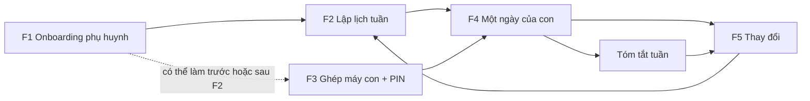
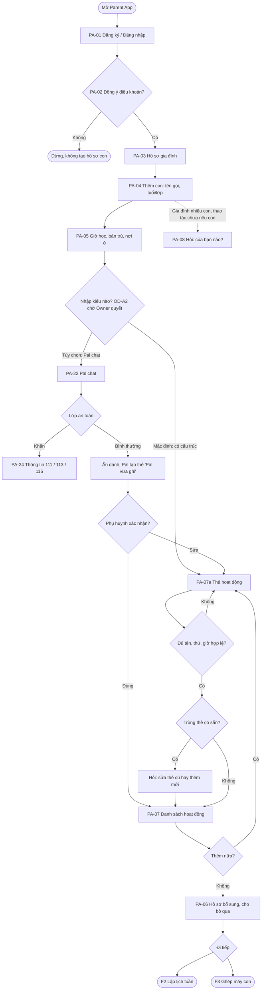
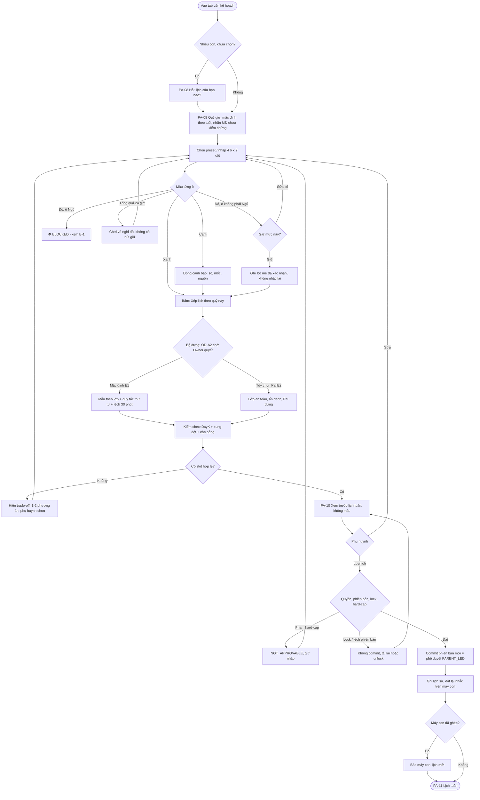
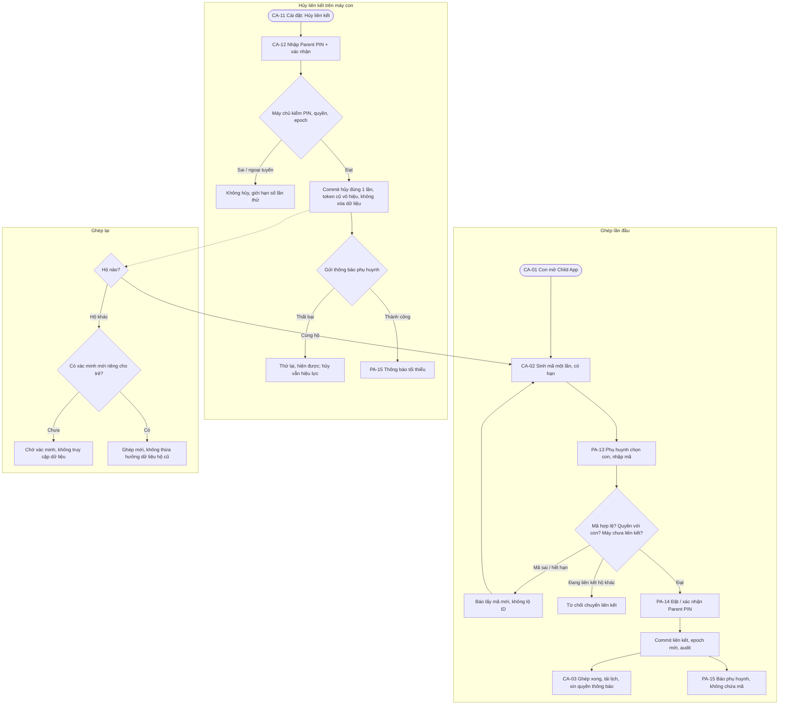
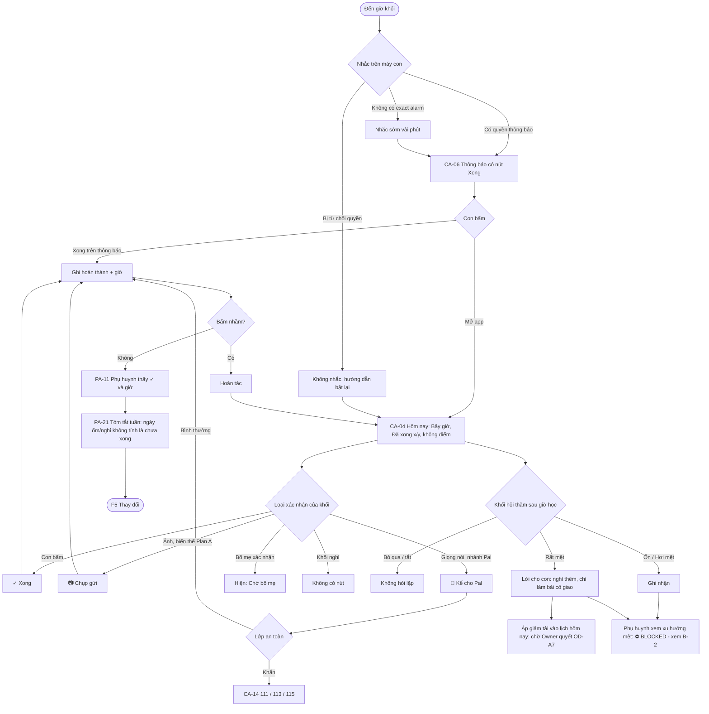
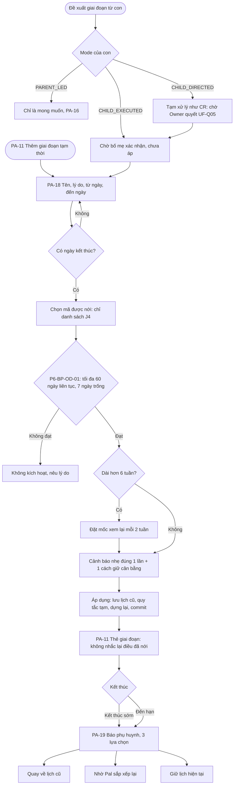
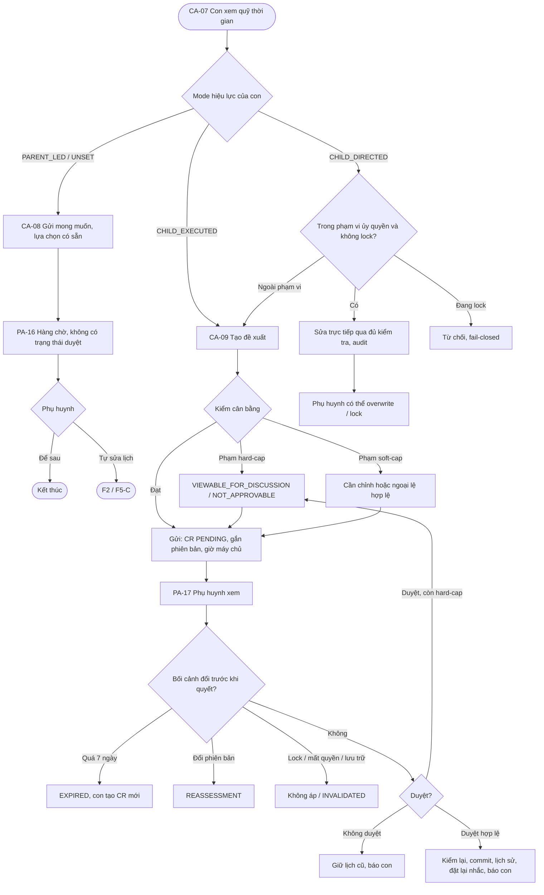
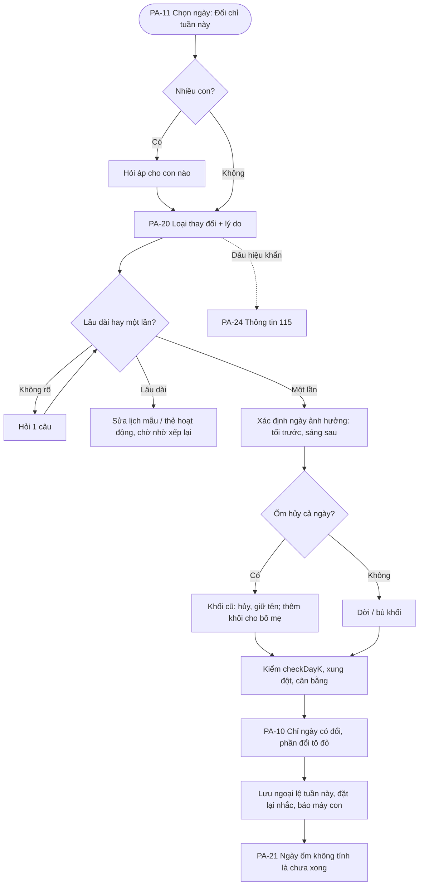

# 04.1 – USER FLOW: VÒNG LẬP LỊCH (BATCH 1)

**Product Blueprint – Bước 4: User Flow**
**Người soạn:** AI, chưa kiểm chứng độc lập · **Trạng thái:** nháp chờ duyệt · **Ngày:** 14/11/2026
**Phạm vi:** F1 Onboarding phụ huynh · F2 Lập lịch tuần · F3 Ghép máy con và Parent PIN · F4 Một ngày của con · F5 Thay đổi lịch.
**Không thuộc phạm vi:** wireframe, giao diện, API, mô hình dữ liệu, thuật toán. Không tạo Feature ID mới. Không thêm ngưỡng thời gian hay ngưỡng sức khỏe mới.

> **Đọc trước:** Tài liệu này có 2 **Blocker** (mục 9). Các bước bị chặn được đánh dấu `⛔ BLOCKED – xem B-x` và không được vẽ tiếp. Các điểm chờ Owner (OD-A1, OD-A2, OD-A7, OD-A8) chỉ vẽ **nhánh mặc định** và ghi `chờ Owner quyết`; tài liệu này không quyết định thay Owner.

---

## 0. Nguồn và quy ước

### 0.1 Nguồn đã đọc (chỉ đọc, không sửa)

| Mã dẫn | File |
|---|---|
| `02.5` | `main/app-design-document/02_User_Research/User_Research_02_5_User_Scenarios.md` (S01, S03–S05, S09, S11; Q1–Q4; R3) |
| `02.S§3` | `main/app-design-document/02_User_Research/User_Research_02_Summary.md` §3 (ma trận vai trò) |
| `03.4` | `main/app-design-document/03_Feature_Planning/Product_Blueprint_03_4_Feature_Interaction_and_Use_Case_Mapping.md` (UC-001…UC-010, UC-012, UC-015) |
| `QT` | `repo/documents/pal/spec-quy-tac-lap-lich.md` (**nguồn chuẩn quy tắc**; trích theo ID A1…O) |
| `TAB` | `repo/documents/pal/spec-quy-thoi-gian-va-tab-cua-con.md` (trích theo §) |
| `PROTO` | `repo/prototype/index.html` (hành vi chuẩn; trích theo hàm và số dòng) |
| `FR-01` | `Feature_3_2_L4_FR01_Parent_PIN_Unlink_and_Repairing_Owner_Decision_APPROVED.md` |
| `B01-CR` | `Feature_3_2_L4_B01_Change_Requests_Owner_Decision_Log_APPROVED.md` |
| `B01-MS` | `Feature_3_2_L4_B01_Mode_State_Owner_Decision_Log_APPROVED.md` |
| `B01-PS` | `Feature_3_2_L4_B01_Plan_Structure_Owner_Decision_Log_APPROVED.md` |
| `B01-CL` | `Feature_3_2_L4_B01_Consent_Ledger_Owner_Decision_Log_APPROVED.md` |
| `P6-BP` | `Feature_3_2_L4_P6_Balanced_Planning_Owner_Decision_Log_APPROVED.md` |
| `A-lite` | `phase-3-scoring-audit/03_A_Lite_Workflow_Validation.md` (A-lite v2) và `08_Research_Gaps_and_Decisions.md` (OD-A1…OD-A8) |
| `PA` | `repo/documents/app/spec-phuong-an-a-app-android.md` (Plan A: nhắc giờ, quyền Android, không popup) |
| `CLAUDE` | `repo/CLAUDE.md` (Pal xưng "mình", nghe trước, không chẩn đoán, lớp an toàn trước AI, 111/113/115) |

### 0.2 Mức căn cứ khi nêu con số

Mọi con số lấy từ `QT`, giữ nguyên mức căn cứ: **[NC]** có nghiên cứu/khuyến nghị tổ chức chuyên môn; **[NL]** nghiên cứu ở người lớn hoặc gián tiếp; **[MĐ]** mặc định của Pal, chưa kiểm chứng. Con số đến từ quyết định Owner (7 ngày, 60 ngày, ≥7 ngày trống) ghi là **quyết định Owner**, không phải bằng chứng khoa học. Con số không có nguồn ghi `UNKNOWN`.

### 0.3 Chế độ tự chủ (theo B01-MS-OD-02, B01-PS-OD-03)

| Mode | Quyền của con đối với lịch | Ghi chú |
|---|---|---|
| `UNSET` | Như `PARENT_LED` | Trạng thái nội bộ, không phải mode thứ tư (B01-MS-OD-04) |
| `PARENT_LED` | Không tạo, không sửa lịch có hiệu lực; **chỉ gửi mong muốn** | Không tạo Change Request chính thức (B01-CR §2) |
| `CHILD_EXECUTED` | Tạo đề xuất/nháp; phụ huynh duyệt mới áp dụng | CR hết hạn sau 7 ngày (B01-CR-OD-04) |
| `CHILD_DIRECTED` | Tự sửa trong phạm vi được ủy quyền; phụ huynh `overwrite`/`lock` | Ngoài phạm vi thì dùng CR (B01-CR-OD-01) |

Mode **không** xóa các quyền khác của con: tự làm việc đã duyệt, hỏi Pal, báo trạng thái, Journal (B01-MS-OD-02). Mỗi con có mode riêng (B01-MS-OD-01).

### 0.4 Ký hiệu

- `PA-xx` màn Parent App; `CA-xx` màn Child App (danh mục ở mục 7).
- `[E1]` xử lý theo quy tắc, không AI; `[E2]` có LLM (chỉ ở nhánh Pal chat).
- `chờ Owner quyết` = nhánh mặc định do AI vẽ, chưa được duyệt.
- `đề xuất nội bộ` = cách xử lý luồng do AI đề xuất, không có trong nguồn đã duyệt.

### 0.5 Nhánh mặc định cho các quyết định đang chờ

| OD | Câu hỏi | Nhánh vẽ trong tài liệu này |
|---|---|---|
| OD-A1 | Bắt đầu từ mục tiêu hay từ thời khóa biểu | **Từ thời khóa biểu**; mục tiêu là trường tùy chọn `muc_tieu_bo_me` (QT B3) · `chờ Owner quyết` |
| OD-A2 | A-lite E1 hay biến thể Pal chat | **Nhập có cấu trúc [E1]** là luồng chính; **Pal chat [E2] là nhánh tùy chọn** · `chờ Owner quyết` |
| OD-A7 | L3 nào sở hữu tín hiệu mệt/đói | Vẽ hành vi theo `TAB §4`, không gán module chủ · `chờ Owner quyết` |
| OD-A8 | Mã gia đình (Plan A) hay tài khoản + PIN (FR-01) | Vẽ theo **FR-01** (hợp đồng đã duyệt); biến thể mã gia đình ghi chú cho spike kỹ thuật · `chờ Owner quyết` |

### 0.6 Bất biến áp cho mọi flow

1. **Lớp an toàn chạy trước AI.** Mọi ô nhập chữ tự do hoặc giọng nói đi qua lớp an toàn trước khi tới Pal. Tình huống khẩn chỉ hiện thông tin tĩnh: **111** bảo vệ trẻ em, **113** công an, **115** cấp cứu (CLAUDE; QT N2; PA §4). Không gọi Claude cho tin khẩn.
2. **Ẩn danh trước khi gọi LLM:** tên con, trường, địa chỉ thay bằng mã (`[CON_1]`, `[TRUONG_1]`) (PA §4).
3. **Không popup.** Cảnh báo là một dòng chữ có biểu tượng, nằm ngay dưới ô nhập, ghi số hiện tại, mốc và nguồn (QT D6; TAB §1.3; PA §4).
4. **Cảnh báo đúng một lần;** đã xác nhận thì không nhắc lại (QT A2). Tín hiệu mới từ con không tính là nhắc lại (TAB §1.5).
5. **Thông báo chỉ gửi sau khi commit thành công;** không có thông báo "đã đổi" trước commit (03.4 §2, §7).
6. **Pal** xưng "mình", tối đa 3 câu ngắn, mỗi lượt tối đa 1 câu hỏi (QT A3); không gắn nhãn tính cách, không chẩn đoán (QT A4); không bao giờ tự đề xuất kéo dài giờ học (QT A5).
7. **Có nhiều con mà phụ huynh không nêu tên: hỏi lại, không đoán** (CLAUDE). Áp ở mọi màn có thao tác theo con.
8. Không so sánh trẻ với trẻ khác; không điểm tổng; không chấm điểm (TAB §4; CLAUDE).

---

## 1. Tổng quan vòng lặp

Phụ huynh có thể lập lịch trước khi con ghép máy (B01-CL-OD-01). Con chỉ truy cập chương trình sau khi ghép hợp lệ (B01-CL-OD-01).

---

## 2. F1 – Onboarding phụ huynh

| Mục | Nội dung |
|---|---|
| **Actor / App** | Phụ huynh (người chăm sóc chính) · Parent App |
| **Mode** | Con mới tạo ở `UNSET` (cư xử như `PARENT_LED`) (B01-MS-OD-04) |
| **Entry point** | Mở Parent App lần đầu; hoặc PA-03 "Thêm con" với gia đình đã có |
| **Mục tiêu** | Có hồ sơ gia đình, hồ sơ con tối thiểu theo QT B1 và danh sách hoạt động cố định (QT E1) |
| **Nguyên tắc UX** | Tối đa 3–4 câu hỏi trọng tâm ở bước đầu, phần còn lại hỏi dần (02.5 N3, S11 – mục tiêu UX, chưa kiểm chứng); giải thích vì sao hỏi; cho bỏ qua; cho sửa |

### 2.1 Các bước

| # | Màn | Người dùng làm | Hệ thống phản hồi |
|---|---|---|---|
| 1 | PA-01 Chào mừng / Đăng ký | Tạo tài khoản hoặc đăng nhập | Tạo tài khoản người lớn (F01-G01-M01). Thất bại → báo lỗi, giữ dữ liệu đã nhập |
| 2 | PA-02 Đồng ý và quyền riêng tư | Đọc, đồng ý | Ghi consent dạng `SELF_DECLARED`, không bắt xác minh tư cách giám hộ ở onboarding thường (B01-CL-OD-01; F01-G04-M02). Không đồng ý → dừng, không tạo hồ sơ con |
| 3 | PA-03 Hồ sơ gia đình | Đặt tên gia đình, cách Pal gọi mình ("chị Lan") | Tạo hộ gia đình (F01-G02-M01); người tạo là Primary Caregiver (B01-CL) |
| 4 | PA-04 Thêm con – cơ bản | Nhập tên gọi, tuổi/lớp | Tạo hồ sơ con (F01-G03-M01). Bắt buộc tuổi/lớp (QT B1). Mode = `UNSET` |
| 5 | PA-05 Giờ học | Nhập giờ vào học, tan học từng thứ; bán trú hay không; nơi ở (tỉnh/thành) | Bắt buộc theo QT B1; nơi ở dùng cho điều chỉnh theo mùa (QT B2, I1–I2). Ghi đúng lời phụ huynh (QT B3; F02-G01-M01) |
| 6 | PA-07 Hoạt động của con | Bấm "Thêm hoạt động" | Mở PA-07a |
| 7 | PA-07a Thẻ hoạt động | Nhập tên, loại (học thêm/tập luyện/năng khiếu/khác), các thứ, giờ bắt đầu–kết thúc, đi lại (phút, cả đi và về), địa điểm, ghi chú; bấm Lưu | Kiểm: có tên, ≥1 thứ, giờ kết thúc sau giờ bắt đầu (PROTO `actForm`, dòng ~918). Hợp lệ → thêm thẻ; dải T2…CN và tổng giờ/tuần cập nhật (TAB §2.3). Tập có huấn luyện viên tính vào Học thêm; vận động vui không phải thẻ học thêm (QT E6) |
| 8 | PA-07 | Lặp lại cho các hoạt động khác, hoặc "Xong" | Không tạo trùng (QT E2). Tổng giờ học thêm + đi lại vào nhóm "Học thêm và tập luyện" của quỹ, không nhập tay (QT D2) |
| 9 | PA-06 Hồ sơ bổ sung (tùy chọn) | Trả lời hoặc "Để sau": sức khỏe, giấc ngủ, thể lực, tính cách, môn mạnh/khó, ăn uống ở trường | Tối đa 2 câu ngắn mỗi lượt (QT B2). Sức khỏe là dữ liệu nhạy cảm: không bắt buộc, giữ tối thiểu (02.5 S11; A-lite SG-03, MR-021) |
| 10 | — | — | Chuyển sang F2 (PA-09) hoặc F3 (PA-13). Hiện lời mời ghép máy con, không bắt buộc ngay (02.5 Q1) |

### 2.2 Nhánh ngoại lệ

| Mã | Tình huống | Xử lý |
|---|---|---|
| F1-X1 | **Nhiều con**, phụ huynh thao tác mà chưa chọn con (ví dụ "thêm lớp tiếng Anh") | Mở PA-08 Chọn con: "Lớp này của bạn nào?". **Không đoán**, không mặc định con gần nhất (CLAUDE) |
| F1-X2 | Thiếu thứ hoặc giờ ở thẻ hoạt động | Không lưu; chỉ ra ô thiếu (PROTO `actForm`). Nhánh Pal chat: hỏi 1 câu, chưa ghi (QT E2) |
| F1-X3 | Thẻ trùng tên với thẻ có sẵn | Hỏi: sửa thẻ cũ hay thêm thẻ mới (QT E2 "không tạo trùng") · cách hỏi là `đề xuất nội bộ` |
| F1-X4 | Hoạt động chồng giờ học ở trường hoặc chồng thẻ khác | Lưu thẻ, đánh dấu xung đột; xử lý ở bước kiểm xung đột F2 (F04-G02-M02) |
| F1-X5 | Phụ huynh muốn nhanh, bỏ qua nhiều câu | Đặt giả định hợp lý, nói ngắn giả định chính, mời bổ sung sau (QT B4). Giả định hiện trong hồ sơ, gắn nhãn "giả định" |
| F1-X6 | Mất mạng giữa chừng | Giữ nháp trên máy; đồng bộ khi có mạng · `đề xuất nội bộ`, chờ System Design |
| F1-X7 | Phụ huynh không đồng ý điều khoản | Không tạo hồ sơ con; có thể quay lại sau |
| F1-X8 | **Nhánh Pal chat** (OD-A2, `chờ Owner quyết`) | Phụ huynh kể tự do hoặc gửi ảnh thời khóa biểu. Lớp an toàn → ẩn danh → Pal [E2] tạo thẻ, viền xanh, nhãn "● Pal vừa ghi" (TAB §2.3). Phụ huynh xác nhận dữ liệu quan trọng (ngày/giờ, tên, lưu ý sức khỏe) trước khi lưu (02.5 S11). Pal không tự thêm hoạt động phụ huynh chưa nói (QT E2) |
| F1-X9 | Người dùng từ 18 tuổi tự quản | Ngoài phạm vi batch này; không mặc định phụ huynh quản (B01-MS-OD-04; 02.S§3) |

### 2.3 Dữ liệu ghi nhận

Tài khoản người lớn; consent (`SELF_DECLARED`, phiên bản chính sách); hộ gia đình; vai trò Primary Caregiver; cách Pal gọi phụ huynh. Hồ sơ con: `tuoi_lop`, `gio_hoc`, bán trú, `noi_o`, các trường tùy chọn theo QT B3 (`an_uong`, `hoc_them`, `suc_khoe`, `the_luc`, `giac_ngu`, `tinh_cach`, `hoc_tap`, `so_thich`, `khong_thich`, `muc_tieu_bo_me`), nguồn và cờ "giả định". Thẻ hoạt động: các trường QT E1, nguồn (`bo_me`/`pal`). Mode = `UNSET`.

### 2.4 Liên kết

- **Feature IDs:** F01-G01-M01, F01-G02-M01, F01-G03-M01, F01-G04-M02, F01-G05-M01, F02-G01-M01, F02-G01-M02 (hỏi dần), F02-G04-M01 (ứng viên chủ của thẻ hoạt động, A-lite SG-02), F03-G04-M01 (chỉ khi OD-A1 chọn mục tiêu).
- **UC:** UC-001; UC-003 (cập nhật thông tin có nguồn); UC-005 (chỉ khi OD-A1 chọn nhánh mục tiêu).
- **Quy tắc:** QT B1–B4, E1, E2, E6, D2; TAB §2.3; 02.5 Q1, N3, S01, S11; B01-CL-OD-01; B01-MS-OD-04; CLAUDE (nhiều con).

### 2.5 Sơ đồ

---

## 3. F2 – Lập lịch tuần

| Mục | Nội dung |
|---|---|
| **Actor / App** | Phụ huynh · Parent App (tab 🧭 Lên kế hoạch và 🗓️ Lịch tuần, TAB §0) |
| **Mode** | Commit bởi phụ huynh ở mọi mode. Ở `PARENT_LED`/`UNSET`: **lưu = phê duyệt** (A-lite §2 bước 4; UC-008; B01-MS-OD-04) |
| **Entry point** | Sau F1; hoặc PA-09 từ tab Lên kế hoạch; hoặc nút "Nhờ Pal cập nhật lịch" khi thẻ hoạt động đổi (QT E5) |
| **Mục tiêu** | Một lịch mẫu tuần có phiên bản, đã kiểm cân bằng và xung đột, được phụ huynh chốt |

### 3.1 Các bước

| # | Màn | Người dùng làm | Hệ thống phản hồi |
|---|---|---|---|
| 1 | PA-08 (nếu nhiều con) | Chọn con | Không đoán (CLAUDE) |
| 2 | PA-09 Quỹ giờ | Xem bảng 6 nhóm × 2 cột (ngày đi học, cuối tuần) | Nạp quỹ mặc định theo tuổi (QT D, "Quỹ mặc định" – **[MĐ]**). Gắn nhãn "mặc định của Pal, chưa kiểm chứng"; không gắn `BALANCED/VALID` khi bar chưa được thẩm định (P6-BP-OD-03; B01-PS-OD-02). Hai nhóm cố định lấy từ thời khóa biểu và thẻ hoạt động, không nhập tay (QT D2). "Chơi và nghỉ" tự tính = 24 giờ trừ các nhóm, cộng một nửa giờ ăn (QT D3) |
| 3 | PA-09 | Chọn preset (Bình thường, Thi cử, Nghỉ hè, Nghỉ lễ…) hoặc giữ mặc định | Nạp preset; mỗi preset giữ riêng các xác nhận vùng đỏ (TAB §2.1). Thi cử/Nghỉ hè là ngoại lệ có thời hạn, không phải Standard Bar dài hạn (A-lite, SC-001-D03) → nếu chọn, gợi ý tạo giai đoạn tạm thời (F5-A) |
| 4 | PA-09 | Nhập **một con số** (giờ/ngày) cho: học ở nhà, ăn uống và vệ sinh, ngủ, màn hình giải trí tối đa (QT D1) | Tính lại "Chơi và nghỉ"; chấm màu theo bảng ngưỡng QT D (xem 3.2). Học ở nhà **không chấm màu**, Pal không đặt trần riêng (QT D5) |
| 5 | PA-09 | Ô cam: không cần làm gì | Dòng ⚠️ dưới ô, ghi số hiện tại, mốc, nguồn; mốc không nguồn ghi "mặc định của Pal" (TAB §1.3) |
| 6 | PA-09 | Ô đỏ (trần mềm): bấm **"Giữ mức này"** hoặc sửa số | Bấm "Giữ mức này": ô vẫn đỏ, dòng chữ đổi thành "bố mẹ đã xác nhận", Pal không nhắc lại (TAB §1.4; QT A2, D6). Đây là "ngoại lệ soft-cap hợp lệ" cho phép commit (B01-CR-OD-05; B01-PS-OD-02). **Riêng ô Ngủ đỏ: ⛔ BLOCKED – xem B-1** |
| 7 | PA-09 | Tổng các nhóm > 24 giờ | Dòng "Chơi và nghỉ" báo đỏ kèm số giờ bị vượt (TAB §2.1; PROTO `judge` dòng 769). Không có nút "Giữ mức này" cho dòng này (PROTO dòng 838 chỉ hiện nút ở ô nhập). Phụ huynh phải giảm một ô nhập. Nháp vẫn lưu được (B01-PS-OD-02), nhưng không dựng được lịch hợp lệ nên không lưu-phê duyệt được · phần "không lưu-phê duyệt" là `đề xuất nội bộ` suy từ ràng buộc 24 giờ |
| 8 | PA-09 | (Tùy chọn) "Lưu preset" / "Lưu thành mới" / "Xóa" | Lưu quỹ thành preset (QT D7) |
| 9 | PA-09 | Bấm **"Xếp lịch theo quỹ này"** | **Dựng lịch đề xuất** (F04-G02-M01). Nhánh mặc định [E1]: mẫu theo lớp (F04-G01-M02) + quy tắc thứ tự trong ngày + xê dịch ±30′ quanh số phụ huynh nhập (QT D4) · `chờ Owner quyết` OD-A2; khả thi E1 là `UNKNOWN` tới khi có spike RG-01. Nhánh Pal chat [E2]: như PROTO (Pal xếp theo prompt `RULES`) |
| 10 | (hệ thống) | — | Áp quy tắc dựng: sàn C1–C7; khối và nhãn tải F1–F3; phiên học F4; màn hình không phải nghỉ F5; nhịp ngày G1–G10; bữa ăn H1–H3; điều chỉnh mùa I1–I3 trong quỹ ăn uống-vệ sinh ±30′. Lỗi thứ tự (hai khối học liền nhau, học ngay khi vừa về, học trước giờ đi học) **tự sửa, không hỏi lại** (QT C cuối mục; TAB §1.2) |
| 11 | (hệ thống) | — | **Kiểm tự động** cho từng ngày (QT O; PROTO `checkDayK`): `ngu`, `phuc_hoi`, `cao_lien`, `an_xa` (hiện cho phụ huynh); `truoc_gio_hoc`, `tong_gio_hoc`, `tap_muon` (chỉ dùng nội bộ). **Kiểm xung đột** chồng giờ (F04-G02-M02; UC-010). **Kiểm cân bằng** (F04-G02-M03) |
| 12 | PA-10 Xem trước lịch tuần | Xem từng ngày; xem 1 điều đã chỉnh theo con (QT B5) | Lịch chi tiết **không có màu** (QT D6). Vi phạm còn lại hiện thành dòng chữ ở ngày đó. Phần mới đổi tô đỏ (QT K2) |
| 13 | PA-10 | Sửa (quay lại PA-09 hoặc PA-07) hoặc bấm **"Lưu lịch"** | Kiểm lại: quyền (F01-G04-M01), phiên bản lịch, lock, cân bằng. Nếu còn vi phạm `protected_hard_cap` → `NOT_APPROVABLE`, không commit (B01-CR-OD-05; P6-BP-OD-02). Soft-cap đỏ chưa xác nhận → yêu cầu xác nhận hoặc sửa |
| 14 | (hệ thống) | — | Commit lịch mẫu tuần phiên bản mới (F04-G01-M01, idempotent); ghi lịch sử người lưu, lý do (F04-G06-M02). Ở `PARENT_LED`/`UNSET`, đây là phê duyệt |
| 15 | (hệ thống) | — | Sau commit: đặt lại toàn bộ lời nhắc trên máy con (F04-G07-M01; PA bước 3); báo máy con "Lịch mới" nếu đã ghép (F04-G07-M01). Chưa ghép → lịch chờ, không gửi |
| 16 | PA-11 Lịch tuần | Xem lịch đã lưu | Hiện hồ sơ, tổng quan, chi tiết ngày, thẻ giai đoạn tạm thời (TAB §0) |

### 3.2 Ngưỡng màu dùng ở bước 4–7 (chép từ QT D, giữ mức căn cứ)

| Ô | Xanh | Cam | Đỏ | Căn cứ |
|---|---|---|---|---|
| Ngủ | ≥ mức tối thiểu theo tuổi (6–12 tuổi 9–12 giờ; 13–18 tuổi 8–10 giờ) | thiếu ≤30′ | thiếu >30′ | [NC] AASM |
| Màn hình giải trí | ≤1 giờ | 1–2 giờ | >2 giờ | Đỏ [NC] Canada 24h; cam [MĐ] |
| Ăn uống, vệ sinh | ≥1h30 | 1h–1h30 | <1 giờ | [MĐ] |
| Chơi và nghỉ (ngày đi học) | ≥1 giờ | 30′–1 giờ | <30′ hoặc tổng >24 giờ | [MĐ]; WHO 60′ vận động/ngày [NC] |
| Chơi và nghỉ (cuối tuần) | ≥2 giờ | 1–2 giờ | <1 giờ | [MĐ] |
| Học thêm (ngày đi học) | ≤2 giờ | 2–3 giờ | >3 giờ | [MĐ] |
| Học thêm (cuối tuần) | ≤3 giờ | 3–4h30 | >4h30 | [MĐ] |
| Học ở nhà | không chấm | | | QT D5 |

Nhánh theo tuổi: A2 (6–10) và A3 (11–14) khác nhau ở mức ngủ tối thiểu (QT C1), quỹ màn hình mặc định (≤10 tuổi 30′/1 giờ; lớn hơn 1 giờ/2 giờ – [MĐ]), độ dài phiên học (lớp 1–3 khoảng 20–30′; lớp 4–5 30–40′; lớp 6–9 40–45′ – [MĐ], QT F4) và G8 (11–15 tuổi: ít khối hơn, con tự sắp trong khối, xác nhận nhẹ hơn – [NC] NT-07). Tiểu học 2 buổi/ngày: khối ôn bài là ôn nhẹ (QT G10).

### 3.3 Nhánh ngoại lệ

| Mã | Tình huống | Xử lý |
|---|---|---|
| F2-X1 | Thiếu dữ liệu bắt buộc (QT B1) | Không dựng; dẫn về PA-05. Không tự giả định giờ ngủ (03.4 UC-010; A-lite §2) |
| F2-X2 | **Không có slot hợp lệ** (ví dụ hoạt động tối làm sát giờ ngủ) | Hiện trade-off, không ép chọn (03.4 UC-010). Pal nói 1 câu lý do, đưa 1–2 phương án cân bằng và hỏi phụ huynh chọn (QT C đầu mục) |
| F2-X3 | Phụ huynh yêu cầu phương án phạm sàn C | Ở lượt đó **không** xếp phương án phạm (QT C). Draft vẫn lưu được để xem, gắn `NOT_APPROVABLE` nếu phạm protected hard-cap (B01-PS-OD-02; B01-CR-OD-05) |
| F2-X4 | Xung đột chồng giờ (thẻ hoạt động chồng giờ học, hai thẻ chồng nhau) | Chỉ ra cặp xung đột và gợi ý slot khác; không tự dời (03.4 UC-010) |
| F2-X5 | Ngày có học thêm buổi tối | Bữa phụ chắc sau giờ học; giờ ngủ lùi tối đa 15–30′; hỏi phụ huynh có muốn bớt học ở nhà không (QT G7, [MĐ]) |
| F2-X6 | Hai lần ăn cách quá 5 giờ (6 tuổi: quá 4 giờ) | Dòng cảnh báo `an_xa`; chưa biết giờ ăn trưa thì giả định 11h15 và nói rõ là giả định (QT H2, [NC] + nguồn phổ thông) |
| F2-X7 | Phụ huynh đổi preset sau khi đã có lịch | Lịch chưa đổi; hiện nút "Xếp lịch theo quỹ này" (TAB §2.1) |
| F2-X8 | Phụ huynh tự sửa thẻ hoạt động sau khi đã có lịch | Hiện "Lịch tuần chưa cập nhật" + nút "Nhờ Pal cập nhật lịch"; **không tự xếp lại khi chưa được nhờ** (QT E5) |
| F2-X9 | Hai người lớn cùng sửa (đổi phiên bản giữa chừng) | Commit bị từ chối do lệch phiên bản; yêu cầu tải lại và đánh giá lại (03.4 UC-010 "concurrent change"; B01-PS-OD-01) |
| F2-X10 | Lịch đang `LOCK` | Không commit; người có quyền unlock trước hoặc dùng `authorized override` có audit (B01-PS-OD-04) |
| F2-X11 | Mất mạng khi bấm Lưu | Không báo "đã lưu" khi chưa commit; giữ nháp; thử lại idempotent; đối soát trạng thái thật trước khi thử lại (B01-CR-OD-04 "timeout ≠ failed") |
| F2-X12 | Commit thành công nhưng gửi lịch tới máy con thất bại | Lịch vẫn có hiệu lực; gửi lại; hiện trạng thái "máy con chưa nhận" cho phụ huynh · cách hiển thị là `đề xuất nội bộ` |
| F2-X13 | Mùa lạnh/nồm miền Bắc làm quỹ ăn uống-vệ sinh vượt ±30′ | Nói với phụ huynh một lần, gợi ý lưu preset theo mùa (QT I3) |
| F2-X14 | **Nhánh Pal chat** (OD-A2) | Phụ huynh nói "xếp lại cả tuần". Lớp an toàn → ẩn danh → Pal [E2] dựng. Kết quả vẫn qua `checkDayK`, kiểm xung đột, kiểm cân bằng [E1] trước khi hiện PA-10. LLM không có quyền commit (03.4 §7) |

### 3.4 Dữ liệu ghi nhận

Quỹ theo con: 4 ô nhập × 2 cột, preset đang dùng, danh sách xác nhận vùng đỏ theo preset (khóa `cột.nhóm`), phiên bản Standard Bar dùng để chấm (hoặc `UNKNOWN`). Lịch mẫu tuần: khối (giờ bắt đầu, kết thúc, tên, việc nhỏ, cách xác nhận, nhãn tải), phiên bản, người commit, thời điểm. Kết quả kiểm (mã QT O). Lịch sử thay đổi.

### 3.5 Liên kết

- **Feature IDs:** F04-G02-M03 (Balanced Planning), F04-G02-M01 (dựng lịch), F04-G02-M02 (xung đột), F04-G01-M01 (lưu phiên bản), F04-G01-M02 (mẫu), F04-G06-M02 (lịch sử), F04-G07-M01 (đặt lại nhắc), F01-G04-M01 (quyền), F01-G05-M01 (mode), F03-G03-M01 (tùy chọn, mốc theo giai đoạn).
- **UC:** UC-007, UC-008; UC-010 (nhánh xung đột).
- **Quy tắc:** QT A1–A6, B4–B5, C1–C7, D1–D7, E4–E6, F1–F7, G1–G10, H1–H4, I1–I3, O; TAB §1, §2; P6-BP-OD-02, -03; B01-PS-OD-01, -02, -04; B01-CR-OD-04, -05; B01-MS-OD-04.

### 3.6 Sơ đồ

---

## 4. F3 – Ghép máy của con và Parent PIN (FR-01)

| Mục | Nội dung |
|---|---|
| **Actor / App** | Con (Child App) tạo mã; phụ huynh (Parent App) ghép; người chăm sóc có quyền nhập PIN trên máy con khi hủy liên kết |
| **Mode** | Không phụ thuộc mode lịch. Ghép là **identity linking**, không chứng minh thẩm quyền pháp lý (B01-CL-OD-01) |
| **Entry point** | Con mở Child App lần đầu (CA-01); phụ huynh mở PA-13 "Ghép máy của con" từ PA-03 hoặc lời mời sau F1 |
| **Mô hình định danh** | Vẽ theo FR-01 (tài khoản phụ huynh + ghép + PIN). Biến thể "mã gia đình" của Plan A chỉ cho spike kỹ thuật · `chờ Owner quyết` OD-A8 |

### 4.1 Các bước – ghép lần đầu

| # | Màn | Người dùng làm | Hệ thống phản hồi |
|---|---|---|---|
| 1 | CA-01 Chào | Con mở app | Chưa ghép: không hiện chương trình của phụ huynh (B01-CL-OD-01) |
| 2 | CA-02 Mã ghép | Con xem mã | Child App sinh **mã ghép mới**, dùng một lần, có hạn (B01-CL-OD-01; FR-01 mục 3). Thời hạn mã: `UNKNOWN`, chờ System Design |
| 3 | PA-13 Ghép máy | Phụ huynh chọn con (PA-08 nếu nhiều con), nhập mã | Kiểm: tài khoản phụ huynh hợp lệ, quyền với hồ sơ con, mã còn hạn, máy con chưa có liên kết hiệu lực (F01-G02-M01, F01-G04-M01) |
| 4 | PA-14 Parent PIN | Đặt PIN (lần đầu) hoặc xác nhận PIN đã có | Lưu PIN thuộc người chăm sóc có quyền. Quy trình đặt, đổi, khôi phục, độ dài, số lần thử: chờ System Design/bảo mật (FR-01 "Remaining unspecified") · thời điểm đặt PIN ở bước ghép là `đề xuất nội bộ` |
| 5 | (hệ thống) | — | Tạo liên kết hiệu lực (binding epoch mới); ghi audit (F01-G01-M02, F01-G04-M02) |
| 6 | CA-03 Ghép thành công | Con thấy "Đã kết nối với gia đình" | Tải lịch đã commit (nếu có) → CA-04; xin quyền thông báo (CA-15; PA §7 `POST_NOTIFICATIONS`) |
| 7 | PA-15 Thông báo | Phụ huynh nhận "Đã ghép máy của [tên gọi]" | Thông báo sau commit, tối thiểu, không chứa mã ghép (FR-01 mục 2) |

### 4.2 Các bước – hủy liên kết từ máy con (FR-01A)

| # | Màn | Người dùng làm | Hệ thống phản hồi |
|---|---|---|---|
| 1 | CA-11 Cài đặt | Bấm "Hủy liên kết" | Yêu cầu Parent PIN; con biết phiên đăng nhập hoặc mở được Cài đặt **không đủ** để hủy (FR-01 mục 1) |
| 2 | CA-12 Nhập Parent PIN | Người lớn nhập PIN, xác nhận lần nữa | Máy chủ kiểm PIN + quyền tài khoản hiện tại + binding epoch. PIN là kiểm tra thêm, không thay quyền phía máy chủ (FR-01 mục 1) |
| 3 | (hệ thống) | — | Commit hủy liên kết đúng một lần (idempotent, FR01-T03); tăng epoch; vô hiệu token cũ. **Không xóa dữ liệu con, không cấp quyền Journal** (FR-01 mục 3) |
| 4 | PA-15 | Phụ huynh nhận thông báo tối thiểu "Máy của [tên gọi] đã hủy liên kết" | Không chứa PIN, mã ghép, nội dung Journal, lý do riêng (FR-01 mục 2). Gửi thất bại → thử lại, hiện được; không đảo ngược việc hủy (FR-01 mục 2; FR01-T04) |

### 4.3 Ghép lại

| Trường hợp | Xử lý |
|---|---|
| Cùng hộ gia đình, sau khi đã hủy | Luồng 4.1 bình thường với **mã mới**; mã và token cũ vô hiệu (FR-01 mục 3; FR01-T05) |
| Hộ khác (B) khi liên kết với hộ A còn hiệu lực | **Từ chối**, kể cả có mã (FR-01 mục 5; FR01-T08) |
| Hộ khác (B) sau khi hộ A đã hủy hợp lệ | Cần **xác minh mới, riêng cho trẻ này** rằng người lớn ở B có quyền quản lý trẻ. Tài khoản hợp lệ + thành viên hộ + biết mã **không đủ** (FR-01 mục 4). Chưa có bằng chứng → trạng thái chờ xác minh, **không** có quyền truy cập dữ liệu (FR01-T06). Phương pháp xác minh: `NEEDS_POLICY/LEGAL/UX DESIGN`; không tự đặt yêu cầu giấy tờ hay sự đồng ý của hộ cũ (FR-01). Hộ B không thừa hưởng dữ liệu, quyền, Journal của hộ A (FR-01 mục 5) |

### 4.4 Nhánh ngoại lệ

| Mã | Tình huống | Xử lý |
|---|---|---|
| F3-X1 | Mã sai hoặc hết hạn | Báo "Mã không đúng hoặc đã hết hạn, hãy lấy mã mới trên máy con". Không tiết lộ mã đó có tồn tại không (B01-CL-OD-01: không để người lạ biết một ID) |
| F3-X2 | Nhập PIN sai (hủy liên kết) | Không hủy, không lộ dữ liệu; giới hạn số lần thử ở máy chủ (FR01-T02). Số lần cụ thể: `UNKNOWN` |
| F3-X3 | Máy con ngoại tuyến khi hủy | **Không** coi trạng thái trên máy là đã hủy; hủy chỉ có hiệu lực khi máy chủ commit (FR-01 "Offline… fail-closed"; FR01-T09) |
| F3-X4 | Mất phản hồi sau commit hủy, thử lại | Đúng một lần hủy, đúng một lần tăng epoch (FR01-T03) |
| F3-X5 | **Con chưa có máy** | Phụ huynh vẫn lập và lưu lịch (B01-CL-OD-01). Không có Child App thì không có nhắc trên máy con. Cách theo dõi khi không có máy con (dùng chung máy như PROTO, hay chỉ phụ huynh xem): chưa chốt · `chờ Owner quyết` OD-A8 phương án (c) |
| F3-X6 | Nhiều con | Mỗi con ghép riêng; PA-13 bắt chọn con trước khi nhập mã (CLAUDE). Một máy ghép nhầm con → hủy liên kết (4.2) rồi ghép lại đúng con · `đề xuất nội bộ` |
| F3-X7 | Từ chối quyền thông báo trên máy con | Vẫn ghép được; CA-04 hiện hướng dẫn bật lại; báo phụ huynh "nhắc trên máy con đang tắt" · `đề xuất nội bộ` |
| F3-X8 | Người dùng 18+ tự quản | Parent PIN không tạo quyền người chăm sóc đối với người lớn tự quản (FR-01 mục 1; FR01-T11) |
| F3-X9 | Thông báo ghép thành công gửi thất bại | Liên kết vẫn có hiệu lực; thử lại; PA-03 hiện trạng thái "đã ghép" |

### 4.5 Dữ liệu ghi nhận

Mã ghép (một lần, có hạn, không lưu sau khi dùng), liên kết hộ–con–máy, binding epoch, audit ghép/hủy (ai, khi nào, không có PIN), PIN dạng đã băm (cơ chế mật mã chờ System Design), trạng thái thông báo, trạng thái "chờ xác minh" cho ghép khác hộ.

### 4.6 Liên kết

- **Feature IDs:** F01-G02-M01, F01-G02-M02, F01-G01-M02, F01-G04-M01, F01-G04-M02, F04-G07-M01 (thông báo cho phụ huynh).
- **UC:** UC-001 (liên kết thiết bị khi thiết lập gia đình), UC-002 (cấp/thu hồi quyền).
- **Quy tắc:** FR-01 mục 1–5, FR01-T01…T11; B01-CL-OD-01; B01-MS-OD-04 (18+); PA §7.

### 4.7 Sơ đồ

---

## 5. F4 – Một ngày của con

| Mục | Nội dung |
|---|---|
| **Actor / App** | Con (Child App, tab 🧒 "Hôm nay"); phụ huynh (Parent App, tab 🗓️ Lịch tuần, tóm tắt tuần) |
| **Mode** | Mọi mode: con tự làm và báo các việc đã duyệt (B01-MS-OD-02). Mode chỉ ảnh hưởng quyền sửa lịch (xem F5) |
| **Entry point** | Con chạm thông báo nhắc; hoặc mở Child App (CA-04); phụ huynh mở PA-11 hoặc PA-21 |
| **Tiền điều kiện** | Đã có lịch commit (F2) và máy con đã ghép (F3) |

### 5.1 Các bước – trong ngày

| # | Màn | Người dùng làm | Hệ thống phản hồi |
|---|---|---|---|
| 1 | CA-06 Thông báo | Nhận nhắc theo khối; buổi sáng có báo thức | Mỗi khối lịch thành một lời nhắc cục bộ, có nút "Xong" ngay trên thông báo (PA §2, bước 3; F04-G07-M01). Tôn trọng tùy chọn thông báo (F04-G07-M02); giờ yên lặng cụ thể: `UNKNOWN` |
| 2 | CA-06 | Bấm "Xong" trên thông báo (với khối loại con bấm) | Ghi hoàn thành + giờ (F04-G05-M01 → F06-G01-M01) |
| 3 | CA-04 Hôm nay | Mở tab | Danh sách khối hôm nay, chữ to, lời đơn giản; lấy ngoại lệ tuần này nếu có, ẩn khối đã hủy (PROTO `renderToday` dòng 999). Khối đang diễn ra có nhãn **"Bây giờ"**; thanh **"Đã xong x/y"** chỉ đếm khối cần xác nhận; **không chấm điểm, không xếp hạng** (TAB §4; QT L1; F04-G04-M01) |
| 4 | CA-04 | Bấm nút trên khối, tùy cách xác nhận (QT F1, L1) | **✓ Xong** → ghi giờ. **📷 Chụp gửi** → chỉ ở biến thể Plan A (F04-G05-M02); AI chấm bài chỉ cho pilot có kiểm soát (A-lite: SC-002-D05). **🎤 Kể cho Pal** → chỉ ở nhánh Pal chat (OD-A2). **"Tự ghi nhận"** → tự động. **"Chờ bố mẹ xác nhận"** → không có nút cho con. Khối nghỉ → không có nút |
| 5 | CA-04 | Bấm **"Hoàn tác"** nếu bấm nhầm | Xóa ghi nhận khối đó (QT L1; PROTO dòng 1025) |
| 6 | CA-05 Hỏi thăm sau giờ học | Ở khối "Ghi lại việc được giao và hỏi thăm" (QT G3), chọn **Ổn / Hơi mệt / Rất mệt**, hoặc bỏ qua | Lời mời **tùy chọn**, con được bỏ qua hoặc tắt; không hỏi lặp khi con bỏ qua (02.5 R3, S09). Lưu lựa chọn trong nhật ký ngày |
| 7 | CA-05 | Chọn **"Rất mệt"** | Hiện lời cho con: "Hôm nay con nghỉ thêm một chút nhé. Tối nay mình chỉ làm phần cô giao thôi." (PROTO dòng 1038). Quy tắc giảm tải theo QT G3 / TAB §4: phục hồi thêm khoảng 15′ (**[MĐ]**), bỏ phần học theo định hướng bố mẹ hôm đó, giữ bài cô giao. Việc áp thay đổi này vào lịch hôm nay (ai sở hữu, có coi là thay đổi lịch trong `PARENT_LED` không) · `chờ Owner quyết` OD-A7. PROTO hiện chỉ ghi nhận và hiện lời, chưa đổi lịch (A-lite SG-14) |
| 8 | CA-04 | (Biến thể Plan A) Bấm **🍎 "Con thấy đói"** | Ghi giờ. Lần đầu trong ngày vào hàng chờ của phụ huynh, kèm bữa gần nhất và bữa tiếp theo. Với con: chỉ nhắc uống nước hoặc chờ bữa sắp tới, không tự cho ăn (QT H5; TAB §4). Module chủ · `chờ Owner quyết` OD-A7. A-lite E1 xếp là hoãn được |
| 9 | CA-04 khối Soạn cặp | (Biến thể Plan A) Chọn "Ngày mai trời thế nào?" ☀️/🌧/🧥/🌤 | Hiện đồ cần mang; sáng hôm sau khối thay đồ nhắc lại (QT I4) |
| 10 | PA-11 Lịch tuần | Phụ huynh xem hôm nay | Thấy dấu ✓ và giờ con làm xong từng việc (TAB §4; F06-G05-M02) |
| 11 | PA-11 / PA-21 | Phụ huynh xem tín hiệu mệt của con | **⛔ BLOCKED – xem B-2** (ai được xem dữ liệu hỏi thăm, dưới dạng nào) |

### 5.2 Các bước – tóm tắt tuần

| # | Màn | Người dùng làm | Hệ thống phản hồi |
|---|---|---|---|
| 1 | PA-21 Tóm tắt tuần | Phụ huynh mở (từ thông báo hoặc tab) | Tổng hợp theo đối tượng xem (F06-G05-M01/M02; UC-015): việc đã xong theo ngày, ngày có ngoại lệ, giai đoạn tạm thời đang chạy. Phân biệt "đã bấm xong" (tự báo cáo) với tiến bộ năng lực (02.5 S04; 03.4 §6.4) |
| 2 | PA-21 | — | Ngày ốm, ngày nghỉ, ngày giảm tải **không tính là chưa hoàn thành** (QT K4; F06-G02-M02) |
| 3 | PA-21 | Bấm "Điều chỉnh" | Sang F5 hoặc F2 |
| 4 | CA-13 Tuần của con | Con xem tuần của mình | Chỉ thứ con được xem; không điểm, không so sánh với trẻ khác (TAB §4; CLAUDE) |

Tần suất và thời điểm gửi tóm tắt tuần: `UNKNOWN` (nguồn chưa nêu).

### 5.3 Nhánh ngoại lệ

| Mã | Tình huống | Xử lý |
|---|---|---|
| F4-X1 | Máy con từ chối `POST_NOTIFICATIONS` | Không có nhắc; tab Hôm nay vẫn dùng được; hiện hướng dẫn bật lại · `đề xuất nội bộ` |
| F4-X2 | Không có `SCHEDULE_EXACT_ALARM` (Android 14 mặc định tắt) | Nhắc sớm vài phút (PA §7) |
| F4-X3 | Máy ngủ, tiết kiệm pin làm nhắc trễ | Màn hướng dẫn bỏ tối ưu pin theo hãng (PA §7). Điều kiện đạt nhắc lệch ≤1 phút là mục tiêu test của Plan A, không phải quy tắc sản phẩm (PA §6) |
| F4-X4 | Lịch đổi trong ngày (F5) | Đặt lại toàn bộ lời nhắc (PA bước 3); CA-04 tải lịch mới; khối đã hủy biến mất |
| F4-X5 | Con bấm Xong khi ngoại tuyến | Ghi trên máy, đồng bộ khi có mạng; đây là ghi nhận thực hiện, không phải sửa lịch · `đề xuất nội bộ`, chờ System Design |
| F4-X6 | Con không mở app, không bấm gì | Không nhắc dồn; không coi là thất bại; phụ huynh thấy "chưa ghi nhận", không thấy "không làm" · `đề xuất nội bộ` |
| F4-X7 | Thông báo nhắc gửi thất bại | Tab Hôm nay vẫn đúng lịch; ghi lỗi vào nhật ký sự kiện (PA bước 1 có nhật ký giờ hẹn, giờ thật, độ lệch) |
| F4-X8 | **Con không có máy** | Không có CA-04. Hiển thị lịch của con ở đâu, ai bấm Xong · `chờ Owner quyết` OD-A8 |
| F4-X9 | Con nhập chữ tự do hoặc nói (🎤, Pal chat) có dấu hiệu nguy hiểm | Lớp an toàn chạy trước; tình huống khẩn chỉ hiện CA-14 với 111/113/115; không gọi Claude (CLAUDE; PA §4; QT N2). Quy trình chuyển tuyến chi tiết thuộc F07-G05 (UC-019), ngoài batch này |
| F4-X10 | Con báo ốm qua chữ tự do | Pal không chẩn đoán, không nêu liều thuốc; gợi ý báo bố mẹ (QT N1). Khó thở, co giật, bất tỉnh → 115 (QT N2) |
| F4-X11 | Gia đình nhiều con dùng chung một máy phụ huynh để xem | PA-11 và PA-21 luôn hiện tên con đang xem; đổi con qua PA-08 (CLAUDE) |
| F4-X12 | Con 11–14 tuổi (A3) | Ít khối hơn, con tự sắp xếp trong khối, xác nhận nhẹ hơn (QT G8, [NC] NT-07) |

### 5.4 Dữ liệu ghi nhận

Nhật ký ngày theo con: khối, giờ bấm Xong, cách xác nhận, hoàn tác (F06-G01-M01; nguồn dữ liệu F06-G01-M02 tùy chọn). Lựa chọn hỏi thăm (Ổn/Hơi mệt/Rất mệt) hoặc "bỏ qua" – **phạm vi hiển thị bị chặn ở B-2**. Báo đói: giờ báo, bữa gần nhất, bữa tiếp theo. Lựa chọn thời tiết. Trạng thái gửi nhắc (giờ hẹn, giờ thật). Không lưu ghi âm gốc (02.5 S06 định hướng chung; chi tiết ngoài batch).

### 5.5 Liên kết

- **Feature IDs:** F04-G04-M01, F04-G05-M01, F04-G05-M02 (biến thể Plan A), F04-G07-M01, F04-G07-M02, F06-G01-M01, F06-G01-M02, F06-G02-M01, F06-G02-M02, F06-G05-M01, F06-G05-M02, F06-G04-M01 (xu hướng, **bị chặn ở B-2**), F07-G05-M01 và F07-G01-M01 (lớp an toàn, nội dung tĩnh).
- **UC:** UC-009, UC-015.
- **Quy tắc:** QT F1, G3, G8, H5, I4, K4, L1, L2, N1, N2; TAB §4; 02.5 S04, S09, R3; PA §2, §4, §6 bước 3, §7.

### 5.6 Sơ đồ

---

## 6. F5 – Thay đổi lịch

F5 có ba luồng con: **F5-A** giai đoạn tạm thời; **F5-B** đề xuất và mong muốn của con; **F5-C** thay đổi chỉ trong tuần này.

### 6.1 F5-A – Giai đoạn tạm thời (ôn thi, nghỉ lễ, theo chỉ định bác sĩ…)

| Mục | Nội dung |
|---|---|
| **Actor / App** | Phụ huynh · Parent App. Con chỉ khởi tạo qua F5-B |
| **Mode** | Phụ huynh tạo ở mọi mode. Đề xuất từ con phải có bố mẹ xác nhận mới áp dụng (QT J5) |
| **Entry point** | PA-11 "Thêm giai đoạn tạm thời"; chọn preset Thi cử/Nghỉ hè ở PA-09; nhánh Pal chat khi phụ huynh kể "con thi ngày 28/11…" (PROTO `renderChips`) |

| # | Màn | Người dùng làm | Hệ thống phản hồi |
|---|---|---|---|
| 1 | PA-18 Giai đoạn tạm thời | Nhập tên, lý do (ôn thi, chỉ định bác sĩ, hồi phục sau ốm, thi đấu, việc gia đình), từ ngày, **đến ngày** | Lý do chính đáng có thời hạn: Pal không phản đối, không giảng giải (QT J1). Bắt buộc có ngày kết thúc (QT J2). Form có cấu trúc là nhánh mặc định [E0/E1] (A-lite SG-17: PROTO tạo giai đoạn qua LLM, dòng 497) |
| 2 | PA-18 | Chọn các kiểm tra muốn nới | **Chỉ được chọn:** `truoc_gio_hoc`, `van_dong`, `man_hinh`, `an_uong` (chỉ theo bác sĩ), `tong_gio_hoc` (QT J4). Không hiện lựa chọn nới C1, C2 (giữ ≥15′), C3, C7 (QT J4; TAB §3 "Sàn cố định không bao giờ được nới") |
| 3 | (hệ thống) | — | Kiểm **P6-BP-OD-01** (quyết định Owner): cùng một ràng buộc chỉ được nới **liên tục tối đa 60 ngày**, kể cả khi đổi mục đích; giữa hai ngoại lệ **tương tự** (cùng phạm vi + ràng buộc + mục đích) phải có **≥7 ngày trống hoàn chỉnh**. Không đạt → không kích hoạt, nêu lý do |
| 4 | (hệ thống) | — | Kỳ dài hơn 6 tuần → đặt mốc xem lại mỗi 2 tuần (QT J2; TAB §3) – quy tắc sản phẩm |
| 5 | PA-18 | Đọc **một** cảnh báo nhẹ kèm 1 cách giữ cân bằng tối thiểu | Cảnh báo đúng một lần (QT J2, A2). Ăn uống/giảm cân chỉ theo đúng lời bác sĩ phụ huynh kể; không đặt calo hay mục tiêu cân; không nói về cân nặng với con (QT H6) |
| 6 | PA-18 | Bấm "Áp dụng" | Lưu bản lịch cũ để khôi phục (QT J2; PROTO `snapshotPlan`); lập bộ quy tắc tạm; dựng lại lịch (bước 9–14 F2); commit phiên bản mới (F04-G01-M01). Pal không tự đề xuất thêm giờ học, kể cả khi nhóm học đang được nới (QT A5) |
| 7 | PA-11 Thẻ giai đoạn | Xem "⏳ [tên] · từ → đến · Đang áp dụng · còn N ngày" + danh sách quy tắc tạm + dòng "Luôn giữ: đủ giờ ngủ, nghỉ sau giờ học ít nhất 15 phút, nghỉ ngắn giữa các khối học, không bỏ bữa" | PROTO `renderPlan` dòng ~345–350. Trong giai đoạn: không nhắc lại cảnh báo về những điều đã nới (QT J3); `checkDay` bỏ qua các mã đã nới (PROTO dòng 589–591) |
| 8 | PA-11 | (Tùy chọn) "Kết thúc sớm" | Chuyển sang hết hạn, sang bước 9 (PROTO `applyPeriod` "ket_thuc") |
| 9 | PA-15 → PA-19 | Hết hạn: nhận thông báo, chọn 1 trong 3 | **Quay về lịch cũ** (PROTO `revertPeriod`), **nhờ Pal sắp xếp lại**, hoặc **giữ lịch hiện tại** (QT J6; PROTO `checkPeriodExpiry`, `renderChips`). Phần đổi lại tô đỏ (QT K2) |

**Nhánh ngoại lệ F5-A**

| Mã | Tình huống | Xử lý |
|---|---|---|
| F5A-X1 | Thiếu ngày kết thúc | Không áp dụng; hỏi ngày kết thúc (QT J2) |
| F5A-X2 | Vượt 60 ngày liên tục cho cùng ràng buộc, hoặc chưa đủ 7 ngày trống | Không kích hoạt; nêu lý do (P6-BP-OD-01). Phụ huynh muốn dài hơn: chưa có luồng · xem mục 8, UF-Q07 |
| F5A-X3 | Giai đoạn đè lên giai đoạn đang chạy | Chưa có quy tắc (P6-BP §3 "tương tác ngoại lệ khác loại: UNKNOWN") · mục 8, UF-Q08 |
| F5A-X4 | Đề xuất giai đoạn từ con (`CHILD_EXECUTED`) | Trạng thái "Chờ bố mẹ xác nhận", chưa áp vào lịch, chưa lưu bản lịch cũ (QT J5; TAB §3; PROTO `applyPeriod` `cho_xac_nhan`) → PA-17 |
| F5A-X5 | Đề xuất giai đoạn từ con khi `CHILD_DIRECTED` | Chưa xác định giai đoạn tạm thời có nằm trong phạm vi ủy quyền không · mục 8, UF-Q05. Tạm xử lý như CR chờ phụ huynh (đạt cả QT J5 và B01-CR-OD-01 "ngoài phạm vi → CR") · `chờ Owner quyết` |
| F5A-X6 | Con báo "Rất mệt" lặp lại trong giai đoạn | Đề xuất "Pal vẫn báo bố mẹ một lần" **chưa chốt** (TAB §3; QT P), và phần hiển thị cho phụ huynh đang bị chặn ở B-2 |
| F5A-X7 | Gắn giai đoạn với preset, hết hạn tự về "Bình thường" | **Chưa chốt** (TAB §3; QT P) · không vẽ |
| F5A-X8 | Thông báo hết hạn gửi thất bại | Thẻ giai đoạn trên PA-11 vẫn hiện "Đã hết hạn" với 3 lựa chọn; các quy tắc tạm ngừng áp dụng đúng ngày (PROTO `checkPeriodExpiry` chạy khi mở app) |
| F5A-X9 | Lịch đang `LOCK` | Không áp dụng tới khi unlock hoặc `authorized override` (B01-PS-OD-04) |

### 6.2 F5-B – Mong muốn và đề xuất của con

| Mục | Nội dung |
|---|---|
| **Actor / App** | Con (Child App) gửi; phụ huynh (Parent App) xem, duyệt |
| **Mode** | Rẽ nhánh theo mode hiệu lực của **con đó** (B01-MS-OD-01). `PARENT_LED`/`UNSET`: chỉ gửi mong muốn. `CHILD_EXECUTED`: tạo đề xuất (CR). `CHILD_DIRECTED`: sửa trực tiếp trong phạm vi, ngoài phạm vi dùng CR |
| **Entry point** | CA-07 "Thời gian của con" (con xem quỹ, không sửa – TAB §4; QT L3) |

| # | Màn | Người dùng làm | Hệ thống phản hồi |
|---|---|---|---|
| 1 | CA-07 | Con xem quỹ thời gian (chỉ xem) | Máy chủ đọc mode hiệu lực của con, quyết định nút hiện ra (F01-G05-M01; F01-G04-M01) |
| **B1** | **`PARENT_LED` / `UNSET`** | | |
| B1.1 | CA-08 Gửi mong muốn | Bấm "Con muốn nói với bố mẹ"; chọn loại mong muốn có sẵn, có thể thêm vài chữ | Không tạo Change Request, không có trạng thái duyệt, không đổi lịch (B01-CR §2; B01-MS-OD-02 regression 4). Lựa chọn có sẵn giúp tránh lộ nguyên văn (A-lite SG-10). Chữ tự do đi qua lớp an toàn trước nếu được xử lý bởi AI (CLAUDE) |
| B1.2 | PA-16 Hàng chờ "Con đề xuất và báo" | Phụ huynh xem; "Để sau" hoặc tự sửa lịch (F2/F5-C) | Mong muốn vào hàng chờ ở màn Lên kế hoạch (QT L3; PROTO dòng 853–864). Phụ huynh sửa lịch là thao tác của phụ huynh, không phải "duyệt" |
| **B2** | **`CHILD_EXECUTED`** | | |
| B2.1 | CA-09 Tạo đề xuất | Con chọn ngày/khối, đổi giờ hoặc đổi việc; có thể ghi lý do; "Lưu nháp" hoặc "Gửi bố mẹ" | Chạy kiểm cân bằng và xung đột (F04-G02-M02, -M03). Phạm `protected_hard_cap` → nháp vẫn lưu và gửi được để thảo luận, trạng thái `VIEWABLE_FOR_DISCUSSION / NOT_APPROVABLE`, cảnh báo rõ mức vi phạm (B01-CR-OD-05). Phạm soft-cap → hiện cần chỉnh hoặc cần ngoại lệ hợp lệ |
| B2.2 | (hệ thống) | — | Tạo CR `PENDING`, gắn phiên bản lịch gốc, người gửi, epoch mode/policy/lock, thời điểm gửi theo giờ máy chủ (B01-CR-OD-02, -04). Chuyển tới người quản lý lịch có quyền (F04-G03-M02). Báo phụ huynh sau khi CR được ghi |
| B2.3 | CA-10 Trạng thái đề xuất | Con thấy "Đang chờ bố mẹ" | — |
| B2.4 | PA-17 Chi tiết đề xuất | Phụ huynh xem phần đổi (tô đỏ), kết quả kiểm; bấm **Duyệt** hoặc **Không duyệt** | Duyệt chỉ được khi không phạm hard-cap; soft-cap cần xác nhận "Giữ mức này" hoặc sửa (B01-CR-OD-05). Lời Pal trong chat không phải bằng chứng duyệt (03.4 UC-010) |
| B2.5 | (hệ thống) | — | Duyệt → kiểm lại quyền, phiên bản, lock, cân bằng → commit phiên bản mới (F04-G01-M01) → lịch sử (F04-G06-M02) → đặt lại nhắc → báo con. `APPROVED ≠ APPLIED` (B01-CR §2). Không duyệt → giữ lịch cũ, báo con (03.4 UC-010) |
| **B3** | **`CHILD_DIRECTED`** | | |
| B3.1 | CA-09b Sửa lịch | Con sửa trong phạm vi được ủy quyền | Sửa trực tiếp không cần CR, nhưng vẫn qua Access Policy, mode, lock, phiên bản, Balanced Planning, hard-cap, audit (B01-CR-OD-01). Ngoài phạm vi → thành CR như B2 |
| B3.2 | PA-11 | Phụ huynh xem; có thể `overwrite` hoặc `lock` | Lock có phạm vi, người khóa, thời điểm, phiên bản, audit; AI không tự lock (B01-MS-OD-02; B01-PS-OD-04). Thời hạn khóa tối đa: chưa chốt (B01-PS-OD-04) |

**Nhánh ngoại lệ F5-B**

| Mã | Tình huống | Xử lý |
|---|---|---|
| F5B-X1 | CR chờ quá **7 ngày** (quyết định Owner) | Tự hết hạn, tính từ thời điểm gửi hợp lệ theo giờ máy chủ; con có thể tạo CR mới (B01-CR-OD-04) |
| F5B-X2 | Lịch đổi phiên bản khi CR đang chờ | CR chuyển "cần đánh giá lại", không tự duyệt/áp; CR đã duyệt chưa áp → vô hiệu, cần CR mới (B01-CR-OD-02 i) |
| F5B-X3 | Lịch bị lock | CR chờ vẫn xem được nhưng không áp; CR đã duyệt chưa áp → vô hiệu (B01-CR-OD-02 ii) |
| F5B-X4 | Đổi Primary Caregiver | CR chờ chuyển cho người có quyền mới; CR đã duyệt chưa áp phải duyệt lại (B01-CR-OD-02 iii) |
| F5B-X5 | Phụ huynh đổi mode làm con mất quyền (ví dụ về `PARENT_LED`) | Cả CR chờ và CR đã duyệt chưa áp đều vô hiệu (B01-CR-OD-02 iv) |
| F5B-X6 | Duyệt xong nhưng commit bị timeout | Đối soát trạng thái thật trước khi thử lại; không tạo trùng phiên bản (B01-CR-OD-04) |
| F5B-X7 | Con ngoại tuyến, gửi đề xuất với mode/lịch cũ | Máy chủ kiểm lại; xung đột thì từ chối, không ghi đè im lặng (B01-MS-OD regression 7) |
| F5B-X8 | Con ở `PARENT_LED` cố gửi CR qua API | Từ chối (B01-MS-OD regression 4) |
| F5B-X9 | Nhánh Pal chat: con nhờ Pal giúp diễn đạt đề xuất | Lớp an toàn → ẩn danh → Pal [E2] lắng nghe, giúp con nói lý do (02.5 S05; UC-012). Pal không duyệt, không tự ghi (03.4 §7) |
| F5B-X10 | Mong muốn của con là than mệt, đói, thiếu giờ chơi | Là tín hiệu mới, không tính là nhắc lại (TAB §1.5). Cách báo xu hướng cho phụ huynh: **⛔ B-2** |

### 6.3 F5-C – Thay đổi chỉ trong tuần này

| Mục | Nội dung |
|---|---|
| **Actor / App** | Phụ huynh · Parent App |
| **Mode** | Phụ huynh commit ở mọi mode. Con yêu cầu thì đi qua F5-B theo mode |
| **Entry point** | PA-11 chọn một ngày → "Đổi chỉ tuần này"; nhánh Pal chat: "Thứ Năm tuần này con bị ốm, hủy toàn bộ lịch" (PROTO `renderChips`) |

| # | Màn | Người dùng làm | Hệ thống phản hồi |
|---|---|---|---|
| 1 | PA-20 Đổi chỉ tuần này | Chọn loại: nghỉ một buổi, học bù, ốm hủy cả ngày, khác; nhập lý do | Không sửa danh sách hoạt động (QT E3). Không rõ là lâu dài hay một lần → hỏi 1 câu (QT K3) |
| 2 | (hệ thống) | — | Xác định mọi ngày bị ảnh hưởng, kể cả tối hôm trước và sáng hôm sau (QT K1, G5) |
| 3 | (hệ thống) | — | **Ốm hủy cả ngày:** các khối cũ chuyển trạng thái hủy, giữ tên; thêm khối cho bố mẹ: báo nghỉ, theo dõi sức khỏe, tối quyết định lịch hôm sau (QT K4) |
| 4 | PA-10 | Xem trước; chỉ những ngày có đổi; khối không đổi giữ nguyên từng chữ, phần đổi tô đỏ (QT K2) | Chạy lại `checkDayK`, xung đột, cân bằng |
| 5 | PA-10 | Bấm Lưu | Ghi ngoại lệ `chi_tuan_nay` kèm lý do (PROTO `cap_nhat_ngay` dòng 431–439); đặt lại nhắc; báo máy con |
| 6 | PA-11 | (Tùy chọn) "Bỏ ngoại lệ" | Quay về lịch mẫu cho ngày đó (PROTO `xoa_ngoai_le` dòng 450–452) |
| 7 | PA-21 | — | Ngày ốm không tính là chưa hoàn thành (F06-G02-M02) |

**Nhánh ngoại lệ F5-C**

| Mã | Tình huống | Xử lý |
|---|---|---|
| F5C-X1 | Thay đổi thật ra là lâu dài (đổi lịch học, đổi giờ cố định) | Sửa lịch mẫu tuần hoặc sửa thẻ hoạt động (QT E3, K3) → "Lịch tuần chưa cập nhật" + nút xếp lại; không tự xếp lại (QT E5) |
| F5C-X2 | Học bù trùng giờ khối khác | Kiểm xung đột, hiện trade-off (F04-G02-M02; UC-010) |
| F5C-X3 | Phụ huynh kể con ốm có dấu hiệu khẩn (khó thở, co giật, bất tỉnh) | Lớp an toàn: hiện 115 (QT N2; CLAUDE). Không chẩn đoán, không nêu liều thuốc (QT N1) |
| F5C-X4 | Hết tuần | Ngoại lệ tự hết hiệu lực khi sang tuần mới: **chưa có quy tắc**; PROTO lưu ngoại lệ theo thứ (T2…CN), không theo ngày, nên không tự hết · mục 8, UF-Q09 |
| F5C-X5 | Nhiều con cùng nghỉ (ví dụ ngày lễ) | Hỏi áp cho con nào; không mặc định áp cho tất cả (CLAUDE) · cách hỏi là `đề xuất nội bộ` |
| F5C-X6 | Lịch đang lock | Như F2-X10 |

### 6.4 Dữ liệu ghi nhận (F5)

Giai đoạn: tên, lý do, nguồn (`bo_me`/`con_de_xuat`), từ ngày, đến ngày, danh sách mã nới, quy tắc tạm, bản lịch cũ, trạng thái (`cho_xac_nhan`, `dang_ap_dung`, `het_han`, `da_ket_thuc`), mốc xem lại, ngày kết thúc sớm. CR: người gửi, phiên bản gốc, epoch mode/policy/lock, thời điểm gửi (giờ máy chủ), trạng thái (`PENDING`, `REASSESSMENT`, `APPROVED`, `APPLIED`, `REJECTED`, `EXPIRED`, `INVALIDATED`, `VIEWABLE_FOR_DISCUSSION/NOT_APPROVABLE`), người duyệt, khóa idempotency. Mong muốn (`PARENT_LED`): loại, chữ kèm theo, ngày, trạng thái đã xem. Ngoại lệ tuần: ngày, khối, lý do. Lock: phạm vi, người khóa, thời điểm, phiên bản.

### 6.5 Liên kết (F5)

- **Feature IDs:** F04-G06-M01, F04-G06-M02, F04-G03-M02, F04-G01-M01, F04-G02-M02, F04-G02-M03, F01-G05-M01, F01-G04-M01, F04-G07-M01, F06-G02-M02; F05-G01-M01 (nhánh Pal của con, UC-012).
- **UC:** UC-010, UC-008, UC-012 (nhánh Pal chat).
- **Quy tắc:** QT A2, A5, E3, E5, G5, H6, J1–J6, K1–K4, L3, N1, N2; TAB §1.5, §3, §4; P6-BP-OD-01, -02; B01-CR-OD-01…05 và §2; B01-MS-OD-01, -02, -04; B01-PS-OD-01, -04.

### 6.6 Sơ đồ F5-A

### 6.7 Sơ đồ F5-B

### 6.8 Sơ đồ F5-C

---

## 7. Danh mục màn hình

### 7.1 Parent App (24 màn)

| Mã | Tên màn | Dùng ở | Ghi chú |
|---|---|---|---|
| PA-01 | Chào mừng / Đăng ký – Đăng nhập | F1 | |
| PA-02 | Đồng ý và quyền riêng tư | F1 | Consent `SELF_DECLARED` |
| PA-03 | Hồ sơ gia đình (danh sách con, trạng thái ghép) | F1, F3 | |
| PA-04 | Thêm con – thông tin cơ bản | F1 | |
| PA-05 | Giờ học và thời khóa biểu | F1, F2 | |
| PA-06 | Hồ sơ bổ sung (tùy chọn) | F1 | Cho bỏ qua |
| PA-07 | Hoạt động của con (khung thẻ, dải T2…CN, tổng giờ/tuần) | F1, F2, F5-C | |
| PA-07a | Form thẻ hoạt động | F1 | Form con của PA-07, không tính là màn riêng |
| PA-08 | Chọn con | F1–F5 | Bắt buộc khi nhiều con và chưa nêu con |
| PA-09 | Lên kế hoạch – Quỹ giờ (6 nhóm × 2 cột, preset) | F2, F5-A | |
| PA-10 | Xem trước lịch tuần / kết quả kiểm | F2, F5-C | Không màu |
| PA-11 | Lịch tuần (chi tiết ngày, ✓ và giờ, thẻ giai đoạn) | F2, F4, F5 | |
| PA-12 | Chế độ tự chủ của con | F5-B | Chuyển mode thuộc F01-G05-M02, chưa chạy trong batch thiết kế B01 (B01-MS §4) |
| PA-13 | Ghép máy của con | F3 | |
| PA-14 | Parent PIN (đặt / đổi) | F3 | Chi tiết chờ System Design |
| PA-15 | Thông báo | F3, F4, F5 | |
| PA-16 | Hàng chờ "Con đề xuất và báo" | F4, F5-B | Nằm ở tab Lên kế hoạch (QT L3) |
| PA-17 | Chi tiết đề xuất / Change Request | F5-A, F5-B | |
| PA-18 | Giai đoạn tạm thời – tạo, sửa | F5-A | |
| PA-19 | Giai đoạn hết hạn – 3 lựa chọn | F5-A | Có thể là trạng thái của thẻ trên PA-11 |
| PA-20 | Đổi chỉ tuần này | F5-C | |
| PA-21 | Tóm tắt tuần | F4, F5 | |
| PA-22 | Trò chuyện với Pal | F1, F2, F5 | Nhánh tùy chọn, `chờ Owner quyết` OD-A2; chủ module chờ OD-A6 |
| PA-23 | Xin quyền thông báo | F2, F4 | Plan A §7 |
| PA-24 | Thông tin hỗ trợ khẩn cấp (111/113/115, tĩnh) | mọi ô chữ tự do | |

Đếm: 25 mục, trong đó PA-07a là form con của PA-07 → **24 màn Parent App**.

### 7.2 Child App (16 màn)

| Mã | Tên màn | Dùng ở | Ghi chú |
|---|---|---|---|
| CA-01 | Chào / chưa ghép | F3 | |
| CA-02 | Mã ghép | F3 | Mã một lần, có hạn |
| CA-03 | Ghép thành công | F3 | |
| CA-04 | Hôm nay | F4 | "Bây giờ", "Đã xong x/y", nút theo cách xác nhận, Hoàn tác |
| CA-05 | Hỏi thăm sau giờ học | F4 | Trong khối; tùy chọn, bỏ qua được |
| CA-06 | Thông báo nhắc (của hệ điều hành) có nút "Xong" | F4 | |
| CA-07 | Thời gian của con (quỹ, chỉ xem) | F5-B | |
| CA-08 | Gửi mong muốn | F5-B | `PARENT_LED`/`UNSET` |
| CA-09 | Tạo đề xuất | F5-B | `CHILD_EXECUTED`; và `CHILD_DIRECTED` ngoài phạm vi |
| CA-09b | Sửa lịch trong phạm vi | F5-B | `CHILD_DIRECTED` |
| CA-10 | Trạng thái đề xuất | F5-B | |
| CA-11 | Cài đặt | F3 | |
| CA-12 | Nhập Parent PIN | F3 | |
| CA-13 | Tuần của con | F4 | |
| CA-14 | Thông tin hỗ trợ khẩn cấp (111/113/115, tĩnh) | F4, F5 | |
| CA-15 | Xin quyền thông báo | F3, F4 | |

Đếm: **16 màn Child App** (gồm CA-09b).

**Tổng: 40 màn** (24 Parent App + 16 Child App), chưa gồm màn hướng dẫn tắt tối ưu pin theo hãng (PA §7) và màn Phòng thử của Plan A (chỉ cho spike).

---

## 8. Quyết định còn mở

### 8.1 Đang chờ Owner (đã có mã)

| Mã | Câu hỏi | Ảnh hưởng tới flow | Nhánh đang vẽ |
|---|---|---|---|
| OD-A1 | Bắt đầu từ mục tiêu hay thời khóa biểu | F1, F2 | Thời khóa biểu trước, mục tiêu tùy chọn |
| OD-A2 | A-lite E1 hay biến thể Pal chat | F1, F2, F4, F5 (PA-22, 🎤, "Pal vừa ghi") | Có cấu trúc là chính; Pal chat tùy chọn |
| OD-A6 | Chủ module hội thoại Pal với phụ huynh | PA-22 | Không gán |
| OD-A7 | L3 sở hữu tín hiệu mệt/đói | F4 bước 7–8; F5A-X6 | Không gán; quy tắc giảm tải chưa áp vào lịch |
| OD-A8 | Mã gia đình hay tài khoản + PIN | F3; F3-X5; F4-X8 | FR-01 |

### 8.2 Câu hỏi mới phát sinh khi vẽ flow (đề xuất nội bộ, chưa có ID quyết định chính thức)

| Mã | Câu hỏi | Flow | Ghi chú |
|---|---|---|---|
| UF-Q01 | Ô Ngủ dưới mức tối thiểu: chặn nhập hay cảnh báo + "Giữ mức này"? | F2 | Chính là Blocker B-1 |
| UF-Q02 | Dữ liệu hỏi thăm (Ổn/Hơi mệt/Rất mệt) có hiện cho phụ huynh không, dạng nào, lưu bao lâu? | F4, F5 | Chính là Blocker B-2 |
| UF-Q03 | Khi con chọn "Rất mệt", hệ thống tự đổi lịch hôm nay hay chỉ hiện lời và chờ phụ huynh? Ở `PARENT_LED` có coi là thay đổi lịch của con không? | F4 | Liên quan OD-A7; PROTO chỉ hiện lời |
| UF-Q04 | Con không có máy riêng: theo dõi ra sao, ai bấm Xong? | F3, F4 | Liên quan OD-A8 (c) |
| UF-Q05 | Ở `CHILD_DIRECTED`, giai đoạn tạm thời (nới kiểm tra) có thuộc phạm vi ủy quyền không? | F5-A | QT J5 viết trước khi có mode; phạm vi ủy quyền thuộc Access Policy (B01-MS-OD-03). Tạm vẽ fail-closed: thành CR |
| UF-Q06 | Mong muốn của con ở `PARENT_LED` có hết hạn, có báo con "bố mẹ đã xem" không? | F5-B | Nguồn chưa nêu |
| UF-Q07 | Phụ huynh cần giai đoạn dài hơn 60 ngày cho cùng ràng buộc (ví dụ ôn thi vào 10 kéo dài) thì đi luồng nào? | F5-A | P6-BP-OD-01 đặt trần, QT J2 chưa ghi trần; QT chưa được cập nhật theo quyết định này |
| UF-Q08 | Hai giai đoạn khác loại chồng nhau | F5-A | P6-BP §3: UNKNOWN |
| UF-Q09 | Ngoại lệ "chỉ tuần này" tự hết khi nào; lưu theo ngày hay theo thứ | F5-C | PROTO lưu theo thứ |
| UF-Q10 | Thời hạn mã ghép, số lần thử PIN, đặt PIN lúc nào | F3 | FR-01 giao System Design |
| UF-Q11 | Giờ yên lặng của nhắc; tần suất và thời điểm gửi tóm tắt tuần | F4 | Không có số trong nguồn |
| UF-Q12 | Ghi nhận khi ngoại tuyến (Xong, nháp onboarding) | F1, F4 | Chờ System Design |
| UF-Q13 | Thiết lập mode ở onboarding hay để `UNSET` tới khi phụ huynh chủ động chọn | F1, F5-B | B01-MS-OD-04 cho phép `UNSET`; F01-G05-M02 chưa chạy |

### 8.3 Cần đồng bộ tài liệu (không phải blocker)

| Điểm | Chi tiết | Hướng xử lý đã có |
|---|---|---|
| QT L3 và TAB §4 cho mọi con "gửi đề xuất" | Viết trước quyết định mode | B01-MS-OD-02 và B01-CR §2 (sau) giới hạn: `PARENT_LED` chỉ gửi mong muốn. Flow F5-B theo quyết định sau. Cần sửa QT L3, TAB §4 và nhãn nút "Con muốn đề xuất" trong PROTO dòng 1051 qua quy trình đổi quy tắc |
| QT J chưa có trần 60 ngày và 7 ngày trống | P6-BP-OD-01 (12/11) sau QT (03/11) | Theo QT "Cách dùng file này", cần đưa vào QT trước rồi mới sửa PROTO |
| R3 (02.5) yêu cầu check-in bỏ qua/tắt được; QT G3 đặt check-in trong khối 10′ cố định | Không mâu thuẫn nếu khối vẫn có, chỉ phần hỏi là tùy chọn | Flow F4 bước 6 vẽ "bỏ qua / tắt" |

---

## 9. Blockers

Mỗi blocker là mâu thuẫn giữa các nguồn đã duyệt. Flow dừng ở bước bị ảnh hưởng; các flow khác vẫn vẽ tiếp.

### B-1 – Ô Ngủ đỏ có được "Giữ mức này" không

- **Bước bị chặn:** F2 bước 6, nhánh ô Ngủ đỏ (thiếu >30′ so với mức tối thiểu theo tuổi).
- **Nguồn cho phép xác nhận:**
  - `repo/documents/pal/spec-quy-tac-lap-lich.md` dòng 65 (D6: "Vùng đỏ cần bố mẹ bấm 'Giữ mức này' một lần") và dòng 72 (bảng ngưỡng có hàng Ngủ: đỏ = thiếu >30′).
  - `repo/documents/pal/spec-quy-thoi-gian-va-tab-cua-con.md` dòng 30 (§1.4 trần mềm: dòng đỏ có nút "Giữ mức này").
  - `repo/prototype/index.html` dòng 838: nút "Giữ mức này" hiện cho **mọi** ô nhập màu đỏ, gồm ô `ngu`.
- **Nguồn cấm:**
  - `spec-quy-tac-lap-lich.md` dòng 46 (C1 ngủ đủ mức tối thiểu, nới trong giai đoạn tạm thời: "Không bao giờ") và dòng 63 (D4: ngủ "không dưới sàn C1").
  - `spec-quy-thoi-gian-va-tab-cua-con.md` dòng 25 (Sàn cố định "Không ai chỉnh": ngủ không dưới mức tối thiểu) và dòng 55 (Ngủ: "không thấp hơn mức tối thiểu theo tuổi").
  - `Feature_3_2_L4_P6_Balanced_Planning_Owner_Decision_Log_APPROVED.md` P6-BP-OD-02 (không có đường tắt vượt `protected_hard_cap`) và `Feature_3_2_L4_B01_Change_Requests_Owner_Decision_Log_APPROVED.md` B01-CR-OD-05 (không APPROVE/APPLY khi phạm hard-cap). A-lite §3 xếp sàn ngủ [NC] là HARD_SAFETY.
- **Vì sao chặn:** Nếu ô Ngủ là sàn cứng, nút "Giữ mức này" ở ô này không có ý nghĩa hoặc cho phép vượt sàn. Nếu là trần mềm, mâu thuẫn với C1/D4. Flow không thể vẽ màn PA-09 cho ô Ngủ đỏ (cho nhập hay chặn, có nút hay không, lịch dựng ra theo số nào) mà không chọn một bên.
- **Không bị ảnh hưởng:** các ô khác của quỹ; ô Ngủ xanh/cam; bộ dựng lịch vẫn không xếp dưới sàn C1 (D4).
- **Cần:** Owner quyết, rồi sửa QT trước, sau đó PROTO (theo quy trình đổi quy tắc).

### B-2 – Ai được xem dữ liệu hỏi thăm "Ổn / Hơi mệt / Rất mệt"

- **Bước bị chặn:** F4 bước 11 (phụ huynh xem tín hiệu mệt); phần hiển thị trong PA-11, PA-21; F5A-X6; F5B-X10.
- **Nguồn yêu cầu báo phụ huynh:**
  - `repo/documents/pal/spec-quy-tac-lap-lich.md` dòng 171 (L2: "Báo bố mẹ xu hướng, không chép nguyên văn lời con") và dòng 116 (G3).
  - `repo/documents/pal/spec-quy-thoi-gian-va-tab-cua-con.md` dòng 31 (§1.5: Pal báo bố mẹ theo xu hướng).
  - `repo/documents/app-design-document/Scenario_Change_Log_SC-001.md` dòng 22 (SC-001-D02 Cause-Aware Adaptive Planning dùng tín hiệu mệt để điều chỉnh).
- **Nguồn hạn chế:**
  - `main/app-design-document/02_User_Research/User_Research_02_5_User_Scenarios.md` dòng 100 (S09: "không mặc định báo cáo trạng thái cảm xúc riêng tư cho phụ huynh. Muốn dùng dữ liệu cảm xúc làm chỉ số dài hạn cần chính sách thông báo, quyền truy cập và lưu trữ riêng"); dòng 98 (S09 xếp "mệt" vào lựa chọn cảm xúc/trạng thái); dòng 27 (N1/R3 đã chốt).
  - `main/app-design-document/02_User_Research/User_Research_02_4_User_Needs_and_Pain_Points.md` dòng 186 ("nơi lưu chỉ số cảm xúc và ai được xem" còn mở).
- **Bối cảnh:** `Feature_3_2_L4_B01_Consent_Ledger_Owner_Decision_Log_APPROVED.md` dòng 16 (B01-CL-OD-04: chỉ Child Journal là private tuyệt đối; dữ liệu ngoài Journal chia sẻ theo quyền gia đình) có thể nghiêng về cho xem, nhưng không nói rõ dữ liệu hỏi thăm thuộc loại nào và không thay "chính sách riêng" mà S09 đòi. OD-A7 (chủ module) cũng chưa quyết.
- **Không bị ảnh hưởng:** phía con: hỏi thăm tùy chọn, bỏ qua được, lời giảm tải cho con (F4 bước 6–7); dấu ✓ và giờ hoàn thành cho phụ huynh.
- **Cần:** Owner quyết (a) dữ liệu hỏi thăm có phải "dữ liệu cảm xúc" theo S09 không; (b) nếu báo phụ huynh: dạng xu hướng, cửa sổ 2 tuần (QT L2), ngưỡng số ngày (`UNKNOWN`, chưa có nguồn – A-lite SG-16), thời hạn lưu, ai xem; (c) chủ module (OD-A7).

---

## 10. Tự kiểm

- Không tạo Feature ID mới: mọi ID đã đối chiếu với `Product_Blueprint_03_2_Feature_Inventory_and_Scope.md`.
- Không thêm ngưỡng thời gian hay sức khỏe mới: các con số đều từ QT (kèm [NC]/[NL]/[MĐ]), từ quyết định Owner (7 ngày, 60 ngày, ≥7 ngày trống), hoặc từ PA (mục tiêu test, ghi rõ không phải quy tắc sản phẩm). Chỗ không có số ghi `UNKNOWN`.
- Không quyết thay Owner: OD-A1, A2, A7, A8 và UF-Q01…Q13 chỉ vẽ nhánh mặc định có nhãn.
- Không sửa file trong `repo/` hay `main/`.

*người soạn: AI, chưa kiểm chứng độc lập; trạng thái: nháp chờ duyệt.*
