# 04.2 – USER FLOW: CÁC LUỒNG CÒN LẠI (ĐỢT 2)

> **Cập nhật lượt 3 (15/11/2026):** khi đóng băng (D-27, D-41), app của con chỉ xem lịch đã tải, không nhận lịch mới, không gửi mong muốn; điều này thay phần "con vẫn dùng lịch / gửi đề xuất" ở G4-X2, G10-X1 trong trường hợp đóng băng. Rút đồng ý theo D-42 thay G6 bước 4. Chuyển người quản lý chính hoãn khỏi nấc 1 (D-34). Nút "Con cần giúp đỡ" trong đợt thử chỉ có lời tĩnh và 111, chưa gửi tin (D-43).

**Product Blueprint – Bước 4: User Flow**
**Người soạn:** AI, chưa kiểm chứng độc lập · **Trạng thái:** nháp chờ duyệt · **Bản:** 15/11/2026
**Đi kèm:** `User_Flow_04_1_Scheduling_Loop.md` bản 15/11 (đợt 1: F1–F5, 40 màn PA-01..PA-24, CA-01..CA-15).
**Phạm vi:** các luồng còn thiếu để vòng lõi A-lite E1 chạy được và có nền tối thiểu (quyền, đồng ý, dữ liệu, an toàn, thông báo). Luồng thuộc nấc 2 (Pal chat) hoặc ngoài A-lite chỉ vẽ ở mức khung.
**Không thuộc phạm vi:** wireframe, API, mô hình dữ liệu, thuật toán. Không tạo Feature ID mới. Không thêm ngưỡng mới. Không chọn MVP. Không đánh dấu cổng pháp lý nào là PASS.

> **Đọc trước.** Mọi luồng ở đây kế thừa nguồn, quy ước, ký hiệu và 9 bất biến của 04.1 §0 (mã dẫn `QT`, `TAB`, `PROTO`, `FR-01`, `B01-xx`, `P6-xx`, `OD-1115`, `CRG`…). Quyết định của chủ sản phẩm ngày 15/11 (`OD-1115`) thắng nguồn cũ khi khác. Chỗ nguồn thiếu hay mâu thuẫn: vẽ nhánh mặc định an toàn (fail-closed), gắn `chờ Owner quyết`, đưa vào §15. Ví dụ dùng tên giả (bé "Na", "Bin"; phụ huynh "chị Hoa", "anh Minh").

---

## 0. Nguồn bổ sung cho đợt 2

| Mã dẫn | File (chỉ đọc) |
|---|---|
| `03.4` | `app-design-document/03_Feature_Planning/Product_Blueprint_03_4_Feature_Interaction_and_Use_Case_Mapping.md` §4.1 (UC-001..UC-024), §6, §7 |
| `03.2` | `app-design-document/03_Feature_Planning/Product_Blueprint_03_2_Feature_Inventory_and_Scope.md` (tên L3) |
| `WF` | `app-design-document/progress/phase-3-scoring/audit/baseline_v1/03_Dependency_and_Workflow_Analysis_REVIEW.md` dòng 60–63, 257–260 (W1, W1E1, W2, W3) |
| `A-lite` | `app-design-document/progress/phase-3-scoring/audit/03_A_Lite_Workflow_Validation.md` (A-lite v2, 29 module) |
| `06` | `app-design-document/progress/phase-3-scoring/audit/06_MVP_Readiness_Summary.md` |
| `08` | `app-design-document/progress/phase-3-scoring/audit/08_Research_Gaps_and_Decisions.md` |
| `AP` | `Feature_3_2_L4_P6_Access_Policy_Owner_Decision_Log_APPROVED.md` (P6-AP-OD-01..05) |
| `CL` | `Feature_3_2_L4_B01_Consent_Ledger_Owner_Decision_Log_APPROVED.md` (B01-CL-OD-01..04) |
| `B01C` | `Feature_3_2_L4_B01_Consolidation_Owner_Decision_Log_APPROVED.md` (B01C-OD-01..08) |
| `B02` | `Feature_3_2_L4_B02_Design_and_Checkpoint_REVIEW.md` (ứng viên L4 xóa: ẩn ngay bằng tombstone, xóa hẳn theo hạn chính sách; bản REVIEW, chưa duyệt) |
| `OD` | `Feature_3_2_L4_OD02_OD05_Owner_Decision_Log_APPROVED.md` (OD-02, OD-03, OD-05) |
| `PBA` | `Feature_3_2_L4_B01_Purpose_Bound_Access_Owner_Decision_Log_APPROVED.md` (PBA-OD-01..04; trong CRG ghi là PA-OD-01..04) |
| `CRG` | `app-design-document/progress/Constraint_Register_Approved_Decisions.md` (mã dòng ràng buộc như CP-xx, CL-OD-xx, E-D04, PkD-P2, REM-HRW; C-01..C-16; OC-01..04; cổng §6 B-1..B-7) |
| `PA` | `repo/documents/app/spec-phuong-an-a-app-android.md` |

Trong file này, "cổng B-x" là cổng chặn ở `CRG §6`, khác với blocker B-1, B-2 của 04.1.

---

## 1. Bảng phủ

### 1.1 Use Case trong 3.4 (24 UC)

Cột **Đợt 1**: luồng 04.1 đã phủ. Cột **Đợt 2**: luồng trong file này. `Gx` = luồng vẽ đầy đủ; `Kx` = chỉ vẽ khung; `—` = không vẽ (có lý do).

| UC | Tên (3.4) | A-lite E1 cần? | Đợt 1 | Đợt 2 | Ghi chú |
|---|---|---|---|---|---|
| UC-001 | Phụ huynh thiết lập gia đình và hồ sơ trẻ | Có | **Phủ** (F1, F3) | G10 (đăng nhập lại, khôi phục) | |
| UC-002 | Cấp/thu hồi quyền thành viên | Có (một phần) | Một phần (F3 hủy liên kết) | **G4, G5, G6** | F01-G02-M02 (mời thành viên) không nằm trong A-lite v2 → UF-Q26 |
| UC-003 | Cập nhật quan sát có nguồn | Có (phía phụ huynh) | Một phần (F1 nhập hồ sơ) | **G7** (xem, sửa hồ sơ) | Phía trẻ thuộc nấc 2 |
| UC-004 | Trẻ xem và phản đối nhận định về mình | Không (F02-G05-M02 ngoài A-lite) | — | K8 | |
| UC-005 | Chọn mục tiêu phát triển | Tùy chọn (OD-A1) | Một phần (F1 trường mục tiêu tùy chọn) | K6 | |
| UC-006 | Xem xét điều chỉnh mục tiêu | Không | — | K6 | |
| UC-007 | Tạo kế hoạch | Có | **Phủ** (F2; bắt đầu từ thời khóa biểu theo OD-A1) | — | |
| UC-008 | Phụ huynh duyệt kế hoạch | Có | **Phủ** (F2 lưu = duyệt; F5-B) | — | |
| UC-009 | Trẻ thực hiện, báo cáo tối giản | Có | **Phủ** (F4) | — | |
| UC-010 | Đề nghị sửa lịch khi xung đột | Có | **Phủ** (F2-X4, F5-B, F5-C) | G2 (khóa lịch ảnh hưởng CR) | |
| UC-011 | Trẻ hỏi AI về khó khăn học tập | Không (nấc 2 / W3) | — | K2 | FR-03 chặn thật (WF dòng 70) |
| UC-012 | Trẻ nhờ AI giúp đề xuất đổi kế hoạch | Không (nấc 2 / W3) | Một phần (F5B-X9 nhãn nấc 2) | K2 | |
| UC-013 | Trẻ tạo/xem/xóa Journal | Không (W3) | — | K3 | |
| UC-014 | Trẻ xem/sửa/xóa insight riêng | Không (W3) | — | K3 | |
| UC-015 | Xem tiến độ có kiểm soát | Có | Một phần (F4 §5.2 tóm tắt tuần) | **G1** | |
| UC-016 | Review và đề nghị sửa mục tiêu | Không (F06-G06 hoãn, A-lite §5) | — | K6 | |
| UC-017 | Tra cứu hướng dẫn có nguồn (Pal) | Không (nấc 2 / W2) | — | K1 | OD-A6 (b) |
| UC-018 | Biên tập viên duyệt nguồn tri thức | Không | — | — | Luồng nội bộ biên tập, không phải người dùng app |
| UC-019 | Triage tín hiệu an toàn | Có (phần tĩnh) | Một phần (0.6 mục 1; F4-X9) | **G8** | Human Response hoãn (REM-HRW) |
| UC-020 | Người được ủy quyền xử lý incident | Không | — | — | Owner hoãn Human Response Workflow (CRG REM-HRW) |
| UC-021 | Kết nối/thu hồi nguồn trường, thiết bị | Không (nấc 2: vùng GPS) | — | K4 | OD-A3 |
| UC-022 | Tìm dịch vụ, xem quảng cáo | Không | — | — | Ngoài vòng lõi; OD-02 cấm tài trợ cho người dưới 18 ở bản đầu |
| UC-023 | Đổi gói, xem quyền lợi | Không | — | K7 | Chưa chốt giá (CRG PkD-P1) |
| UC-024 | Thẩm tra audit, ngân sách | Không | — | — | Luồng vận hành nội bộ |

**Tóm tắt UC (24):** 5 phủ hẳn ở đợt 1 (UC-001, 007, 008, 009, 010; đợt 2 bổ sung đăng nhập lại và khóa lịch); 4 phủ một phần ở đợt 1, hoàn tất ở đợt 2 (UC-002, 003, 015, 019); 11 chỉ vẽ khung (UC-004, 005, 006, 011, 012, 013, 014, 016, 017, 021, 023, gom vào K1–K8); 4 không vẽ (UC-018, 020, 022, 024).

### 1.2 Workflow trong kiểm toán (W1, W1E1, A-lite v2, W2, W3)

| Workflow | Nguồn | Số module bắt buộc | Quan hệ với OD-A2 | Phủ |
|---|---|---|---|---|
| W1E1 (A-lite v1) | WF dòng 61, 258 | 24 | Thay bằng A-lite v2 | Phủ qua A-lite v2 |
| **A-lite v2 (E1)** | A-lite §1 | 29 | **Làm trước** (OD-A2 (c)) | **Phủ đủ 29 module** (bảng 1.3) |
| W1 (lịch có Pal soạn) | WF dòng 60, 257 | 32 | Gần với A-lite Plan A, nấc 2 | Phần E1 phủ; 8 module AI và nội dung tĩnh chỉ ở nhãn `[Nấc 2]` và K1 |
| A-lite Plan A | A-lite §1 | 40 | Nấc 2 | 29 module E1 phủ; 11 module thêm: khung K1, K4, K5 và các nhãn `[Nấc 2]` ở 04.1 |
| W2 (Pal đồng hành phụ huynh) | WF dòng 62, 259 | 26 | Không thuộc A-lite | Khung K1 |
| W3 (tiếng nói của trẻ) | WF dòng 63, 260 | 49 | Không thuộc A-lite | Khung K2, K3, K8; 9 module bị chặn pháp lý (WF dòng 63) |

### 1.3 29 module A-lite v2 và luồng phủ

| Module (03.2) | Đợt 1 | Đợt 2 |
|---|---|---|
| F01-G01-M01 Account Access | F1 | G9, G10 |
| F01-G01-M02 Session Security | F3 (phiên máy con) | G10 |
| F01-G02-M01 Family Structure | F1, F3 | G4, G9 |
| F01-G03-M01 Core Identity | F1 | G7, G9 |
| F01-G04-M01 Access Policy | mọi luồng | G2, G4, G5, G6, G7 |
| F01-G04-M02 Consent Ledger | F1 (PA-02) | **G6**, G4 |
| F01-G05-M01 Mode State | F5-B | **G5** |
| F01-G06-M01 Lifecycle Controls | — | **G7, G9** |
| F02-G01-M01 Intake | F1 | G7 |
| F04-G01-M01 Plan baseline | F2, F5 | G2 |
| F04-G01-M02 Template | F2 | — |
| F04-G02-M01 Schedule construction | F2 | — |
| F04-G02-M02 Conflict | F2, F5 | — |
| F04-G02-M03 Balanced Planning | F2, F5-A | — |
| F04-G03-M01 Task Ownership | F2 | — |
| F04-G03-M02 Approval Routing | F5-B | G4 (chuyển CR khi đổi Primary) |
| F04-G04-M01 Daily Task View | F4 | — |
| F04-G05-M01 Lightweight Check-off | F4 | — |
| F04-G06-M01 Change Requests | F5-B | G2, G4, G5 |
| F04-G07-M01 Schedule Notifications | F2, F3, F4, F5 | **G3** |
| F04-G07-M02 Notification Preferences | (giờ yên lặng UNKNOWN) | **G3** |
| F06-G01-M01 Activity Event Log | F4 | G1 |
| F06-G02-M01 Progress Rules | F4 | G1 |
| F06-G02-M02 Progress Exceptions | F4, F5-C | G1 |
| F06-G04-M01 Deterministic Trends | F4 bước 11 | **G1** |
| F06-G05-M01 Audience Views | F4 | **G1** |
| F06-G05-M02 Summary Rendering | F4 | **G1** |
| F07-G06-M01 Purpose-bound Access | (ngầm) | G6, G7 |
| F07-G06-M02 Retention & Export | — | **G7, G9** (bị chặn cổng H4 khi dùng dữ liệu thật) |

Module ngoài A-lite v2 nhưng luồng đợt 2 cần: **F01-G02-M02 Member Relationships** (mời, gỡ thành viên; G4) và **F01-G05-M02 Mode Transitions** (con xin đổi mode; G5 chỉ vẽ phần phụ huynh đặt mode). Hai điểm này đưa vào UF-Q26, UF-Q31.

### 1.4 Mười bước workflow A-lite (A-lite §2) và luồng phủ

| Bước | Nội dung | Phủ |
|---|---|---|
| 1 Hồ sơ, đầu vào | thời khóa biểu, thẻ hoạt động, tuổi/lớp | F1 |
| 2 Quỹ thời gian | 6 nhóm, preset, sàn, trần mềm | F2 |
| 3 Dựng lịch E1 | mẫu + thứ tự + ±30′ | F2 |
| 4 Phê duyệt | lưu = duyệt; CR theo mode | F2, F5-B, **G5** (đặt mode) |
| 5 Thực hiện | Hôm nay, nhắc | F4, **G3** |
| 6 Ghi nhận | ✓ Xong | F4 |
| 7 Phản hồi | hỏi thăm, xu hướng 2 tuần | F4, **G1** |
| 8 Đánh giá | tóm tắt tuần | F4 §5.2, **G1** |
| 9 Điều chỉnh | giai đoạn tạm thời, chỉ tuần này | F5-A, F5-C, **G2** (khóa) |
| Nền | định danh, quyền, đồng ý, dữ liệu, an toàn | F3, **G4, G6, G7, G8, G9, G10** |

---

## 2. Danh sách luồng đợt 2

| Mã | Luồng | Mức vẽ | Ưu tiên cho A-lite E1 |
|---|---|---|---|
| G1 | Xem lại tuần và báo cáo cho phụ huynh, tuần của con | Đầy đủ | 1 |
| G2 | Khóa và mở khóa lịch | Đầy đủ | 2 (phạm vi E1: UF-Q27) |
| G3 | Thông báo và nhắc: cài đặt, phân loại, gửi | Đầy đủ | 1 |
| G4 | Thành viên gia đình và đổi người quản lý chính | Đầy đủ | 2 (phạm vi E1: UF-Q26) |
| G5 | Đặt chế độ tự chủ cho con | Đầy đủ | 1 |
| G6 | Đồng ý: xem, cập nhật, rút | Đầy đủ | 1 |
| G7 | Xem, sửa, xóa, xuất dữ liệu | Đầy đủ (dữ liệu thật bị chặn cổng H4) | 1 |
| G8 | An toàn khẩn cấp cho trẻ và phụ huynh | Đầy đủ phần E1; nấc 2 ở mức khung | 1 |
| G9 | Xóa hồ sơ con, rời gia đình, xóa tài khoản | Đầy đủ (dữ liệu thật bị chặn cổng H4) | 1 |
| G10 | Đăng nhập lại, khôi phục tài khoản, phiên trên máy | Đầy đủ (phương pháp khôi phục UNKNOWN) | 2 |
| K1–K8 | Luồng nấc 2 hoặc ngoài A-lite | Khung | — |

Số màn mới: Parent App **PA-25..PA-38** (14 màn), Child App **CA-16..CA-17** (2 màn). Danh mục tổng ở §14.

---

## 3. G1 – Xem lại tuần và báo cáo

| Mục | Nội dung |
|---|---|
| **Mục tiêu** | Phụ huynh hiểu tuần vừa qua của từng con và quyết định có điều chỉnh không. Con xem tuần của mình. Không chấm điểm, không so sánh |
| **Người dùng** | Phụ huynh có quyền xem dữ liệu học tập, phát triển của con trong scope (P6-AP-OD-02). Con (CA-13). Supporter/Observer: chỉ phần được cấp |
| **Điều kiện vào** | Có lịch đã commit ít nhất một ngày. Mở từ thông báo tóm tắt tuần (G3) hoặc tab Lịch tuần |
| **Phạm vi** | A-lite E1 |

### 3.1 Các bước

| # | Màn | Người dùng làm | Hệ thống phản hồi |
|---|---|---|---|
| 1 | PA-08 | Chọn con (nếu nhiều con) | Không đoán (CLAUDE) |
| 2 | (hệ thống) | — | Kiểm quyền và mục đích trước khi đọc (F01-G04-M01, F07-G06-M01; CRG CAP-2). Chỉ đọc nguồn được phép, tối thiểu (03.4 §7) |
| 3 | PA-21 Tóm tắt tuần | Xem | F06-G02-M01 tổng hợp từ nhật ký sự kiện (F06-G01-M01): việc đã xong theo ngày (✓ và giờ), ngày có ngoại lệ, giai đoạn tạm thời. Ngày ốm, nghỉ, ngày đã giảm tải không tính là chưa xong (F06-G02-M02; QT K4). Ghi rõ đây là **tự báo cáo**, không phải tiến bộ năng lực (03.4 §6.4) |
| 4 | PA-21 mục "Xu hướng" | Xem | Chỉ hiện khi F06-G04-M01 phát hiện xu hướng trong cửa sổ 2 tuần (QT L2) **không cần ngưỡng**, hiện từ 1 lần, gộp theo loại ngày (D-21, D-37). Nội dung: xu hướng mệt **liên quan lịch** (ví dụ "con hay báo mệt vào ngày có học thêm buổi tối"), một câu hỏi về bối cảnh, một đề xuất cụ thể; không cảm xúc, không nguyên văn, không kết luận nguyên nhân (D-03; TAB §1.5) |
| 5 | PA-21 | Bấm "Xem lịch sử thay đổi" | PA-25 Lịch sử thay đổi lịch (F04-G06-M02): ai lưu, khi nào, lý do, phiên bản. Không lộ nội dung riêng tư (B01C-OD-07) |
| 6 | PA-21 | Bấm "Điều chỉnh" | Chọn: sửa quỹ, lịch mẫu (F2); tạo giai đoạn tạm thời (F5-A); đổi chỉ tuần này (F5-C); xem hàng chờ con đề xuất (PA-16) |
| 7 | CA-13 Tuần của con | Con xem | Chỉ việc của con, dấu ✓ con đã bấm, ngày nghỉ không bị tính thiếu; không điểm, không so sánh (TAB §4). Con thấy mình đã chọn gì ở hỏi thăm (dữ liệu của con) · `đề xuất nội bộ` |

### 3.2 Nhánh ngoại lệ

| Mã | Tình huống | Xử lý |
|---|---|---|
| G1-X1 | Chưa đủ dữ liệu (tuần đầu, con chưa bấm gì) | Hiện "chưa có ghi nhận", không hiện "không làm" (04.1 F4-X6) |
| G1-X2 | Con không có thiết bị (D-11) | Hiện lịch đã lên; ghi "chưa có dữ liệu từ máy con"; không có mục xu hướng |
| G1-X3 | Supporter/Observer mở | Chỉ thấy phần được cấp; không có xu hướng mệt nếu chưa được cấp mục đích này · `đề xuất nội bộ`, `chờ Owner quyết` UF-Q30 |
| G1-X4 | Xu hướng có dấu hiệu nguy hiểm | QT L2 cho phép chép khi "có dấu hiệu nguy hiểm", nhưng A-lite E1 không có chữ tự do phía con nên không phát sinh. Nấc 2: theo G8 |
| G1-X5 | Gửi thông báo tóm tắt thất bại | PA-21 vẫn mở được từ tab; thử lại (G3) |
| G1-X6 | Phụ huynh muốn xem từng ngày con chọn "Rất mệt" | Không hiện (D-03; nhánh an toàn) · UF-Q18 |

### 3.3 Dữ liệu ghi nhận

Không tạo dữ liệu mới ngoài: lượt xem tóm tắt (nếu cần cho audit, tối thiểu), thời điểm gửi tóm tắt. Đọc: nhật ký sự kiện, ngoại lệ tuần, giai đoạn, kết quả xu hướng (đã tổng hợp), lịch sử thay đổi.

### 3.4 Liên kết

- **L3:** F06-G01-M01, F06-G02-M01, F06-G02-M02, F06-G04-M01, F06-G05-M01, F06-G05-M02, F04-G06-M02, F01-G04-M01, F07-G06-M01.
- **UC:** UC-015.
- **Ràng buộc:** D-03; P6-AP-OD-02; B01-CL-OD-04 (dữ liệu ngoài Journal chia sẻ theo quyền, không công khai); CRG CAP-2, L3C-05; QT K4, L2; TAB §1.5, §4; 03.4 §6.4, §7; CLAUDE (không so sánh, không điểm).

### 3.5 Sơ đồ

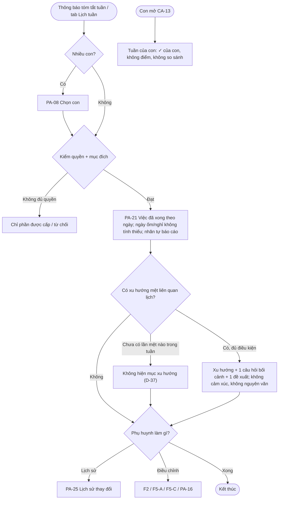

### 3.6 Màn hình

PA-21 (có), PA-25 **mới** (Lịch sử thay đổi lịch), PA-16 (có), CA-13 (có).

---

## 4. G2 – Khóa và mở khóa lịch

| Mục | Nội dung |
|---|---|
| **Mục tiêu** | Người có quyền giữ nguyên lịch có hiệu lực trong một phạm vi, để không ai commit thay đổi, rồi mở lại khi cần |
| **Người dùng** | Primary Caregiver có quyền lịch cao nhất với trẻ chưa tự quản (B01-PS-OD-04). AI không tự khóa (B01-MS-OD-02). Con: chỉ thấy trạng thái |
| **Điều kiện vào** | Có lịch đã commit. PA-11 → "Khóa lịch" |
| **Phạm vi** | Có trong F04-G01-M01 (A-lite v2). A-lite §5 coi "lock precedence" của máy trạng thái CR v3.1 là quá mức cho pilot. Nhánh mặc định: có khóa thủ công đơn giản, giữ đủ quy tắc đã duyệt dưới đây · `chờ Owner quyết` UF-Q27 |

### 4.1 Các bước

| # | Màn | Người dùng làm | Hệ thống phản hồi |
|---|---|---|---|
| 1 | PA-11 | Bấm "Khóa lịch" | Kiểm quyền (F01-G04-M01). Không phải Primary của scope → không hiện nút |
| 2 | PA-26 Khóa lịch | Chọn phạm vi (lịch mẫu tuần của con này; phạm vi khác: `UNKNOWN`), ghi lý do có sẵn hoặc ngắn | Báo trước hệ quả: không ai commit được, kể cả chính mình, cho tới khi mở; CR đang chờ vẫn xem được nhưng không áp; CR đã duyệt chưa áp sẽ vô hiệu (B01-CR-OD-02 ii) |
| 3 | PA-26 | Xác nhận | Ghi khóa: phạm vi, người khóa, thời điểm, phiên bản lịch, audit (B01-PS-OD-04). **Không có thời hạn tối đa, không tự mở** (B01C-OD-05) |
| 4 | (hệ thống) | — | Báo con sau commit: "Lịch đang được giữ nguyên" (G3). Con vẫn tự làm việc, báo ✓, hỏi thăm, gửi mong muốn hoặc đề xuất (B01-MS-OD-02; P5-R-FC) |
| 5 | (hệ thống) | — | **Nhắc phụ huynh xem lại khóa** định kỳ (B01C-OD-05). Tần suất: `UNKNOWN` · UF-Q28 |
| 6 | PA-11 / PA-26 | Bấm "Mở khóa" | Kiểm quyền. Ghi audit. CR đang chờ chuyển "cần đánh giá lại" nếu phiên bản đổi (B01-CR-OD-02 i) |
| 7 | (thay thế) | Muốn sửa mà không mở khóa | `authorized override` có audit (B01-PS-OD-04). Ai được override: `UNKNOWN` ngoài Primary · nhánh mặc định: chỉ Primary của scope |

### 4.2 Nhánh ngoại lệ

| Mã | Tình huống | Xử lý |
|---|---|---|
| G2-X1 | Đang khóa, phụ huynh sửa lịch | Cho sửa nháp, làm offline; **không commit** (B01C-OD-06). Nút Lưu báo "lịch đang khóa" |
| G2-X2 | Đang khóa, con ở `CHILD_DIRECTED` sửa trong phạm vi | Từ chối, fail-closed (04.1 sơ đồ 6.7) |
| G2-X3 | Đang khóa, giai đoạn tạm thời hết hạn | Khôi phục theo D-09 · xem 04.1 F5-A bước 9, UF-Q21 |
| G2-X4 | Đổi Primary khi đang khóa | Khóa giữ nguyên, người mới thấy khóa và người đã khóa · `đề xuất nội bộ`, UF-Q29 |
| G2-X5 | Hai người lớn cùng thao tác | Chỉ một Primary hiệu lực (P6-AP-OD-01); Supporter không khóa được |
| G2-X6 | Không có Primary hợp lệ | Không khóa, không mở được; mọi commit kế hoạch đã bị chặn (P5-OD-03) |

### 4.3 Dữ liệu ghi nhận

Khóa: phạm vi, người khóa, thời điểm, phiên bản lịch, lý do, lần nhắc xem lại, người mở, thời điểm mở, override (ai, khi nào, lý do). Audit không lộ nội dung riêng (B01C-OD-07).

### 4.4 Liên kết

- **L3:** F04-G01-M01, F04-G06-M01, F04-G06-M02, F01-G04-M01, F04-G07-M01.
- **UC:** UC-010 (lock trong bảng vô hiệu CR).
- **Ràng buộc:** B01-PS-OD-04; B01C-OD-05, -06, -07; B01-CR-OD-02; CRG CR-INV ("Lock chặn mọi commit"); B01-MS-OD-02 (AI không tự lock); P5-OD-03.

### 4.5 Sơ đồ

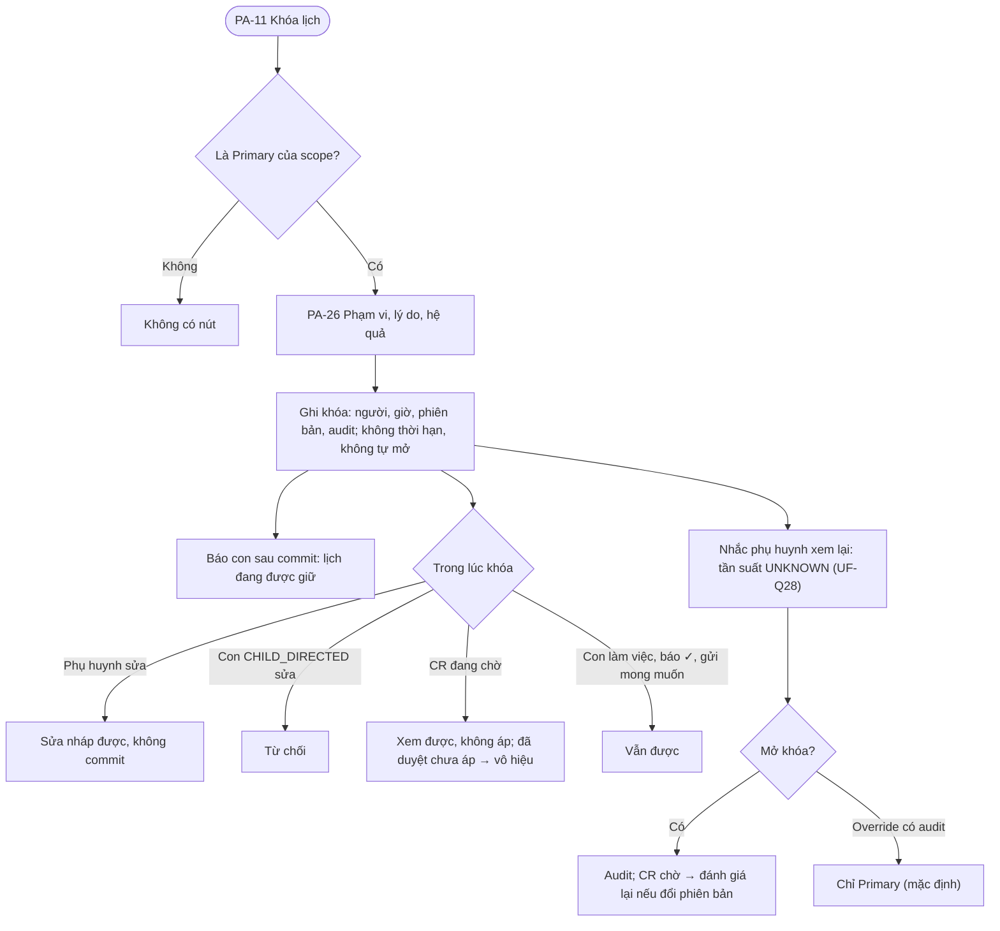

### 4.6 Màn hình

PA-11 (có), PA-26 **mới** (Khóa / mở khóa lịch).

---

## 5. G3 – Thông báo và nhắc

| Mục | Nội dung |
|---|---|
| **Mục tiêu** | Đúng người nhận đúng thông báo, sau commit, không lộ dữ liệu riêng, tôn trọng giới hạn tần suất và thời gian |
| **Người dùng** | Phụ huynh (Parent App), con (Child App) |
| **Điều kiện vào** | Có sự kiện đã commit (bảng 5.1) hoặc giờ khối lịch. Lần đầu: xin quyền (PA-23, CA-15) |
| **Phạm vi** | A-lite E1. Thông báo đẩy giữa hai máy là tính năng 5 của Plan A (PA §1) và cũng cần cho E1 (báo lịch mới, CR) |

### 5.1 Danh mục thông báo (theo 04.1 và đợt 2)

| Loại | Người nhận | Kích hoạt | Nội dung tối thiểu | Nguồn |
|---|---|---|---|---|
| Nhắc khối lịch, báo thức sáng | Con | Giờ khối | Tên khối, nút Xong | F04-G07-M01; PA §1 |
| Lịch mới / lịch đổi | Con | Commit lịch | "Lịch có thay đổi" | 04.1 F2 bước 15 |
| Mong muốn / đề xuất của con | Phụ huynh có quyền | Ghi xong mong muốn / CR | Loại, con nào; không nguyên văn | 04.1 F5-B; F04-G03-M02 |
| Kết quả đề xuất | Con | Duyệt / không duyệt / hết hạn | Trạng thái | B01-CR |
| Giai đoạn kết thúc, lịch đã về như trước | Phụ huynh | Commit khôi phục | Tên giai đoạn | D-09 |
| Ghép / hủy liên kết | Phụ huynh | Commit | Tối thiểu, không mã, không PIN | FR-01 mục 2 |
| Tóm tắt tuần | Phụ huynh | Lịch gửi | "Tóm tắt tuần của [tên gọi]" | UC-015; tần suất `UNKNOWN` (UF-Q11) |
| Nhắc xem lại khóa | Primary | Định kỳ | "Lịch của [tên gọi] đang khóa từ…" | B01C-OD-05; tần suất `UNKNOWN` (UF-Q28) |
| Lịch đang được giữ (khóa) | Con | Commit khóa | Trạng thái | G2 |
| Thành viên, quản lý chính đổi | Người lớn liên quan | Commit | Tối thiểu | G4 |
| Đồng ý cần cập nhật | Primary | Chính sách đổi phiên bản | Lời mời xem | G6 |
| Yêu cầu xóa / xuất xong | Người yêu cầu | Trạng thái đổi | Trạng thái | G7, G9 |

### 5.2 Các bước

| # | Màn | Người dùng làm | Hệ thống phản hồi |
|---|---|---|---|
| 1 | PA-23 / CA-15 | Cho phép hoặc từ chối `POST_NOTIFICATIONS` | Từ chối → app vẫn dùng được; hiện hướng dẫn bật lại (04.1 F3-X7, F4-X1) |
| 2 | PA-27 Cài đặt thông báo | Phụ huynh bật/tắt từng loại (trừ loại bắt buộc), đặt giờ yên lặng cho mình | Lưu tùy chọn (F04-G07-M02). Giờ yên lặng mặc định: `UNKNOWN` (UF-Q11). Loại bắt buộc không tắt được: ghép/hủy liên kết, an toàn tĩnh · `đề xuất nội bộ` |
| 3 | PA-27 (phần của con) | Phụ huynh xem tùy chọn nhắc của con | Ai đặt giờ yên lặng cho máy con: `UNKNOWN`. Nhánh mặc định: phụ huynh đặt; con được tắt riêng lời mời hỏi thăm (02.5 R3) · UF-Q32 |
| 4 | (hệ thống) | — | Trước khi gửi: **kiểm quyền người nhận** cho từng thông báo (CRG E-D04); chỉ gửi **sau commit** (03.4 §7); nội dung xem trước trên màn khóa không chứa dữ liệu riêng (E-D04) |
| 5 | (hệ thống) | — | Gửi; ghi trạng thái (giờ hẹn, giờ thật, lỗi) (PA §6 bước 1) |
| 6 | PA-15 / CA-06 | Người nhận mở | Mở đúng màn liên quan; kiểm quyền lại khi mở |

### 5.3 Nhánh ngoại lệ

| Mã | Tình huống | Xử lý |
|---|---|---|
| G3-X1 | Thiếu `SCHEDULE_EXACT_ALARM` | Nhắc sớm vài phút (PA §7) |
| G3-X2 | Tiết kiệm pin làm trễ | Màn hướng dẫn theo hãng (PA §7). "Lệch ≤1 phút" là mục tiêu test Plan A, không phải quy tắc sản phẩm (PA §6) |
| G3-X3 | Gửi thất bại | Thử lại, idempotent; không tạo hành động lặp (03.4 §7). Trạng thái thật vẫn xem được trong app |
| G3-X4 | Người nhận mất quyền giữa lúc tạo và lúc gửi | Không gửi (kiểm quyền ở bước 4) |
| G3-X5 | Trong giờ yên lặng | Hoãn tới hết giờ yên lặng, trừ nhắc khối lịch của con và báo thức sáng · `đề xuất nội bộ`, UF-Q11 |
| G3-X6 | Nhiều con | Mỗi thông báo ghi tên gọi của con; không gộp làm mất tên |
| G3-X7 | Hạn mức (quota) gói | Không được chặn thông báo an toàn tĩnh (CRG E-D02, PkD-P2) |

### 5.4 Dữ liệu ghi nhận

Tùy chọn thông báo theo người; trạng thái quyền hệ điều hành; nhật ký gửi (loại, người nhận, giờ hẹn, giờ thật, kết quả), không lưu nội dung riêng.

### 5.5 Liên kết

- **L3:** F04-G07-M01, F04-G07-M02, F01-G04-M01.
- **UC:** UC-009, UC-010, UC-015 (phần thông báo).
- **Ràng buộc:** 03.4 §7 (thông báo sau commit); CRG E-D04 (kiểm quyền, xem trước không lộ Journal); E-D02, PkD-P2 (quota không chặn an toàn); FR-01 mục 2; B01C-OD-05; PA §6, §7; 02.5 R3.

### 5.6 Sơ đồ

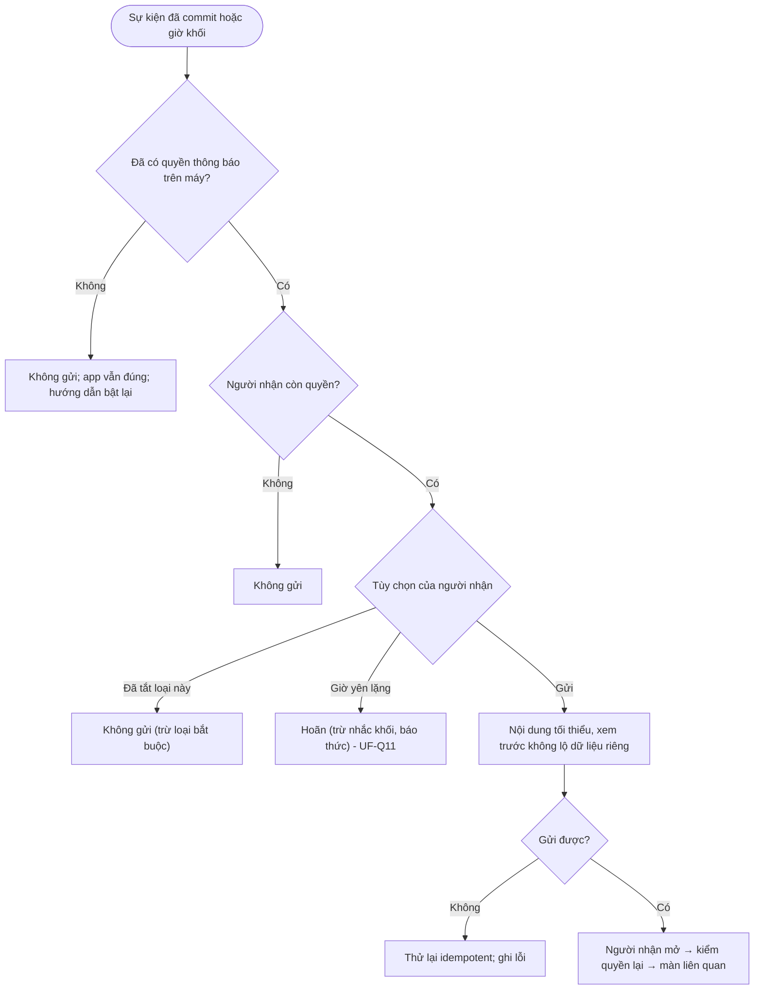

### 5.7 Màn hình

PA-15, PA-23, CA-06, CA-15 (có); PA-27 **mới** (Cài đặt thông báo).

---

## 6. G4 – Thành viên gia đình và đổi người quản lý chính

| Mục | Nội dung |
|---|---|
| **Mục tiêu** | Thêm, gỡ người lớn hỗ trợ; chuyển vai trò người quản lý chính (Primary Caregiver) mà không làm mất quyền của con và không mở rộng quyền ngầm |
| **Người dùng** | Primary Caregiver hiện tại; người lớn được mời (Supporter/Observer); Primary mới |
| **Điều kiện vào** | Gia đình đã có Primary hiệu lực. PA-28 Thành viên |
| **Phạm vi** | Đổi Primary có quyết định D-07. Mời, gỡ thành viên dùng **F01-G02-M02, không nằm trong A-lite v2**. Nhánh mặc định: vẽ đủ để Owner chọn · `chờ Owner quyết` UF-Q26 |

### 6.1 Các bước – mời thành viên

| # | Màn | Người dùng làm | Hệ thống phản hồi |
|---|---|---|---|
| 1 | PA-28 Thành viên | Primary bấm "Mời người lớn" | Kiểm quyền (F01-G04-M01). Chỉ Primary mời được · `đề xuất nội bộ` suy từ P6-AP-OD-01 |
| 2 | PA-29 Mời thành viên | Chọn vai trò Supporter hoặc Observer; chọn con và loại dữ liệu được xem (học tập, phát triển trong scope) | Không cấp quyền Journal, nội dung riêng hay thông tin an toàn (P6-AP-OD-02; CRG L3C-03). Mỗi quyền có resource, action, purpose, scope (P6-AP-OD-02) |
| 3 | (hệ thống) | — | Tạo lời mời dùng một lần, có hạn (cùng nguyên tắc mã mời B01-CL-OD-01). Thời hạn: `UNKNOWN` |
| 4 | PA-31 Nhận lời mời | Người được mời đăng nhập hoặc tạo tài khoản (F01-G01-M01), đọc và đồng ý (PA-02), chấp nhận | Thêm vào hộ (F01-G02-M02). Vai trò trong app không đồng nghĩa người giám hộ hợp pháp (P6-AP-OD-01) |
| 5 | PA-15 | Primary nhận "[tên] đã tham gia" | Sau commit |

### 6.2 Các bước – đổi người quản lý chính

| # | Màn | Người dùng làm | Hệ thống phản hồi |
|---|---|---|---|
| 1 | PA-30 Chuyển người quản lý chính | Primary hiện tại chọn một thành viên người lớn đã tham gia | F01-G04 sở hữu luồng; F01-G05 chỉ tham gia nếu liên quan mode (P6-AP-OD-03) |
| 2 | PA-30 | Đọc hệ quả, xác nhận | Hệ quả hiện rõ: (a) quyền đã cấp cho con **giữ nguyên** (mode, phạm vi ủy quyền sửa lịch) (D-07; B01C-OD-01; B01-MS-OD-04); (b) đồng ý cũ giữ nguyên, người mới tạo sự kiện mới nếu muốn đổi (B01-CL-OD-03); (c) CR đang chờ chuyển cho người mới; CR đã duyệt chưa áp phải duyệt lại (B01-CR-OD-02 iii; D-07); (d) quyền xem của người lớn khác chuyển `REVIEW_REQUIRED` (P6-AP-OD-02; D-07 chỉ loại trừ quyền của trẻ) · cách hiểu (d) `chờ Owner quyết` UF-Q30 |
| 3 | PA-31 (người nhận) | Người được chọn chấp nhận | Phải chấp nhận mới đổi; xác minh thêm: `UNKNOWN` (MR-016/017) · nhánh mặc định: chỉ cần chấp nhận trong app, ghi rõ không chứng minh giám hộ |
| 4 | (hệ thống) | — | Commit đổi Primary, versioning, audit, kiểm quyền lại trước mọi thay đổi (P6-AP-OD-03). Luôn đúng một Primary hiệu lực (P6-AP-OD-01) |
| 5 | (hệ thống) | — | Báo người lớn liên quan sau commit (G3). Báo con: "Người quản lý lịch của con bây giờ là [tên]" · `đề xuất nội bộ`, UF-Q29 |

### 6.3 Các bước – gỡ thành viên, tự rời

| # | Tình huống | Xử lý |
|---|---|---|
| 1 | Primary gỡ Supporter/Observer | Thu hồi mọi quyền của người đó ngay; không xóa dữ liệu của con; ghi audit; báo tối thiểu |
| 2 | Supporter tự rời | Như trên, do chính họ làm |
| 3 | Primary muốn rời | Phải chuyển Primary trước (6.2) hoặc xóa gia đình (G9). Không cho rời để lại gia đình không có Primary · nhánh an toàn suy từ P5-OD-03, `chờ Owner quyết` UF-Q40 |

### 6.4 Nhánh ngoại lệ

| Mã | Tình huống | Xử lý |
|---|---|---|
| G4-X1 | Người được chọn từ chối hoặc không trả lời | Không đổi; Primary cũ giữ vai trò. Hạn trả lời: `UNKNOWN` |
| G4-X2 | Primary không còn dùng app (mất liên lạc, tranh chấp) | **Không** cho người khác tự nâng quyền (P5-OD-03 "Observer không tự nâng quyền"). Kế hoạch bị chặn sửa (fail-closed); con vẫn tự làm việc và gửi đề xuất (P5-R-FC). Cách khôi phục: `UNKNOWN`, cần quy trình xác minh · UF-Q29 |
| G4-X3 | Có hai người cùng quyền trên một scope (lỗi dữ liệu) | Chặn sửa kế hoạch (P5-OD-03) |
| G4-X4 | Người được mời là con 18+ tự quản | Không áp quyền caregiver lên người 18+ (P6-AP-OD-04); ngoài phạm vi (lớp 1–9) |
| G4-X5 | Lời mời gửi nhầm người | Primary hủy lời mời trước khi được chấp nhận; lời mời một lần, có hạn |
| G4-X6 | Người lớn mới muốn xem dữ liệu riêng của Primary cũ (ví dụ ghi chú riêng) | Không (CLAUDE "không đưa dữ liệu riêng của người này cho người lớn khác") |

### 6.5 Dữ liệu ghi nhận

Thành viên: vai trò, quyền (resource, action, purpose, scope), thời điểm cấp, thu hồi. Lời mời: hạn, trạng thái. Đổi Primary: người cũ, người mới, thời điểm, phiên bản, audit. Trạng thái `REVIEW_REQUIRED` cho quyền người lớn khác.

### 6.6 Liên kết

- **L3:** F01-G02-M01, F01-G02-M02 (ngoài A-lite v2), F01-G04-M01, F01-G04-M02, F01-G05-M01, F04-G03-M02, F04-G06-M01.
- **UC:** UC-002.
- **Ràng buộc:** D-07; P6-AP-OD-01..04; P5-OD-03, P5-R-FC; B01-CL-OD-01, -03; B01C-OD-01; B01-MS-OD-04; B01-CR-OD-02 iii; CRG L3C-03, OC-03 (đã được D-07 giải quyết cho quyền của trẻ); CLAUDE (hai phạm vi).

### 6.7 Sơ đồ

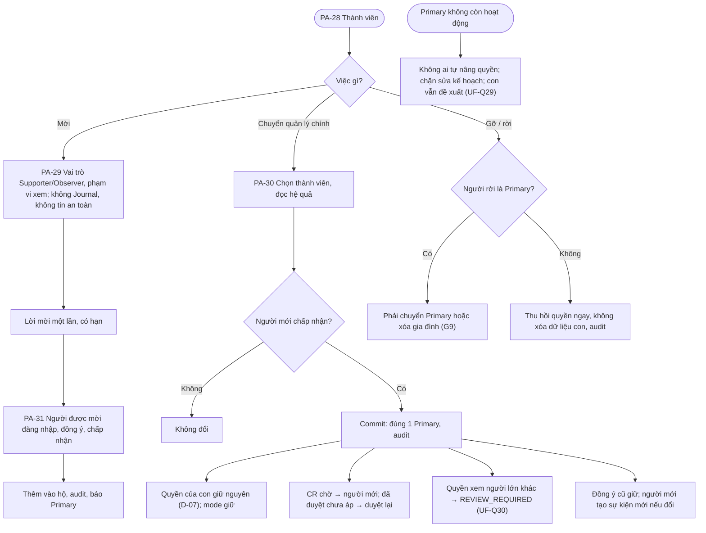

### 6.8 Màn hình

PA-28 **mới** (Thành viên gia đình), PA-29 **mới** (Mời thành viên), PA-30 **mới** (Chuyển người quản lý chính), PA-31 **mới** (Nhận lời mời / nhận vai trò), PA-02 (có).

---

## 7. G5 – Đặt chế độ tự chủ cho con

| Mục | Nội dung |
|---|---|
| **Mục tiêu** | Primary đặt mode lịch cho từng con, hiểu rõ quyền con nhận được |
| **Người dùng** | Primary (chỉ phụ huynh đổi mode, B01-MS R1). Con: được báo |
| **Điều kiện vào** | Có hồ sơ con. Mặc định `UNSET` (như `PARENT_LED`) (B01-MS-OD-04). PA-12 |
| **Phạm vi** | F01-G05-M01 (A-lite v2). Luồng con xin đổi mode (F01-G05-M02) ngoài A-lite v2, không vẽ · UF-Q31 |

### 7.1 Các bước

| # | Màn | Người dùng làm | Hệ thống phản hồi |
|---|---|---|---|
| 1 | PA-08 → PA-12 | Chọn con, mở Chế độ tự chủ | Kiểm quyền; mỗi con một mode (B01-MS-OD-01) |
| 2 | PA-12 | Xem mô tả từng mode bằng lời dễ hiểu | `PARENT_LED`: con gửi mong muốn. `CHILD_EXECUTED`: con tạo đề xuất, bố mẹ duyệt, đề xuất hết hạn sau 7 ngày. `CHILD_DIRECTED`: **ẩn trong A-lite E1** (UF-Q23). Mọi mode con vẫn tự làm việc, báo trạng thái (B01-MS-OD-02). Không dùng tuổi cứng (B01-PS-OD-03) |
| 3 | PA-12 | Chọn mode, xác nhận | Báo trước hệ quả nếu giảm quyền: CR đang chờ và CR đã duyệt chưa áp đều vô hiệu (B01-CR-OD-02 iv) |
| 4 | (hệ thống) | — | Commit mode, audit. AI không đổi mode |
| 5 | (hệ thống) | — | Báo con sau commit, kèm câu giải thích quyền mới · `đề xuất nội bộ` (minh bạch với trẻ), UF-Q31 |

### 7.2 Nhánh ngoại lệ

| Mã | Tình huống | Xử lý |
|---|---|---|
| G5-X1 | Không có Primary hợp lệ | Không đổi mode được; giữ mode cũ (P5-OD-03) |
| G5-X2 | Con ngoại tuyến gửi đề xuất theo mode cũ | Máy chủ kiểm lại, từ chối nếu mode không còn cho phép (04.1 F5B-X7) |
| G5-X3 | Đổi Primary | Mode giữ nguyên (B01-MS-OD-04; D-07) |
| G5-X4 | Supporter cố đổi mode | Không có nút; API từ chối |

### 7.3 Dữ liệu, liên kết, ràng buộc

- **Dữ liệu:** mode theo con, người đổi, thời điểm, mode cũ, audit.
- **L3:** F01-G05-M01, F01-G04-M01, F04-G06-M01; (F01-G05-M02 ngoài A-lite).
- **UC:** UC-002 (phần quyền), UC-010.
- **Ràng buộc:** B01-MS-OD-01..04, B01-MS R1; B01-PS-OD-03; B01-CR-OD-02 iv; P5-OD-03; D-07; CRG C-01.

### 7.4 Sơ đồ

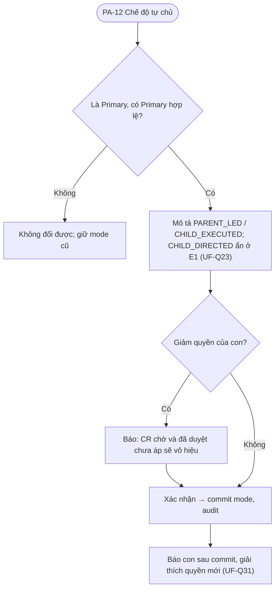

### 7.5 Màn hình

PA-12 (có).

---

## 8. G6 – Đồng ý: xem, cập nhật, rút

| Mục | Nội dung |
|---|---|
| **Mục tiêu** | Người lớn thấy mình đã đồng ý gì, cập nhật khi chính sách đổi, rút khi muốn. Con được giải thích bằng lời dễ hiểu những gì bố mẹ thấy |
| **Người dùng** | Primary (đồng ý do caregiver quản lý); người lớn khác (đồng ý của chính họ); con (xem giải thích) |
| **Điều kiện vào** | PA-32 Quyền riêng tư và đồng ý; hoặc thông báo "chính sách có phiên bản mới"; con: CA-16 sau khi ghép |
| **Phạm vi** | F01-G04-M02, F07-G06-M01 (A-lite v2) |

### 8.1 Các bước – phụ huynh

| # | Màn | Người dùng làm | Hệ thống phản hồi |
|---|---|---|---|
| 1 | PA-32 | Xem danh sách đồng ý đã ghi: phiên bản chính sách, ngày, người ghi, phạm vi (theo con) | Ghi `SELF_DECLARED` (B01-CL-OD-01). Nêu rõ: đã ghi đồng ý **không** có nghĩa đã đủ căn cứ xử lý (B01-CL INV-6). Hiện mục đích dùng dữ liệu theo danh mục mục đích đã duyệt; danh mục chưa duyệt → ghi "đang chờ duyệt" (PBA-OD-02; cổng B-4) |
| 2 | PA-32 | Chính sách có phiên bản mới → bấm "Xem và đồng ý" | Mở PA-02 với phiên bản mới. Trước khi đồng ý lại: **không xử lý dữ liệu mới theo mục đích mới**; dữ liệu và lịch hiện có vẫn xem được · nhánh an toàn, `chờ Owner quyết` UF-Q33 |
| 3 | PA-32 | Bấm "Rút đồng ý" cho một con hoặc một mục đích | Chỉ Primary rút được đồng ý do caregiver quản lý (B01-CL-OD-02). Báo trước hệ quả |
| 4 | (hệ thống) | — | Ghi sự kiện rút, không sửa lịch sử (CRG §1 mục 2). Dừng xử lý tiếp theo cho mục đích đó (03.4 §6.2 "revoked consent → ngừng processing"). Nhánh mặc định cho vòng lập lịch: lịch có hiệu lực chuyển chỉ xem; máy con ngừng nhận lịch mới và ngừng ghi nhận mới; **không tự xóa dữ liệu** (xóa đi qua G7/G9) · `chờ Owner quyết` UF-Q33 |
| 5 | (hệ thống) | — | Rút đồng ý của người lớn **không** làm mất quyền của con dừng chia sẻ Journal (B01-CL-OD-02; áp ở nấc có Journal) |

### 8.2 Các bước – con

| # | Màn | Người dùng làm | Hệ thống phản hồi |
|---|---|---|---|
| 1 | CA-16 Những gì bố mẹ thấy | Sau khi ghép (CA-03), con xem; mở lại được từ Cài đặt (CA-11) | Lời dễ hiểu, câu ngắn: bố mẹ thấy lịch, việc con đã bấm Xong và giờ; bố mẹ thấy **xu hướng** con hay mệt vào ngày nào, **không** thấy con chọn gì từng ngày (D-03); mong muốn, đề xuất con gửi thì bố mẹ đọc được. Nội dung khớp với quyền thật (kiểm quyền khi dựng màn) · câu chữ `đề xuất nội bộ`; sự đồng thuận của trẻ (assent) theo tuổi `RESEARCH_REQUIRED` (MR-017) · UF-Q42 |
| 2 | CA-16 | Bấm "Con hiểu rồi" | Ghi mốc con đã xem (dùng để chứng minh D-03 "trẻ được biết"). Không chặn dùng app nếu con không bấm · `đề xuất nội bộ` |

### 8.3 Nhánh ngoại lệ

| Mã | Tình huống | Xử lý |
|---|---|---|
| G6-X1 | Supporter muốn rút đồng ý thay Primary | Không được; chỉ rút được đồng ý của chính mình (B01-CL-OD-02) |
| G6-X2 | Có phản đối pháp lý từ chủ thể khác (ví dụ người giám hộ không có trong app) | Không bỏ qua chỉ vì UI chỉ có nút cho Primary (B01-CL INV-8). Kênh tiếp nhận: `UNKNOWN` · UF-Q33 |
| G6-X3 | Đổi Primary | Đồng ý cũ giữ nguyên; Primary mới tạo sự kiện mới nếu muốn đổi (B01-CL-OD-03) |
| G6-X4 | Dùng dữ liệu thật khi căn cứ pháp lý `UNKNOWN` | Không xử lý (PBA-OD-04; `LEGAL_UNKNOWN ≠ ALLOW`). Ngoại lệ có giới hạn D-01 chỉ cho Plan A ≤3 gia đình; cổng H4, FR-03 vẫn mở |

### 8.4 Dữ liệu ghi nhận

Sự kiện đồng ý: chủ thể, người ghi, phiên bản chính sách, mục đích, phạm vi con, thời điểm, loại (`SELF_DECLARED`), sự kiện rút. Mốc con đã xem CA-16.

### 8.5 Liên kết

- **L3:** F01-G04-M02, F01-G04-M01, F07-G06-M01.
- **UC:** UC-002.
- **Ràng buộc:** B01-CL-OD-01..04, CL INV-6, INV-8; PBA-OD-01, -02, -04; D-01, D-03; CRG CAP-4, cổng B-1, B-4; 03.4 §6.2.

### 8.6 Sơ đồ

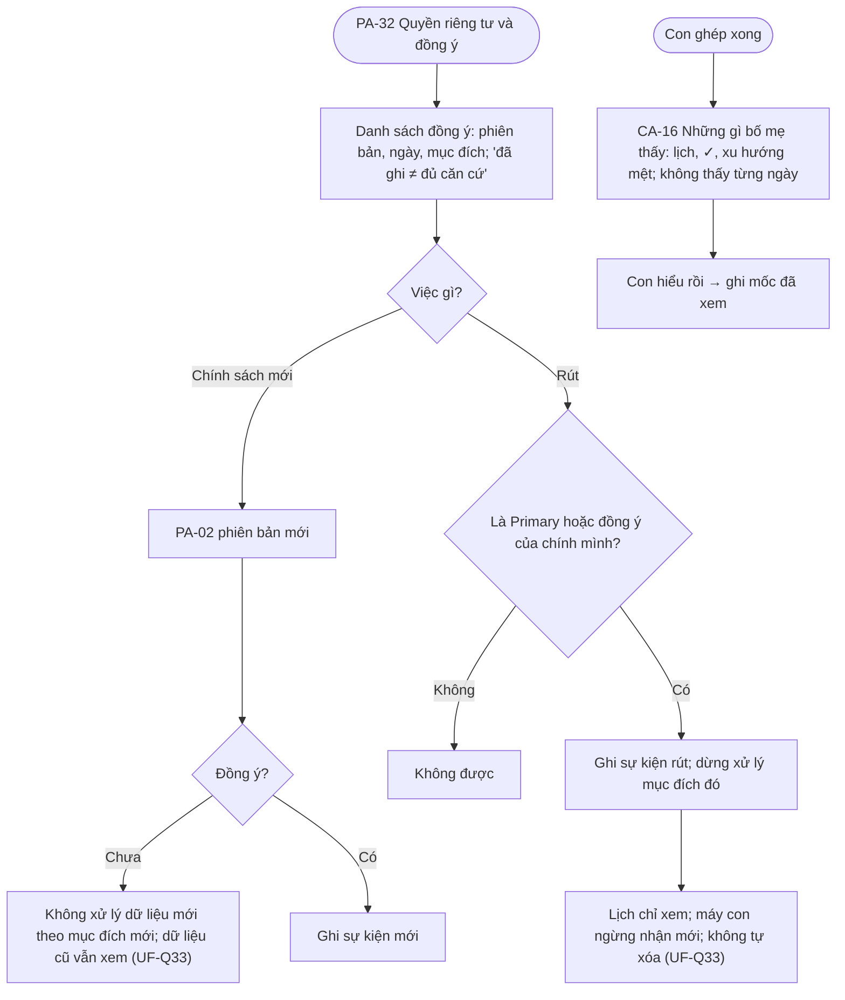

### 8.7 Màn hình

PA-02 (có), PA-32 **mới** (Quyền riêng tư và đồng ý), CA-16 **mới** (Những gì bố mẹ thấy), CA-11 (có).

---

## 9. G7 – Xem, sửa, xóa, xuất dữ liệu

| Mục | Nội dung |
|---|---|
| **Mục tiêu** | Mọi dữ liệu app lưu về gia đình hiện cho người có quyền thấy, sửa, xóa được (CLAUDE "Minh bạch"); xuất được khi có chính sách |
| **Người dùng** | Primary (dữ liệu hồ sơ, lịch của con trong scope; dữ liệu của chính mình); người lớn khác (dữ liệu của chính họ); con (dữ liệu con tạo: xem ở CA-13) |
| **Điều kiện vào** | PA-33 Dữ liệu của gia đình |
| **Phạm vi** | F01-G06-M01, F07-G06-M01, F07-G06-M02 (A-lite v2). **Xóa hẳn và xuất với dữ liệu thật bị chặn cổng H4** (thời hạn xóa theo Nghị định 356/2025 chưa xác định; CRG cổng B-2). Luồng vẽ đủ; không coi cổng là đạt |

### 9.1 Loại dữ liệu và thao tác (A-lite E1)

| Loại | Xem | Sửa | Xóa | Ghi chú |
|---|---|---|---|---|
| Hồ sơ con (tuổi/lớp, giờ học, nơi ở, trường tùy chọn) | Primary | Primary | Primary (từng trường tùy chọn); trường bắt buộc chỉ sửa | Có nguồn và cờ "giả định" (QT B3, B4) |
| Thẻ hoạt động | Primary | Primary | Primary | Xóa → "Lịch tuần chưa cập nhật" (QT E5) |
| Quỹ giờ, preset | Primary | Primary | Primary (preset tự lưu) | |
| Lịch có hiệu lực | Primary, người được cấp | qua F2/F5 | Không xóa riêng; xóa cùng hồ sơ con (G9) · `đề xuất nội bộ` | |
| Lịch sử thay đổi (PA-25) | Primary | Không | Không xóa từng dòng; xóa cùng hồ sơ con · nhánh an toàn, UF-Q36 | Audit cần cho quyền và CR |
| Nhật ký ngày (✓ Xong, giờ) | Primary, con | Con dùng Hoàn tác trong ngày (QT L1) | Theo hồ sơ con | |
| Hỏi thăm sau giờ học | **Con** (CA-13) | Không | Con yêu cầu xóa: `UNKNOWN` · UF-Q35 | Phụ huynh chỉ thấy xu hướng (D-03) |
| Mong muốn, đề xuất của con | Primary, con | Không | Theo hồ sơ con | |
| Đồng ý | Người ghi | Không (ghi sự kiện mới) | Không | G6 |
| Thông tin của chính người lớn (cách Pal gọi, liên hệ) | Chính người đó | Có | Có | Không cho người lớn khác xem (CLAUDE) |

### 9.2 Các bước

| # | Màn | Người dùng làm | Hệ thống phản hồi |
|---|---|---|---|
| 1 | PA-33 | Chọn con (PA-08) và loại dữ liệu | Kiểm quyền, mục đích trước khi đọc (F07-G06-M01; CRG CAP-2) |
| 2 | PA-33 | Xem | Hiện dữ liệu kèm nguồn (`bo_me`/`pal`/hệ thống) và cờ "giả định" |
| 3 | PA-33 | Sửa | Ghi phiên bản mới, giữ nguồn (F02-G01-M01). Sửa dữ liệu dùng cho lịch → "Lịch tuần chưa cập nhật", không tự xếp lại (QT E5) |
| 4 | PA-33 | Xóa một mục | Xác nhận. **Ẩn ngay** khỏi mọi màn và báo cáo (tombstone; B02 CAND-F07-G06-M02-suppress, bản REVIEW). Xóa hẳn theo hạn chính sách: hạn cho dữ liệu ngoài Journal `UNKNOWN` (mốc 60 ngày chỉ đã duyệt cho Journal, CRG CP-07, ODP-02) · UF-Q34. Không hứa "đã xóa hết" khi chưa xóa hẳn (03.4 §6.2) |
| 5 | PA-34 Xuất dữ liệu | Primary yêu cầu xuất dữ liệu của gia đình / một con | Kiểm quyền. Ai được xuất dữ liệu của con, định dạng: `UNKNOWN` · UF-Q43. Yêu cầu xếp hàng; khi chạy kiểm lại tombstone, bỏ mục đã xóa (B02 R1) |
| 6 | PA-15 | Nhận "Bản xuất đã sẵn sàng" | Tải trong hạn; hạn tải `UNKNOWN` |

### 9.3 Nhánh ngoại lệ

| Mã | Tình huống | Xử lý |
|---|---|---|
| G7-X1 | Yêu cầu xóa trùng hoặc mất phản hồi | Idempotent; giữ thời điểm chấp nhận đầu tiên (B02 R2) |
| G7-X2 | Người không có quyền yêu cầu xóa | Không có tác dụng (B02 R2) |
| G7-X3 | Xóa trong lúc đang xuất | Bản xuất bỏ mục đã xóa (B02 R1) |
| G7-X4 | Nghĩa vụ lưu theo luật dài hơn yêu cầu xóa | Hạn chế mục đích, quyền; giải thích đúng, không hứa xóa ngay (03.4 §6.2) |
| G7-X5 | Dữ liệu thật khi cổng H4 chưa xong | Không chạy luồng xóa hẳn và xuất với dữ liệu thật; ngoại lệ D-01 xóa khi kết thúc thử nghiệm theo điều kiện D-01 |
| G7-X6 | Trường sức khỏe | Ẩn khi dùng dữ liệu thật (UF-Q16; CRG C-07) |
| G7-X7 | Supporter mở PA-33 | Chỉ thấy phần được cấp và dữ liệu của chính họ |

### 9.4 Dữ liệu ghi nhận

Yêu cầu xóa: người yêu cầu, phạm vi, thời điểm chấp nhận, tombstone, phiên bản chính sách, hạn xóa hẳn (`UNKNOWN`), trạng thái. Yêu cầu xuất: người yêu cầu, phạm vi, trạng thái, hạn tải. Phiên bản hồ sơ.

### 9.5 Liên kết

- **L3:** F01-G06-M01, F07-G06-M01, F07-G06-M02, F02-G01-M01, F01-G03-M01, F01-G04-M01.
- **UC:** UC-003 (phía phụ huynh), UC-002 (phần dữ liệu).
- **Ràng buộc:** CLAUDE (minh bạch, hai phạm vi); 03.4 §6.2, FI-3.4-003; B02 (REVIEW); CRG CP-07, ODP-02, REM-LB, cổng B-2 (H4); D-01, D-03; QT B3, B4, E5, L1.

### 9.6 Sơ đồ

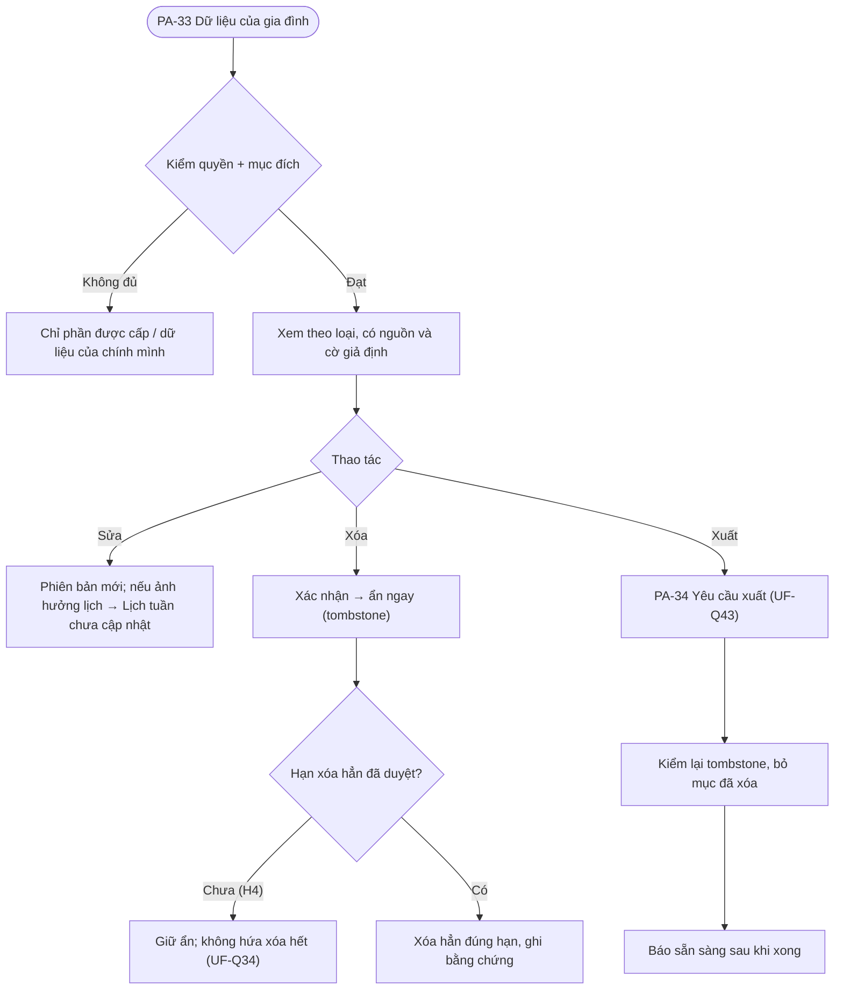

### 9.7 Màn hình

PA-33 **mới** (Dữ liệu của gia đình), PA-34 **mới** (Xuất dữ liệu), PA-25 (lịch sử, mới ở G1), CA-13 (có).

---

## 10. G8 – An toàn khẩn cấp cho trẻ và phụ huynh

| Mục | Nội dung |
|---|---|
| **Mục tiêu** | Ai cần giúp khẩn cấp thấy ngay thông tin hỗ trợ tĩnh đúng với người nhận; không chẩn đoán; không tự liên hệ ai |
| **Người dùng** | Phụ huynh, người lớn (Parent App); con (Child App) |
| **Điều kiện vào** | (a) Phụ huynh mở mục "Hỗ trợ khẩn cấp" cố định; (b) bộ kiểm từ khóa [E1] trên ô chữ tự do của Parent App khớp dấu hiệu khẩn; (c) con bấm "Con cần giúp đỡ" (nếu Owner chọn, UF-Q37); (d) `[Nấc 2]` lớp an toàn trước AI phát hiện ở chat, giọng nói |
| **Phạm vi** | A-lite E1: (a), (b), (c). Nấc 2: (d) ở mức khung. Human Response Workflow (F07-G05-M02) **hoãn** (CRG REM-HRW) |

### 10.1 Các bước – người lớn

| # | Màn | Người dùng làm | Hệ thống phản hồi |
|---|---|---|---|
| 1 | Menu Parent App | Bấm "Hỗ trợ khẩn cấp" (luôn có, không cần mạng) | Mở PA-24 · lối vào cố định là `đề xuất nội bộ` |
| 1b | Ô chữ tự do (ghi chú thẻ, lý do thay đổi, tên giai đoạn) | Nhập chữ khớp danh sách dấu hiệu khẩn | Bộ kiểm từ khóa [E1] chạy trước khi lưu, hiện PA-24 ngay dưới ô, không popup (0.6 mục 1, 3). Vẫn cho lưu nội dung. Danh sách từ khóa cần thẩm định (cổng B-6) · UF-Q38 |
| 2 | PA-24 | Đọc | Nội dung tĩnh: **115** cấp cứu, **113** công an, **111** bảo vệ trẻ em, khi phù hợp; câu ngắn khi nào gọi số nào (QT N2; OD-03b). Không chẩn đoán, không nêu liều thuốc (QT N1), không gợi ý trả phí (OD-03b; CLAUDE), không tự gọi. Nội dung số khẩn cần thẩm định trước khi chạy thật (cổng B-6) |
| 3 | PA-24 | Bấm số | Mở trình gọi điện của máy với số đó; app không tự gọi · `đề xuất nội bộ` |

### 10.2 Các bước – con

| # | Màn | Người dùng làm | Hệ thống phản hồi |
|---|---|---|---|
| 1 | CA-04 / CA-11 | Bấm "Con cần giúp đỡ" (nút tĩnh) · `đề xuất nội bộ`, `chờ Owner quyết` UF-Q37 | Mở CA-14, không cần mạng |
| 2 | CA-14 | Đọc | Lời tĩnh: **"Con hãy nói với một người lớn con tin cậy"**, có thể kèm **111** (OD-03a; D-06). **Không** hiện 113, 115 |
| 3 | (hệ thống) | — | **Không** ghi lại việc con mở màn này, **không** báo gia đình, không mở hồ sơ, không tự liên hệ (OD-03a; REM-HRW). Vì không xử lý dữ liệu nhập của trẻ, nhánh này không phát sinh việc xử lý mà cổng FR-03 chặn · nhận định này `chờ Owner quyết` UF-Q37 |

### 10.3 Khung nấc 2 – lớp an toàn trước AI

| # | Bước | Ràng buộc |
|---|---|---|
| 1 | Mọi chữ tự do, giọng nói (phụ huynh, con) qua lớp an toàn trước khi tới Pal | CLAUDE; PA §4; F07-G05-M01 |
| 2 | Khẩn → chỉ nội dung tĩnh theo người nhận (như 10.1, 10.2); không gọi Claude | OD-03; D-06 |
| 3 | Không khẩn → ẩn danh → Pal; đầu ra phải được kiểm trước khi phát, không stream byte chưa kiểm | OD-05a; CRG C-11 |
| 4 | Nghi người chăm sóc là nguồn nguy hại → không mặc định báo chính người đó | CRG CP-17; 03.4 §6.3 |
| 5 | Hạn mức lượt chat không chặn nội dung an toàn tĩnh | CRG E-D02, C-11 |
| 6 | Lớp an toàn xử lý chữ của trẻ là xử lý dữ liệu: cổng FR-03 **mở**, không PASS | CRG C-10, cổng B-3 |

### 10.4 Nhánh ngoại lệ

| Mã | Tình huống | Xử lý |
|---|---|---|
| G8-X1 | Không có mạng | PA-24, CA-14 vẫn hiện (nội dung lưu sẵn trên máy) |
| G8-X2 | Từ khóa khớp nhầm (không khẩn) | Dòng thông tin chỉ hiện, không chặn thao tác; không ghi nhãn rủi ro vào hồ sơ · `đề xuất nội bộ` |
| G8-X3 | Hết hạn mức gói | Không ảnh hưởng (E-D02, PkD-P2) |
| G8-X4 | Phụ huynh nhập dấu hiệu bạo hành trẻ | Hiện 111 trước (QT N2 "bạo hành hoặc xâm hại trẻ thì gọi 111") |

### 10.5 Dữ liệu ghi nhận

Phía con: **không ghi**. Phía người lớn: không lưu kết quả khớp từ khóa thành nhãn hồ sơ; chỉ đếm tổng hợp không định danh nếu cần đo lường · `đề xuất nội bộ`, UF-Q38.

### 10.6 Liên kết

- **L3:** F07-G05-M01, F07-G01-M01 (nội dung tĩnh); F07-G05-M02 hoãn.
- **UC:** UC-019 (phần tĩnh); UC-020 không vẽ.
- **Ràng buộc:** D-06; OD-03a, -03b, -03c; CLAUDE; QT N1, N2; CRG REM-HRW, CP-17, E-D02, PkD-P2, C-09, C-10, C-11, cổng B-3, B-6; PA §4.

### 10.7 Sơ đồ

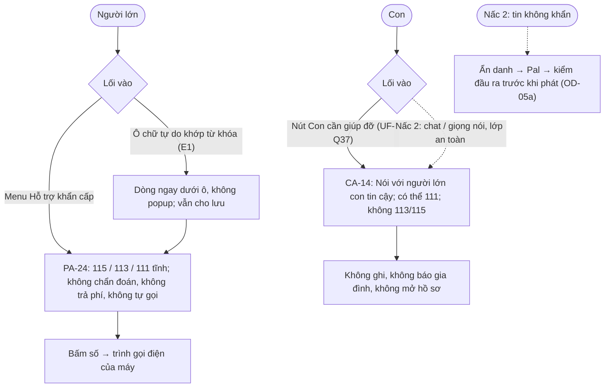

### 10.8 Màn hình

PA-24 (có), CA-14 (có; thành E1 nếu Owner chọn UF-Q37). Không thêm màn mới.

---

## 11. G9 – Xóa hồ sơ con, rời gia đình, xóa tài khoản

| Mục | Nội dung |
|---|---|
| **Mục tiêu** | Kết thúc dùng app một cách rõ ràng: xóa một con, một người lớn rời, hoặc xóa cả gia đình và tài khoản |
| **Người dùng** | Primary (xóa con, xóa gia đình); người lớn khác (rời, xóa tài khoản của chính mình) |
| **Điều kiện vào** | PA-35 Xóa tài khoản và dữ liệu |
| **Phạm vi** | F01-G06-M01, F07-G06-M02, F01-G02-M01 (A-lite v2). Xóa hẳn dữ liệu thật bị chặn cổng H4 |

### 11.1 Các bước

| # | Màn | Người dùng làm | Hệ thống phản hồi |
|---|---|---|---|
| 1 | PA-35 | Chọn: (a) xóa hồ sơ một con; (b) rời gia đình; (c) xóa gia đình và tài khoản | Kiểm quyền: (a), (c) chỉ Primary; (b) mọi người lớn, riêng Primary phải chuyển trước (G4 6.3) |
| 2 | PA-35 | (Tùy chọn) Xuất dữ liệu trước | Sang G7 PA-34 |
| 3 | PA-36 Xác nhận xóa | Đọc hệ quả, gõ xác nhận lần hai | Hệ quả: máy con được hủy liên kết (không cần PIN vì do Primary làm từ Parent App · `đề xuất nội bộ`); CR đang chờ, CR đã duyệt chưa áp **vô hiệu** (B01-CR-OD-02 "archive"); nhắc trên máy con dừng; dữ liệu ẩn ngay, xóa hẳn theo hạn chính sách (`UNKNOWN`, H4) |
| 4 | (hệ thống) | — | Commit; ghi audit tối thiểu (B01C-OD-07); tăng epoch liên kết, vô hiệu token máy con (FR-01 mục 3) |
| 5 | (hệ thống) | — | Báo người lớn khác trong gia đình (nếu còn) sau commit (G3). Máy con hiện CA-17 "Máy này không còn kết nối với gia đình" |
| 6 | (hệ thống) | — | Thời gian chờ có thể hoàn tác trước khi xóa hẳn: `UNKNOWN` · UF-Q39 |

### 11.2 Nhánh ngoại lệ

| Mã | Tình huống | Xử lý |
|---|---|---|
| G9-X1 | Primary xóa gia đình khi còn người lớn khác | Báo trước cho người lớn khác; quyền của họ bị thu hồi. Có cần họ đồng ý hoặc chuyển Primary thay vì xóa: `UNKNOWN` · UF-Q40 |
| G9-X2 | Máy con ngoại tuyến | Liên kết vô hiệu ở máy chủ; máy con thấy CA-17 khi có mạng; dữ liệu trên máy con xóa khi nhận lệnh · cách xóa cục bộ chờ System Design |
| G9-X3 | Mất phản hồi, gửi lại | Idempotent (B02 R2) |
| G9-X4 | Con tự muốn xóa | Con không xóa được tài khoản gia đình. Con hủy liên kết máy cần Parent PIN (FR-01 mục 1; 04.1 F3 §4.2) |
| G9-X5 | Nghĩa vụ lưu theo luật | Hạn chế quyền, mục đích; giải thích đúng (03.4 §6.2) |
| G9-X6 | Người trả tiền (nếu có gói) | Không vì trả tiền mà có quyền dữ liệu; hạ gói không xóa tiến độ (CRG PkD-P2). Ngoài A-lite (K7) |
| G9-X7 | Ngoại lệ D-01 kết thúc thử nghiệm | Xóa theo điều kiện D-01 (xóa khi kết thúc); không đưa lên repo |

### 11.3 Dữ liệu, liên kết, ràng buộc

- **Dữ liệu:** yêu cầu xóa (loại, người, phạm vi, thời điểm chấp nhận, tombstone, hạn xóa hẳn), audit hủy liên kết, epoch.
- **L3:** F01-G06-M01, F07-G06-M02, F01-G02-M01, F01-G01-M01, F04-G06-M01 (vô hiệu CR), F04-G07-M01.
- **UC:** UC-001 (đảo ngược), UC-002.
- **Ràng buộc:** FR-01 mục 1–3; B01-CR-OD-02; B01C-OD-07; P5-OD-03; 03.4 §6.2, FI-3.4-003; B02 (REVIEW); CRG PkD-P2, REM-LB, cổng B-2 (H4); D-01.

### 11.4 Sơ đồ

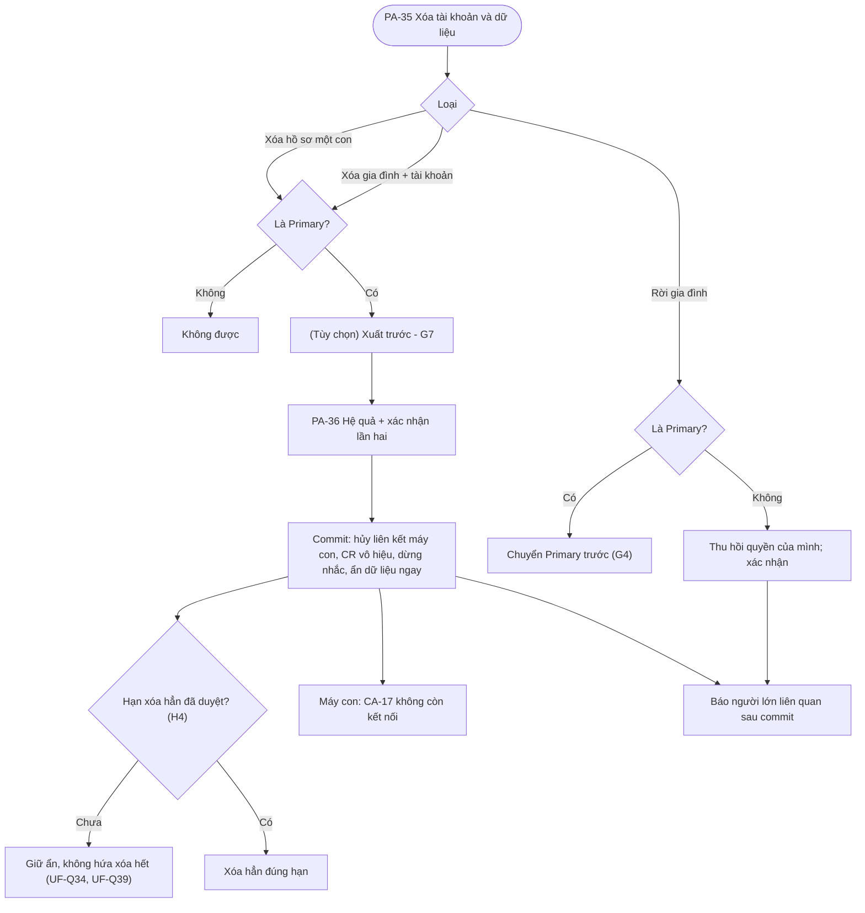

### 11.5 Màn hình

PA-35 **mới** (Xóa tài khoản và dữ liệu), PA-36 **mới** (Xác nhận xóa / rời), CA-17 **mới** (Máy không còn kết nối với gia đình).

---

## 12. G10 – Đăng nhập lại, khôi phục tài khoản, phiên trên máy

| Mục | Nội dung |
|---|---|
| **Mục tiêu** | Người lớn vào lại được tài khoản an toàn; thấy và đăng xuất các phiên |
| **Người dùng** | Người lớn |
| **Điều kiện vào** | PA-01 "Quên mật khẩu / không vào được"; PA-38 Phiên đăng nhập |
| **Phạm vi** | F01-G01-M01, F01-G01-M02 (A-lite v2). Spike dùng mã gia đình, không có luồng này (OD-A8 (b)); pilot gia đình thật cần luồng này |

### 12.1 Các bước

| # | Màn | Người dùng làm | Hệ thống phản hồi |
|---|---|---|---|
| 1 | PA-37 Khôi phục tài khoản | Chọn cách khôi phục | Phương pháp khôi phục (email, số điện thoại…): `UNKNOWN`, chờ System Design và bảo mật · UF-Q41. Không tiết lộ tài khoản có tồn tại không (cùng nguyên tắc 04.1 F3-X1) |
| 2 | (hệ thống) | — | Khôi phục xong: vô hiệu phiên cũ · `đề xuất nội bộ` |
| 3 | PA-38 Phiên đăng nhập | Xem các máy đang đăng nhập; đăng xuất từng máy | F01-G01-M02. Đăng xuất máy phụ huynh **không** hủy liên kết máy con (hủy liên kết theo FR-01) |
| 4 | (hệ thống) | — | Khôi phục tài khoản **không** cho đặt lại Parent PIN mà bỏ qua kiểm quyền; quy trình đổi, khôi phục PIN chờ System Design (FR-01 "Remaining unspecified"; UF-Q10) |

### 12.2 Nhánh ngoại lệ, liên kết

| Mã | Tình huống | Xử lý |
|---|---|---|
| G10-X1 | Primary không khôi phục được tài khoản | Như G4-X2: không ai tự nâng quyền; chặn sửa kế hoạch; con vẫn dùng lịch đã commit |
| G10-X2 | Đăng nhập lạ | Báo người dùng · cơ chế `UNKNOWN` |

- **L3:** F01-G01-M01, F01-G01-M02. **UC:** UC-001. **Ràng buộc:** FR-01; OD-A8; P5-OD-03.

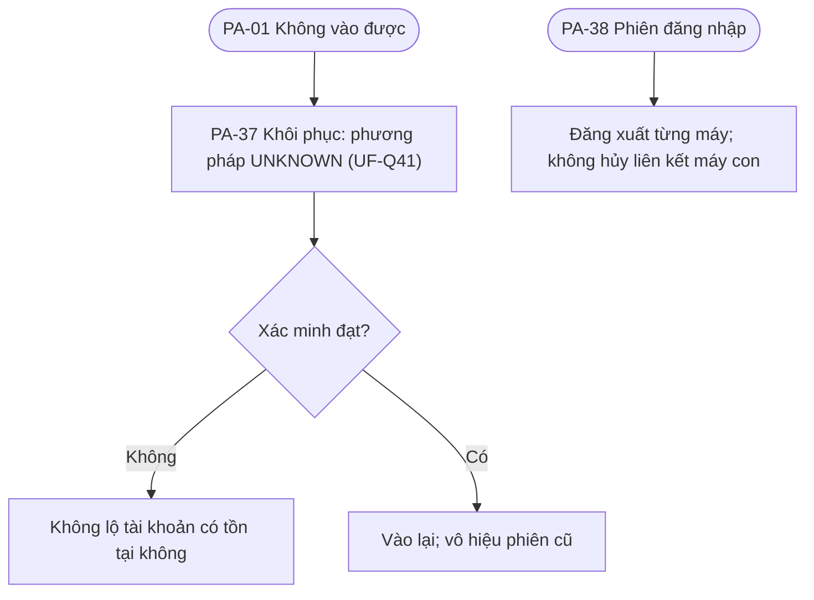

**Màn hình:** PA-37 **mới** (Khôi phục tài khoản), PA-38 **mới** (Phiên đăng nhập và thiết bị).

---

## 13. Khung các luồng nấc 2 và ngoài A-lite

Chỉ ghi mục tiêu, bước chính, ràng buộc chặn. Không đánh số màn hình; sẽ đánh số khi Owner đưa vào phạm vi.

| Mã | Luồng | Nhóm | Bước chính | L3 | Ràng buộc chặn / còn mở |
|---|---|---|---|---|---|
| K1 | Pal đồng hành phụ huynh: hỏi đáp có nguồn, nhập lịch bằng lời | Nấc 2 (W2, UC-017) | PA-22 → lớp an toàn → ẩn danh → tìm kho chuẩn → trả lời có nguồn; ngoài kho chỉ tra ngoài cho câu hỏi giáo dục, kèm nhãn "chưa kiểm chứng" và hàng đợi (D-05, OD-05b); đầu ra kiểm trước khi phát (OD-05a) | F07-G03-M01/M02 (entry), F03-G05 (outcome) theo OD-A6 (b); F07-G01, F07-G04, F07-G05-M01 | Kho tri thức chưa có mục đã duyệt (06 §5; WF dòng 79); OD-05a; cảm xúc phụ huynh mặc định riêng (CLAUDE); không gợi ý trả phí khi phụ huynh buồn (CLAUDE) |
| K2 | Con trò chuyện với Pal, nhờ Pal giúp đề xuất đổi lịch | Nấc 2 / W3 (UC-011, UC-012) | CA chat → lớp an toàn (trẻ: OD-03a) → ẩn danh → Pal lắng nghe, giúp diễn đạt; ý định đổi lịch chuyển thành CR/mong muốn, F04-G06 sở hữu kết quả; Pal không duyệt, không ghi | F05-G01-M01/M02, F04-G06-M01, F07-G03 | **Cổng FR-03 chặn thật** (WF dòng 70); B01C-OD-08 (kênh mong muốn qua F05) |
| K3 | Nhật ký riêng của con, insight riêng | W3 (UC-013, UC-014) | Tạo, xem, xóa; chia sẻ từng mục khi con cho phép; dừng chia sẻ thì chặn ngay; xóa: ẩn ngay, xóa hẳn sau 60 ngày | F05-G04, F05-G05, F05-G06-M01/M02, F07-G06-M02 | B01-CL-OD-04, B01C-OD-02 (con chọn có báo không, mặc định không báo); PA-OD-03; cổng H4; giọng nói không lưu mặc định (PkE-V) |
| K4 | Vùng GPS Nhà, Trường, nơi học thêm | Nấc 2 (Plan A tính năng 2, UC-021 thiết bị) | Phụ huynh bật vùng → xin quyền vị trí nền (PA §7) → chỉ lưu sự kiện vào/ra → lệch mốc thì báo bố mẹ | F08-G04-M01/M02, F01-G04-M02, F06-G01-M01, F04-G07-M01 (OD-A3 (a)) | Purpose catalog chưa có mục vị trí (CRG C-08, cổng B-4); báo lệch mốc có thuộc "luồng an toàn" không còn mở (CRG C-15); con cần được biết (suy từ D-03, CA-16) |
| K5 | Chụp ảnh bài làm, ghi âm, Pal nhận xét | Nấc 2 (Plan A tính năng 3, 4) | 📷/🎤 ở CA-04 → lưu có hạn → (tùy chọn) Pal nhận xét | F04-G05-M02, F06-G07-M01, F07-G03-M03 | AI chấm chỉ pilot có benchmark (CRG CP-06-6); không đưa đáp án trong luồng gợi ý, không tự tạo `PARENT_CONFIRMED` (AA-OD-01..03); ghi âm là Journal hay không còn mở (CRG C-12); hạn xóa 30 ngày của PA là `đề xuất nội bộ` |
| K6 | Mục tiêu phát triển và xem lại mục tiêu | Ngoài A-lite (tùy chọn theo OD-A1) | Phụ huynh đặt mục tiêu ngắn → gắn vào lịch; buổi xem lại mục tiêu theo kỳ → đề nghị sửa qua F03-G06 | F03-G04-M01, F03-G06, F06-G06-M01/M02 | OD-A1 (a): tùy chọn; FI-3.4-004 (F03-G06 và F06-G06 chồng nhau); AI không tự khởi tạo mục tiêu (03.4 §6.4) |
| K7 | Gói và quyền lợi | Ngoài A-lite (UC-023) | Xem gói → đổi gói → quyền lợi đổi | F01-G06-M02/M03, F07-G07-M02 | Chưa chốt giá (PkD-P1); người trả tiền không có quyền dữ liệu, quota không chặn an toàn, hạ gói không xóa tiến độ (PkD-P2) |
| K8 | Con xem và đề nghị sửa nhận định về mình | Ngoài A-lite (UC-004) | Con xem hồ sơ hiểu con → đề nghị sửa → người có quyền xem xét | F02-G05-M01/M02 | Tách với insight riêng của F05 (FI-3.4-002); MR-015, MR-019 |

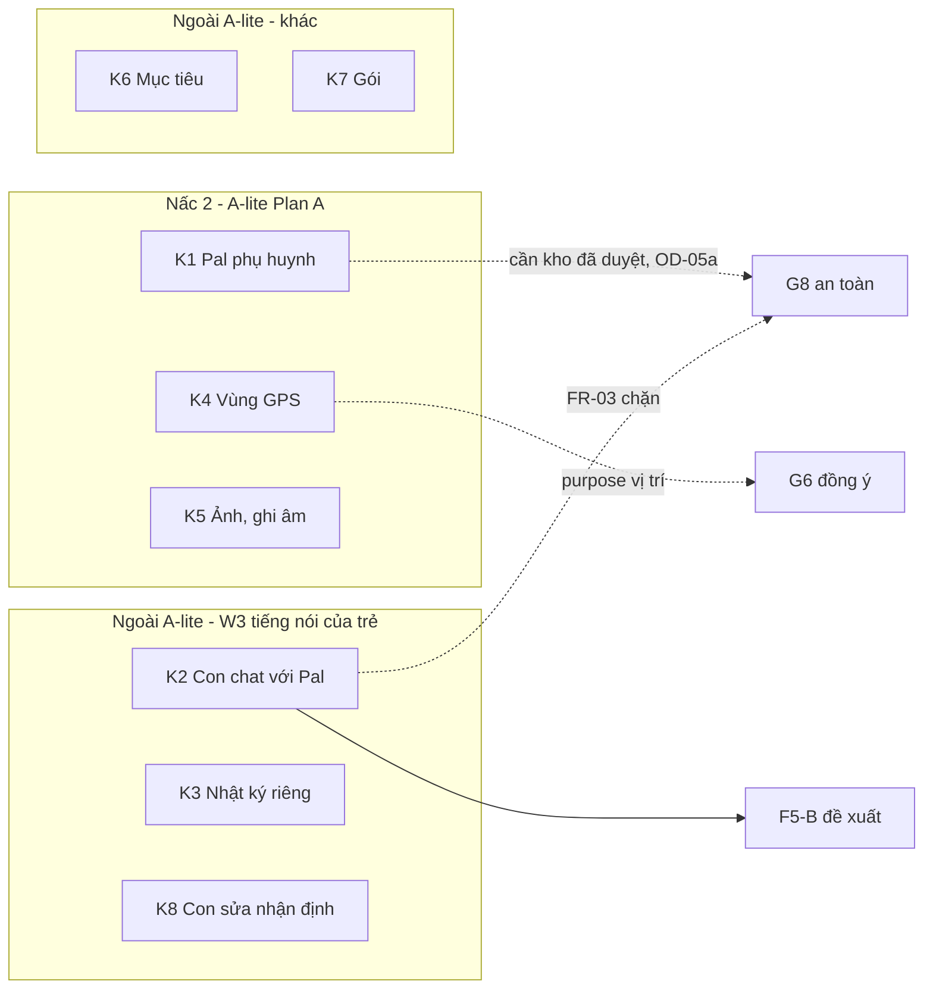

---

## 14. Danh mục màn hình tổng

### 14.1 Parent App

| Mã | Tên màn | Đợt | Luồng | Phạm vi |
|---|---|---|---|---|
| PA-01 … PA-24 | (xem 04.1 §7.1) | 1 | F1–F5 | 23 E1, PA-22 nấc 2 |
| PA-25 | Lịch sử thay đổi lịch | 2 | G1, G7 | E1 |
| PA-26 | Khóa / mở khóa lịch | 2 | G2 | E1 (UF-Q27) |
| PA-27 | Cài đặt thông báo | 2 | G3 | E1 |
| PA-28 | Thành viên gia đình | 2 | G4 | Chờ Owner (UF-Q26) |
| PA-29 | Mời thành viên | 2 | G4 | Chờ Owner (UF-Q26) |
| PA-30 | Chuyển người quản lý chính | 2 | G4 | Chờ Owner (UF-Q26) |
| PA-31 | Nhận lời mời / nhận vai trò | 2 | G4 | Chờ Owner (UF-Q26) |
| PA-32 | Quyền riêng tư và đồng ý | 2 | G6 | E1 |
| PA-33 | Dữ liệu của gia đình (xem, sửa, xóa) | 2 | G7 | E1 (xóa hẳn chặn H4) |
| PA-34 | Xuất dữ liệu | 2 | G7 | E1 (chặn H4) |
| PA-35 | Xóa tài khoản và dữ liệu | 2 | G9 | E1 (xóa hẳn chặn H4) |
| PA-36 | Xác nhận xóa / rời | 2 | G9 | E1 |
| PA-37 | Khôi phục tài khoản | 2 | G10 | E1 (pilot gia đình thật) |
| PA-38 | Phiên đăng nhập và thiết bị | 2 | G10 | E1 |

### 14.2 Child App

| Mã | Tên màn | Đợt | Luồng | Phạm vi |
|---|---|---|---|---|
| CA-01 … CA-15, CA-09b | (xem 04.1 §7.2) | 1 | F3–F5 | 15 E1, CA-14 nấc 2 (UF-Q37) |
| CA-16 | Những gì bố mẹ thấy | 2 | G6 (D-03) | E1 |
| CA-17 | Máy không còn kết nối với gia đình | 2 | G9 | E1 |

### 14.3 Đếm

| Nhóm | Đợt 1 | Đợt 2 mới | Tổng |
|---|---|---|---|
| Parent App | 24 | 14 (PA-25..PA-38) | **38** |
| Child App | 16 | 2 (CA-16, CA-17) | **18** |
| **Cộng** | 40 | 16 | **56** |

Trong 56 màn: 2 màn nấc 2 (PA-22, CA-14; CA-14 thành E1 nếu Owner chọn UF-Q37); 4 màn chờ Owner về phạm vi (PA-28..PA-31, UF-Q26). Chưa gồm màn hướng dẫn tối ưu pin, màn Phòng thử của Plan A, và màn của khung K1–K8.

---

## 15. Câu hỏi mở UF-Q14 trở đi

UF-Q14..UF-Q25 phát sinh khi cập nhật đợt 1 (chi tiết ở 04.1 §8.2), nhắc lại ở đây để có một danh sách. Cột **Đề xuất** là gợi ý của AI để chủ sản phẩm chọn, không phải quyết định.

| Mã | Câu hỏi | Luồng | Nhánh đang vẽ (fail-closed) | Đề xuất |
|---|---|---|---|---|
| UF-Q14 | D-02 có áp cho ô Ngủ **cam** (thiếu ≤30′) không? | F2 | Cảnh báo; lịch vẫn xếp đủ mức tối thiểu | Giữ như đang vẽ; sửa câu D-02 thành "lịch có hiệu lực không xếp ngủ dưới mức tối thiểu" |
| UF-Q15 | A-lite E1: Child App không có ô chữ tự do? | F4, F5-B | Không có | Đồng ý (tránh FR-03, khớp SG-10) |
| UF-Q16 | Trường sức khỏe khi chưa có purpose ID | F1, G7 | Ẩn khi dùng dữ liệu thật | Đồng ý; bổ sung purpose vào danh mục trước pilot |
| UF-Q17 | Dùng chung máy phụ huynh làm máy con? | F3 | Không | Đồng ý (giữ ranh giới quyền) |
| UF-Q18 | Phụ huynh có xem lựa chọn hỏi thăm từng ngày không? | F4, G1 | Không, chỉ xu hướng | **Đã quyết: không** (D-38) |
| UF-Q19 | "Rất mệt" ở `CHILD_DIRECTED` mở CR hay cho sửa trong phạm vi? | F4 | Mở CR | Mở CR (đúng chữ D-10) |
| UF-Q20 | Ngưỡng số ngày mệt trong 2 tuần để báo | F4, G1 | `UNKNOWN` → không báo | **Đã quyết:** không cần ngưỡng; tổng hợp trong báo cáo tuần, theo loại ngày, hiện từ 1 lần (D-21, D-37) |
| UF-Q21 | Khôi phục tự động khi hết giai đoạn: ngoại tuyến, `LOCK` | F5-A, G2 | Quy tắc tạm ngừng đúng ngày; khôi phục không bị khóa chặn | Đồng ý; ghi vào Business Logic |
| UF-Q22 | Báo xu hướng mệt trong giai đoạn tạm thời? | F5-A | Có | Có (tín hiệu mới, TAB §1.5) |
| UF-Q23 | A-lite E1 có bật `CHILD_DIRECTED`? | F5-B, G5 | Ẩn | Ẩn trong E1, ghi rõ cho người dùng (CRG C-01 phương án 1) |
| UF-Q24 | Module chủ của mong muốn có cấu trúc ở E1 (B01C-OD-08 giao F05 AI) | F5-B | Chưa gán | Tạm giao F04-G06-M01 phần nhận, ghi thành change request L3 |
| UF-Q25 | CR đổi lịch "hôm nay" chưa duyệt trong ngày | F5-B | Chờ tới 7 ngày | Tự hết hạn cuối ngày đó cho CR chỉ áp một ngày |
| UF-Q26 | Mời, gỡ thành viên (F01-G02-M02) có vào A-lite E1 không? | G4 | Vẽ đủ, phạm vi chờ | Có, ở mức tối thiểu, vì D-07 và nhu cầu hai bố mẹ cần nó; nếu không, ghi rõ pilot chỉ một người lớn |
| UF-Q27 | Khóa lịch có vào A-lite E1 không? | G2 | Có, khóa thủ công đơn giản | Có; bỏ phần "lock precedence" phức tạp, giữ quy tắc đã duyệt |
| UF-Q28 | Tần suất nhắc xem lại khóa (B01C-OD-05) | G2, G3 | `UNKNOWN` | Owner chọn số tạm, gắn nhãn chưa kiểm chứng |
| UF-Q29 | Khi Primary không còn hoạt động: khôi phục quyền thế nào; báo con khi đổi Primary? | G4, G10 | Chặn sửa kế hoạch, không ai tự nâng quyền; báo con | Quy trình hỗ trợ thủ công có xác minh; báo con bằng câu ngắn |
| UF-Q30 | Sau đổi Primary, quyền xem của người lớn khác có chuyển `REVIEW_REQUIRED` (P6-AP-OD-02) không? Supporter có thấy xu hướng mệt không? | G4, G1 | Có `REVIEW_REQUIRED`; không thấy xu hướng nếu chưa được cấp | Đồng ý (D-07 chỉ loại trừ quyền của trẻ) |
| UF-Q31 | Báo con khi đổi mode? Luồng con xin đổi mode (F01-G05-M02) có cần cho E1? | G5 | Báo con; không có luồng con xin | Báo con; để F01-G05-M02 sau E1 |
| UF-Q32 | Ai đặt giờ yên lặng cho máy con? | G3 | Phụ huynh; con tắt được lời mời hỏi thăm | Đồng ý |
| UF-Q33 | Chưa đồng ý phiên bản mới, hoặc đã rút đồng ý: vòng lập lịch còn chạy phần nào? Kênh nhận phản đối pháp lý của chủ thể khác? | G6 | Lịch chỉ xem, máy con ngừng nhận mới, không tự xóa | Cần ý kiến pháp lý (MR-016/017); giữ nhánh đang vẽ tới khi có |
| UF-Q34 | Hạn xóa hẳn cho dữ liệu ngoài Journal | G7, G9 | Ẩn ngay; không hứa xóa hết | Chờ kết quả H4; không chạy dữ liệu thật trước đó (trừ D-01) |
| UF-Q35 | Con có được yêu cầu xóa dữ liệu hỏi thăm của mình? | G7 | `UNKNOWN`, chưa có nút | Có (dữ liệu do con tạo); cần quyết định |
| UF-Q36 | Có cho xóa từng dòng lịch sử thay đổi? | G7 | Không; xóa cùng hồ sơ con | Đồng ý (cần cho audit CR) |
| UF-Q37 | Nút tĩnh "Con cần giúp đỡ" ở Child App E1, không ghi, không báo | G8 | Có (đề xuất) | Có; nhờ chuyên gia duyệt câu chữ (cổng B-6) |
| UF-Q38 | Bộ kiểm từ khóa [E1] trên ô chữ tự do của phụ huynh: danh sách, có đo đếm không | G8, 04.1 §0.6 | Có kiểm; không ghi nhãn hồ sơ | Danh sách ngắn do chuyên gia duyệt; chỉ đếm tổng hợp |
| UF-Q39 | Có thời gian chờ để hoàn tác khi xóa tài khoản? | G9 | `UNKNOWN` | Có khoảng chờ ngắn, nhưng phải ≤ hạn pháp lý (REM-LB) |
| UF-Q40 | Primary xóa gia đình hoặc rời khi còn người lớn khác | G4, G9 | Rời: phải chuyển trước; xóa: báo trước, thu hồi quyền | Bắt buộc đề nghị chuyển Primary trước khi cho xóa |
| UF-Q41 | Phương pháp khôi phục tài khoản | G10 | `UNKNOWN` | Giao System Design; chọn trước pilot gia đình thật |
| UF-Q42 | Nội dung CA-16 và sự đồng thuận của trẻ theo tuổi | G6 | Màn giải thích, không chặn dùng | Duyệt câu chữ với chuyên gia; MR-017 |
| UF-Q43 | Ai được xuất dữ liệu của con; định dạng; hạn tải | G7 | Chỉ Primary; `UNKNOWN` | Chỉ Primary, định dạng đọc được (ví dụ bảng); chờ H4 |

---

## 16. Blocker

**Không có mâu thuẫn chặn hẳn việc vẽ** trong đợt 2. Mọi chỗ thiếu hay mâu thuẫn đều vẽ được nhánh mặc định an toàn (§15).

Cổng chặn **dùng dữ liệu thật** (không chặn vẽ, không được coi là đạt):

| Cổng (CRG §6) | Luồng bị ảnh hưởng |
|---|---|
| B-1 Căn cứ pháp lý xử lý dữ liệu trẻ (MR-016) | Mọi luồng với dữ liệu thật, trừ ngoại lệ có giới hạn D-01 |
| B-2 H4 thời hạn xóa | G7 (xóa hẳn, xuất), G9, K3 |
| B-3 FR-03 | G8 nấc 2, K2 |
| B-4 Purpose catalog (sức khỏe, vị trí) | F1 trường sức khỏe, K4 |
| B-6 Thẩm định số khẩn và Bar mặc định | G8, F2 |
| B-7 Bốn L3 nền chưa kiểm độc lập (F01-G04-M01, F01-G04-M02, F01-G05-M01, F07-G06-M01) | G4, G5, G6, G7 dựa trên các module này |

---

## 17. Tự kiểm

- Không tạo Feature ID mới: mọi ID đối chiếu với 03.2. Hai module được dùng mà nằm ngoài A-lite v2 (F01-G02-M02, F01-G05-M02) được ghi rõ và đưa vào UF-Q26, UF-Q31.
- Không thêm ngưỡng: các con số (7 ngày, 60 ngày, 2 tuần) dẫn nguồn; chỗ thiếu ghi `UNKNOWN`.
- Không quyết thay Owner; không chọn MVP; không đánh dấu cổng pháp lý PASS.
- Ví dụ dùng tên giả. Không dùng dữ liệu trẻ thật.
- Không sửa nguồn chuẩn; chỉ soạn bản nháp.

*người soạn: AI, chưa kiểm chứng độc lập; trạng thái: nháp chờ duyệt.*
