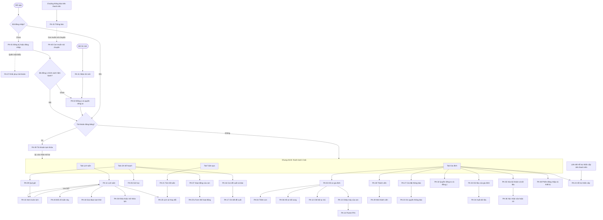
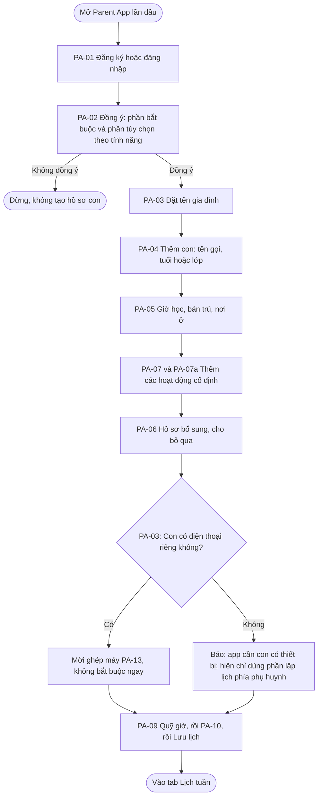
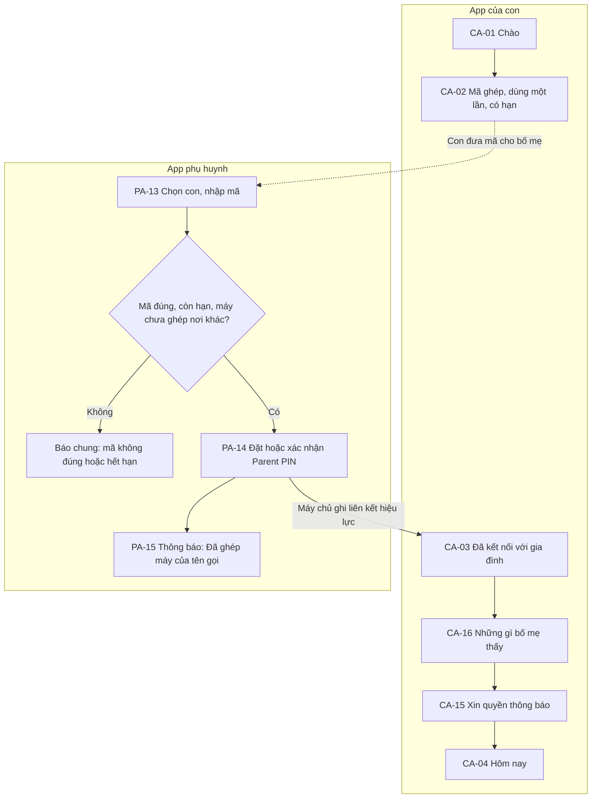
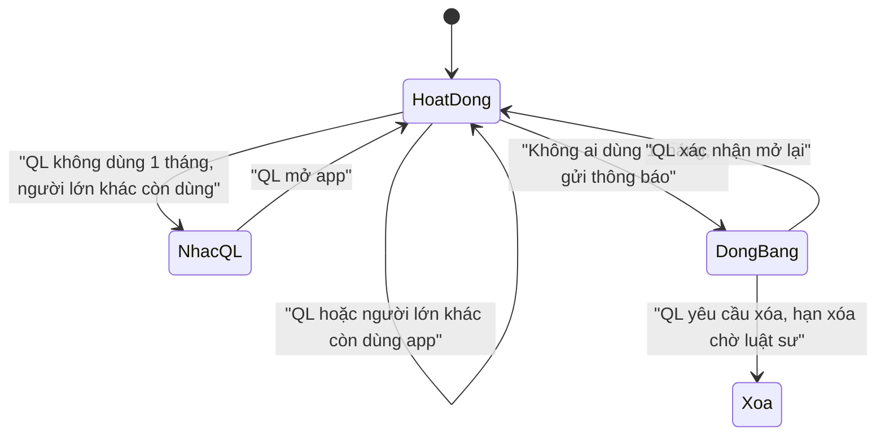
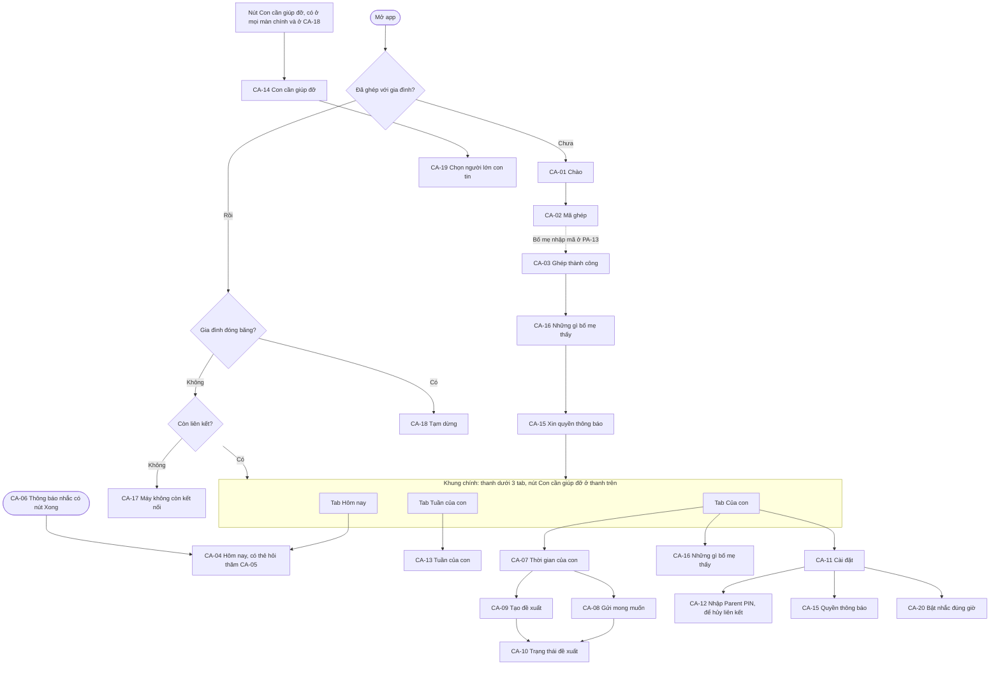
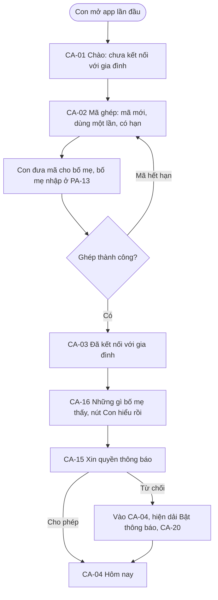

# IA 06.1 – Kiến trúc thông tin của nấc 1 (A-lite E1): App phụ huynh và App của con

> **Cập nhật lượt 3 (15/11/2026):** áp D-33..D-46 (sổ quyết định mục 7). Đáng chú ý: người lớn thứ hai chỉ xem (D-35); khóa lịch có trong nấc 1 (D-36); trạng thái đóng băng của app con theo D-41; màn "Con cần giúp đỡ" chỉ có lời tĩnh và 111 trong đợt thử (D-43); màn chuyển người quản lý chính hoãn (D-34).

**Bước:** Product Blueprint, sau Bước 4 (User Flow), trước thiết kế giao diện
**Người soạn:** AI, chưa kiểm chứng độc lập · **Trạng thái:** nháp chờ duyệt · **Bản:** 15/11/2026
**Đi kèm:** `MVP_Step1_Module_List.md` (cùng thư mục; mã `MQ-xx` ở dưới là câu hỏi mở của file đó)
**Không thuộc phạm vi:** màu, bố cục điểm ảnh, hình ảnh, phông chữ, chọn công nghệ, API, mô hình dữ liệu. Không tạo Feature ID mới. Không đánh PASS cổng pháp lý. Không quyết thay chủ sản phẩm: chỗ nguồn thiếu hoặc mâu thuẫn thì chọn nhánh an toàn (fail-closed), gắn nhãn, đưa vào mục 8.

---

## 0. Tóm tắt và cách đọc

**Hai app.** App phụ huynh (Parent App) và App của con (Child App), cài trên hai máy khác nhau. Con phải có máy riêng (D-11). Gia đình không có máy cho con chỉ dùng phần lập lịch phía phụ huynh.

**Nguồn.** 56 màn hình ở `app-design-document/04_User_Flow/User_Flow_04_1_Scheduling_Loop.md` §7 (40 màn: PA-01..PA-24, CA-01..CA-15, CA-09b) và `User_Flow_04_2_Remaining_Flows.md` §14 (16 màn: PA-25..PA-38, CA-16, CA-17). Quyết định bản mới nhất: `app-design-document/progress/Owner_Decision_Log_20261115.md` (ODL, nhánh pr26, có D-31, D-32), thắng nguồn cũ khi khác.

**Kết quả.**

| Hạng mục | Parent App | Child App | Tổng |
|---|---|---|---|
| Màn trong User Flow (56) | 38 | 18 | 56 |
| Hoãn hoặc bỏ khỏi nấc 1 | 2 (PA-22, PA-30) | 1 (CA-09b) | 3 |
| Còn lại từ User Flow | 36 | 17 | 53 |
| Màn MỚI do IA bổ sung (chờ duyệt) | 2 (PA-39, PA-40) | 3 (CA-18, CA-19, CA-20) | 5 |
| **Màn nấc 1 trong tài liệu này** | **38** | **20** | **58** |

Trong 58 màn có 2 màn giữ có điều kiện (PA-26 khóa lịch, PA-34 xuất dữ liệu) và 1 điểm vào không phải màn trong app (CA-06, thông báo của hệ điều hành). Chi tiết ở mục 1.

**Năm điều IA khác với nguồn hoặc bổ sung nguồn** (đọc trước):
1. D-26/D-30 (nút "Con cần giúp đỡ", gửi "Con cần nói chuyện" cho người lớn con chọn) và D-27 (đóng băng tài khoản) chưa có màn trong User Flow. IA bổ sung 5 màn mới (mục 1.3).
2. D-28 (rút đồng ý từng phần) thay nhánh "lịch chỉ xem" của UF-Q33 khi rút một phần. PA-32 có công tắc theo từng tính năng (mục 3.5, 5).
3. D-21 (mệt chỉ tổng hợp trong báo cáo tuần, không ngưỡng) làm PA-21 là nơi **duy nhất** phụ huynh thấy xu hướng mệt; không còn thông báo lẻ.
4. D-19 (ẩn `CHILD_DIRECTED`): CA-09b không có; PA-12 chỉ có hai chế độ.
5. D-22 (mời, gỡ thành viên mức tối thiểu): PA-28, PA-29, PA-31 vào nấc 1; chuyển người quản lý chính (PA-30) hoãn (MQ-04).

**Ký hiệu.** `QL` = người quản lý chính (Primary Caregiver). `NL` = người lớn khác (người lớn được mời, vai Supporter hoặc Observer). `Con` = trẻ lớp 1–9 dùng Child App. `[MỚI]` = màn hoặc thành phần do IA bổ sung, chờ duyệt. `[ĐỀ XUẤT]` = AI đề xuất. `UNKNOWN` = nguồn không có. `F1..F5` = luồng 04.1; `G1..G10` = luồng 04.2.

---

## 1. Phạm vi màn hình nấc 1

### 1.1 Parent App

| Mã | Tên màn (theo User Flow) | Quyết định nấc 1 | Lý do, nguồn |
|---|---|---|---|
| PA-01 | Chào mừng / Đăng ký – Đăng nhập | Giữ | Tài khoản FR-01 là bắt buộc trước thử với gia đình thật (D-18, OD-A8) |
| PA-02 | Đồng ý và quyền riêng tư | Giữ, mở rộng | Thêm đồng ý theo từng tính năng (D-28) |
| PA-03 | Hồ sơ gia đình | Giữ | Thêm câu hỏi "Con có điện thoại riêng không?" (D-11) |
| PA-04 | Thêm con – cơ bản | Giữ | |
| PA-05 | Giờ học và thời khóa biểu | Giữ | Điểm bắt đầu (OD-A1 a) |
| PA-06 | Hồ sơ bổ sung (tùy chọn) | Giữ | Mục tiêu là trường tùy chọn; ẩn trường sức khỏe khi dùng dữ liệu thật (UF-Q16) |
| PA-07 | Hoạt động của con | Giữ | |
| PA-07a | Form thẻ hoạt động | Giữ (form con của PA-07, không tính màn) | |
| PA-08 | Chọn con | Giữ (bộ chọn dùng chung) | "Có nhiều con mà không nêu tên thì hỏi lại, không đoán" (CLAUDE.md) |
| PA-09 | Lên kế hoạch – Quỹ giờ | Giữ | Ô Ngủ không có "Giữ mức này" (D-02) |
| PA-10 | Xem trước lịch tuần / kết quả kiểm | Giữ | Thêm câu hỏi một lần "bớt học ở nhà?" (D-23) |
| PA-11 | Lịch tuần | Giữ | |
| PA-12 | Chế độ tự chủ của con | Giữ, chỉ 2 chế độ | `CHILD_DIRECTED` ẩn (D-19) |
| PA-13 | Ghép máy của con | Giữ | |
| PA-14 | Parent PIN | Giữ | Chi tiết chờ System Design (FR-01) |
| PA-15 | Thông báo | Giữ | |
| PA-16 | Hàng chờ "Con đề xuất và báo" | Giữ | Nhận mong muốn (mẫu cố định, D-20) và đề xuất. Báo đói là nấc 2 |
| PA-17 | Chi tiết đề xuất / Change Request | Giữ | Chỉ cho con ở `CHILD_EXECUTED` |
| PA-18 | Giai đoạn tạm thời – tạo, sửa | Giữ | Tối đa 60 ngày (D-09) |
| PA-19 | Giai đoạn đã kết thúc | Giữ (trạng thái của thẻ trên PA-11) | D-09, D-24 |
| PA-20 | Đổi chỉ tuần này | Giữ | |
| PA-21 | Tóm tắt tuần | Giữ | Nơi duy nhất báo xu hướng mệt (D-21) |
| PA-22 | Trò chuyện với Pal | **Hoãn (nấc 2)** | OD-A2 (c), OD-A6 (b) |
| PA-23 | Xin quyền thông báo | Giữ | |
| PA-24 | Thông tin hỗ trợ khẩn cấp cho người lớn | Giữ | D-06; nội dung tĩnh, dùng được khi ngoại tuyến |
| PA-25 | Lịch sử thay đổi lịch | Giữ có điều kiện | Cần module `F04-G06-M02` (MQ-01) |
| PA-26 | Khóa / mở khóa lịch | Giữ có điều kiện | UF-Q27: khóa thủ công đơn giản; chưa chủ sản phẩm xác nhận |
| PA-27 | Cài đặt thông báo | Giữ | |
| PA-28 | Thành viên gia đình | Giữ | D-22 |
| PA-29 | Mời thành viên | Giữ | D-22 |
| PA-30 | Chuyển người quản lý chính | **Hoãn (mặc định)** | Xác minh người mới `UNKNOWN` (LQ-02, LQ-03); MQ-04 |
| PA-31 | Nhận lời mời / nhận vai trò | Giữ | D-22. Chỉ nhận vai người lớn khác (không nhận quyền quản lý chính) |
| PA-32 | Quyền riêng tư và đồng ý | Giữ, mở rộng | D-28 |
| PA-33 | Dữ liệu của gia đình (xem, sửa, xóa) | Giữ | Xóa hẳn chặn H4 với dữ liệu thật |
| PA-34 | Xuất dữ liệu | Giữ có điều kiện | Chặn H4 với dữ liệu thật; trong thử D-01 thực hiện thủ công theo runbook |
| PA-35 | Xóa tài khoản và dữ liệu | Giữ | |
| PA-36 | Xác nhận xóa / rời | Giữ | |
| PA-37 | Khôi phục tài khoản | Giữ | Phương pháp khôi phục `UNKNOWN` (UF-Q41) |
| PA-38 | Phiên đăng nhập và thiết bị | Giữ | |

### 1.2 Child App

| Mã | Tên màn | Quyết định nấc 1 | Lý do, nguồn |
|---|---|---|---|
| CA-01 | Chào / chưa ghép | Giữ | |
| CA-02 | Mã ghép | Giữ | Mã một lần, có hạn; hạn `UNKNOWN` |
| CA-03 | Ghép thành công | Giữ | |
| CA-04 | Hôm nay | Giữ, một phần | Chỉ "Xong" và "Hoàn tác". Ảnh, giọng nói, báo đói, thời tiết là nấc 2 |
| CA-05 | Hỏi thăm sau giờ học | Giữ (thẻ nằm trong CA-04) | Tùy chọn, tắt được; D-03, D-10, D-21 |
| CA-06 | Thông báo nhắc của hệ điều hành, có nút "Xong" | Giữ, là điểm vào chứ không phải màn trong app | |
| CA-07 | Thời gian của con (quỹ, chỉ xem) | Giữ | |
| CA-08 | Gửi mong muốn | Giữ | `PARENT_LED` / `UNSET`; chỉ lựa chọn có sẵn (D-20) |
| CA-09 | Tạo đề xuất | Giữ | Chỉ `CHILD_EXECUTED` |
| CA-09b | Sửa lịch trong phạm vi | **Hoãn (ẩn)** | `CHILD_DIRECTED` ẩn (D-19) |
| CA-10 | Trạng thái đề xuất | Giữ | |
| CA-11 | Cài đặt | Giữ | |
| CA-12 | Nhập Parent PIN | Giữ | |
| CA-13 | Tuần của con | Giữ | |
| CA-14 | Con cần giúp đỡ (lời an toàn cho trẻ) | **Giữ, chuyển từ nấc 2 sang nấc 1** | D-26, D-30, D-06, UF-Q37 |
| CA-15 | Xin quyền thông báo | Giữ | |
| CA-16 | Những gì bố mẹ thấy | Giữ | D-03; chứng minh "trẻ được biết" |
| CA-17 | Máy không còn kết nối với gia đình | Giữ | |

### 1.3 Màn MỚI do IA bổ sung (chờ chủ sản phẩm duyệt)

Các màn này **không** có trong User Flow. Chúng xuất phát từ quyết định 15/11 chưa kịp vào User Flow. Cần cập nhật User Flow nếu được duyệt (đề xuất: đợt User Flow tiếp theo).

| Mã | Tên | Xuất phát từ | Vì sao cần |
|---|---|---|---|
| PA-39 | Tài khoản đang tạm khóa (đóng băng) | D-27 | Người quản lý chính phải xác nhận mở lại |
| PA-40 | Con muốn nói chuyện (màn của người lớn nhận) | D-26, D-30 | Người lớn con chọn nhận thông báo cần một màn đón, kèm gợi ý ngắn. Mọi nội dung do chuyên gia duyệt (MQ-09) |
| CA-18 | Tạm dừng (đóng băng) | D-27 | Con cần biết vì sao không thấy lịch; vẫn có nút giúp đỡ |
| CA-19 | Chọn người lớn con tin | D-26, D-30 | Bước chọn người nhận "Con cần nói chuyện" và màn xác nhận đã gửi (MQ-03) |
| CA-20 | Bật nhắc đúng giờ | UF 04.1 §7.2 ghi chú ("màn hướng dẫn tắt tối ưu pin"), F4-X1..X3 | Nhắc sai giờ là rủi ro chính của nấc 1 (nhắc lệch +45 giây trong test Plan A, MVP §1.1) |

Thành phần mới (không phải màn): câu hỏi một lần "bớt học ở nhà?" trong PA-10 (D-23); công tắc theo tính năng trong PA-32 (D-28); dòng nhắc "Cần hỗ trợ khẩn cấp?" dưới các ô chữ tự do của phụ huynh (thay cho dò từ khóa, MQ-02).

### 1.4 Màn hoãn hoặc bỏ

| Màn | Tình trạng | Khi nào xem lại |
|---|---|---|
| PA-22 Trò chuyện với Pal | Hoãn | Nấc 2 (chưa có lịch; Plan A dừng, D-31) |
| PA-30 Chuyển người quản lý chính | Hoãn (mặc định) | Khi chủ sản phẩm duyệt MQ-04 |
| CA-09b Sửa lịch trong phạm vi | Hoãn (ẩn) | Khi bật `CHILD_DIRECTED` |
| Màn của khung K1..K8 (UF2 §13) | Ngoài nấc 1 | Chưa đánh số |
| Phòng thử của Plan A | Bỏ | Chỉ cho spike; Plan A dừng (D-31) |

---

## 2. Vai trò, quyền và nguyên tắc IA

### 2.1 Vai trò

| Vai | Tên trên giao diện (đề xuất) | Ai | Ghi chú |
|---|---|---|---|
| QL | Người quản lý chính | Người lớn tạo gia đình | Mọi commit về lịch, chế độ, đồng ý, xóa. Chỉ có một người hiệu lực (P6-AP-OD-01). Không đọc tin an toàn chỉ vì vai trò (CRG AP-OD-02) |
| NL | Người lớn khác (vai "Người hỗ trợ" hoặc "Người xem") | Người lớn được QL mời | Chỉ xem phần được cấp; không duyệt đề xuất (CR-OD-03); không thấy xu hướng mệt nếu chưa được cấp (UF-Q30). Nguồn không nêu khác biệt quyền giữa Supporter và Observer ngoài "không duyệt", nên IA dùng một nhóm NL với phạm vi được cấp; xem IA-Q11 |
| Con | Con | Trẻ lớp 1–9 có máy Android riêng, đã ghép | Tự làm việc đã duyệt, báo Xong, hỏi thăm, gửi mong muốn. Quyền sửa lịch phụ thuộc chế độ (xem 2.2) |

### 2.2 Chế độ tự chủ trong nấc 1

| Chế độ (tên trong nguồn) | Tên trên giao diện (đề xuất) | Con làm được gì với lịch | Hiện trong nấc 1 |
|---|---|---|---|
| `UNSET` (mặc định, như `PARENT_LED`) | "Bố mẹ sắp lịch" | Chỉ gửi mong muốn (mẫu cố định). Không tạo Change Request | Có (mặc định) |
| `PARENT_LED` | "Bố mẹ sắp lịch" | như trên | Có |
| `CHILD_EXECUTED` | "Con đề xuất, bố mẹ duyệt" | Tạo đề xuất; hết hạn sau 7 ngày | Có |
| `CHILD_DIRECTED` | — | Tự sửa trong phạm vi được ủy quyền | **Ẩn** (D-19) |

Mọi chế độ: con vẫn tự làm việc đã duyệt, báo Xong, trả lời hỏi thăm (B01-MS-OD-02).

### 2.3 Nguyên tắc IA (rút từ bất biến 04.1 §0.6 và quyết định 15/11)

1. **Không popup cho cảnh báo.** Cảnh báo là một dòng chữ có biểu tượng, nằm ngay dưới ô nhập, ghi số hiện tại, mốc và nguồn (04.1 §0.6 mục 3). Màu chỉ hiện ở bảng quỹ giờ (PA-09); lịch chi tiết không có màu (QT D6).
2. **Một cảnh báo, một lần.** Đã xác nhận thì không nhắc lại. Tín hiệu mới từ con không tính là nhắc lại.
3. **Luôn có tên gọi của con** trên mọi màn và mọi thông báo liên quan đến con. Nhiều con: chọn con rồi mới thao tác (PA-08).
4. **Hai phạm vi.** Riêng (chỉ người tạo thấy) và Cả nhà (người lớn có quyền thấy). Mặc định: lựa chọn hỏi thăm của con là Riêng; phụ huynh chỉ thấy tổng hợp (D-03, D-21).
5. **Minh bạch.** Mọi thứ app lưu về con, phụ huynh xem được, sửa được, xóa (ẩn) được ở PA-33. Trẻ biết bố mẹ thấy gì (CA-16).
6. **Không điểm, không xếp hạng, không so sánh trẻ với trẻ khác.** "Chưa ghi nhận" khác "không làm".
7. **Hỗ trợ khẩn cấp luôn một chạm, không cần mạng, không cần đăng nhập** [ĐỀ XUẤT]. Nội dung tách theo người nhận: người lớn thấy 115, 113, 111; trẻ thấy lời "Con hãy nói với một người lớn con tin cậy", có thể kèm 111, **không** thấy 113, 115 (D-06, OD-03).
8. **Nhãn "chưa kiểm chứng"** hiện trên mọi con số mặc định và lịch dựa trên thông số mặc định; không dùng chữ "cân bằng", "đạt", "hợp lệ" cho màu xanh khi ngưỡng là [MĐ] (D-08, D-25; spike B-10).
9. **Không gì tự đổi lịch có hiệu lực** ngoài thao tác commit của người có quyền. Ngoại lệ duy nhất đã quyết: giai đoạn tạm thời hết hạn thì tự về lịch chuẩn mới nhất (D-09, D-24).
10. **Fail-closed.** Thiếu quyền, mất mạng, trạng thái không rõ: không cho thao tác thay đổi dữ liệu; chỉ cho xem và cho thông tin an toàn.
11. **Câu chữ cố định, không AI.** Lời của app là câu mẫu theo quy tắc Pal (xưng "mình", tối đa 3 câu ngắn, tối đa 1 câu hỏi mỗi lượt). Không chẩn đoán, không gắn nhãn tính cách, không gợi ý trả phí.
12. **Không chữ tự do ở Child App** (UF-Q15) để tránh xử lý chữ của trẻ (FR-03 vẫn mở).

---

## 3. App phụ huynh (Parent App)

### 3.1 Sơ đồ điều hướng



Ghi chú sơ đồ: PA-08 (Chọn con) không vẽ vì xuất hiện ở đầu mọi màn có thao tác theo con khi gia đình có nhiều con. PA-19 là trạng thái của thẻ giai đoạn trên PA-11, không phải màn riêng. PA-22 và PA-30 hoãn nên không vẽ.

### 3.2 Cấu trúc tab và menu

**Thanh dưới: 4 tab** [ĐỀ XUẤT; TAB gốc (`spec-quy-thoi-gian-va-tab-cua-con.md` §0) có 3 tab của app một máy; hai app tách nên cần chia lại]. Mở app: vào "Lịch tuần" nếu đã có lịch có hiệu lực, vào "Lên kế hoạch" nếu chưa.

| Tab | Nhãn đề xuất | Việc chính | Màn |
|---|---|---|---|
| 1 | Lịch tuần | Xem lịch có hiệu lực, hôm nay con làm gì; đổi lịch một tuần, giai đoạn tạm thời, khóa | PA-11 (+ PA-10, PA-18, PA-19, PA-20, PA-25, PA-26) |
| 2 | Lên kế hoạch | Nhập giờ học, hoạt động, quỹ giờ; xếp lịch; xem mong muốn và đề xuất của con | PA-05, PA-07, PA-07a, PA-09, PA-10, PA-16, PA-17 |
| 3 | Tuần qua | Tóm tắt tuần, xu hướng mệt liên quan lịch, lịch sử thay đổi | PA-21, PA-25 |
| 4 | Gia đình | Hồ sơ con, ghép máy, thành viên, thông báo, quyền riêng tư, dữ liệu, xóa, phiên, hỗ trợ khẩn cấp | PA-03, PA-04, PA-06, PA-12, PA-13, PA-14, PA-27, PA-28, PA-29, PA-32, PA-33, PA-34, PA-35, PA-36, PA-38, PA-24 |

**Thanh trên (mọi màn chính):**
- Tên con đang xem (bấm để đổi con, mở PA-08) khi gia đình có nhiều con.
- Chuông thông báo, mở PA-15, kèm số chưa đọc.
- Liên kết "Hỗ trợ khẩn cấp", mở PA-24 [ĐỀ XUẤT; UF2 G8 bước 1 chỉ yêu cầu "luôn có, không cần mạng" nên vị trí cố định này là đề xuất, xem IA-Q02].

**Dải trạng thái** (nằm dưới thanh trên của PA-11, khi cần; xếp ưu tiên từ trên xuống, tối đa 2 dải cùng lúc):
1. "Lịch đang được giữ nguyên" (đã khóa).
2. "Lịch tuần chưa cập nhật" + nút "Xếp lại lịch" (thẻ hoạt động hoặc giờ học đã đổi; không tự xếp lại).
3. "Con chưa ghép máy" + nút "Ghép máy" hoặc "Máy của con chưa nhận lịch mới".
4. "Nhắc trên máy con đang tắt".
5. "Có N mong muốn hoặc đề xuất của con" (mở PA-16).
6. Nhãn "Lịch dựa trên thông số mặc định, chưa kiểm chứng" (luôn hiện khi áp dụng, D-25).

### 3.3 Cây màn hình

**Cấp 1: thanh dưới và thanh trên.** Cấp 2: màn mở từ cấp 1. Cấp 3: màn con, bảng, hộp xác nhận.

```text
Màn vào (ngoài khung chính)
  PA-01 Đăng ký / Đăng nhập
    PA-37 Khôi phục tài khoản
  PA-02 Đồng ý và quyền riêng tư
  PA-31 Nhận lời mời
  PA-39 Tài khoản tạm khóa [MỚI]

Khung chính
  Thanh trên
    PA-15 Thông báo
      PA-40 Con muốn nói chuyện [MỚI]
    PA-24 Hỗ trợ khẩn cấp
    PA-08 Chọn con (bộ chọn)

  1. Lịch tuần
    PA-11 Lịch tuần                                       (cấp 2)
      Chi tiết ngày + thẻ giai đoạn tạm thời              (cấp 3)
      PA-10 Xem trước lịch tuần                           (cấp 3)
      PA-20 Đổi chỉ tuần này                              (cấp 3)
      PA-18 Giai đoạn tạm thời                            (cấp 3)
      PA-19 Giai đoạn đã kết thúc (trạng thái thẻ)        (cấp 3)
      PA-26 Khóa / mở khóa lịch                           (cấp 3)
      PA-25 Lịch sử thay đổi                              (cấp 3)

  2. Lên kế hoạch
    PA-07 Hoạt động của con                               (cấp 2)
      PA-07a Form thẻ hoạt động                           (cấp 3)
    PA-05 Giờ học và thời khóa biểu                       (cấp 2)
    PA-09 Quỹ giờ                                         (cấp 2)
      PA-10 Xem trước lịch tuần                           (cấp 3)
    PA-16 Con đề xuất và báo                              (cấp 2)
      PA-17 Chi tiết đề xuất                              (cấp 3)

  3. Tuần qua
    PA-21 Tóm tắt tuần                                    (cấp 2)
      PA-25 Lịch sử thay đổi                              (cấp 3)

  4. Gia đình
    PA-03 Hồ sơ gia đình                                  (cấp 2)
      PA-04 Thêm con                                      (cấp 3)
      PA-06 Hồ sơ bổ sung                                 (cấp 3)
      PA-12 Chế độ tự chủ                                 (cấp 3)
      PA-13 Ghép máy của con                              (cấp 3)
        PA-14 Parent PIN                                  (cấp 3)
    PA-28 Thành viên gia đình                             (cấp 2)
      PA-29 Mời thành viên                                (cấp 3)
    PA-27 Cài đặt thông báo                               (cấp 2)
      PA-23 Xin quyền thông báo                           (cấp 3)
    PA-32 Quyền riêng tư và đồng ý                        (cấp 2)
    PA-33 Dữ liệu của gia đình                            (cấp 2)
      PA-34 Xuất dữ liệu                                  (cấp 3)
    PA-35 Xóa tài khoản và dữ liệu                        (cấp 2)
      PA-36 Xác nhận xóa / rời                            (cấp 3)
    PA-38 Phiên đăng nhập và thiết bị                     (cấp 2)
    PA-24 Hỗ trợ khẩn cấp (lối vào thứ hai)               (cấp 2)
```

**Hoãn, không có trong cây:** PA-22, PA-30.

### 3.4 Màn vào

#### 3.4.1 Onboarding phụ huynh (F1)



Nguyên tắc: tối đa 3–4 câu hỏi trọng tâm ở bước đầu, phần còn lại hỏi dần; giải thích vì sao hỏi; cho bỏ qua; cho sửa (04.1 F1 "Nguyên tắc UX"). Thứ tự các màn là của User Flow; IA chỉ thêm rằng PA-02 chia phần bắt buộc và tùy chọn.

#### 3.4.2 Ghép máy và Parent PIN (F3), hai app



Ghép với hộ khác: **từ chối** trong nấc 1 (FR-01 mục 5; hộ chỉ một). Hủy liên kết bắt đầu từ máy con: CA-11 → CA-12 (nhập Parent PIN) → máy chủ kiểm PIN, quyền, binding epoch → PA-15 báo tối thiểu "Máy của [tên gọi] đã hủy liên kết". Hủy liên kết từ Parent App khi xóa hồ sơ con (PA-36) không cần PIN [ĐỀ XUẤT nội bộ của 04.2 G9].

#### 3.4.3 Các màn vào khác

| Lối vào | Màn đầu | Rồi | Ghi chú |
|---|---|---|---|
| Lời mời của QL (liên kết hoặc mã một lần, hạn `UNKNOWN`) | PA-31 | Đăng nhập hoặc tạo tài khoản (PA-01) → PA-02 → chấp nhận → khung chính (vai NL) | Chấp nhận vai người lớn, không phải quyền quản lý chính. Vai trò trong app không chứng minh quyền giám hộ pháp lý (P6-AP-OD-01) |
| Không vào được tài khoản | PA-37 | Xác minh (phương pháp `UNKNOWN`, UF-Q41) → vào lại; vô hiệu phiên cũ | Thông báo trung tính, không lộ tài khoản có tồn tại không |
| Chính sách có phiên bản mới | PA-32 (từ thông báo) | PA-02 phiên bản mới | Chưa đồng ý lại: xem 3.5 |
| Tài khoản đóng băng | PA-39 | QL xác nhận mở lại | Xem 3.5 |
| Thông báo hệ điều hành | màn liên quan (bảng 3.4.4) | | Kiểm quyền lại khi mở |
| Thêm con thứ hai | PA-03 → PA-04 | Như F1 từ bước 4 | |

#### 3.4.4 Thông báo nhận được và màn mở ra (G3)

| Thông báo | Người nhận | Mở màn | Nội dung xem trước (không lộ dữ liệu riêng) |
|---|---|---|---|
| Con gửi mong muốn hoặc đề xuất | QL | PA-16 → PA-17 | "[Tên gọi] có đề xuất mới" (loại, con nào; không nguyên văn) |
| Giai đoạn tạm thời kết thúc, lịch đã về như trước | QL | PA-11 (thẻ PA-19) | Tên giai đoạn |
| Ghép hoặc hủy liên kết | QL | PA-13 hoặc PA-03 | Tối thiểu, không mã, không PIN |
| Tóm tắt tuần | QL (NL nếu được cấp) | PA-21 | "Tóm tắt tuần của [tên gọi]"; tần suất `UNKNOWN` |
| Nhắc xem lại khóa lịch | QL | PA-26 | Tần suất `UNKNOWN` |
| Thành viên mới tham gia | QL | PA-28 | |
| Chính sách đồng ý có bản mới | QL | PA-32 | |
| Bản xuất sẵn sàng, yêu cầu xóa xong | Người yêu cầu | PA-34, PA-33 | Trạng thái |
| Tài khoản bị đóng băng | QL (và NL còn lại nếu có) | PA-39 | Nội dung tối thiểu; kênh gửi khi phụ huynh không mở app: `UNKNOWN` (MQ-08) |
| Nhắc người quản lý chính (khi chỉ người lớn khác còn dùng) | QL | PA-11 | D-27 |
| Con muốn nói chuyện | Chỉ người lớn do con chọn | PA-40 | "[Tên gọi] muốn nói chuyện với bạn"; xem trước không có thêm chi tiết |

### 3.5 Trạng thái đặc biệt

Sơ đồ vòng đời tài khoản (D-27):



Dữ liệu giữ nguyên khi đóng băng (D-27). Tài khoản của con đã ghép đóng băng theo.

**Bảng trạng thái đặc biệt.** Mọi hành vi dưới "chặn" và "cho phép" là mặc định an toàn; chỗ không có quyết định ghi rõ.

| Trạng thái | Điều kiện vào, ra | Parent App | Child App | Chặn / cho phép | Nguồn |
|---|---|---|---|---|---|
| **Chưa ghép máy** | Con có hồ sơ, chưa ghép hoặc đã hủy liên kết. Ra: ghép xong (F3) | PA-03 thẻ con "Chưa ghép máy"; PA-11 dải "Lịch đã lưu, chờ ghép máy". Vẫn lập lịch được. Không có ✓, hỏi thăm, PA-16; PA-21 ghi "chưa có dữ liệu từ máy con" | Chỉ CA-01, CA-02. Không thấy chương trình của phụ huynh. CA-14 chỉ hiện lời tĩnh (chưa có người lớn trong nhóm để gửi) | Chặn: nhắc trên máy con, đồng bộ. Cho phép: lập lịch phía phụ huynh | B01-CL-OD-01; 04.1 §1; D-11 |
| **Con chưa có máy riêng** | Trả lời "Không" ở PA-03. Ra: con có máy → ghép | Chế độ chỉ phụ huynh: PA-12, PA-16, PA-13, PA-14 ẩn hoặc mờ; PA-21 ghi "chưa có dữ liệu từ máy con". Không cho dùng máy của phụ huynh làm máy con [ĐỀ XUẤT, UF-Q17] | Không có | Chặn: mọi tính năng phía con | D-11; F3-X5; F4-X8 |
| **Ngoại tuyến (máy con)** | Mất mạng | CA-04 dùng bản sao lịch lưu trên máy. "Xong" lưu cục bộ, hiện "chưa gửi", đồng bộ khi có mạng. Nhắc chạy cục bộ. Giai đoạn tạm thời hết hạn vẫn về đúng ngày (máy giữ cả lịch chuẩn và lịch giai đoạn). CA-14 (lời tĩnh) hoạt động | Hủy liên kết, ghép máy: cần máy chủ, **không** coi là đã hủy khi chưa commit (fail-closed). Mong muốn, đề xuất: soạn được, gửi khi có mạng, máy chủ kiểm lại | D-24; F3-X3; F4-X5 [đề xuất nội bộ]; F5B-X7 |
| **Ngoại tuyến (máy phụ huynh)** | Mất mạng | Nháp giữ trên máy. **Không** báo "đã lưu" khi chưa commit. Lịch đã tải hiển thị kèm "cập nhật lúc…" [ĐỀ XUẤT]; không lưu bản sao của dữ liệu nhạy (hỏi thăm, xu hướng). PA-24 dùng được | Chặn: lưu lịch, duyệt, đổi chế độ, mọi commit | F2-X11; F1-X6; G8-X1 |
| **Đóng băng** | Xem sơ đồ trên | Mở app thấy PA-39; không thấy dữ liệu con; chỉ QL bấm mở lại (NL xem dòng "chờ người quản lý chính"). Không thu dữ liệu mới, không gửi nhắc (trừ thông báo đóng băng) [ĐỀ XUẤT, MQ-08] | CA-18 "Tạm dừng": lời ngắn "Gia đình đang tạm dừng app. Nhờ bố mẹ mở lại." Nhắc dừng. **CA-14 vẫn dùng được** | Chặn: lập lịch, nhắc, ghi nhận. Cho phép: hỗ trợ khẩn cấp, mở lại, yêu cầu xóa. Giữ nguyên dữ liệu; thời hạn giữ chờ luật sư | D-27; LQ-15 |
| **Chưa đồng ý (lần đầu)** | Bấm "Không đồng ý" ở PA-02 | Dừng, không tạo hồ sơ con; quay lại PA-02 được | Không có | Chặn: mọi dữ liệu con | F1-X7 |
| **Chưa đồng ý (bản chính sách mới)** | Chính sách đổi phiên bản, QL chưa đồng ý lại | Dải "Cần xem và đồng ý chính sách mới" → PA-02. Dữ liệu và lịch hiện có vẫn xem được | Lịch hiện có vẫn chạy | Chặn: xử lý dữ liệu mới theo mục đích mới | UF-Q33 (nhánh an toàn, chờ Owner) |
| **Rút đồng ý một phần** | QL tắt một tính năng ở PA-32 | Tính năng tắt: xem bảng 3.5.1. Lịch vẫn chạy | Tính năng tắt: xem bảng 3.5.1 | Chỉ tắt phần được rút; không tắt cả app | D-28 |
| **Rút đồng ý toàn bộ** | QL chọn "Rút toàn bộ" | Ngừng thu dữ liệu; dẫn tới PA-35 (xóa). Thời hạn xóa chờ luật sư | Máy con ngừng nhận lịch, ngừng ghi nhận; hiện CA-17 khi hủy liên kết | Chặn: mọi thu thập | D-28; D-29 |
| **Lịch đang khóa** | QL khóa ở PA-26 | Dải "Lịch đang được giữ nguyên". Sửa nháp được nhưng không lưu | Dải "Lịch đang được giữ nguyên". Con vẫn Xong, hỏi thăm, gửi mong muốn | Chặn: commit lịch. Không chặn: hết hạn giai đoạn tự về (D-24) | G2; B01-PS-OD-04 |
| **Không có người quản lý chính hợp lệ** | Lỗi dữ liệu hoặc QL mất liên lạc | Chặn sửa kế hoạch; vẫn nhận đề xuất; không ai tự nâng quyền. Cách khôi phục `UNKNOWN`, hỗ trợ thủ công | Con vẫn dùng lịch đã lưu và gửi mong muốn | Fail-closed | P5-OD-03; G4-X2; CRG C-03 |
| **Giai đoạn tạm thời đang chạy / vừa hết** | Có giai đoạn; ngày kết thúc ≤ 60 ngày | Thẻ ở PA-11 "còn N ngày"; sau hết: "Giai đoạn [tên] đã kết thúc, lịch đã về như trước" (PA-19) | Banner nhỏ trên CA-04 khi đang chạy [ĐỀ XUẤT]; lịch tự đổi về đúng ngày | Không có luồng gia hạn | D-09, D-24 |
| **Thiếu quyền thông báo** | Từ chối trên hệ điều hành | PA-27 hướng dẫn bật lại; PA-11 dải "Nhắc trên máy con đang tắt" (khi biết) | CA-04 vẫn dùng; CA-20 hướng dẫn bật | | F3-X7; F4-X1 |
| **Chưa kiểm chứng** | Mọi lịch dựa trên thông số mặc định | Nhãn "chưa kiểm chứng" ở PA-09, PA-10, PA-11 | Không hiện nhãn cho con [ĐỀ XUẤT, IA-Q05] | Cho lưu nếu không phạm sàn | D-08, D-25 |

#### 3.5.1 Rút đồng ý từng tính năng: hệ quả hiển thị [ĐỀ XUẤT, chờ MQ-07]

D-28 chỉ cho ví dụ "rút đồng ý ghi mệt thì tắt nút báo mệt, lịch vẫn chạy". Danh sách tính năng dưới đây là đề xuất của AI.

| Tính năng có thể tắt | Parent App khi tắt | Child App khi tắt | Dữ liệu đã có |
|---|---|---|---|
| 1. Hỏi thăm sau giờ học và xu hướng mệt | PA-21 bỏ mục xu hướng; dòng "Bạn đã tắt tính năng này" | CA-05 không hiện; CA-16 bỏ dòng liên quan | Ẩn ngay khỏi phụ huynh; giữ hay xóa theo H4 (chờ luật sư) |
| 2. Nhắc và thông báo trên máy con | PA-11 dải "Nhắc trên máy con đang tắt" | CA-04 vẫn xem được, không nhắc | Không đổi |
| 3. Ghi nhận "Xong" và tiến độ | PA-11 không còn ✓ và giờ; PA-21 bỏ phần đã xong | CA-04 không còn nút "Xong", thanh "Đã xong x/y" | Ẩn |
| 4. Kênh mong muốn, đề xuất của con | PA-16 ẩn; PA-12 chỉ còn "Bố mẹ sắp lịch" | CA-08, CA-09 ẩn | Đề xuất đang chờ: vô hiệu |
| 5. Tóm tắt tuần | PA-21 không dựng báo cáo | CA-13 vẫn có (dữ liệu của con) | Không đổi |
| 6. Mời người lớn khác xem | PA-28 ẩn nút mời; người lớn đã mời bị thu hồi quyền | Không đổi | Không đổi |

Lịch tuần và tài khoản là phần cốt lõi: không có công tắc riêng; tắt hai thứ này thành "Rút toàn bộ".

### 3.6 Nội dung từng màn

Cột "Ai thấy": QL, NL, Con như mục 2.1. "NL: phần được cấp" nghĩa là chỉ dữ liệu của con được cấp ở PA-29, chỉ đọc. Cột "Luồng": F = 04.1, G = 04.2.

#### 3.6.1 Màn vào và nền

| Mã · Tên | Mục đích | Thành phần chính | Dữ liệu hiển thị | Hành động | Ai thấy | Luồng |
|---|---|---|---|---|---|---|
| PA-01 Đăng ký / Đăng nhập | Vào app bằng tài khoản người lớn | Giới thiệu ngắn; nút Đăng ký, Đăng nhập; liên kết "Không vào được tài khoản?" | Không có dữ liệu gia đình | Đăng ký; đăng nhập; mở PA-37 | Người chưa đăng nhập | F1, G10 |
| PA-02 Đồng ý và quyền riêng tư | Cho người lớn đọc và đồng ý bằng lời dễ hiểu | Tóm tắt theo mục: app thu gì, ai thấy, trẻ được báo gì; phần bắt buộc (lập lịch) tách phần tùy chọn (từng tính năng, MQ-07); nút Đồng ý, Không đồng ý | Phiên bản chính sách; mục đích (ghi "đang chờ duyệt" nếu chưa duyệt) | Đồng ý tất cả hoặc từng phần; không đồng ý thì dừng | Người lớn đăng ký; người được mời; QL khi chính sách đổi | F1, G4, G6 |
| PA-03 Hồ sơ gia đình | Trung tâm của gia đình và các con | Tên gia đình; thẻ từng con (tên gọi, lớp, trạng thái ghép, có máy hay không, chế độ hiện hành); nút Thêm con; câu hỏi "Con có điện thoại riêng không?" | Tên gọi, lớp, trạng thái ghép, cờ thiết bị, chế độ | Thêm con; chọn con; mở PA-04, PA-06, PA-12, PA-13 | QL đầy đủ; NL: con được cấp, chỉ đọc | F1, F3 |
| PA-04 Thêm con – cơ bản | Tạo hồ sơ con tối thiểu | Ô tên gọi (gợi ý dùng tên gọi, không nhập họ tên đầy đủ); ô tuổi hoặc lớp | Tên gọi, tuổi hoặc lớp | Lưu | QL | F1 |
| PA-05 Giờ học và thời khóa biểu | Nhập giờ vào học, tan học từng thứ; bán trú; nơi ở | Bảng T2 đến CN; công tắc bán trú; chọn tỉnh hoặc thành phố | Giờ học, nơi ở (tỉnh, thành) | Nhập, sửa, lưu. Sửa sau khi đã có lịch → dải "Lịch tuần chưa cập nhật" | QL; NL chỉ đọc | F1, F2 |
| PA-06 Hồ sơ bổ sung (tùy chọn) | Thu thêm hiểu biết về con; cho bỏ qua | Câu hỏi chọn hoặc nhập ngắn: giấc ngủ, thể lực, tính cách, môn mạnh và khó, ăn uống ở trường, mục tiêu của bố mẹ (tùy chọn); mỗi câu có "vì sao hỏi"; nút "Để sau". Trường sức khỏe ẩn khi dùng dữ liệu thật | Câu trả lời + nhãn nguồn (bố mẹ) và cờ "giả định" | Trả lời; để sau; sửa; xóa từng trường | QL | F1, G7 |
| PA-07 Hoạt động của con | Quản lý hoạt động cố định (học thêm, tập luyện, năng khiếu) | Dải T2 đến CN; tổng giờ mỗi tuần (học thêm + đi lại); danh sách thẻ; dấu xung đột; nút Thêm hoạt động | Thẻ: tên, loại, thứ, giờ, đi lại, địa điểm, ghi chú | Thêm, sửa, xóa; mở PA-07a | QL; NL chỉ đọc; Con: không (con thấy kết quả trong lịch) | F1, F2, F5-C |
| PA-07a Form thẻ hoạt động | Nhập hoặc sửa một thẻ | Tên, loại, các thứ, giờ bắt đầu và kết thúc, đi lại (phút đi, phút về), địa điểm, ghi chú; dòng nhắc "Cần hỗ trợ khẩn cấp?" dưới ô ghi chú | | Lưu (kiểm thiếu ô, giờ kết thúc sau giờ bắt đầu); thẻ trùng tên → hỏi sửa hay thêm mới | QL | F1 |
| PA-08 Chọn con | Chọn đúng con trước khi thao tác theo con | Danh sách tên gọi + lớp; câu "Lớp này của bạn nào?" | Tên gọi, lớp | Chọn | QL, NL | F1–F5, G1 |
| PA-37 Khôi phục tài khoản | Vào lại tài khoản an toàn | Lựa chọn cách khôi phục (`UNKNOWN`); thông báo trung tính | Không | Gửi yêu cầu khôi phục | Người chưa đăng nhập | G10 |
| PA-38 Phiên đăng nhập và thiết bị | Thấy và đăng xuất các phiên | Danh sách phiên (máy, lần cuối); máy con đã ghép (chỉ xem); nút Đăng xuất từng máy; dòng "Đăng xuất máy này không hủy liên kết máy con" | Phiên của chính mình | Đăng xuất | Mỗi người lớn thấy phiên của mình | G10 |
| PA-39 Tài khoản đang tạm khóa `[MỚI]` | Đón người dùng khi tài khoản đóng băng | Lý do ("1 tháng chưa dùng"); dòng "Dữ liệu vẫn được giữ"; nút Mở lại tài khoản; lối vào PA-24 và PA-35 | Không hiện dữ liệu con | QL xác nhận mở lại; NL chỉ đọc | QL, NL | D-27 |

#### 3.6.2 Lập lịch, xem lịch, thay đổi

| Mã · Tên | Mục đích | Thành phần chính | Dữ liệu hiển thị | Hành động | Ai thấy | Luồng |
|---|---|---|---|---|---|---|
| PA-09 Quỹ giờ | Đặt quỹ giờ và nhờ app xếp lịch | Bảng 6 nhóm × 2 cột (ngày đi học, cuối tuần); chọn preset (Bình thường, Thi cử, Nghỉ hè, Nghỉ lễ…); 4 ô nhập (học ở nhà, ăn uống và vệ sinh, ngủ, màn hình giải trí tối đa); hai nhóm cố định lấy từ giờ học và thẻ hoạt động; dòng "Chơi và nghỉ" tự tính; dấu màu + một dòng cảnh báo ngay dưới ô (số hiện tại, mốc, nguồn); nút "Giữ mức này" ở ô đỏ **trừ ô Ngủ**; nhãn "mặc định chưa kiểm chứng"; nút "Xếp lịch theo quỹ này" | Quỹ, preset, các xác nhận "bố mẹ đã xác nhận" theo preset, phiên bản Bar hoặc `UNKNOWN` | Chọn preset; nhập số; Giữ mức này; lưu hoặc xóa preset; Xếp lịch | QL sửa; NL chỉ đọc; Con xem phiên bản chỉ đọc ở CA-07 | F2, F5-A |
| PA-10 Xem trước lịch tuần / kết quả kiểm | Xem lịch dựng được trước khi lưu | Tab T2 đến CN; khối lịch (giờ, tên, việc nhỏ, cách xác nhận, nhãn tải) không có màu; dòng vi phạm còn lại ở ngày đó; phần mới đổi tô đỏ; **câu hỏi một lần "bớt học ở nhà?" ở ngày học thêm tối (hai lựa chọn, mặc định giữ quỹ)**; hiện đánh đổi khi không có slot hợp lệ; nhãn "chưa kiểm chứng"; nút Lưu lịch, Sửa quỹ | Khối của từng ngày; kết quả kiểm sàn, xung đột, cân bằng | Xem; chọn phương án; Lưu lịch; quay lại sửa. Ô Ngủ đỏ: nút Lưu bị chặn, nháp gắn "chưa thể áp dụng" | QL | F2, F5-C |
| PA-11 Lịch tuần | Xem lịch có hiệu lực và hôm nay con làm gì | Chọn con; tuần hiện tại; chi tiết từng ngày; ✓ và giờ con làm xong; thẻ giai đoạn tạm thời ("còn N ngày") và danh sách quy tắc nới; dòng "Luôn giữ: đủ giờ ngủ, nghỉ sau giờ học ít nhất 15 phút, nghỉ ngắn giữa các khối học, không bỏ bữa"; dải trạng thái (3.2); menu hành động | Lịch, ✓, giờ, ngoại lệ tuần, giai đoạn, nhãn | Chọn ngày; Đổi chỉ tuần này; Thêm giai đoạn; Kết thúc sớm; Khóa hoặc mở khóa; Xếp lại lịch; Xem lịch sử | QL; NL chỉ đọc (✓ nếu được cấp); Con: xem phiên bản của mình ở CA-04, CA-13 | F2, F4, F5 |
| PA-18 Giai đoạn tạm thời | Tạo hoặc sửa giai đoạn có thời hạn | Tên; lý do (ôn thi, chỉ định bác sĩ, hồi phục sau ốm, thi đấu, việc gia đình); từ ngày, đến ngày (ô chọn ngày không cho quá 60 ngày); danh sách kiểm tra được nới (5 mục, không có sàn ngủ, nghỉ sau giờ học, bữa ăn); một cảnh báo nhẹ; dòng "Luôn giữ" | Giai đoạn đang chạy | Áp dụng; Kết thúc sớm; sửa ngày kết thúc (≤ 60 ngày từ ngày bắt đầu) | QL; đề xuất từ con ở trạng thái "Chờ bố mẹ xác nhận" | F5-A |
| PA-19 Giai đoạn đã kết thúc | Báo lịch đã tự về như trước | Thẻ trên PA-11: "Giai đoạn [tên] đã kết thúc, lịch đã về như trước"; phần đổi lại tô đỏ; nút "Xếp lại lịch" nếu thẻ hoạt động đã đổi trong lúc đó | Tên giai đoạn; ngày | Xem; sửa lịch mẫu qua PA-09 | QL; NL chỉ đọc | F5-A |
| PA-20 Đổi chỉ tuần này | Ngoại lệ chỉ cho tuần hiện tại | Chọn con (nếu nhiều con: hỏi áp cho con nào); loại: nghỉ một buổi, học bù, ốm hủy cả ngày, khác; lý do (có dòng nhắc khẩn cấp dưới ô chữ) | Ngày bị ảnh hưởng, kể cả tối hôm trước và sáng hôm sau | Chọn loại; xem trước (PA-10); Lưu; Bỏ ngoại lệ | QL | F5-C |
| PA-26 Khóa / mở khóa lịch (có điều kiện) | Giữ nguyên lịch có hiệu lực | Phạm vi (lịch mẫu tuần của con này); lý do có sẵn; hệ quả đọc trước (không ai lưu được, đề xuất chờ vô hiệu); trạng thái khóa; người khóa, giờ | Trạng thái khóa | Khóa; Mở khóa. Không có thời hạn tối đa, không tự mở; nhắc xem lại định kỳ (tần suất `UNKNOWN`) | Chỉ QL thấy nút; NL xem trạng thái; Con thấy "Lịch đang được giữ nguyên" | G2 |
| PA-25 Lịch sử thay đổi lịch (có điều kiện) | Xem ai đổi lịch, khi nào, vì sao | Danh sách phiên bản: người lưu, thời điểm, lý do (kể cả "hết hạn giai đoạn" do hệ thống) | Lịch sử; không lộ nội dung riêng | Xem. Không xóa từng dòng | QL; NL phần được cấp | G1, G7 |

#### 3.6.3 Con đề xuất, tuần qua

| Mã · Tên | Mục đích | Thành phần chính | Dữ liệu hiển thị | Hành động | Ai thấy | Luồng |
|---|---|---|---|---|---|---|
| PA-16 Con đề xuất và báo | Nhận mong muốn và đề xuất của con | Danh sách theo con; mỗi mục: loại (từ mẫu cố định, vd. "Con mệt, muốn nghỉ thêm hôm nay"), ngày hoặc khối, trạng thái; nút Để sau | Loại, con nào, thời điểm; **không nguyên văn, không cảm xúc** | Mở PA-17 (đề xuất); sửa lịch qua PA-09 hoặc PA-20 (mong muốn); Để sau | QL; NL: không (mặc định) | F4, F5-B |
| PA-17 Chi tiết đề xuất | Duyệt hoặc không duyệt đề xuất của con (`CHILD_EXECUTED`) | Phần đổi tô đỏ; kết quả kiểm; hạn 7 ngày; nếu phạm sàn: "chưa thể duyệt"; nút Duyệt, Không duyệt; "Giữ mức này" khi chỉ phạm trần mềm | Đề xuất, lịch gốc, kết quả kiểm | Duyệt; Không duyệt | QL | F5-A, F5-B |
| PA-21 Tóm tắt tuần | Giúp phụ huynh hiểu tuần qua, không chấm điểm | Chọn con; việc đã xong theo ngày (✓, giờ); ngày ngoại lệ; giai đoạn đang chạy; nhãn "tự báo cáo, không phải đánh giá năng lực"; ngày ốm, nghỉ không tính là chưa xong; mục "Xu hướng mệt liên quan lịch" (nội dung theo MQ-05) + một câu hỏi về bối cảnh + một đề xuất cụ thể; "chưa ghi nhận" ≠ "không làm"; nút Điều chỉnh, Xem lịch sử thay đổi | Tổng hợp tuần | Điều chỉnh (→ PA-09, PA-18, PA-20, PA-16); Xem lịch sử | QL; NL phần được cấp, **không có mục xu hướng** nếu chưa được cấp; Con: CA-13 của riêng mình | F4, G1 |

#### 3.6.4 Gia đình, ghép máy, quyền riêng tư

| Mã · Tên | Mục đích | Thành phần chính | Dữ liệu hiển thị | Hành động | Ai thấy | Luồng |
|---|---|---|---|---|---|---|
| PA-12 Chế độ tự chủ | Cho QL đặt chế độ của từng con | Hai lựa chọn mô tả bằng lời dễ hiểu ("Bố mẹ sắp lịch, con gửi mong muốn"; "Con đề xuất, bố mẹ duyệt, đề xuất hết hạn sau 7 ngày"); không dùng tuổi cứng; cảnh báo hệ quả khi giảm quyền | Chế độ hiện tại của con | Chọn; xác nhận. Giảm quyền → đề xuất đang chờ và đã duyệt chưa áp bị vô hiệu | QL sửa; NL chỉ đọc | F5-B, G5 |
| PA-13 Ghép máy của con | Nhập mã ghép từ máy con | Chọn con; ô nhập mã; hướng dẫn "mở app trên máy của con để lấy mã" | Trạng thái ghép | Nhập mã | QL | F3 |
| PA-14 Parent PIN | Đặt, đổi PIN để con không tự hủy liên kết | Ô PIN + nhập lại; giải thích mục đích; chi tiết quy trình chờ System Design | PIN không bao giờ hiển thị lại | Đặt; đổi | Người lớn có quyền chăm sóc | F3 |
| PA-27 Cài đặt thông báo | Chọn nhận gì, lúc nào | Công tắc từng loại (trừ loại bắt buộc: ghép/hủy liên kết, đóng băng, an toàn tĩnh); giờ yên lặng của mình; xem nhắc trên máy con | Tùy chọn của mình; nhắc của con | Bật, tắt; đặt giờ yên lặng (mặc định `UNKNOWN`) | Mỗi người lớn: của mình. QL đặt nhắc cho máy con | G3 |
| PA-23 Xin quyền thông báo | Xin quyền thông báo của hệ điều hành | Giải thích vì sao; nút Cho phép, Để sau; hướng dẫn bật lại | Trạng thái quyền | Cho phép | Người lớn | F2, F4 |
| PA-15 Thông báo | Danh sách thông báo đã nhận | Danh sách: loại, tên gọi con, thời điểm; mở màn liên quan (bảng 3.4.4) | Nội dung tối thiểu | Mở | Riêng người nhận | F3–F5, G3 |
| PA-28 Thành viên gia đình | Xem và quản lý người lớn trong gia đình | Danh sách người lớn: tên, vai trò, phạm vi được xem; lời mời đang chờ; nút Mời người lớn | Thành viên, quyền, lời mời | QL: mời, gỡ, hủy lời mời. NL: tự rời | QL; NL xem danh sách | G4 |
| PA-29 Mời thành viên | Mời người lớn khác xem lịch | Chọn vai ("Người hỗ trợ" hoặc "Người xem"); chọn con và loại dữ liệu được xem; dòng "Không cấp: tin an toàn, nội dung riêng"; tạo lời mời dùng một lần, có hạn (`UNKNOWN`) | Phạm vi cấp | Gửi lời mời | QL | G4 |
| PA-31 Nhận lời mời | Người được mời chấp nhận vai | Ai mời, vai gì, sẽ thấy gì; đăng nhập hoặc tạo tài khoản → PA-02 → chấp nhận | Phạm vi cấp | Chấp nhận; Từ chối | Người được mời | G4 |
| PA-32 Quyền riêng tư và đồng ý | Xem, cập nhật, rút đồng ý | Danh sách đồng ý (phiên bản, ngày, người ghi, phạm vi); nhãn "đã ghi đồng ý không có nghĩa đã đủ căn cứ pháp lý"; **công tắc theo từng tính năng** (3.5.1); nút "Xem và đồng ý" khi chính sách mới; "Rút toàn bộ" → PA-35; mục đích chưa duyệt ghi "đang chờ duyệt" | Sổ đồng ý | Bật hoặc tắt tính năng; Rút toàn bộ | QL: đồng ý của hộ. NL: của chính mình | G6 |
| PA-33 Dữ liệu của gia đình | Xem, sửa, xóa mọi dữ liệu app lưu | Chọn con và loại dữ liệu; mỗi mục có nguồn (bố mẹ, hệ thống) và cờ "giả định"; | Hồ sơ con, thẻ hoạt động, quỹ giờ, lịch, nhật ký, mong muốn, đồng ý (bảng 5) | Xem; sửa (tạo phiên bản mới); xóa = ẩn ngay, không hứa "đã xóa hết"; Yêu cầu xuất → PA-34 | QL; NL: dữ liệu của chính mình và phần được cấp | G7 |
| PA-34 Xuất dữ liệu (có điều kiện) | Yêu cầu bản xuất dữ liệu | Chọn phạm vi (gia đình hoặc một con); trạng thái yêu cầu; hạn tải `UNKNOWN`; trong thử D-01: gửi yêu cầu rồi xử lý thủ công | Trạng thái | Gửi yêu cầu; tải | QL | G7 |
| PA-35 Xóa tài khoản và dữ liệu | Chọn kết thúc dùng app | Ba lựa chọn: xóa hồ sơ một con; rời gia đình; xóa gia đình và tài khoản; gợi ý xuất trước | | Chọn → PA-36 | QL (xóa con, xóa gia đình); NL (rời) | G9 |
| PA-36 Xác nhận xóa / rời | Xác nhận lần hai | Hệ quả: máy con hủy liên kết, đề xuất vô hiệu, nhắc dừng, dữ liệu ẩn ngay, xóa hẳn theo hạn (`UNKNOWN`); ô gõ xác nhận | | Xác nhận | Như PA-35 | G9 |
| PA-24 Hỗ trợ khẩn cấp | Cho người lớn thông tin hỗ trợ tĩnh | Ba thẻ: 115 cấp cứu, 113 công an, 111 bảo vệ trẻ em; mỗi thẻ một câu "khi nào gọi"; dòng "App không tự gọi và không thay khám bệnh". Không chẩn đoán, không nêu liều thuốc, không gợi ý trả phí | Nội dung tĩnh lưu trên máy | Bấm số mở trình gọi điện của máy | Mọi người lớn | G8 |
| PA-40 Con muốn nói chuyện `[MỚI]` | Đón người lớn được con chọn | Dòng "[Tên gọi] muốn nói chuyện với bạn"; vài gợi ý ngắn cách lắng nghe (nội dung chuyên gia duyệt); lối vào PA-24 | Không chi tiết thêm | Đóng; mở PA-24 | **Chỉ người nhận do con chọn**. QL không thấy nếu không phải người nhận | D-26, D-30 |

---

## 4. App của con (Child App)

### 4.1 Sơ đồ điều hướng



CA-08 hay CA-09 hiện tùy chế độ của con (2.2). Nút "Con cần giúp đỡ" nằm ở thanh trên của mọi màn trong khung chính và ở CA-18 [ĐỀ XUẤT; UF2 G8 bước 10.2 chỉ nêu "CA-04 hoặc CA-11"; xem IA-Q03].

### 4.2 Cấu trúc tab và menu

**Thanh dưới: 3 tab** [ĐỀ XUẤT]. Ít tab cho trẻ nhỏ.

| Tab | Nhãn đề xuất | Việc chính | Màn |
|---|---|---|---|
| 1 | Hôm nay | Việc hôm nay, "Bây giờ", bấm Xong, hỏi thăm sau giờ học | CA-04 (gồm thẻ CA-05) |
| 2 | Tuần của con | Xem cả tuần của mình | CA-13 |
| 3 | Của con | Quỹ thời gian; gửi mong muốn hoặc đề xuất; xem bố mẹ thấy gì; cài đặt | CA-07, CA-08, CA-09, CA-10, CA-16, CA-11, CA-12, CA-15, CA-20 |

**Thanh trên (mọi màn trong khung chính):** nút "Con cần giúp đỡ" (mở CA-14).

**Dải thông báo trong app** (CA-04), tối đa 1 dải cùng lúc: "Lịch có thay đổi" (lịch mới); "Lịch đang được giữ nguyên" (khóa); "Giai đoạn [tên] đang áp dụng" (giai đoạn tạm thời); "Chưa gửi lên được, sẽ gửi khi có mạng" (ngoại tuyến); "Bật thông báo để nhận nhắc" (thiếu quyền, mở CA-20).

### 4.3 Cây màn hình

```text
Màn vào
  CA-01 Chào / chưa ghép
    CA-02 Mã ghép
  CA-03 Ghép thành công
    CA-16 Những gì bố mẹ thấy
    CA-15 Xin quyền thông báo
  CA-17 Máy không còn kết nối với gia đình
  CA-18 Tạm dừng [MỚI]

Khung chính
  Thanh trên
    CA-14 Con cần giúp đỡ (nút)
      CA-19 Chọn người lớn con tin [MỚI]

  1. Hôm nay
    CA-04 Hôm nay                                         (cấp 2)
      CA-05 Hỏi thăm sau giờ học (thẻ trong CA-04)        (cấp 3)
    [điểm vào] CA-06 Thông báo nhắc của hệ điều hành

  2. Tuần của con
    CA-13 Tuần của con                                    (cấp 2)

  3. Của con
    CA-07 Thời gian của con                               (cấp 2)
      CA-08 Gửi mong muốn (chế độ "Bố mẹ sắp lịch")       (cấp 3)
      CA-09 Tạo đề xuất (chế độ "Con đề xuất")            (cấp 3)
      CA-10 Trạng thái đề xuất                            (cấp 3)
    CA-16 Những gì bố mẹ thấy                             (cấp 2)
    CA-11 Cài đặt                                         (cấp 2)
      CA-12 Nhập Parent PIN                               (cấp 3)
      CA-15 Quyền thông báo                               (cấp 3)
      CA-20 Bật nhắc đúng giờ [MỚI]                       (cấp 3)
```

**Hoãn:** CA-09b.

### 4.4 Màn vào



Nguyên tắc cho trẻ: chưa ghép thì **không** thấy chương trình của phụ huynh (B01-CL-OD-01); mã mới mỗi lần; không lộ mã cũ còn tồn tại không. CA-16 là mốc chứng minh "trẻ được biết" (D-03); không chặn dùng app nếu con chưa bấm "Con hiểu rồi" (04.2 G6 bước 8.2).

### 4.5 Trạng thái đặc biệt

| Trạng thái | Điều kiện | Hiển thị trên máy con | Cho phép, chặn |
|---|---|---|---|
| Chưa ghép | Chưa có liên kết | CA-01, CA-02. CA-14 chỉ lời tĩnh, không gửi được | Chặn mọi nội dung gia đình |
| Đóng băng | Gia đình đóng băng (D-27) | CA-18. Không có lịch, không có nhắc. Dữ liệu trên máy giữ nguyên | **CA-14 vẫn dùng được** |
| Ngoại tuyến | Mất mạng | Lịch từ bản sao máy; "Xong" lưu cục bộ, dải "Chưa gửi lên được"; hết hạn giai đoạn vẫn về đúng ngày (D-24) | Chặn hủy liên kết (cần máy chủ). CA-14 lời tĩnh dùng được; gửi "Con cần nói chuyện" đợi có mạng, hiện rõ "chưa gửi" |
| Chưa đồng ý | Phụ huynh chưa đồng ý hoặc chưa đồng ý bản mới | Không có hồ sơ con nên không ghép được; hoặc lịch hiện có vẫn chạy (bản chính sách mới, UF-Q33) | |
| Rút đồng ý một phần | Phụ huynh tắt tính năng | Theo bảng 3.5.1 cột Child App. Không hiện thông báo gây lo cho con; có thể cập nhật CA-16 | Tính năng khác vẫn chạy |
| Rút toàn bộ / xóa | Phụ huynh xóa hồ sơ con, rời, hoặc xóa gia đình | CA-17 | Dừng nhận lịch, nhắc |
| Lịch đang khóa | QL khóa | Dải "Lịch đang được giữ nguyên" | Vẫn Xong, hỏi thăm, gửi mong muốn |
| Giai đoạn tạm thời | Đang chạy hoặc vừa hết | Dải "Giai đoạn [tên] đang áp dụng"; hết hạn lịch tự về | |
| Thiếu quyền thông báo | Từ chối | Dải "Bật thông báo để nhận nhắc" → CA-20 | CA-04 vẫn dùng được |
| Hỏi thăm bị tắt | Con tắt lời mời, hoặc phụ huynh rút đồng ý | CA-05 không hiện, không hỏi lặp | |

### 4.6 Nội dung từng màn

Câu chữ cho con dưới đây là **gợi ý**, ngắn, đọc được ở lớp 1–9; chốt ở bước giao diện và thử với trẻ (IA-Q04).

| Mã · Tên | Mục đích | Thành phần chính | Dữ liệu hiển thị | Hành động | Ai thấy | Luồng |
|---|---|---|---|---|---|---|
| CA-01 Chào / chưa ghép | Chào, nói rõ chưa kết nối | Lời chào ngắn; nút "Lấy mã"; nút Con cần giúp đỡ (lời tĩnh) | Không | Mở CA-02 | Con (máy chưa ghép) | F3 |
| CA-02 Mã ghép | Cho con đưa mã cho bố mẹ | Mã cỡ lớn; hướng dẫn "Đưa mã này cho bố mẹ nhập"; nút "Lấy mã mới"; hạn mã `UNKNOWN` | Mã một lần | Lấy mã mới | Con | F3 |
| CA-03 Ghép thành công | Báo đã kết nối | "Đã kết nối với gia đình"; nút Tiếp tục | Không | Tiếp tục → CA-16 | Con | F3 |
| CA-16 Những gì bố mẹ thấy | Cho con biết bố mẹ thấy gì, bằng lời dễ hiểu | Danh sách câu ngắn: bố mẹ thấy lịch; thấy việc con bấm Xong và giờ; **thấy xu hướng** con hay mệt vào ngày nào trong báo cáo tuần, **không thấy** con chọn gì từng ngày; thấy mong muốn, đề xuất con gửi; **không thấy** khi con bấm Con cần giúp đỡ. Nút "Con hiểu rồi". Mở lại từ tab Của con | Danh sách khớp quyền thật | Con hiểu rồi (ghi mốc đã xem) | Con | G6, D-03 |
| CA-04 Hôm nay | Việc hôm nay của con | Chữ to, lời đơn giản; khối đang diễn ra có nhãn "Bây giờ"; thanh "Đã xong x/y" (chỉ đếm khối cần xác nhận); mỗi khối có nút tùy cách xác nhận: ✓ Xong / chữ "Tự ghi nhận" / chữ "Chờ bố mẹ" / không nút (khối nghỉ); nút Hoàn tác; thẻ CA-05; các dải ở 4.2. Khối đã hủy trong ngày biến mất. **Không điểm, không xếp hạng** | Khối hôm nay (từ ngoại lệ tuần này nếu có), trạng thái Xong | Xong; Hoàn tác; mở CA-05 | Con | F4 |
| CA-05 Hỏi thăm sau giờ học | Hỏi con cảm thấy thế nào sau giờ học | Thẻ nhỏ ở khối "Ghi lại việc được giao và hỏi thăm": ba nút **Ổn / Hơi mệt / Rất mệt** và "Bỏ qua"; luôn có dòng nhỏ: "Khi con hay mệt vào những ngày có lịch dày, bố mẹ sẽ được báo là con hay mệt vào ngày nào. Bố mẹ không thấy con chọn gì từng ngày." (câu chữ đề xuất nội bộ). Chọn "Rất mệt": **lịch không đổi**; hiện "Con có muốn nhắn bố mẹ xin nghỉ thêm hôm nay không?" kèm nút "Nhắn bố mẹ" (mở CA-08) hoặc "Đề xuất đổi lịch hôm nay" (mở CA-09 với gợi ý điền sẵn) | Lựa chọn của con (Riêng) | Chọn; bỏ qua; tắt lời mời | Con. Phụ huynh không thấy; chỉ thấy tổng hợp tuần ở PA-21 | F4 |
| CA-06 Thông báo nhắc (điểm vào) | Nhắc theo khối, báo thức sáng | Thông báo của hệ điều hành: tên khối + nút "Xong" ngay trên thông báo; xem trước không chứa dữ liệu riêng | Tên khối | Bấm Xong; mở CA-04 | Con | F4 |
| CA-13 Tuần của con | Con xem cả tuần của mình | Lịch tuần của con; dấu ✓ con đã bấm; ngày nghỉ, ngày ốm không tính thiếu; lựa chọn hỏi thăm của chính con (Riêng) [đề xuất nội bộ]. Không điểm, không so sánh | Lịch tuần, ✓ | Xem | Con | G1 |
| CA-07 Thời gian của con | Cho con thấy quỹ thời gian của mình, không sửa | Thanh 6 nhóm (ngày đi học, cuối tuần), chỉ xem; không hiện cảnh báo màu và nhãn "chưa kiểm chứng" [ĐỀ XUẤT, IA-Q05]; nút "Con muốn nói với bố mẹ" (CA-08) hoặc "Con muốn đề xuất" (CA-09) theo chế độ | Quỹ giờ | Mở CA-08 hoặc CA-09 | Con | F5-B |
| CA-08 Gửi mong muốn | Con gửi mong muốn khi bố mẹ sắp lịch | Danh sách lựa chọn có sẵn (vd. "Con mệt, muốn nghỉ thêm hôm nay", "Con muốn thêm giờ chơi", "Con muốn đổi giờ một việc"); chọn ngày hoặc khối liên quan (nếu cần). **Không có ô chữ tự do** | Lựa chọn | Gửi → CA-10 ("Đã gửi") | Con | F5-B |
| CA-09 Tạo đề xuất | Con đề xuất đổi lịch (`CHILD_EXECUTED`) | Chọn ngày hoặc khối; đổi giờ hoặc đổi việc; chọn lý do có sẵn (không chữ tự do); nút Lưu nháp, Gửi bố mẹ; từ "Rất mệt": điền sẵn gợi ý giảm tải (phục hồi thêm khoảng 15 phút, bỏ phần học theo định hướng của bố mẹ, giữ bài cô giao; [MĐ]); cảnh báo nếu phạm sàn: gửi để bàn được, bố mẹ không duyệt được | Đề xuất, kết quả kiểm | Lưu nháp; Gửi | Con | F5-B |
| CA-10 Trạng thái đề xuất | Cho con biết đề xuất đến đâu | "Đang chờ bố mẹ" / "Bố mẹ đã duyệt" / "Bố mẹ chưa duyệt lần này" / "Hết hạn"; con có thể tạo đề xuất mới khi hết hạn. Không báo "bố mẹ đã xem" (UF-Q06 mặc định) | Trạng thái | Xem | Con | F5-B |
| CA-11 Cài đặt | Cài đặt của con | "Hủy liên kết" (cần Parent PIN); quyền thông báo; xem CA-16; hướng dẫn nhắc đúng giờ (CA-20); tắt lời mời hỏi thăm | Trạng thái ghép, quyền | Mở CA-12, CA-15, CA-20; tắt hỏi thăm | Con | F3 |
| CA-12 Nhập Parent PIN | Chỉ người lớn hủy được liên kết | Ô PIN, nhập lại xác nhận; dòng "Cần bố mẹ nhập PIN" | PIN không hiển thị | Xác nhận; sai → báo, giới hạn số lần ở máy chủ (số `UNKNOWN`) | Người lớn nhập PIN | F3 |
| CA-14 Con cần giúp đỡ | Cho con thấy lời tĩnh và lối tìm người lớn | Lời tĩnh: "Con hãy nói với một người lớn con tin cậy"; có thể kèm số 111. Gợi ý "Con có thể nhắn cho bố mẹ" kèm nút gửi sẵn "Con cần nói chuyện"; nút "Chọn người lớn khác" (→ CA-19). **Không** hiện 113, 115. **Mặc định không ghi lại việc con mở màn**, không tự báo gia đình, không mở hồ sơ | Nội dung tĩnh lưu trên máy | Gửi sẵn cho bố mẹ; chọn người khác; đóng | Con. Không ai khác thấy việc con mở màn | G8, D-26, D-30 |
| CA-15 Xin quyền thông báo | Xin quyền thông báo | Giải thích ngắn vì sao; Cho phép, Để sau | Trạng thái | Cho phép | Con | F3, F4 |
| CA-17 Máy không còn kết nối | Báo đã hủy liên kết hoặc gia đình đã xóa | "Máy này không còn kết nối với gia đình."; nút Lấy mã mới (nếu muốn ghép lại) | Không | Lấy mã mới | Con | G9 |
| CA-18 Tạm dừng `[MỚI]` | Báo gia đình đang tạm dừng | "Gia đình đang tạm dừng app. Con nhờ bố mẹ mở lại nhé."; nút Con cần giúp đỡ | Không | Con cần giúp đỡ | Con | D-27 |
| CA-19 Chọn người lớn con tin `[MỚI]` | Con chọn người nhận "Con cần nói chuyện" | Danh sách tên người lớn trong gia đình (chỉ tên); nút Gửi; sau khi gửi: "Đã gửi cho [tên]"; nếu gia đình chỉ có một người lớn: chỉ hiện lời tĩnh và 111 (MQ-09) | Tên người lớn | Chọn; Gửi | Con. **Chỉ người nhận được chọn nhận thông báo** | D-30 |
| CA-20 Bật nhắc đúng giờ `[MỚI]` | Giúp nhắc việc chạy đúng giờ | Hướng dẫn từng bước: bật thông báo; báo thức chính xác (Android 14); bỏ tối ưu pin theo hãng máy. Nội dung nhiều hãng | Trạng thái quyền | Mở cài đặt máy | Con (và người lớn giúp) | F4-X1..X3 |

---

## 5. Ma trận dữ liệu

Quy ước ô: **X** xem · **S** sửa · **Xóa** ẩn ngay hoặc xóa theo hạn (xóa hẳn chờ H4) · **—** không thấy. Phạm vi: **Riêng** (chỉ người tạo hoặc người con chọn), **Cả nhà** (người lớn có quyền), **Tổng hợp** (kết quả đã gộp, không phải dữ liệu gốc). "NL" luôn là mặc định: không thấy nếu chưa được QL cấp ở PA-29. Dữ liệu thật của trẻ chỉ có trong thử nội bộ dưới ngoại lệ D-01.

| # | Dữ liệu | Phạm vi | Hiện ở | QL | NL | Con | Ghi chú |
|---|---|---|---|---|---|---|---|
| 1 | Tài khoản, liên hệ, phiên đăng nhập của chính người lớn | Riêng | PA-01, PA-37, PA-38 | X S Xóa (của mình) | X S Xóa (của mình) | — | Người lớn khác không xem (CLAUDE.md) |
| 2 | Parent PIN | Riêng | PA-14, CA-12 | Đặt, đổi; không xem lại | — | Chỉ thấy ô nhập (người lớn nhập) | Lưu dạng đã băm |
| 3 | Hồ sơ gia đình; danh sách con; trạng thái ghép; cờ "có thiết bị" | Cả nhà | PA-03 | X S | X (con được cấp) | Chỉ thấy "Đã kết nối" | |
| 4 | Hồ sơ con cơ bản (tên gọi, lớp, giờ học, nơi ở) | Cả nhà | PA-04, PA-05, PA-33 | X S Xóa | X (được cấp) | — (con thấy kết quả trong lịch) | Nơi ở dùng cho điều chỉnh theo mùa |
| 5 | Hồ sơ bổ sung (giấc ngủ, thể lực, tính cách, ăn uống, mục tiêu của bố mẹ) | Cả nhà, nhạy | PA-06, PA-33 | X S Xóa từng trường | — (mặc định) | — | Có nguồn và cờ "giả định". Con không xem nhận định về mình ở nấc 1 (K8 ngoài nấc 1) |
| 6 | Sức khỏe (dị ứng, thuốc) | — | Không thu khi dữ liệu thật | — | — | — | Ẩn tới khi có purpose ID (CRG C-07) |
| 7 | Thẻ hoạt động | Cả nhà | PA-07, PA-07a, PA-33 | X S Xóa | X | X (là khối trong lịch) | |
| 8 | Quỹ giờ, preset, xác nhận "bố mẹ đã xác nhận" | Cả nhà | PA-09, CA-07 | X S Xóa (preset) | X | X (chỉ đọc, không cảnh báo) | |
| 9 | Lịch tuần có hiệu lực; nhãn "chưa kiểm chứng" | Cả nhà | PA-10, PA-11, CA-04, CA-13 | X (S qua lập lịch) | X | X (lịch của mình; không nhãn) | Lịch không xóa riêng; xóa cùng hồ sơ con |
| 10 | Giai đoạn tạm thời | Cả nhà | PA-18, PA-11, CA-04 | X S | X | X (banner) | ≤ 60 ngày |
| 11 | Ngoại lệ "chỉ tuần này" | Cả nhà | PA-20, PA-11, CA-04 | X S Xóa | X | X | |
| 12 | Lịch sử thay đổi lịch | Cả nhà | PA-25 | X | X (được cấp) | — | Không xóa từng dòng (UF-Q36) |
| 13 | Khóa lịch | Cả nhà | PA-26, PA-11, CA-04 | X S | X | X (chỉ trạng thái) | |
| 14 | Nhật ký "Xong" và giờ | Cả nhà | PA-11, PA-21, CA-04, CA-13 | X | X (được cấp) | X; S (Hoàn tác trong ngày) | "Chưa ghi nhận" ≠ "không làm" |
| 15 | **Lựa chọn hỏi thăm theo ngày (Ổn, Hơi mệt, Rất mệt)** | **Riêng của con** | CA-05, CA-13 | **—** | **—** | X | Phụ huynh không thấy từng ngày (D-03, UF-Q18). Con yêu cầu xóa: `UNKNOWN` (UF-Q35) |
| 16 | **Xu hướng mệt liên quan lịch** (tổng hợp tuần) | Tổng hợp | PA-21 | X | — (mặc định, UF-Q30) | Không xem số liệu; thấy lời giải thích ở CA-16 | Chỉ trong báo cáo cuối tuần (D-21). Không cảm xúc, không nguyên văn. Cách gộp theo MQ-05 |
| 17 | Mong muốn của con (mẫu cố định) và đề xuất | Cả nhà | CA-08, CA-09, CA-10, PA-16, PA-17 | X, duyệt (đề xuất) | — (mặc định; không duyệt) | X (của mình) | Không chữ tự do. Hiện ở PA-16 vì con chủ động gửi (F5B-X10) |
| 18 | **Việc con gửi "Con cần nói chuyện"** | **Riêng của con, tới người nhận** | CA-14, CA-19, PA-40 | **Chỉ nếu là người nhận** | **Chỉ nếu là người nhận** | X (đã gửi cho ai) | QL **không** thấy nếu không phải người nhận (không tự báo gia đình, D-26/D-30; QL không đọc tin an toàn chỉ vì vai trò). Có ghi lại tối thiểu hay không: `UNKNOWN` (MQ-03) |
| 19 | Việc con mở màn "Con cần giúp đỡ" | — | CA-14 | — | — | — | Mặc định **không ghi** (D-26) |
| 20 | Chế độ tự chủ của con | Cả nhà | PA-12, CA-07 | X S | X | X (mô tả quyền của mình) | `CHILD_DIRECTED` ẩn |
| 21 | Sổ đồng ý | Theo người ghi | PA-02, PA-32, CA-16 | X (hộ) S (ghi sự kiện mới, rút) | X (của mình) | — (xem bản dễ hiểu ở CA-16) | Rút từng tính năng (D-28). "Đã ghi" ≠ đủ căn cứ pháp lý |
| 22 | Thành viên và vai trò; lời mời | Cả nhà | PA-28, PA-29, PA-31 | X S | X (danh sách) | Chỉ thấy tên người lớn để chọn gửi (CA-19) | |
| 23 | Cài đặt thông báo | Riêng mỗi người | PA-27, CA-11 | X S (của mình + nhắc máy con) | X S (của mình) | S (tắt lời mời hỏi thăm của mình) | Giờ yên lặng `UNKNOWN` |
| 24 | Thông báo đã nhận | Riêng người nhận | PA-15 | X (của mình) | X (của mình) | — | Nội dung xem trước không lộ dữ liệu riêng |
| 25 | Tóm tắt tuần (việc xong theo ngày, ngoại lệ, giai đoạn) | Tổng hợp | PA-21, CA-13 | X | X (được cấp, không xu hướng) | X (của mình, CA-13) | Nhãn "tự báo cáo" |
| 26 | Yêu cầu xóa, yêu cầu xuất | Riêng người yêu cầu | PA-33..PA-36 | X | X (của mình) | — | Xóa hẳn và xuất với dữ liệu thật chặn H4 |
| 27 | Trạng thái đóng băng | Cả nhà | PA-39, CA-18 | X S (mở lại) | X (chỉ đọc) | X (CA-18) | Giữ nguyên dữ liệu (D-27) |
| 28 | Mã ghép | Riêng con, một lần | CA-02, PA-13 | Nhập; không lưu | — | X trong thời gian có hạn | Không lưu sau khi dùng; không chứa trong thông báo |
| 29 | Ảnh bài làm, ghi âm, vị trí GPS, báo đói, thời tiết, trò chuyện với Pal, cảm xúc của phụ huynh | — | — | — | — | — | **Không thu ở nấc 1** (nấc 2). Cảm xúc của phụ huynh mặc định Riêng khi có Pal |

Nguyên tắc đọc ma trận: (a) dữ liệu của con về cảm xúc thì mặc định Riêng của con, người lớn chỉ thấy tổng hợp; (b) dữ liệu an toàn của con (hàng 18, 19) không đi lên QL chỉ vì vai trò; (c) NL mặc định không thấy gì hơn tên con và lịch; mọi cấp thêm qua PA-29; (d) dữ liệu của chính một người lớn không đưa cho người lớn khác.

---

## 6. Từ ngữ giao diện chính

Nguyên tắc: tiếng Việt thường ngày, câu ngắn, không thuật ngữ kỹ thuật, không chữ vay mượn khi có chữ Việt rõ. Với con: câu cực ngắn, một ý một câu, thể hiện giọng tôn trọng, không chấm điểm, không "phải". Câu chốt do bước giao diện và thử với phụ huynh, trẻ.

### 6.1 Nhãn tab và menu

| Vị trí | Nhãn đề xuất | Tránh | Ghi chú |
|---|---|---|---|
| Parent tab 1 | Lịch tuần | Schedule, Lịch biểu | Giữ tên trong TAB gốc |
| Parent tab 2 | Lên kế hoạch | Planning | Giữ tên trong TAB gốc |
| Parent tab 3 | Tuần qua | Báo cáo, Analytics | Thử với phụ huynh: có hiểu là "tóm tắt tuần vừa rồi" không (IA-Q01) |
| Parent tab 4 | Gia đình | Cài đặt, Settings | Chứa cả cài đặt, thành viên, dữ liệu |
| Parent thanh trên | Hỗ trợ khẩn cấp | SOS | Luôn dùng chữ này, không biểu tượng đơn lẻ |
| Child tab 1 | Hôm nay | | Giữ tên trong TAB gốc |
| Child tab 2 | Tuần của con | | Giữ tên trong UF |
| Child tab 3 | Của con | Hồ sơ, Cài đặt | Chứa quỹ giờ, mong muốn, "bố mẹ thấy gì", cài đặt |
| Child nút thanh trên | Con cần giúp đỡ | | Tên do chủ sản phẩm chốt (D-26). Không đổi thành chữ nhẹ hơn |

### 6.2 Nút và nhãn quan trọng

| Màn | Nhãn | Ý nghĩa | Tránh |
|---|---|---|---|
| PA-09 | Xếp lịch theo quỹ này | Dựng lịch tuần từ quỹ giờ | "Nhờ Pal cập nhật lịch" (nấc 2) |
| PA-09 | Giữ mức này | Bố mẹ xác nhận trần mềm; **không có ở ô Ngủ** | |
| PA-09, PA-10, PA-11 | chưa kiểm chứng | Số mặc định chưa được chuyên gia thẩm định (D-08, D-25) | "đạt", "cân bằng", "hợp lệ" |
| PA-09 | mặc định, chưa kiểm chứng | | |
| PA-10 | Lưu lịch | Lưu là duyệt (ở chế độ "Bố mẹ sắp lịch") | |
| PA-10 | Bớt học ở nhà hôm đó? | Câu hỏi một lần cho ngày học thêm tối, mặc định "Giữ như cũ" (D-23) | "Bỏ ôn bài" |
| PA-11 | Lịch tuần chưa cập nhật / Xếp lại lịch | Thẻ hoạt động đã đổi | |
| PA-11 | Đổi chỉ tuần này | Ngoại lệ một tuần | "Override" |
| PA-18 | Giai đoạn tạm thời (ôn thi, nghỉ lễ…) | Thay đổi có hạn; tối đa 60 ngày | Thử nhãn "Giai đoạn đặc biệt" (IA-Q09) |
| PA-19 | Lịch đã về như trước | Hết hạn, tự về | |
| PA-26 | Giữ nguyên lịch / Mở lại lịch | Khóa, mở khóa | "Lock" |
| PA-12 | Bố mẹ sắp lịch / Con đề xuất, bố mẹ duyệt | Hai chế độ | PARENT_LED, CHILD_EXECUTED, "mode" |
| PA-16 | Con đề xuất và báo | Hàng chờ | "Change Request" |
| PA-17 | Duyệt / Chưa duyệt | | "Reject" |
| PA-28 | Người quản lý chính / Người hỗ trợ / Người xem | Ba vai | Primary, Supporter, Observer |
| PA-29 | Mời người lớn | | "Invite" |
| PA-32 | Đồng ý theo từng tính năng; Rút đồng ý | | "Consent" |
| PA-33 | Xem, sửa, xóa dữ liệu | Xóa là ẩn ngay; không hứa "đã xóa hết" khi chưa xóa hẳn | "Tombstone" |
| PA-39 | Mở lại tài khoản | | "Unfreeze" |
| CA-04 | Hôm nay · Bây giờ · Đã xong 3/5 · Xong · Hoàn tác · Tự ghi nhận · Chờ bố mẹ | | "Task", "Streak", điểm, sao, huy hiệu |
| CA-05 | Ổn · Hơi mệt · Rất mệt · Bỏ qua | Ba mức do chủ sản phẩm giữ | "Cảm xúc", điểm số |
| CA-08 | Con muốn nói với bố mẹ | `PARENT_LED` | "Yêu cầu" |
| CA-09 | Con muốn đổi lịch · Gửi bố mẹ · Lưu nháp | `CHILD_EXECUTED` | "Đề xuất" nếu trẻ nhỏ không hiểu (IA-Q04) |
| CA-10 | Đang chờ bố mẹ · Bố mẹ đã duyệt · Lần này bố mẹ chưa duyệt · Hết hạn | | "Bị từ chối" |
| CA-14 | Con cần giúp đỡ · Con hãy nói với một người lớn con tin cậy · Con cần nói chuyện | Lời tĩnh theo OD-03a | 113, 115 |
| CA-16 | Những gì bố mẹ thấy · Con hiểu rồi | | "Quyền riêng tư" |
| CA-18 | Gia đình đang tạm dừng app | | "Khóa", "Đóng băng" (làm trẻ lo) |

### 6.3 Mẫu lời của app

Lời của app (xưng "mình", tối đa 3 câu ngắn, tối đa 1 câu hỏi mỗi lượt; không chẩn đoán; không gợi ý trả phí; không đề xuất kéo dài giờ học).

| Tình huống | Mẫu gợi ý | Nguồn |
|---|---|---|
| Cảnh báo quỹ (cam, đỏ) | "[Biểu tượng] Con ngủ [x] giờ. Mức tối thiểu cho tuổi này là [y] giờ (nguồn…). Mình sẽ xếp đủ giờ ngủ." | QT D6; TAB §1.3 |
| Ô Ngủ đỏ | "Giờ ngủ thấp hơn mức tối thiểu nên chưa thể áp dụng. Bạn tăng giờ ngủ giúp mình nhé." | D-02 |
| Hỏi bớt học tối | "Hôm nay có học thêm buổi tối. Bạn có muốn bớt học ở nhà hôm đó không? Mình giữ nguyên nếu bạn không chọn." | D-23; QT G7 |
| "Rất mệt" (cho con) | "Con thấy rất mệt. Con có muốn nhắn bố mẹ xin nghỉ thêm hôm nay không?" | UF1 F4 bước 7 |
| Hết hạn giai đoạn | "Giai đoạn [tên] đã kết thúc. Lịch đã về như trước." | D-09, D-24 |
| Chưa ghi nhận | "Chưa có ghi nhận." (không dùng "không làm") | UF1 F4-X6 |
| Lịch chưa kiểm chứng | "Lịch dùng mức mặc định, chưa kiểm chứng." | D-25 |

---

## 7. Cách IA đáp ứng các ràng buộc quan trọng

| Ràng buộc | Cách IA thể hiện | Màn |
|---|---|---|
| Lớp an toàn tách theo người nhận (D-06, OD-03) | Hai nội dung riêng: PA-24 (người lớn), CA-14 (trẻ). Không dùng chung một màn | PA-24, CA-14 |
| "Con cần giúp đỡ" không tự báo gia đình (D-26, D-30) | Không ghi mở màn; chỉ gửi khi con bấm; chọn người nhận; QL không thấy nếu không là người nhận | CA-14, CA-19, PA-40 |
| Mệt chỉ trong báo cáo tuần (D-21), con được biết (D-03) | Phụ huynh chỉ thấy ở PA-21; CA-05 và CA-16 có dòng giải thích | PA-21, CA-05, CA-16 |
| "Rất mệt" không tự đổi lịch (D-10) | CA-05 chỉ mở CA-08 hoặc CA-09; lịch không đổi | CA-05, CA-08, CA-09 |
| Ô Ngủ không "Giữ mức này" (D-02) | Nút không hiển thị ở ô Ngủ; PA-10 chặn lưu | PA-09, PA-10 |
| Giai đoạn ≤ 60 ngày, tự về (D-09, D-24) | Ô chọn ngày bị chặn; thẻ PA-19; máy con giữ hai bản lịch | PA-18, PA-19, CA-04 |
| Con cần có máy (D-11) | Nhánh "chỉ phần phụ huynh" ở PA-03 và PA-21; không dùng máy phụ huynh làm máy con | PA-03 |
| Rút đồng ý từng phần (D-28) | Công tắc theo tính năng ở PA-32; bảng hệ quả 3.5.1 | PA-32 |
| Đóng băng (D-27) | PA-39, CA-18; không đóng băng nếu người lớn khác còn dùng (chỉ nhắc QL) | PA-39, CA-18 |
| Mời, gỡ thành viên tối thiểu (D-22) | PA-28, PA-29, PA-31; không cấp tin an toàn, nội dung riêng | PA-28 |
| `CHILD_DIRECTED` ẩn (D-19) | PA-12 chỉ hai chế độ; CA-09b không có | PA-12 |
| Mong muốn qua mẫu cố định (D-20) | CA-08 chỉ lựa chọn có sẵn | CA-08 |
| Không chữ tự do phía con (UF-Q15) | Child App không có ô nhập chữ | toàn Child App |
| Không popup (QT D6) | Cảnh báo là dòng dưới ô | PA-09, PA-10 |
| Không chọn con thì hỏi lại (CLAUDE.md) | PA-08 trước mọi thao tác theo con | PA-08 |

---

## 8. Câu hỏi mở

### 8.1 Cho UX (bước giao diện)

| Mã | Câu hỏi | Mặc định đang vẽ | Đề xuất |
|---|---|---|---|
| IA-Q01 | Parent App 4 tab có hợp lý không? Có gộp "Tuần qua" vào "Lịch tuần" (hai nửa của một màn)? Nhãn "Tuần qua" có hiểu không? | 4 tab | Thử với 5–8 phụ huynh (khi có thực địa PA-1); thử card sorting nhãn |
| IA-Q02 | Lối vào "Hỗ trợ khẩn cấp" của người lớn: thanh trên mọi màn, hay chỉ trong tab Gia đình? Có cần không đăng nhập vẫn mở được? | Thanh trên + tab Gia đình; dùng được ngoại tuyến | Giữ cả hai; cần chuyên gia duyệt nội dung (cổng B-6) |
| IA-Q03 | Vị trí nút "Con cần giúp đỡ": thanh trên mọi màn hay chỉ CA-04 và CA-11? Làm sao tránh bấm nhầm và vẫn tìm thấy ngay? | Thanh trên mọi màn | Thử với trẻ; không đặt cạnh nút "Xong" |
| IA-Q04 | Trẻ lớp 1–3 (6–8 tuổi) đọc được không? Cần biểu tượng, đọc to? Ai ghép máy cùng con? Từ "đề xuất" có quá nặng cho trẻ nhỏ? | Chữ ngắn; chưa có đọc to | Nhắc lại câu hỏi của MVP: cohort D-11 có thể lệch về lớp 5–9. Cần thực địa (PA-1) |
| IA-Q05 | Con có thấy nhãn "chưa kiểm chứng", cảnh báo màu ở quỹ giờ (CA-07)? | Không hiện cho con | Thử: nhãn cho con dễ gây lo và hiểu nhầm là lỗi của con |
| IA-Q06 | CA-05 hỏi thăm: đặt ở đâu trong ngày, hỏi lặp thế nào khi con bỏ qua, cách tắt, lời giải thích D-03 để con không thấy bị theo dõi (MR-031) | Thẻ trong CA-04, tùy chọn, tắt được | Phỏng vấn ngắn trẻ; dừng phần này nếu trẻ thấy áp lực (MVP PA-2) |
| IA-Q07 | PA-21 mục xu hướng khi chưa có gì để báo: ẩn hay ghi "chưa có gì"? Ghi "chưa có" có vô tình lộ ngưỡng hoặc làm phụ huynh lo? | Ẩn | Ẩn khi không có |
| IA-Q08 | Nhiều con: bộ chọn con luôn ở thanh trên hay chỉ hỏi khi cần ("không đoán")? | Thanh trên + hỏi lại khi thao tác không nêu con | Thử độ nhầm lẫn |
| IA-Q09 | Nhãn "Giai đoạn tạm thời" có hiểu không? Thử "Giai đoạn đặc biệt" | Giữ nhãn của UF | Thử card sorting |
| IA-Q10 | Câu hỏi "bớt học ở nhà?" (PA-10): trước khi xếp lịch hay sau khi xem trước? | Sau khi xem trước | Thử |
| IA-Q11 | Hai vai "Người hỗ trợ" và "Người xem" có cần khác nhau ở nấc 1? | Một nhóm "người lớn khác" với phạm vi được cấp | Một vai ở nấc 1, hai vai khi có nhu cầu thật |
| IA-Q12 | Mã ghép: dạng số hay chữ, độ dài, quét mã (QR) hay gõ, hạn bao lâu | `UNKNOWN` (UF-Q10) | System Design chọn; UX thử độ dễ nhập |
| IA-Q13 | PA-40: người lớn nhận "Con muốn nói chuyện" thấy gợi ý gì để không phản ứng làm con sợ? Ai duyệt câu chữ? | Gợi ý ngắn chuyên gia duyệt | Chờ MQ-09; trước đó chỉ hiện dòng thông báo trung tính |
| IA-Q14 | Công tắc rút đồng ý (PA-32): bố cục nào giúp phụ huynh hiểu hệ quả mà không sợ mất lịch? | Công tắc + câu hệ quả | Thử |
| IA-Q15 | Đóng băng: nội dung thông báo, kênh gửi khi phụ huynh không mở app; con thấy gì để không lo | CA-18 lời ngắn; kênh `UNKNOWN` | Chờ MQ-08 |
| IA-Q16 | Ngoại tuyến: ký hiệu "chưa gửi" của con và "chưa nhận" của phụ huynh, tránh hiểu thành "không làm" | Dải và nhãn | Thử |
| IA-Q17 | Con 11–14 tuổi (A3): ít khối hơn, con tự sắp trong khối (QT G8): giao diện khác con nhỏ? | Một giao diện | Quyết sau khi có thử |
| IA-Q18 | Tên "Pal": app xưng "mình", dùng giọng "Pal" dù chưa có trò chuyện? | Giữ giọng Pal | Cùng MQ-12 |
| IA-Q19 | Hộp nhắc "Cần hỗ trợ khẩn cấp?" dưới ô chữ tự do: đủ để thay dò từ khóa? | Có | Cùng MQ-02 |
| IA-Q20 | Khả năng tiếp cận: cỡ chữ, tương phản, đọc màn hình | Chưa vẽ | Bước giao diện |

### 8.2 Cho chủ sản phẩm (chi tiết ở `MVP_Step1_Module_List.md` mục 9)

| Mã | Câu hỏi tóm tắt | Mặc định an toàn của IA |
|---|---|---|
| MQ-01 | Thêm module Change History (PA-25)? | Giữ PA-25 có điều kiện |
| MQ-02 | Nội dung an toàn tĩnh; dò từ khóa ô chữ phụ huynh? | Nội dung tĩnh có; không dò từ khóa |
| MQ-03 | Module chủ của "Con cần nói chuyện"; ghi nhận tối thiểu hay không? | Gửi bật khi đã định module; QL không thấy nếu không là người nhận |
| MQ-04 | Chuyển người quản lý chính trong nấc 1? | Hoãn (PA-30 không có) |
| MQ-05 | Nội dung tóm tắt mệt khi không có ngưỡng; rủi ro lộ ngày cụ thể | Gộp theo loại ngày; không liệt kê ngày |
| MQ-07 | Danh sách tính năng rút đồng ý riêng | 6 tính năng đề xuất ở 3.5.1 |
| MQ-08 | Định nghĩa "không dùng" và hệ quả đóng băng; kênh thông báo | Dừng thu dữ liệu và nhắc; giữ lịch cuối chỉ xem; CA-14 luôn có |
| MQ-09 | Chuyên gia duyệt câu chữ an toàn khi chưa có kinh phí (D-17) | Chỉ lời tĩnh OD-03a; tắt gửi tới khi duyệt |
| IA-O1 | Có cho trẻ chạm số 111 để gọi (CA-14)? Cuộc gọi hiện trong nhật ký cuộc gọi của máy | Chỉ hiện số, không nút gọi trực tiếp, tới khi chuyên gia bảo vệ trẻ em cho ý kiến |
| IA-O2 | Khi gia đình chỉ có một người lớn, và người đó là người con không muốn nói: con có lối nào khác trong app? | Chỉ lời tĩnh + 111 |
| IA-O3 | Có hiện "nhãn chưa kiểm chứng" vĩnh viễn khi chưa có kinh phí thẩm định (D-17)? | Có |
| IA-O4 | Cập nhật User Flow cho các màn mới (PA-39, PA-40, CA-18, CA-19, CA-20) và quyết định D-26..D-28? | Đề nghị đợt User Flow tiếp theo |

---

## 9. Tự kiểm

- Không tạo Feature ID mới. Các màn mới (PA-39, PA-40, CA-18, CA-19, CA-20) là đề xuất màn hình, không phải Feature ID, và đều gắn nhãn `[MỚI]`.
- Số màn: 56 − 3 hoãn (PA-22, PA-30, CA-09b) = 53; + 5 màn mới = 58 (Parent 36 + 2 = 38; Child 17 + 3 = 20).
- Không thiết kế giao diện chi tiết (màu, bố cục điểm ảnh). Tên tab, nhãn, câu chữ là đề xuất để thử, không phải bản chốt.
- Không đánh PASS cổng pháp lý nào. Thử với dữ liệu thật chỉ qua ngoại lệ D-01; 8 điều kiện chưa được chủ sản phẩm xem.
- Chỗ nguồn thiếu hoặc mâu thuẫn đều chọn nhánh an toàn và ghi `UNKNOWN` hoặc đưa vào mục 8: D-21 "không cần ngưỡng" với rủi ro lộ ngày cụ thể (MQ-05); D-26/D-30 chưa có trong User Flow (5 màn mới); D-28 thay UF-Q33 khi rút một phần; PA-26 và PA-34 giữ có điều kiện.
- Không dùng dữ liệu trẻ thật. Ví dụ dùng "[tên gọi]", "[tên]".
- Không sửa file nguồn.

người soạn: AI, chưa kiểm chứng độc lập; trạng thái: nháp chờ duyệt
