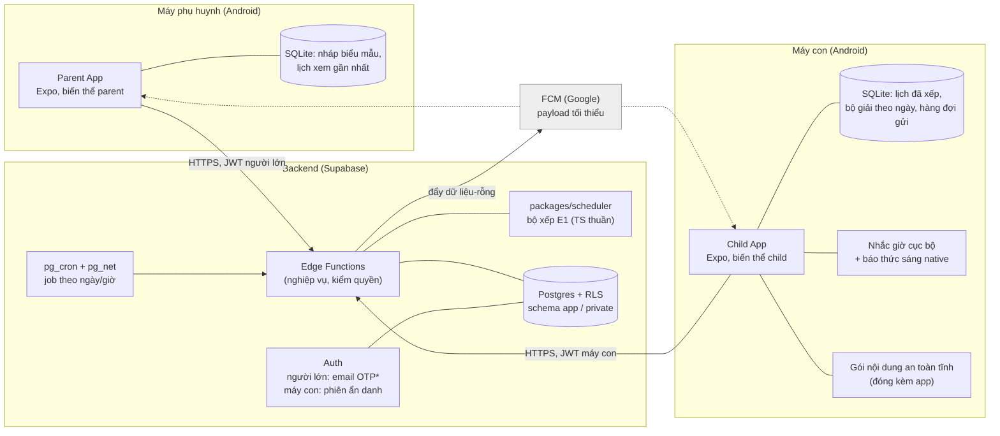
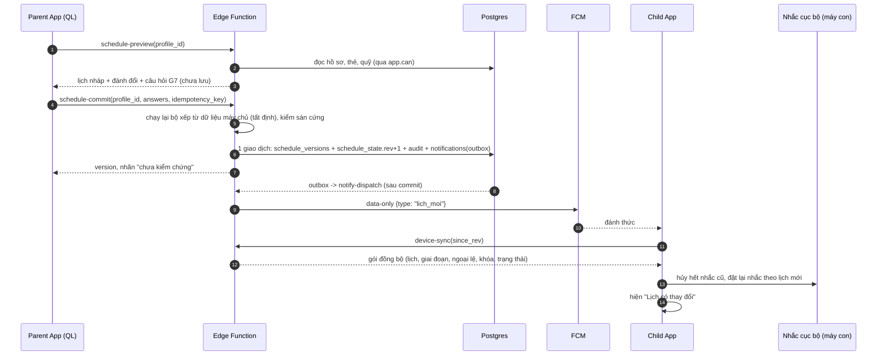
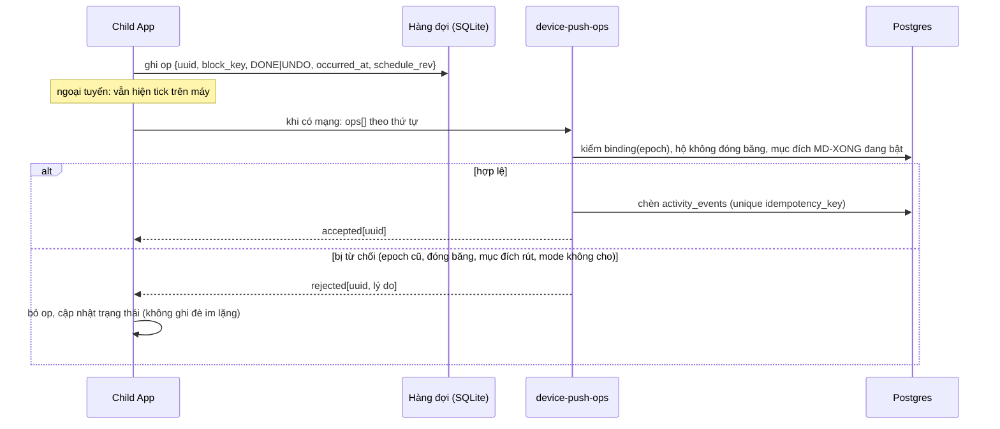
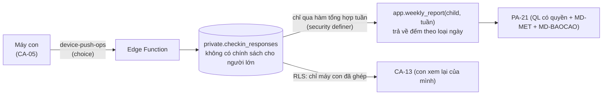
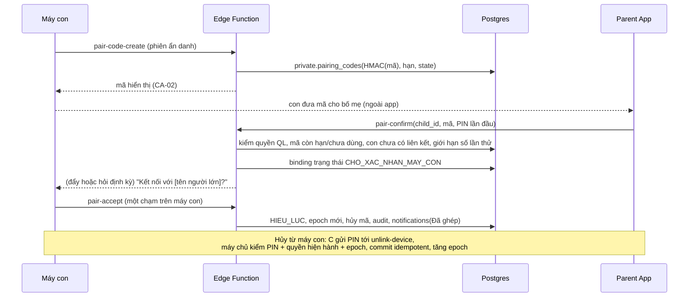
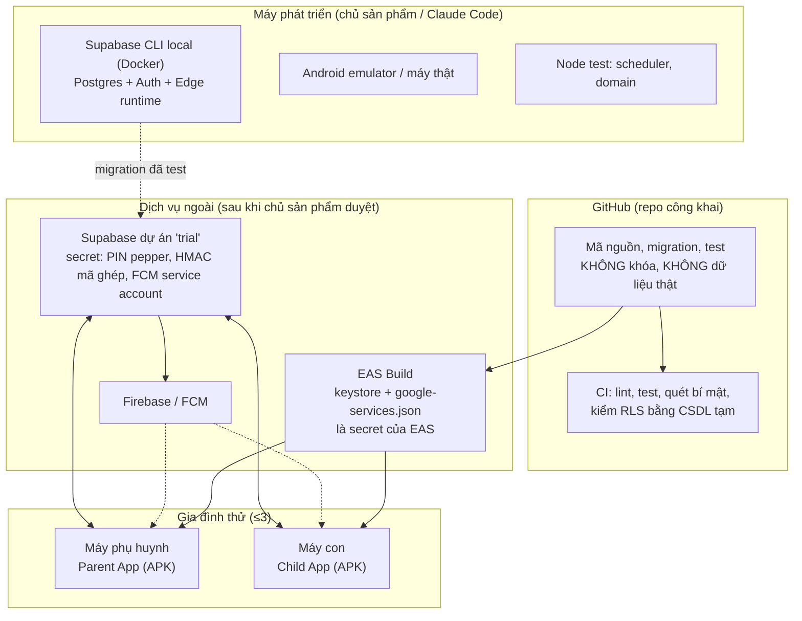

# Architecture 12.1 – Kiến trúc hệ thống nấc 1 (A-lite E1)

**Bước:** 12 Kiến trúc hệ thống (trước 13 Tech Spec, 15 Dev Planning)
**Người soạn:** AI, chưa kiểm chứng độc lập · **Trạng thái:** nháp chờ duyệt · **Bản:** 15/11/2026
**Đi kèm:** `Tech_Spec_13_1_MVP_Step1.md`, `Dev_Plan_15_1_MVP_Step1.md` (cùng thư mục)
**Nguồn chính (chỉ đọc, bản ở nhánh pr27):** `MVP_Step1_Module_List.md` (32 module, D-33), `IA_06_1_Information_Architecture.md` (58 màn), `Business_Logic_11_1..11_4_DRAFT.md`, `spike-e1-scheduler/`, `internal-test-kit/`, `Legal_Question_Pack.md`, `Owner_Decision_Log_20261115.md` (D-01..D-46), `documents/app/spec-phuong-an-a-app-android.md`, mã `mobile/` và `supabase/` (đã đọc để đánh giá tái dùng).
**Không thuộc phạm vi:** chọn thay chủ sản phẩm; đánh PASS cổng pháp lý; code; tạo tài khoản dịch vụ; chi tiền. Chỗ nguồn thiếu: chọn nhánh an toàn (fail-closed), gắn nhãn, đưa vào mục 16.

Ký hiệu: `[MĐKT]` = mặc định kiến trúc do AI chọn, đảo ngược được, chờ duyệt cùng tài liệu. `[CHỜ CSP]` = cần chủ sản phẩm quyết. `UNKNOWN` = nguồn không có. `QL` = người quản lý chính, `NL` = người lớn khác, `Con` = trẻ dùng Child App. Ngày tra giá và tính năng nền tảng: **15/11/2026**.

---

## 0. Tóm tắt một trang

**Kiến trúc đề xuất (một câu).** Một mã nguồn Expo (TypeScript) build ra **hai app Android** (Parent, Child) nói chuyện với **một backend Supabase** (Postgres + RLS + Edge Functions + pg_cron). **Bộ xếp lịch E1 chạy ở máy chủ** (tái dùng spike, thuần TypeScript, tất định). **Máy con chỉ giữ bản lịch đã xếp** và một bộ giải "ngày nào dùng lịch nào" rất nhỏ, nên nhắc giờ chạy cục bộ và hết hạn giai đoạn đúng ngày kể cả ngoại tuyến (D-24). Dữ liệu riêng của con (lựa chọn hỏi thăm từng ngày) nằm trong **schema không mở cho API và không có chính sách nào cho người lớn**, nên D-38 được bảo đảm ở tầng dữ liệu.

**Sáu điều cần biết.**
1. **Không có AI, không có GPS, ảnh, ghi âm** ở nấc 1 (D-16, D-45). Backend không gọi dịch vụ AI nào. Dịch vụ ngoài duy nhất cho dữ liệu là hạ tầng (Supabase) và đẩy thông báo (FCM).
2. **Hai app, một codebase** `[MĐKT]`: tách quyền Android, tách mô tả đối tượng sử dụng, con không có màn của phụ huynh trên máy mình.
3. **Con không có tài khoản cá nhân.** Máy con dùng phiên ẩn danh của Supabase, gắn vào hồ sơ con bằng **mã ghép một lần** do phụ huynh nhập (FR-01). Parent PIN chỉ được kiểm ở máy chủ, có băm kèm khóa bí mật phía máy chủ và giới hạn số lần thử.
4. **Consent 7 mục đích là điều kiện đọc ở tầng dữ liệu** (D-42): rút một mục thì dữ liệu cũ của mục đó ẩn ngay vì chính sách đọc kiểm trạng thái mục đích và mốc `active_since`.
5. **Mọi job theo ngày/giờ** (hết hạn giai đoạn, đóng băng, báo cáo tuần Chủ Nhật 20:00, hết hạn thử) chạy bằng pg_cron gọi Edge Function, **tính theo ngày chứ không theo "lần chạy trước"**, nên chạy bù được khi dự án bị tạm dừng.
6. **Bốn quyết định chờ chủ sản phẩm** (mục 13): kênh cài app, cách đăng nhập, tái dùng mã `mobile/`, nơi đặt hạ tầng (LQ-08). Với mỗi quyết định có 3 phương án, chi phí ước tính cho ≤3 gia đình, rủi ro pháp lý và đề xuất. **Không phương án nào loại bỏ hết LQ-08**, vì thông báo đẩy Android luôn đi qua FCM của Google.

**Chi phí hạ tầng tối thiểu cho đợt thử (ước tính, tra 15/11/2026):** 0 USD (Supabase Free + EAS Free + APK) đến khoảng 25 USD một tháng (Supabase Pro). Hai mục chưa tra được: SMTP gửi mã đăng nhập, FCM (`UNKNOWN`). Lý do cân nhắc Pro: dự án Free bị tạm dừng sau 1 tuần không hoạt động, mà D-44 cần job xóa chạy ở ngày thứ 7 sau khi thử xong (mục 13.5).

**Điều AI không làm:** không chọn thay chủ sản phẩm; không coi bất kỳ cổng pháp lý nào là đạt (H4, FR-03, LQ-01/02/05/08/11 vẫn mở; ngoại lệ D-45 là căn cứ thử duy nhất).

---

## 1. Ràng buộc kiến trúc (rút từ quyết định, không phải lựa chọn)

| # | Ràng buộc | Nguồn | Hệ quả kiến trúc |
|---|---|---|---|
| C1 | Không AI ở nấc 1; bộ xếp lịch tất định | D-16, BL 11.1 §10 | Không có đường gọi LLM; không cần lớp ẩn danh trước AI (để nấc 2) |
| C2 | Con phải có máy riêng; không dùng chung máy phụ huynh | D-11, BR-FAM-037 | Hai app trên hai máy; máy con không có thông tin đăng nhập người lớn |
| C3 | FR-01 xong trước khi thử với gia đình thật; không dùng "mã gia đình" của spike | D-18, OD-A8, BR-FAM-090 | Migration `families.join_code` của Plan A **không dùng lại** (mục 13.3) |
| C4 | Hủy liên kết chỉ có hiệu lực khi máy chủ commit; PIN chỉ là kiểm tra thêm | FR-01, BR-FAM-034/035, FR01-T01..T11 | Kiểm quyền hiện hành + epoch + PIN ở máy chủ; máy con ngoại tuyến không tự coi là đã hủy |
| C5 | Lựa chọn hỏi thăm từng ngày: phụ huynh không thấy, không xuất | D-38, BR-CON-032/039 | Bảo đảm ở tầng dữ liệu (mục 6.3), có test không-suy-ngược |
| C6 | Mệt chỉ tổng hợp theo loại ngày, trong báo cáo tuần, hiện từ 1 lần; gửi tối Chủ Nhật 20:00 | D-21, D-37, D-40 | Hàm tổng hợp có mốc cắt; không có thông báo lẻ |
| C7 | Giai đoạn tạm thời ≤60 ngày; hết hạn tự về hồ sơ chuẩn mới nhất, kể cả khi lịch khóa, kể cả khi đóng băng, kể cả máy con ngoại tuyến | D-09, D-24, D-41, BR-FAM-056 | Bộ giải theo ngày trên máy con + job máy chủ idempotent |
| C8 | 7 mục đích đồng ý; rút một mục = ẩn ngay dữ liệu cũ của mục đó; đồng ý lại không tự hiện lại; rút toàn bộ = xác nhận 2 lần rồi tạo yêu cầu xóa | D-28, D-42 | `purpose_state` + `active_since` trong chính sách đọc |
| C9 | Đóng băng sau 30 ngày không có thao tác có chủ đích của người lớn trên Parent App; chỉ QL mở lại; không đóng băng nếu NL còn dùng | D-27, D-41, BR-FAM-050..059 | Job hằng ngày; `members.last_active_at` chỉ cập nhật bởi thao tác có chủ đích |
| C10 | "Con cần giúp đỡ": nội dung tĩnh, không ghi, không gọi mạng; đợt thử chỉ lời tĩnh + 111, **chưa bật gửi tin** | D-26, D-30, D-43, BR-CON-035 | Gói nội dung đóng kèm app; cờ tính năng `talk_send=off` ở máy chủ |
| C11 | Thử nội bộ: tối đa 3 gia đình, có ngày kết thúc, không GPS/ảnh/ghi âm, xóa 7 ngày sau kết thúc (rút giữa chừng: xóa ngay), không đưa dữ liệu thật lên repo công khai | D-44, D-45, BR-CON-080..089 | Bảng `trial_slots`, hàm `purge_household`, cờ `data_class`, test tên giả |
| C12 | Repo công khai: không commit khóa, `.env`, `google-services.json`, khóa ký | CLAUDE.md | Secret ở Supabase/EAS; CI quét bí mật |
| C13 | Tạo tài khoản, dự án dịch vụ, chi phí: hỏi chủ sản phẩm trước; chưa chi tiền ngoài | CLAUDE.md, D-17 | Danh sách việc của chủ sản phẩm ở Dev Plan §6 |
| C14 | Mỗi bước một nhánh, một PR; không đẩy thẳng `main` | CLAUDE.md | Dev Plan chia task = PR |
| C15 | Mọi ngày giờ nghiệp vụ theo `Asia/Ho_Chi_Minh`, `YYYY-MM-DD`, tính cả hai đầu (quy ước `v1`) | BL 11.1 §6.3 | Cột `date` tính ở máy chủ; không phụ thuộc múi giờ máy |

---

## 2. Quyết định kiến trúc và trạng thái

| Mã | Quyết định | Trạng thái | Lý do ngắn | Mục |
|---|---|---|---|---|
| AD-01 | Hai app Android (Parent, Child) từ **một** mã nguồn Expo, hai biến thể build | `[MĐKT]` | Tách quyền, tách hiển thị, giữ chung mã | 3 |
| AD-02 | Backend Supabase (Postgres, Auth, Edge Functions, pg_cron, pg_net) | `[MĐKT]`, kế thừa lựa chọn Plan A (spec §2) | Có sẵn RLS, đã quen, chi phí thấp; **vị trí đặt** là `[CHỜ CSP]` (LQ-08) | 13.4 |
| AD-03 | Bộ xếp lịch chạy **ở máy chủ** (Edge Function), mã thuần TS dùng chung | `[MĐKT]` | Cần cho job hết hạn giai đoạn; kiểm sàn cứng khi commit không tin máy khách | 7 |
| AD-04 | Máy con **không** chạy bộ xếp; chỉ giữ lịch đã xếp + bộ giải theo ngày | `[MĐKT]` | Ngoại tuyến đúng ngày (D-24); bề mặt tấn công nhỏ | 8 |
| AD-05 | Nhắc giờ khối = thông báo **cục bộ** hẹn giờ trên máy con; đẩy FCM chỉ cho sự kiện do máy chủ sinh | `[MĐKT]` | Chạy khi ngoại tuyến; ít dữ liệu ra ngoài | 8.4 |
| AD-06 | FCM gọi **trực tiếp** từ Edge Function (không qua Expo Push); payload không có tên con, không có nội dung | `[MĐKT]`, đảo ngược được | Bớt một bên xử lý trung gian | 8.4 |
| AD-07 | Máy con dùng phiên ẩn danh Supabase + ghép bằng mã một lần; không email/số điện thoại của trẻ | `[MĐKT]` | Tối thiểu hóa dữ liệu của trẻ | 5 |
| AD-08 | Schema `private` (không mở cho API) cho dữ liệu riêng của con, PIN, mã ghép, token đẩy | `[MĐKT]` | D-38 ở tầng dữ liệu | 6 |
| AD-09 | Một điểm quyết định truy cập `app.can(...)` dùng chung cho chính sách RLS và Edge Function | `[MĐKT]` | F01-G04-M01 "một điểm ALLOW/DENY" | 6.2 |
| AD-10 | Báo cáo tuần **tính khi mở** với **mốc cắt** Chủ Nhật 20:00; không lưu bản chụp số liệu | `[MĐKT]`, xem mục 12 (mâu thuẫn BR-NTF-051 và D-40) | Chống suy ngược từng ngày bằng cách mở nhiều lần | 9.2 |
| AD-11 | Ghép máy có bước **xác nhận trên máy con** trước khi liên kết có hiệu lực | `[MĐKT]`, thêm so với IA | Chống nhập mã nhìn lén | 5.3 |
| AD-12 | Xóa = ẩn ngay (`hidden_at`) rồi xóa hẳn theo hạn; thử D-01 có hàm `purge_household` | `[MĐKT]` | BR-CON-070..087 | 11 |
| AD-13 | Kênh cài, cách đăng nhập, tái dùng `mobile/`, nơi đặt hạ tầng | `[CHỜ CSP]` | D-46, LQ-08 | 13 |

---

## 3. Thành phần

### 3.1 Một app hay hai app

| Phương án | Ưu | Nhược | Đánh giá |
|---|---|---|---|
| (A) Một app, hai vai (chọn vai lúc mở) | Một APK, một lần build | Màn phụ huynh nằm trên máy con; quyền Android là hợp của hai app; mô tả đối tượng sử dụng lẫn (người lớn và trẻ); con có thể thử "đổi vai" (máy chủ vẫn chặn, nhưng bề mặt lớn hơn) | Không đề xuất |
| (B) **Một mã nguồn, hai biến thể build** (hai `applicationId`) | Tách quyền, tách đối tượng, máy con không chứa màn phụ huynh; vẫn dùng chung `packages/*` | Hai lần build mỗi bản (gói EAS Free: tối đa 15 bản Android, tra 15/11/2026 từ expo.dev/pricing.md); cấu hình hơi nhiều | **Đề xuất `[MĐKT]`** |
| (C) Hai kho mã | Tách tuyệt đối | Chép mã chung, dễ lệch | Không đề xuất |

Android trước, iOS ngoài phạm vi nấc 1 (spec Plan A mục 1 ghi "không làm iPhone"; chi phí và quy trình tài khoản Apple `UNKNOWN`, chưa tra). **Cần chủ sản phẩm xác nhận cả 3 gia đình thử dùng Android cho cả máy bố mẹ lẫn máy con** (mục 16, Q-ARC-03).

### 3.2 Sơ đồ thành phần

`*` cách đăng nhập là `[CHỜ CSP]` (D-46b, mục 13.2).

### 3.3 Trách nhiệm từng thành phần

| Thành phần | Làm | Không làm |
|---|---|---|
| Parent App | Nhập biểu mẫu (hồ sơ, thẻ hoạt động, quỹ giờ), xem trước và lưu lịch, giai đoạn, ngoại lệ, khóa, duyệt đề xuất, xem báo cáo tuần, quản lý đồng ý, thành viên, xóa; cache chỉ đọc khi ngoại tuyến; nháp biểu mẫu lưu trên máy | Chạy bộ xếp (nấc 1 gọi máy chủ); hủy liên kết bằng PIN của máy con; ghi vào lịch khi ngoại tuyến |
| Child App | Ghép máy, hiện lịch hôm nay/tuần, đặt nhắc cục bộ, Xong/Hoàn tác, hỏi thăm, gửi mong muốn/đề xuất theo mẫu, CA-16, "Con cần giúp đỡ" tĩnh; hàng đợi gửi khi ngoại tuyến | Chạy bộ xếp; sửa lịch; có ô chữ tự do (BR-CON-091); ghi lại việc mở CA-14 |
| Edge Functions | Kiểm quyền (gọi `app.can`), chạy bộ xếp, commit idempotent, đồng bộ, hủy liên kết, tổng hợp báo cáo, gửi FCM, job | Gọi dịch vụ AI; ghi nhật ký nội dung riêng |
| Postgres | Lưu, RLS, ràng buộc, trigger audit, hàm `app.*` | Chứa logic xếp lịch (nằm ở TS để có test chung) |
| pg_cron + pg_net | Lịch gọi job | Chứa logic nghiệp vụ |
| FCM | Đánh thức app | Mang tên con, nội dung lịch, lựa chọn, mã, PIN |

---

## 4. Luồng dữ liệu

### 4.1 Lưu lịch → đồng bộ → nhắc (đường lõi)

Điểm bắt buộc: thông báo chỉ sinh **sau commit** (UF 04.1 §0.6 mục 5; BR-NTF-005); thông báo nằm trong cùng giao dịch với commit (outbox) nên không có thông báo "ma".

### 4.2 Con bấm Xong khi ngoại tuyến

### 4.3 Hỏi thăm: dữ liệu riêng đi một chiều

### 4.4 Ghép máy và hủy liên kết

---

## 5. Xác thực và định danh

### 5.1 Người lớn

- Đăng nhập bằng Supabase Auth; **phương thức là `[CHỜ CSP]`** (mục 13.2). Thiết kế không phụ thuộc phương thức: mọi hàm chỉ cần `auth.uid()` và tra `app.members`.
- `members.user_id` gắn một tài khoản vào **một** hộ (ghép nhiều hộ bị từ chối ở nấc 1, giống ghép máy).
- Khôi phục tài khoản: phương pháp `UNKNOWN` (PR-FAM-10). Nhánh mặc định cho đợt thử: **khôi phục thủ công do chủ sản phẩm hỗ trợ tại chỗ**, không mở luồng khôi phục cho gia đình ngoài đợt thử (BR-FAM-072).
- `members.last_active_at` chỉ cập nhật qua RPC `touch_active()` do Parent App gọi khi người lớn **mở app ở nền trước hoặc bấm** (giới hạn 1 lần/giờ). Đồng bộ nền, mở thông báo mà chưa vào app, hoạt động Child App và job hệ thống **không** gọi hàm này (BR-FAM-050, AC-FAM-26).

### 5.2 Máy con

- Máy con đăng nhập **ẩn danh** (`signInAnonymously`). Tài liệu Supabase (tra 15/11/2026): người dùng ẩn danh dùng role `authenticated`, JWT có claim `is_anonymous`; giới hạn IP 30 yêu cầu/giờ cho đăng nhập ẩn danh; khuyến nghị bật CAPTCHA; **không có dọn dẹp tự động** người dùng ẩn danh.
- Hệ quả thiết kế:
  - Chính sách RLS **không** dựa vào "là người dùng authenticated". Mọi quyền của máy con xuất phát từ bảng `device_bindings` (`state = 'HIEU_LUC'` và epoch khớp).
  - Phiên ẩn danh chưa ghép **không có quyền gì**, trừ gọi `pair-code-create` và `pair-accept`.
  - Job dọn: xóa `auth.users` ẩn danh chưa ghép sau 7 ngày `[MĐKT]`; khi xóa hộ thử thì xóa cả người dùng ẩn danh đã ghép với hộ đó.
  - Gỡ app/xóa dữ liệu app trên máy con = mất phiên = phải ghép lại (cùng hộ, mã mới, BR-FAM-036). Chấp nhận được.
- Token làm mới lưu bằng `expo-secure-store`, không lưu ở SQLite thường.

### 5.3 Mã ghép và Parent PIN (FR-01)

| Hạng mục | Thiết kế | Tham số |
|---|---|---|
| Sinh mã | Máy chủ sinh khi máy con gọi `pair-code-create`; mã ngẫu nhiên mật mã học, 8 ký tự bảng chữ không gây nhầm (khoảng 40 bit) | Độ dài: `[MĐKT]` |
| Lưu mã | Chỉ lưu `HMAC-SHA256(mã, khóa bí mật máy chủ)`, không lưu mã gốc; dùng xong thì xóa dòng (IA ma trận hàng 28) | |
| Hạn mã | Một lần, có hạn | `PR-FAM-04` = `UNKNOWN`; mặc định đề xuất **10 phút**, nhãn `đề xuất nội bộ` |
| Chống đoán | Giới hạn số lần nhập sai theo tài khoản người lớn và theo hộ; thông báo lỗi chung "mã không đúng hoặc hết hạn", không lộ mã có tồn tại không (BR-FAM-031, AC-FAM-11) | Ngưỡng: `[MĐKT]` 5 lần / 15 phút |
| Xác nhận trên máy con | Sau khi QL nhập mã, liên kết ở `CHO_XAC_NHAN_MAY_CON`; máy con hiện "Kết nối với [tên gọi người lớn]? Đồng ý / Không"; chỉ khi chạm Đồng ý mới `HIEU_LUC` (AD-11). Hết 5 phút không chạm thì hủy | Thêm so với IA, chờ UX |
| Một liên kết hiệu lực | Chỉ mục duy nhất một phần: mỗi `child_id` tối đa một `HIEU_LUC`; mỗi `device_user_id` tối đa một | FR-01 mục 5, AC-FAM-12 |
| Hộ khác | Từ chối. Trạng thái `CHO_XAC_MINH` chỉ là trạng thái dữ liệu **không có quyền**; không mở cho nấc 1 (BR-FAM-032, 036) | Phương pháp xác minh `UNKNOWN` |
| Parent PIN | Đặt ở PA-14 khi ghép lần đầu; **chỉ kiểm ở máy chủ**; lưu `bcrypt(pin ∥ pepper)` bằng `pgcrypto`, `pepper` là secret của Edge Function (không nằm trong CSDL), nên lộ CSDL không đủ để dò PIN 4–6 chữ số | Độ dài PIN `UNKNOWN`; mặc định `[MĐKT]` 6 chữ số |
| Giới hạn thử PIN | Đếm ở bảng `private.parent_pins` (`failed_count`, `locked_until`), khóa lũy tiến; PIN sai không hủy, không lộ dữ liệu (AC-FAM-13) | `PR-FAM-05` = `UNKNOWN`; mặc định `[MĐKT]` 5 lần rồi khóa 15 phút, nhân đôi mỗi lần |
| Hủy từ máy con | Máy con gửi PIN tới `unlink-device`; máy chủ kiểm đồng thời (a) PIN đúng, (b) QL còn quyền hiện hành, (c) epoch khớp, (d) khóa idempotent; commit một lần, tăng epoch, vô hiệu phiên cũ, audit, thông báo tối giản (FR01-T01..T04, T09) | |
| Ngoại tuyến | Nút hủy ngoại tuyến không làm gì có hiệu lực; chỉ khi máy chủ trả "đã commit" mới xóa liên kết ở máy (BR-FAM-035, AC-FAM-14) | |
| Đổi QL | Hoãn khỏi nấc 1 (D-34). Mỗi hộ một QL, một PIN | |

---

## 6. Phân quyền ở tầng dữ liệu

### 6.1 Hai schema

| Schema | Mở cho API (PostgREST)? | Chứa | Truy cập |
|---|---|---|---|
| `app` | Có, **mọi bảng bật RLS, mặc định từ chối** | Hộ, thành viên, con, grant, lịch, đồng ý, thông báo, nhật ký Xong, mong muốn, CR, audit | Qua chính sách dùng `app.can(...)` hoặc qua Edge Function |
| `private` | **Không** (không nằm trong danh sách schema được mở) | Lựa chọn hỏi thăm, PIN băm, mã ghép, token đẩy, bản ghi giao tin "Con cần nói chuyện" (sau này), nhật ký lỗi nội bộ | Chỉ qua hàm `security definer` được chọn lọc và qua vai trò `service_role` trong Edge Function |

Kiểm tra tự động trong CI: bảng nào ở `app` thiếu RLS hoặc thiếu dòng trong `policy-matrix` thì test thất bại; bảng ở `private` mà có quyền `select` cho `authenticated`/`anon` thì thất bại.

### 6.2 Một điểm quyết định truy cập

`app.can(actor uuid, action text, child uuid, purpose text) returns boolean` (security definer, `search_path` cố định) kiểm theo đúng thứ tự BL 11.3 §5:

1. phiên hợp lệ, hộ không `DONG_BANG`, hồ sơ con chưa `hidden_at`;
2. nếu hành động gắn mục đích: `purpose_effective(child, purpose)` đang bật (kể cả phụ thuộc);
3. vai trò và grant (bảng quyền BL 11.2 §2.2): QL đủ; NL chỉ **xem** theo grant (D-35); máy con theo `device_bindings` + mode;
4. phạm vi dữ liệu (bảng "ai thấy gì" BL 11.3 §4.3).

Chính sách RLS và mọi Edge Function **cùng gọi hàm này**, nên quy tắc chỉ định nghĩa một lần (F01-G04-M01). Fail-closed: mọi nhánh không rõ trả `false`.

### 6.3 Bảo đảm D-38 (phụ huynh không thấy lựa chọn hỏi thăm từng ngày)

Không chỉ ẩn ở giao diện. Năm lớp, độc lập nhau:

| Lớp | Biện pháp | Test (Tech Spec §7) |
|---|---|---|
| L1 Lưu riêng | Bảng `private.checkin_responses` nằm schema không mở API; không có chính sách nào cho vai người lớn | RLS-D38-01: JWT QL đọc trực tiếp bị từ chối |
| L2 Không đường vòng | Không có view, hàm, bảng nào trả từng dòng; không nằm trong publication Realtime; không có trong xuất dữ liệu; nhật ký thông báo không có loại "hỏi thăm" | RLS-D38-02..04 |
| L3 Hàm tổng hợp hẹp | `app.weekly_report(child, tuần ISO)` chỉ nhận **mã tuần**, không nhận khoảng ngày; trả đếm theo **loại ngày**, không trả ngày/thứ | RLS-D38-05 |
| L4 Mốc cắt chống suy ngược | Mục xu hướng của tuần W chỉ tính bản ghi có `occurred_at ≤ Chủ Nhật 20:00 (giờ VN)` của tuần W và chỉ **mở được sau mốc cắt**; trước đó trả "chưa sẵn sàng". Nhờ đó mở báo cáo nhiều lần trong tuần không cho phép trừ số liệu để ra từng ngày (AD-10) | RLS-D38-06 |
| L5 Kiểm không-suy-ngược | Test sinh dữ liệu: hai bộ dữ liệu chỉ khác **ngày** nào "Rất mệt" (cùng loại ngày) phải cho **đầu ra giống hệt** ở mọi điểm người lớn đọc được (API, xuất, thông báo, nhật ký) | RLS-D38-07 (BR-CON-039) |

**Giới hạn còn lại, ghi thẳng.** (1) Quản trị viên có `service_role`/bảng điều khiển CSDL **đọc được** `private.*`; đây là rủi ro vận hành, không phải của người lớn trong gia đình. Biện pháp: quy tắc "không mở bảng này trừ khi xóa hoặc gỡ lỗi có ghi chú", chủ sản phẩm là người duy nhất giữ khóa. (2) Gộp theo loại ngày vẫn tiết lộ khi một loại ngày chỉ xảy ra 1 ngày/tuần (ví dụ chỉ có một ngày học thêm tối): D-37 chấp nhận hiện từ 1 lần; rủi ro này nằm trong MQ-05, không do kiến trúc giải quyết (mục 16, Q-ARC-06). (3) Phương án mạnh hơn, chưa chọn: giữ lựa chọn từng ngày **chỉ trên máy con** và tải lên đúng bản tổng hợp tuần. Ưu: máy chủ không bao giờ có dữ liệu từng ngày. Nhược: mất khi mất máy, khó test rút đồng ý, đổi thực thể của BL 11.4. Để dành cho quyết định sau nếu LQ-08 cho thấy cần.

### 6.4 Ma trận quyền tóm tắt (chi tiết ở Tech Spec §2.3)

| Dữ liệu | QL | NL (D-35: chỉ xem) | Con (máy đã ghép) | Hệ thống |
|---|---|---|---|---|
| Hồ sơ con, thẻ, quỹ, lịch có hiệu lực | đọc/ghi | đọc nếu grant | đọc lịch của mình | job ghi (hết hạn giai đoạn) |
| Nhật ký Xong | đọc | đọc nếu grant | đọc/ghi (Xong, Hoàn tác) | |
| Lựa chọn hỏi thăm từng ngày | **không** | **không** | đọc/ghi của mình | |
| Xu hướng mệt (tổng hợp tuần) | đọc qua hàm | **không**, trừ khi cấp riêng | không xem số, xem CA-16 | |
| Mong muốn, đề xuất | đọc, duyệt đề xuất | không | gửi/đọc của mình | |
| Sổ đồng ý | đọc, ghi sự kiện mới | đồng ý của chính mình | không | |
| PIN, mã ghép, token đẩy | không đọc | không | không | chỉ `service_role` |
| Audit | đọc dòng của hộ | không | không | ghi |

---

## 7. Bộ xếp lịch: chạy ở đâu, tái dùng spike thế nào

### 7.1 Chọn nơi chạy

| Phương án | Ưu | Nhược | Kết luận |
|---|---|---|---|
| (S1) Trên máy phụ huynh | Xem trước tức thì, ngoại tuyến | Máy khách không đáng tin để chốt sàn cứng; job hết hạn giai đoạn vẫn cần máy chủ | Không |
| (S2) **Trên máy chủ** (Edge Function) | Một nguồn sự thật; kiểm sàn cứng khi commit; job hết hạn dùng chung; spike chạy 0,3–8,4 ms/tuần nên chi phí tính toán không đáng kể | Xem trước cần mạng (200–500 ms) | **Đề xuất `[MĐKT]`** |
| (S3) Cả hai (mã chung, máy khách xem trước, máy chủ chốt) | Xem trước tức thì | Hai nơi chạy, hai bản build, hai bộ lỗi | Để dành (mã đã tách thuần nên mở được) |
| (S4) Trên máy con | — | Trái AD-04 | Không |

### 7.2 Tái dùng `spike-e1-scheduler/`

Đã chạy lại trong thư mục tạm (không ghi vào nguồn): `node src/test-rules-v2.js` cho **32 đạt, 0 lỗi / 32** (Node 22.23.4, không package). Spike gồm khoảng 1.216 dòng JS CommonJS: `scheduler.js` (409), `validators.js` (220), `phase.js` (92), `fatigue.js` (47), `rules.js` (116), `profiles.js` (71, 8 hồ sơ giả lập), test và `out/P1..P8.json`.

| Phần spike | Dùng ở nấc 1 | Việc cần làm |
|---|---|---|
| `scheduler.js` `scheduleWeek` | Lõi bộ xếp | Port sang TS ESM; **giữ nguyên hành vi**, so với `out/P1..P8.json` làm golden |
| `validators.js` | Bộ kiểm (sàn cứng, `judge`, `budgetBoard`, `confirmKeep`) | Port; thay nhận diện khối bằng regex bằng `kind` có cấu trúc (BL B-11, §2.2); gộp hằng số vào `params` (BL M-12) |
| `phase.js` | Giai đoạn tạm thời (≤60 ngày, hết hạn tự về) | Port; thêm hàm thuần `effectiveDay` cho máy con |
| `fatigue.js` | `CHOICES`, `changePath` | `trend()` của spike theo **thứ** và có ngưỡng `null`: **thay** theo D-37 (theo loại ngày, hiện từ 1 lần). Test TC-D03-1 cũ phải viết lại |
| `rules.js` | Bảng 88 quy tắc | Chỉ làm tài liệu; không đưa vào runtime |
| `profiles.js` | 8 hồ sơ giả lập | Làm dữ liệu test và seed (tên giả) |
| `test-rules-v2.js`, `mutation-test.js` | 32 test + thử đột biến 11/12 | Chuyển sang `node:test`; sửa ca đột biến bị bỏ lọt `tap_muon` (B-11c) |

**Việc còn thiếu so với BL (code mới, không phải port):** bốn thông số D-23 (nghỉ ≥5′ đã có; ≥15′ phục hồi trước học thêm ngay sau giờ trường **cần code thêm**, BL Q-BL-04; bữa ≥20′ sàn đã có `đề xuất nội bộ`; câu hỏi G7 đã có), commit/CR/lock (spike chưa có code commit), mặc định D-25 (lưu lịch có nhãn "chưa kiểm chứng"), ngoại lệ theo ngày cụ thể (BR-143), chống chồng giai đoạn (BR-105). Spike **tự báo cáo** lõi khả thi; chưa kiểm chứng độc lập; chất lượng lịch với phụ huynh thật chưa đo (CA-03).

### 7.3 Đóng gói và chạy trên Deno

- Nguồn thật: `packages/scheduler/` (TS thuần, không phụ thuộc, không `fs`, không `Date.now()` trong hàm lõi: nhận `today` làm tham số để tất định).
- Edge Function (Deno) cần mã nằm trong cây `supabase/functions/`. Đề xuất `[MĐKT]`: script `scripts/sync-shared.mjs` chép/bó `packages/scheduler` vào `backend/supabase/functions/_shared/scheduler/` và CI kiểm "không lệch". **Giả định cần xác minh ở task T0.5** (Dev Plan): bó được và chạy đúng trong Edge Function local, thời gian chạy trong ngưỡng.
- Mỗi lịch lưu kèm `engine_version`, `params_version`, `input_hash` để tái lập (cùng input + cùng phiên bản ra cùng output, AC-06).

---

## 8. Đồng bộ lịch sang máy con, ngoại tuyến, thông báo

### 8.1 Mô hình đồng bộ

Đồng bộ **một chiều từ máy chủ xuống máy con** cho lịch; **một chiều từ máy con lên** cho ghi nhận. Không có sửa lịch từ máy con (D-10, D-19).

| Hướng | Nội dung | Cách |
|---|---|---|
| Xuống | Gói đồng bộ: `rev`, lịch tuần của hồ sơ chuẩn, lịch giai đoạn đang áp (nếu có) kèm `den_ngay` và `ho_so_truoc` (lịch chuẩn mới nhất để về), danh sách ngoại lệ theo ngày, trạng thái khóa, mode, trạng thái đóng băng, mục đích đang bật, phiên bản nội dung CA-16 | `device-sync(since_rev)`; gọi khi mở app, khi nhận FCM `lich_moi`, và theo tác vụ nền (nếu hệ điều hành cho) |
| Lên | Hàng đợi op: Xong/Hoàn tác, hỏi thăm, mong muốn, đề xuất | `device-push-ops(ops[])`, mỗi op có `idempotency_key` (UUID), `occurred_at`, `schedule_rev`, `binding_epoch` |

### 8.2 Bộ giải theo ngày trên máy con (đúng ngày kể cả ngoại tuyến)

Hàm thuần `effectiveDay(bundle, date)` trong `packages/domain` (một nguồn, dùng cả máy chủ lẫn máy con):

1. nếu có ngoại lệ `HIEU_LUC` cho `date` thì dùng khối thay thế;
2. nếu có giai đoạn và `date ≤ den_ngay` thì dùng lịch giai đoạn;
3. ngược lại dùng lịch chuẩn (khi giai đoạn đã hết hạn: **lịch chuẩn mới nhất có trong gói**, D-24, M-09).

Ngày hết hạn tính bằng so sánh ngày `YYYY-MM-DD` giờ VN, không cần mạng, không cần job. Job máy chủ sau đó chỉ **ghi nhận chính thức** (phiên bản hệ thống, audit, thông báo "giai đoạn kết thúc") và đồng bộ lại. Hai bên cho cùng kết quả vì cùng hàm.

### 8.3 Ngoại tuyến

| Tình huống | Hành vi |
|---|---|
| Máy con mất mạng | Hiện và nhắc từ bản đã tải; Xong/hỏi thăm vào hàng đợi; hiện nhãn "chưa đồng bộ" |
| Máy con quá lâu không đồng bộ | Gói có `valid_through` (mặc định `[MĐKT]` 14 ngày): nhắc được đặt cho 14 ngày; hết thì tab Hôm nay vẫn xem, nhắc dừng cho tới khi đồng bộ; không báo lỗi dọa con |
| Hủy liên kết/đóng băng/rút mục đích xảy ra khi máy ngoại tuyến | **Hiệu lực ở máy chủ ngay**; máy con chỉ biết ở lần đồng bộ tới. Các nhắc đã hẹn cục bộ có thể còn chạy tới lúc đó. Đây là giới hạn đã biết, ghi vào rủi ro R-05 |
| Op bị từ chối khi đẩy lên | Không ghi đè im lặng; máy con bỏ op, không báo lỗi cho trẻ trừ khi cần (BR-NTF-044) |
| Đồng hồ máy sai | `occurred_at` chỉ để hiển thị; ngày nghiệp vụ tính từ `occurred_at` bị kẹp trong ±2 ngày quanh giờ máy chủ lúc nhận `[MĐKT]`; không dùng đồng hồ máy cho hạn CR, hạn mã, hạn giai đoạn (giờ máy chủ, BR-124) |
| Parent App ngoại tuyến | Xem cache chỉ đọc, nháp biểu mẫu lưu SQLite; **mọi ghi cần mạng** (UF-Q12 nhánh an toàn) |

### 8.4 Nhắc cục bộ so với đẩy

| Loại | Kênh | Lý do |
|---|---|---|
| Nhắc khối, báo thức sáng (Con) | **Cục bộ** (`expo-notifications` hẹn giờ; báo thức sáng bằng module native Kotlin `AlarmManager.setAlarmClock`, không cần `SCHEDULE_EXACT_ALARM`, BR-NTF-003) | Chạy ngoại tuyến; không đi qua bên thứ ba; Plan A đã đo lệch +45 giây khi thiếu quyền báo thức chính xác (nhật ký 05/11/2026), mục tiêu ≤1 phút là mục tiêu thử, không phải quy tắc sản phẩm (BR-NTF-004) |
| Không nhắc trong khối ngủ của lịch con | Lọc lúc đặt nhắc | D-40 |
| Lịch mới/đổi, kết quả đề xuất (Con) | FCM data-only → máy con tự đồng bộ → nhắc cục bộ | Cần thông tin từ máy chủ |
| Mong muốn/đề xuất, ghép/hủy, thành viên, đóng băng, tóm tắt tuần sẵn sàng, giai đoạn kết thúc (Người lớn) | FCM | Sinh ở máy chủ |
| An toàn tĩnh | Không phải thông báo; màn tĩnh trong app | BR-NTF-031a |
| "Con cần nói chuyện" | **Tắt trong đợt thử** (D-43). Khi bật: FCM bắt buộc, miễn giờ yên lặng | |

**FCM payload (AD-06):** `{type, notification_id}` và không gì khác; app nhận xong tự lấy nội dung từ máy chủ (kiểm quyền lại, BR-NTF-035). Không tên con, không nội dung, không mã. Giờ yên lặng người lớn mặc định **tắt** (BR-NTF-033).

**Giới hạn cần đo, không giả định:** số thông báo hẹn giờ tối đa và độ chính xác khi bật tiết kiệm pin trên ≥3 hãng máy (task T3.7). Gói đồng bộ giới hạn 14 ngày nhắc/lần để không phụ thuộc giới hạn này.

---

## 9. Job và sự kiện

### 9.1 Danh sách job

Tất cả là pg_cron → `net.http_post` → Edge Function `job-*` (tài liệu Supabase "Scheduling Edge Functions", tra 15/11/2026: pg_cron + pg_net trên nền tảng hosted, khóa lưu ở Vault). Giờ cron ghi UTC (Việt Nam UTC+7, không đổi giờ mùa hè).

| Job | Lịch (giờ VN → cron UTC) | Việc | Idempotent bằng |
|---|---|---|---|
| `job-daily` | 00:05 → `5 17 * * *` | `tickPhases` (hết hạn giai đoạn, kể cả hộ đóng băng/khóa), hết hạn CR (7 ngày), hết hạn đề xuất chờ, hết hạn lời mời, kiểm đóng băng/nhắc QL (30 ngày), chuyển trạng thái `trial_slots`, dọn mã ghép hết hạn | Tính theo **ngày**, không theo "lần chạy trước" nên chạy bù được |
| `job-weekly-report` | Chủ Nhật 20:00 → `0 13 * * 0` | Với mỗi con có đủ điều kiện (≥1 ngày lịch commit, MD-BAOCAO bật): tạo thông báo "Tóm tắt tuần sẵn sàng" (không số liệu) | khóa `(child, tuần ISO)` |
| `job-notify-retry` | mỗi 5 phút | Gửi lại thông báo `LOI` cùng khóa idempotent | `notifications.idempotency_key` |
| `job-trial-purge` | 03:00 → `0 20 * * *` | `trial_slots` đến `end_date + 7 ngày` hoặc đã rút: gọi `purge_household`, ghi bằng chứng xóa | `trial_slots.purged_at` |
| (thủ công) `purge_household` | khi gia đình rút giữa chừng | Xóa ngay (D-44) | như trên |

Webhook sau commit: thông báo dùng **outbox** (hàng đợi `notifications` ghi trong cùng giao dịch); `notify-dispatch` được gọi bởi trigger/pg_net và bởi `job-notify-retry` làm lưới an toàn. Cần xác minh ở T3.5 rằng pg_net trong trigger đủ tin cậy; nếu không, `job-notify-retry` chạy mỗi phút.

### 9.2 Báo cáo tuần (job lịch + tính khi mở)

- Báo cáo **không lưu bản chụp số liệu**; tính khi mở từ `activity_events` và (qua hàm hẹp) `checkin_responses` (BR-NTF-051).
- Mốc cắt Chủ Nhật 20:00 giờ VN làm kết quả tuần W **ổn định** từ lúc job chạy: mọi lần mở sau đó ra cùng số. Bản ghi hỏi thăm đến sau mốc cắt trong cùng tuần W **không tính vào W** và không dồn sang W+1 (hiếm; ghi rõ ở Tech Spec). Phần "Con đánh dấu Xong ở X trên Y ngày" cũng tính tới mốc cắt.
- Điều kiện hiện mục xu hướng: MD-MET và MD-BAOCAO bật, người xem có quyền xu hướng (QL; NL chỉ khi cấp riêng), tuần có ≥1 lần "Rất mệt" chưa Hoàn tác (BR-NTF-057, D-37).

### 9.3 Sự kiện miền (nội bộ, qua bảng, không bus)

`schedule.committed`, `schedule.system_reverted` (D-09), `phase.activated|ended|expired`, `exception.set`, `lock.set|cleared`, `cr.submitted|decided|expired|invalidated`, `wish.sent|seen`, `binding.paired|unlinked`, `consent.granted|withdrawn`, `household.frozen|reopened`, `deletion.requested|completed`, `trial.opened|closed|purged`. Mỗi sự kiện ghi `audit_log` (mục 12) và, nếu có người nhận, một dòng `notifications` trong cùng giao dịch.

---

## 10. Consent theo 7 mục đích

Danh mục lấy từ BL 11.3 §2.2 (D-42): `MD-LICH` (lõi), `MD-DONGBO`, `MD-XONG`, `MD-MET`, `MD-MONGMUON`, `MD-BAOCAO`, `MD-SUCKHOE`. Tất cả `CHUA_DUYET` (PBA-OD-02); mục tùy chọn không chọn sẵn; `MD-SUCKHOE` **không thu** khi dùng dữ liệu thật (không có cột nào trong lược đồ nấc 1, CRG C-07).

| Thành phần | Thiết kế |
|---|---|
| Sổ | `consent_events` chỉ-thêm (cấm UPDATE/DELETE bằng quyền + trigger); `DONG_Y`/`RUT`, người ghi, phiên bản chính sách, loại `SELF_DECLARED`, mã tham chiếu phiếu giấy (D-01; không chứa dữ liệu cá nhân) |
| Trạng thái | `purpose_state(child, purpose, state, active_since)` cập nhật bởi trigger trên sổ; `CHUA_HOI → DANG_BAT → DA_RUT`; đồng ý lại đặt `active_since = now()` |
| Phụ thuộc | `MD-XONG`, `MD-MET`, `MD-MONGMUON` cần `MD-DONGBO`; `MD-BAOCAO` cần `MD-XONG`; `purpose_effective()` = tự bật **và** mọi phụ thuộc hiệu lực (AC-CON-03) |
| Ép buộc | Chính sách đọc/ghi và Edge Function đều qua `app.can(..., purpose)`; dữ liệu có `created_at < active_since` **không hiện** (đồng ý lại không tự hiện lại, AC-CON-07); thu mới dừng ngay khi rút |
| Rút một phần | Tắt tính năng đó; lịch tuần **không đổi**; CR `PENDING` bị `INVALIDATED` lý do `RUT_DONG_Y` nếu rút `MD-MONGMUON` (AC-CON-04); máy con ngừng nhắc nếu rút `MD-DONGBO` |
| Rút toàn bộ | Xác nhận 2 lần → ghi sự kiện rút mọi mục → hộ/hồ sơ con `CHO_XOA` → tạo `deletion_request`; thu mới bị từ chối; máy con hiện CA-17 (AC-CON-06) |
| Chính sách phiên bản mới | Chưa đồng ý thì không thu theo mục đích mới; dữ liệu cũ vẫn xem được (AC-CON-08) |
| Người ghi | Mỗi người lớn chỉ rút đồng ý **của chính mình**; đồng ý thay con do QL quản lý (AC-CON-05) |
| Trẻ "đồng ý" | Ngoài app trong đợt thử (Kit 02, ghi vào phiếu); trong app chỉ có mốc "Con hiểu rồi" ở CA-16 (BR-CON-030). Hiệu lực pháp lý `UNKNOWN` (MR-017) |

---

## 11. Xóa, ẩn dữ liệu, vòng đời

| Việc | Cách làm |
|---|---|
| Ẩn ngay | Mọi bảng dữ liệu của con có `hidden_at`, `hidden_reason` (`XOA`, `RUT_DONG_Y`, `ROI`, `HET_THU`); chính sách RLS đòi `hidden_at is null`. Ẩn = tombstone (BR-CON-070) |
| Hạn xóa hẳn | Tham số `PR-CON-01` = `UNKNOWN` (H4). Bản ghi ẩn mang trạng thái `CHO_QUYET_HAN`, **không tự xóa hẳn dữ liệu thật** (AC-CON-18), không hiện ngày xóa. Khi chốt hạn, job chạy lại cho tombstone cũ (AC-CON-19) |
| Ngoại lệ gia đình thử D-01 | Duy nhất đường xóa hẳn dữ liệu thật: `purge_household(household, reason)` xóa theo khóa ngoại `on delete cascade`, xóa `auth.users` ẩn danh đã ghép, ghi `deletion_evidence` (không chứa dữ liệu cá nhân, chỉ mã hộ băm, thời điểm, số dòng theo bảng). Điều kiện chạy: `data_class = 'THU_NOI_BO_D01'` **và** (`end_date + 7 ngày` đã qua **hoặc** rút giữa chừng) (D-44, BR-CON-086/087). Với dữ liệu thật không thuộc thử: hàm từ chối (AC-CON-20) |
| Xóa hồ sơ con | Xác nhận lần hai (gõ chữ); sau commit: hủy liên kết máy con (không cần PIN vì làm từ Parent App), CR `PENDING/APPROVED chưa áp` → `INVALIDATED`, dừng nhắc, ẩn ngay, máy con hiện "không còn kết nối" (BR-FAM-080) |
| Đóng băng | `households.state = 'DONG_BANG'`; giữ nguyên dữ liệu; mọi hàm ghi trả `FROZEN`, trừ: nội dung an toàn tĩnh (không qua mạng), job hết hạn giai đoạn (BR-FAM-056), mở lại do QL; `HET_HAN_GIU` (hạn `UNKNOWN`) không tự xóa (BR-FAM-059) |
| Sao lưu | **Quan trọng cho D-44.** Gói Free của Supabase **không có sao lưu tự động**; gói Pro lưu sao lưu hằng ngày 7 ngày (supabase.com/pricing.md, tra 15/11/2026). Với Pro, dữ liệu đã xóa còn nằm trong sao lưu tối đa 7 ngày: có vi phạm cam kết xóa hay không là câu hỏi cho luật sư (PR-CON-04 = `UNKNOWN`). Việc phải làm: ghi vào Kit 01 mục 4; không tự `pg_dump` về máy |
| Bản sao ngoài CSDL | Ghi chú thử nghiệm của người chạy thử nằm ở thư mục mã hóa của chủ sản phẩm, tối đa 2 người mở (D-44); **không phải** phần của hệ thống này |
| Nhật ký/log | Hàm không ghi thân yêu cầu/phản hồi vào log; chỉ mã sự kiện và mã lỗi. Kiểm ở T6.2 |
| Xuất dữ liệu | Dữ liệu thật: **chặn** (H4, AC-CON-20). Trong thử D-01: chủ sản phẩm xuất thủ công khi gia đình yêu cầu, theo runbook; màn PA-34 hiện "đang chờ quy định" |

---

## 12. Nhật ký kiểm toán tối thiểu và mâu thuẫn nguồn đã xử lý

### 12.1 Audit

`app.audit_log` chỉ-thêm (không cấp UPDATE/DELETE; trigger chặn): `at`, `household_id`, `actor_kind` (`adult`, `child_device`, `system`), `actor_id`, `event_code`, `subject_ref`, `meta` (JSON **không** chứa PIN, mã ghép, token, chữ tự do, lựa chọn hỏi thăm, tên). Sự kiện: thành viên vào/gỡ/rời; ghép/hủy liên kết (kèm epoch); đổi mode; sự kiện đồng ý/rút; commit lịch, khóa/mở khóa, hệ thống tự về giai đoạn trước (D-09); CR chuyển trạng thái; đóng băng/mở lại; yêu cầu xóa/ẩn/xóa hẳn; mở/đóng/xóa `trial_slots`. `notification_log` riêng (loại, người nhận, giờ hẹn, giờ thật, kết quả; không nội dung, BR-CON-077). Hạn giữ audit: `PR-CON-04` = `UNKNOWN`. Audit đọc được bởi QL (dòng của hộ mình); **việc con mở CA-14 và việc nó bấm "Con cần giúp đỡ" không có audit** (BR-CON-035).

### 12.2 Chỗ nguồn mâu thuẫn và cách chọn

| Mã | Mâu thuẫn | Chọn (fail-closed) | Hỏi |
|---|---|---|---|
| X-01 | BR-NTF-051 "tính khi mở, không lưu bản chụp" và D-40 "gửi tối Chủ Nhật 20:00" (tuần chưa hết), cộng yêu cầu chống suy ngược | Tính khi mở **với mốc cắt** 20:00 (AD-10); không lưu bản chụp | Q-ARC-06 |
| X-02 | D-01 viết cho "5 tính năng Plan A"; D-45 viết lại cho nấc 1 | Theo D-45 (mới hơn); danh sách mục đích = 7 mục BL 11.3 | Không |
| X-03 | BL 11.1 AC-27 (đếm theo thứ, có ngưỡng) trái D-21/D-37 | Dùng AC-NTF-21, 22; AC-27 coi là hết hiệu lực, cần sửa BL | Cần đồng bộ tài liệu |
| X-04 | Module list nói D-01 hạn 14 ngày? Kit 01 ghi "không quá 14 ngày sau ngày cài"; BR-CON-082 ghi hạn `UNKNOWN` | Mặc định kỹ thuật: `end_date` bắt buộc, kiểm `≤ ngày cài + 14` theo Kit 01 `[MĐKT]` | Q-ARC-09 |
| X-05 | D-44 "xóa 7 ngày sau kết thúc" và BR-CON-086 "ngừng thu ngay, xóa hẳn" | Ngừng thu **ngay** tại `end_date`; xóa hẳn tại `end_date + 7`; rút giữa chừng xóa ngay | Không |
| X-06 | IA: CA-02 → CA-03 không có bước xác nhận trên máy con | Thêm xác nhận (AD-11), chờ UX | Q-ARC-08 |
| X-07 | IA ma trận hàng 4 "Nơi ở dùng cho điều chỉnh theo mùa" nhưng nấc 1 không có điều chỉnh theo mùa; BR-CON-090 tối thiểu hóa | **Không thu "nơi ở"** ở nấc 1 | Q-ARC-10 |

---

## 13. Bốn quyết định chờ chủ sản phẩm

Phương pháp: mỗi quyết định 3 phương án; chi phí tính cho **đợt thử ≤3 gia đình, ≤14 ngày, ước 1 tháng thuê dịch vụ**, đơn vị USD; **không** tính luật sư, thù lao, máy test (D-17, D-44). Nguồn giá: trang công khai, **tra ngày 15/11/2026**. Ô không tra được ghi `UNKNOWN`. AI **đề xuất, không chốt**. Rủi ro pháp lý ghi ở mức "câu hỏi mở" theo `Legal_Question_Pack.md`, không phải kết luận pháp lý.

### 13.1 D-46a Kênh cài app

| | K1. APK ký riêng, gửi/ cài từ link hoặc tệp | K2. Google Play, kênh kiểm thử nội bộ | K3. Chủ sản phẩm cài trực tiếp ở buổi cài (N0) bằng cáp/ADB hoặc tệp APK |
|---|---|---|---|
| Cách | Build bằng EAS (`buildType: apk`) hoặc build local; gia đình tải và cài | Tài khoản Play Console, tải bản lên kênh nội bộ, thêm email người thử | Chủ sản phẩm cầm máy hoặc máy dự phòng (Kit 03 mục 3: chuẩn bị 2 máy), cài tại chỗ |
| Ưu | Không cần tài khoản Play; nhanh | Cập nhật tự động; ít cảnh báo cài | Không phát tán tệp APK; kiểm soát từng máy; khớp buổi N0 90–120 phút |
| Nhược | Phải bật "cài ứng dụng không rõ nguồn"; có thể thấy cảnh báo của Play Protect (`UNKNOWN` mức độ); cập nhật phải cài lại; tệp APK có thể bị chuyển tiếp | Cần xác minh danh tính; **máy con cần tài khoản Google** để nhận từ Play, vướng với trẻ nhỏ (`UNKNOWN`, cần kiểm); app nhắm tới trẻ có thể rơi vào chính sách Families của Play (`UNKNOWN`, chưa tra); tài khoản cá nhân mới có yêu cầu thử đóng 12 người thử × 14 ngày liên tục **trước khi lên production** (Google Play Help 14151465) | Cập nhật giữa đợt thử cần chủ sản phẩm có mặt hoặc dùng K1 |
| Chi phí ước tính | 0 USD (EAS Free: "up to 15 Android" bản build, expo.dev/pricing.md); Starter 19 USD/tháng nếu cần thêm | **25 USD một lần** (Google Play Help 6112435) + có thể phải nộp ID và thẻ | 0 USD |
| Rủi ro pháp lý | Không thêm xử lý dữ liệu. LQ-11 ghi đã dự kiến "cài APK ngoài Google Play" | Thêm một bên (Google Play) biết email người thử; câu hỏi chính sách trẻ em của cửa hàng `UNKNOWN` | Như K1 |
| Rủi ro nền tảng | Từ 30/09/2026 Google bắt đầu yêu cầu xác minh nhà phát triển cho app cài ngoài cửa hàng ở Brazil, Indonesia, Singapore, Thailand; Việt Nam **không được nêu**; mở rộng toàn cầu 2027; có tài khoản "phân phối giới hạn" miễn phí, tối đa 20 thiết bị, không cần ID (thehackernews.com, 06/2026, nguồn thứ cấp ○, chưa đối chiếu với tài liệu Google) | Không | Như K1 |

**Đề xuất (không chốt): K3 để cài lần đầu, K1 để cập nhật** (cùng một APK ký riêng). Lý do: chi phí 0, không phát tán tệp, khớp quy trình Kit 03. K2 xem xét sau đợt thử nếu muốn mở rộng. **Việc phải làm cho chủ sản phẩm:** kiểm trên máy thật xem Play Protect cảnh báo ra sao (ghi vào nhật ký test), và theo dõi xác minh nhà phát triển trước 2027.

### 13.2 D-46b Cách đăng nhập của phụ huynh

(Máy con không có đăng nhập cá nhân, mục 5.2; lựa chọn này chỉ cho người lớn.)

| | Đ1. Email + mã một lần (OTP) | Đ2. Số điện thoại + SMS OTP | Đ3. Đăng nhập bằng Google |
|---|---|---|---|
| Ưu | Không mật khẩu; khôi phục theo hộp thư; Supabase hỗ trợ sẵn (OTP 6 chữ số, email OTP hết hạn tối đa 1 ngày, tài liệu Supabase tra 15/11/2026) | Quen thuộc với nhiều phụ huynh Việt Nam (`UNKNOWN`, chưa có khảo sát) | Android luôn có tài khoản Google; không SMTP, không SMS |
| Nhược | Cần dịch vụ gửi thư; dịch vụ gửi mặc định của Supabase có giới hạn tần suất (`UNKNOWN` con số); phụ huynh phải mở hộp thư | SMS qua nhà cung cấp nước ngoài hay lỗi/chậm ở Việt Nam (`UNKNOWN`, chưa tra); quy định đăng ký tên gửi SMS ở Việt Nam `UNKNOWN`; số điện thoại là định danh mạnh | Thêm Google làm bên xử lý định danh; cấu hình OAuth + chữ ký ứng dụng (SHA-1) dính với kênh cài; khôi phục theo Google |
| Chi phí đợt thử | 0 USD + SMTP `UNKNOWN` (gói miễn phí của các nhà cung cấp thư có thể đủ; chưa tra) | `UNKNOWN` (giá SMS/tin tới Việt Nam chưa tra) | 0 USD |
| Dữ liệu cá nhân thêm | Email | Số điện thoại | Email + mã định danh Google |
| Rủi ro pháp lý | SMTP nước ngoài là thêm luồng ra nước ngoài (LQ-08) | SMS nước ngoài cũng vậy | Google đã có trong luồng FCM; thêm luồng định danh |
| Khớp FR-01/BL | Khôi phục tài khoản `PR-FAM-10` có lối rõ | Như Đ1 | Khôi phục do Google, ít kiểm soát |

**Đề xuất (không chốt): Đ1.** Biến thể Đ1b cho đợt thử: chủ sản phẩm nhập hộ email của phụ huynh tại buổi N0 và đứng cạnh khi nhận mã, nên không phụ thuộc giới hạn gửi thư; khôi phục trong 14 ngày = chủ sản phẩm hỗ trợ thủ công. Đ2 cần số liệu chi phí và tỉ lệ nhận thành công trước khi cân nhắc. Quyết định này điền vào **Kit 01 mục P6** (email hay số điện thoại).

### 13.3 D-46c Có dùng lại mã `mobile/` không

Đã đọc: `mobile/` (Expo SDK 58, 1.728 dòng TS trong `src/pal`, `src/lab`; 716 dòng UI) và `supabase/` (1 migration nền gia đình). Chạy thử trong thư mục tạm: `node --test src/pal/*.test.ts` → **25 đạt / 25**, không cần cài gói (các test chỉ nhập mã nội bộ).

| Phần | Đánh giá | Dùng cho nấc 1? |
|---|---|---|
| `app.json`/`app.config.js`/`eas.json` (cấu hình Expo, hồ sơ EAS, nạp `google-services.json` từ biến file) | Mẫu tốt; **quyền** (GPS nền, micro, camera, báo thức chính xác) phải bỏ: D-45 cấm GPS/ảnh/ghi âm | Dùng lại mẫu, bỏ quyền, thêm biến thể `APP_VARIANT` |
| `src/lab/db.ts`, `notification-log.ts`, `LabScreen`, `tests.ts` (nhật ký sự kiện nhắc giờ: giờ hẹn, giờ thật, độ lệch, % pin) | Công cụ đo độ chính xác nhắc giờ, đúng thứ cần cho T3.7 | **Dùng lại** làm công cụ đo (màn nội bộ, tắt ở bản gia đình) |
| `src/pal/time.ts`, `types.ts` (Block, Plan) | Kiểu `Block`/`Plan` trùng định dạng đầu ra của spike (spike ghi rõ "đúng dạng dữ liệu bản thử") | Dùng lại có sửa: thêm `kind`, `act_id`; **sửa** `todayKey`/`nowHHMM` đang dùng múi giờ máy, phải dùng `Asia/Ho_Chi_Minh` |
| `src/pal/balance.ts` (294 dòng) + test | Port bằng **regex tiếng Việt** từ bản thử (`STUDY`, `SPORT`…), đúng loại mà BL B-11 yêu cầu thay bằng `kind` | **Không** (thay bằng `packages/scheduler`) |
| `src/pal/reply.ts`, `client.ts`, `mock.ts`, `prompt*.ts`, `ChatCard` | Pal trò chuyện, gọi AI | **Không** (nấc 2) |
| `src/lab/geofence-task.ts`, `photo.ts`, ghi âm | GPS, ảnh, ghi âm | **Không** (D-45) |
| `src/ui/LichTuanScreen`, `CuaConScreen`, `kit.tsx`, `BudgetCard` | Gắn với `store.tsx`/prompt cũ; hữu ích làm tham khảo bố cục | Tham khảo, viết lại theo IA 58 màn |
| `supabase/migrations/20261104...nen-gia-dinh.sql` | Dùng **mã gia đình** (`families.join_code`), phiên ẩn danh vào gia đình bằng mã: đúng thứ D-18/OD-A8 cấm dùng cho gia đình thật; mẫu `is_family_member` (security definer, `search_path` rỗng, `(select auth.uid())`) và `revoke ... from public, anon` là **mẫu tốt** | Dùng lại **kỹ thuật**, không dùng lược đồ |
| `supabase/functions/pal-chat`, `push` | Chỉ README | Không |

| | M1. Dựng mới, chỉ tham chiếu | M2. **Tái dùng có chọn lọc** (bảng trên) | M3. Tiếp tục trong `mobile/` và `supabase/` |
|---|---|---|---|
| Ưu | Sạch, không kéo quyền/phụ thuộc thừa | Giữ cấu hình đã chạy trên máy thật và công cụ đo; tránh làm lại phần nền | Nhanh nhất lúc đầu |
| Nhược | Làm lại cấu hình Expo, công cụ đo | Cần kỷ luật chọn phần | Kéo theo quyền GPS/micro/camera (trái D-45), regex (trái B-11), mã gia đình (trái D-18); trái tinh thần D-31 "giữ để tham khảo, không dựng tiếp" |
| Chi phí | 0 USD (công sức: L hơn) | 0 USD | 0 USD |
| Rủi ro pháp lý | Thấp | Thấp nếu bỏ quyền và bỏ dữ liệu theo dõi | **Cao hơn**: nguy cơ vô tình đưa tính năng GPS/ảnh/ghi âm vào bản thử, trái D-45 |

**Đề xuất (không chốt): M2**, với mã mới đặt ở thư mục mới (`apps/`, `packages/`, `backend/`) và **giữ nguyên `mobile/`, `supabase/`** đúng D-31 (có thể chuyển vào `archive/` sau, cần chủ sản phẩm đồng ý). Lý do: nấc 1 khác Plan A cả về quyền, về mô hình định danh, về lập lịch.

### 13.4 LQ-08 Nơi đặt hạ tầng

Ba luồng ra ngoài cần nhìn riêng: (a) CSDL/hàm (Supabase), (b) đẩy thông báo (FCM), (c) gửi thư/SMS đăng nhập (nếu có). Không phương án nào trong bảng loại bỏ (b).

| | H1. Supabase đám mây, vùng gần nhất (Singapore) | H2. Tự dựng trong nước (Postgres + Supabase tự lưu trữ hoặc dịch vụ nội địa) | H3. Chỉ dữ liệu giả lập cho tới khi LQ-08 có ý kiến |
|---|---|---|---|
| Ưu | Có sẵn RLS, Auth, Edge Functions, cron; Singapore là vùng hỗ trợ của Edge Functions (docs.supabase.com, vùng `ap-southeast-1`); công việc thấp nhất | Dữ liệu CSDL nằm trong nước | Không rủi ro dữ liệu thật |
| Nhược | CSDL ngoài lãnh thổ Việt Nam; chủ sản phẩm phụ thuộc nhà cung cấp; Free bị tạm dừng sau 1 tuần không hoạt động | Phải tự vận hành (sao lưu, vá, TLS, giám sát) trong khi nhóm là chủ sản phẩm + AI; mất nhiều công cho Auth/Edge/cron; **rủi ro bảo mật vận hành cao hơn** cho dữ liệu trẻ; vẫn dính FCM | Không thể thử với gia đình thật; trì hoãn D-16 |
| Chi phí đợt thử | 0 USD (Free) đến 25 USD/tháng (Pro, từ supabase.com/pricing.md) | `UNKNOWN` (chưa tra giá máy chủ nội địa) | 0 USD |
| Rủi ro pháp lý | LQ-08 (a) mở; cần ghi **tên nhà cung cấp và nơi đặt** vào Kit 01 mục 4 (B12), không được để trống | Câu hỏi (a) nhẹ hơn, (b) vẫn mở; thêm trách nhiệm bảo vệ dữ liệu về phía chủ sản phẩm | Thấp |
| Khớp thời hạn | Đúng | Trễ nhiều tuần `UNKNOWN` | Trễ không xác định |

**Đề xuất (không chốt): H1 kèm biện pháp giảm thiểu bắt buộc:** (1) chỉ lưu `tên gọi` của con, tuổi/lớp, giờ giấc; **không** tên trường, địa chỉ, nơi ở (X-07); (2) FCM chỉ mang `{type, id}`; (3) không ghi nội dung vào log; (4) hết hạn thử thì `purge_household`; (5) ghi đúng tên nhà cung cấp, vùng, FCM, nhà cung cấp thư/SMS vào Kit 01 mục 4; (6) coi đây là **điều kiện còn mở của ngoại lệ D-45**, không phải đã đạt cổng pháp lý. Chủ sản phẩm là người chấp nhận rủi ro còn lại; AI không thay mặt kết luận pháp lý.

### 13.5 Chi phí gộp cho đợt thử (ước tính, tra 15/11/2026)

| Cấu hình | Thành phần | Tổng ước tính | Ghi chú |
|---|---|---|---|
| Tối thiểu | Supabase Free (0) + EAS Free (0) + K3/K1 (0) + Đ1 với thư mặc định (0) + FCM (`UNKNOWN`) | **0 USD** + `UNKNOWN` | Free: 500 MB CSDL, tạm dừng sau 1 tuần không hoạt động, **không sao lưu**, tối đa 2 dự án hoạt động. Rủi ro: job xóa ngày thứ 7 không chạy vì dự án đã tạm dừng (R-03) |
| Đề xuất | Supabase Pro 1 tháng (từ 25; kèm 10 USD tín dụng tính toán đủ một máy Micro) + EAS Free + K3/K1 + Đ1 | **khoảng 25 USD** + SMTP `UNKNOWN` + FCM `UNKNOWN` | Không tạm dừng khi không dùng; sao lưu 7 ngày (xem mục 11 về hệ quả với xóa) |
| Có kênh Play | Đề xuất + Play Console | khoảng 50 USD | Chỉ nếu chọn K2 |

Các khoản chưa tra được hôm nay: FCM (nhiều khả năng miễn phí nhưng **chưa xác minh**), SMTP, SMS, máy chủ nội địa, tài khoản Apple. Mọi khoản trả tiền cần chủ sản phẩm duyệt trước (CLAUDE.md, D-17). **Không tạo tài khoản hay dự án nào trong lượt này.**

---

## 14. Triển khai và môi trường

| Môi trường | Dữ liệu | Ghi chú |
|---|---|---|
| Local (Docker) | Chỉ giả lập, tên giả (seed từ 8 hồ sơ spike) | Nơi chạy test RLS và hàm; cần Docker (chưa xác nhận có trên máy dựng, T0.6) |
| Cloud `trial` | `GIA_LAP` trước, `THU_NOI_BO_D01` sau khi mở `trial_slot` | Một dự án; Free cho phép 2 dự án hoạt động nhưng cả hai đều bị tạm dừng khi không dùng |
| CI | Không có khóa dịch vụ | Test RLS chạy trên CSDL tạm trong CI (nếu CI có Docker) hoặc chạy local và dán kết quả vào PR |

Cấu hình bí mật: `SUPABASE_SERVICE_ROLE_KEY` chỉ ở Edge Function và máy chủ sản phẩm; khóa `publishable` trong app là công khai theo thiết kế (không có đặc quyền; bảo vệ bằng RLS). `PIN_PEPPER`, `PAIRING_HMAC_KEY`, `FCM_SERVICE_ACCOUNT_JSON` là secret của Edge Function. Keystore: EAS giữ; không commit. `.gitignore` hiện có đã chặn `google-services.json`, `.env`, `key/`.

---

## 15. Rủi ro kỹ thuật và giả định cần xác minh

| Mã | Rủi ro / giả định | Giảm thiểu | Task xác minh |
|---|---|---|---|
| R-01 | Nhắc giờ lệch hoặc bị hãng máy giết khi tiết kiệm pin (Plan A đo +45 giây trên 1 máy) | Báo thức native; màn hướng dẫn bỏ tối ưu pin; đo ≥3 hãng; nhắc có `valid_through` | T3.4, T3.7 |
| R-02 | Bó `packages/scheduler` chạy trong Edge Function không như dự kiến | Spike sớm; nếu hỏng, đóng gói thành một tệp đã bó bằng công cụ build | T0.5 |
| R-03 | Dự án Free bị tạm dừng sau 1 tuần không hoạt động: job xóa D-44, job đóng băng, báo cáo tuần không chạy | Chọn Pro trong đợt thử, hoặc chạy xóa thủ công ngày thứ 7 sau khi khôi phục dự án; ghi vào runbook | T6.4 |
| R-04 | Đăng nhập ẩn danh bị lạm dụng (giới hạn 30/giờ/IP; không dọn tự động) | CAPTCHA nếu mở rộng; job dọn; chỉ bật khi có `trial_slot` | T1.5 |
| R-05 | Nhắc đã hẹn cục bộ còn chạy sau khi hủy liên kết/đóng băng ở máy chủ nhưng máy ngoại tuyến | Chấp nhận, ghi rõ; mất hiệu lực ở lần đồng bộ tới; `valid_through` ≤14 ngày | T3.3 |
| R-06 | pg_net/trigger gửi thông báo không tin cậy | Outbox + job thử lại mỗi phút | T3.5 |
| R-07 | Độ ổn định của Edge Function với bó TS lớn / thời gian khởi động lạnh | Đo p95 ở T0.5 | T0.5 |
| R-08 | Xác minh nhà phát triển của Android ảnh hưởng APK cài ngoài (Việt Nam chưa nêu, 2027 toàn cầu) | Theo dõi; cân nhắc tài khoản phân phối giới hạn; K2 là đường lui | T5.6 |
| R-09 | Quản trị viên đọc được `private.*` | Quy tắc vận hành, ghi nhật ký thủ công; phương án máy-con-giữ-dữ-liệu để dành | T6.4 |
| R-10 | Giả định chưa kiểm: gói Supabase Free có `pg_cron`, `pg_net` và Database Webhooks; Auth hook không cần; vùng CSDL Singapore khả dụng cho tài khoản này | Kiểm khi tạo dự án (sau khi chủ sản phẩm duyệt) | T0.6 |
| R-11 | Quy mô Android: giới hạn số báo hẹn, chế độ Doze | Đo; làm mới theo mỗi lần đồng bộ | T3.7 |
| R-12 | Bốn module nền chưa được kiểm độc lập (`F01-G04-M01`, `F01-G04-M02`, `F01-G05-M01`, `F07-G06-M01`, CRG B-7) | Review độc lập của phiên Claude khác (OD-A5) | T6.3 |

---

## 16. Câu hỏi mở cho chủ sản phẩm (kèm đề xuất)

| Mã | Câu hỏi | Lựa chọn | Đề xuất của AI |
|---|---|---|---|
| Q-ARC-01 | D-46a: kênh cài app | K1 / K2 / K3 (mục 13.1) | K3 cho lần cài đầu, K1 cho cập nhật; K2 sau đợt thử |
| Q-ARC-02 | D-46b: cách đăng nhập phụ huynh | Đ1 / Đ2 / Đ3 (13.2) | Đ1 (email + mã một lần); điền Kit 01 P6 "email" |
| Q-ARC-03 | Cả 3 gia đình thử dùng Android cho cả máy bố mẹ và máy con? | Có / Không (iPhone thì ngoài nấc 1) | Xác nhận trước khi chọn gia đình |
| Q-ARC-04 | D-46c: dùng lại `mobile/` | M1 / M2 / M3 (13.3) | M2, mã mới ở thư mục mới, giữ nguyên `mobile/` và `supabase/` |
| Q-ARC-05 | LQ-08: nơi đặt hạ tầng | H1 / H2 / H3 (13.4) | H1 + 6 biện pháp giảm thiểu; ghi nhà cung cấp, vùng, FCM vào Kit 01 mục 4 |
| Q-ARC-06 | Mốc cắt báo cáo tuần Chủ Nhật 20:00 (AD-10): chấp nhận bản ghi hỏi thăm sau mốc cắt không tính vào tuần đó? Và gộp theo loại ngày khi một loại chỉ có 1 ngày/tuần có thể tiết lộ đúng ngày (MQ-05) | (a) giữ D-37 literal, ghi rõ rủi ro cho trẻ trong CA-16; (b) chỉ hiện khi loại ngày có ≥2 ngày trong tuần | (a) đúng chữ D-37; ghi nhận rủi ro; (b) là lựa chọn an toàn hơn nếu chủ sản phẩm muốn |
| Q-ARC-07 | Hạ tầng Supabase: Free hay Pro cho đợt thử | Free (0, có R-03, không sao lưu) / Pro (khoảng 25 USD, sao lưu 7 ngày) | Pro trong thời gian thử, rồi hạ; nhưng nhờ luật sư/người có chuyên môn xem hệ quả sao lưu với cam kết xóa (PR-CON-04) |
| Q-ARC-08 | Thêm bước xác nhận trên máy con khi ghép (AD-11) | Có / Không | Có (chống nhập mã nhìn lén); chuyển UX xem |
| Q-ARC-09 | Hạn đợt thử: kiểm kỹ thuật `end_date ≤ ngày cài + 14` theo Kit 01? | Có / Không | Có, mặc định 14 ngày; chủ sản phẩm có thể đổi |
| Q-ARC-10 | Không thu "nơi ở" ở nấc 1 (X-07) | Đồng ý / thu như IA | Đồng ý (tối thiểu hóa); IA cần sửa hàng 4 |
| Q-ARC-11 | FCM gọi trực tiếp thay vì Expo Push (AD-06) | Trực tiếp / Expo Push | Trực tiếp (bớt một bên trung gian); chi phí: thêm khoảng M công việc |
| Q-ARC-12 | Chuyển `mobile/`, `supabase/` vào `archive/plan-a/` sau khi chọn D-46c | Có / Không | Không vội; làm ở cuối nấc 1 |

---

người soạn: AI, chưa kiểm chứng độc lập; trạng thái: nháp chờ duyệt
