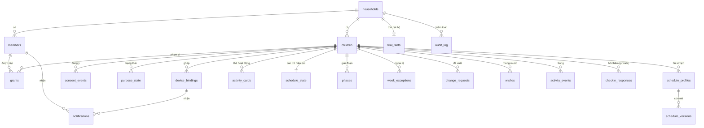

# Tech Spec 13.1 – MVP nấc 1 (A-lite E1)

**Bước:** 13 Tech Spec (sau 12 Kiến trúc)
**Người soạn:** AI, chưa kiểm chứng độc lập · **Trạng thái:** nháp chờ duyệt · **Bản:** 15/11/2026
**Đi kèm:** `Architecture_12_1_System_Architecture.md` (mã `AD-xx`, `C-xx`, `R-xx`, `Q-ARC-xx`), `Dev_Plan_15_1_MVP_Step1.md`
**Nguồn:** `MVP_Step1_Module_List.md` (32 module), `IA_06_1` (màn `PA-xx`, `CA-xx`), `Business_Logic_11_1..11_4_DRAFT.md` (quy tắc `BR-xxx`, `BR-FAM-xxx`, `BR-CON-xxx`, `BR-NTF-xxx`; tiêu chí `AC-xx`, `AC-FAM-xx`, `AC-CON-xx`, `AC-NTF-xx`), `spike-e1-scheduler/`, sổ quyết định D-01..D-46.
**Không thuộc phạm vi:** quyết định thay chủ sản phẩm (D-46, LQ-08 vẫn `[CHỜ CSP]`); mã nguồn; giao diện điểm ảnh.

Spec này **giả định** phương án đề xuất của kiến trúc (Expo hai biến thể + Supabase). Nếu chủ sản phẩm chọn khác ở D-46/LQ-08 thì chỉ phần ghi `[PHỤ THUỘC D-46x]` đổi; mô hình dữ liệu, quyền và API giữ nguyên.

Ký hiệu: `[MĐKT]` mặc định kỹ thuật do AI chọn; `UNKNOWN` nguồn không có số; `(PR-xxx)` tham số chưa chốt trong BL; tên giả khi thử (bé Na, bé Bin, chị Hoa, anh Minh).

---

## 0. Quy ước chung

| Chủ đề | Quy ước |
|---|---|
| Khóa | `uuid` (`gen_random_uuid()`), trừ bảng tra cứu dùng mã chữ (`purposes.code`) |
| Thời gian | Lưu `timestamptz` (UTC). Ngày nghiệp vụ là cột `date` (`local_date`) tính ở máy chủ theo `Asia/Ho_Chi_Minh`; quy ước `v1` = `YYYY-MM-DD`, tính cả hai đầu (BL §6.3). Tuần ISO T2–CN |
| Thứ trong tuần | Mã `T2..CN` như bản thử và spike (`DAYS`) |
| Phiên bản | Lịch bất biến; sửa = phiên bản mới. `schedule_state.rev` tăng 1 mỗi commit (khóa lạc quan) |
| Idempotency | Mọi lệnh ghi có `idempotency_key` (uuid do máy khách sinh) với ràng buộc duy nhất theo (bảng, khóa). Gửi lại cùng khóa trả **kết quả cũ**, không tạo mới (AC-24, FR01-T03, BR-FAM-085) |
| Xóa | Không `delete` dữ liệu con trong luồng thường; đặt `hidden_at` + `hidden_reason`. Xóa hẳn chỉ qua `purge_household` (thử D-01) |
| Lỗi API | HTTP + `{ "error": { "code": "...", "message_vi": "...", "rule": "D-02/C1" } }`. Mã lỗi chung: `UNAUTHENTICATED` 401, `FORBIDDEN` 403, `NOT_FOUND` 404 (cũng dùng khi không được phép biết có tồn tại), `VALIDATION` 422, `CONFLICT_REV` 409, `LOCKED` 409 (`CHO_MO_KHOA`), `FROZEN` 423, `PURPOSE_OFF` 403, `RATE_LIMITED` 429, `IDEMPOTENT_REPLAY` 200 (kèm kết quả cũ), `BLOCKED_H4` 403, `FEATURE_OFF` 403, `INTERNAL` 500. Trường `rule` mang mã quy tắc nghiệp vụ (`D-02/C1`, `D-09`, `J4/OD-02`, `D-19`) |
| Không lộ tồn tại | Mã ghép sai/hết hạn/đã dùng: cùng một lỗi `NOT_FOUND` với cùng thông điệp, cùng thời gian phản hồi xấp xỉ (BR-FAM-031) |
| Nhãn "chưa kiểm chứng" | Mọi `schedule_versions` mang `label_status = 'chua_kiem_chung'` (D-08, D-25); giao diện luôn hiện; không bao giờ hiện như "đạt" (BR-084) |
| Log | Hàm không ghi thân yêu cầu/phản hồi; chỉ `request_id`, mã sự kiện, mã lỗi |
| Tên giả | Seed, test, tài liệu dùng tên giả; không dữ liệu thật trong repo (BR-CON-088) |

---

## 1. Tổng quan thực thể



---

## 2. Mô hình dữ liệu

Cột chung không lặp lại ở từng bảng: `id uuid pk`, `created_at timestamptz default now()`. `h` = có `hidden_at timestamptz`, `hidden_reason text` (tombstone). Schema: `app` (mở API, RLS bật) hoặc `private` (không mở API).

### 2.1 Gia đình, thành viên, ghép máy

| Bảng (schema) | Cột chính | Khóa / ràng buộc | Module | Ghi chú |
|---|---|---|---|---|
| `households` (app) h | `data_class` (`GIA_LAP` \| `THU_NOI_BO_D01`), `state` (`HOAT_DONG` \| `DONG_BANG` \| `CHO_XOA` \| `DA_XOA`), `frozen_at`, `trial_slot_id` | `trial_slot_id` bắt buộc nếu `THU_NOI_BO_D01` | F01-G02-M01, F01-G06-M01 | Không có cột tên gia đình thật; nhãn hiển thị do QL nhập, tùy chọn |
| `members` (app) | `household_id`, `user_id` (→ `auth.users`), `role` (`PRIMARY` \| `SUPPORTER` \| `OBSERVER`), `call_name` (tên gọi), `status` (`DA_THAM_GIA` \| `DA_GO` \| `DA_ROI`), `last_active_at`, `joined_at`, `left_at` | unique(`user_id`) (một hộ); partial unique: đúng một `PRIMARY` `DA_THAM_GIA` mỗi hộ | F01-G02-M01/M02 | Không lưu email ở đây (nằm ở `auth.users`); NL chỉ xem (D-35) |
| `children` (app) h | `household_id`, `call_name` (tên gọi), `grade` (lớp 1..9) hoặc `age_years`, `mode` (`UNSET` \| `PARENT_LED` \| `CHILD_EXECUTED`), `mode_epoch int`, `has_device bool`, `state` (`HOAT_DONG` \| `CHO_XOA` \| `DA_XOA`) | check `mode <> 'CHILD_DIRECTED'` (D-19); `has_device=false` → không cho ghép | F01-G03-M01, F01-G05-M01 | **Không có** cột trường học, địa chỉ, nơi ở (Q-ARC-10), sức khỏe (C-07) |
| `mode_history` (app) | `child_id`, `old_mode`, `new_mode`, `changed_by`, `at` | chỉ-thêm | F01-G05-M01 | BR-FAM-045 |
| `grants` (app) | `member_id`, `child_id`, `resource`, `action` (`view` ở nấc 1), `purpose_code`, `state` (`ACTIVE` \| `REVIEW_REQUIRED` \| `THU_HOI`), `granted_at`, `revoked_at` | unique(`member_id`,`child_id`,`resource`,`purpose_code`) | F01-G04-M01 | Quyền cũ của con giữ nguyên khi đổi QL (D-07) nhưng đổi QL hoãn (D-34) |
| `invitations` (app) | `household_id`, `invited_by`, `role`, `scope_json`, `code_hmac`, `expires_at`, `state` (`DA_GUI` \| `DA_CHAP_NHAN` \| `DA_HUY` \| `HET_HAN`) | unique(`code_hmac`) | F01-G02-M02 | Hạn: PR-FAM-01 `UNKNOWN`, mặc định `[MĐKT]` 72 giờ, nhãn `đề xuất nội bộ`. Cờ `invites_enabled` tắt trong đợt thử (D-35) |
| `device_bindings` (app) | `child_id`, `device_user_id` (→ `auth.users`, ẩn danh), `epoch int`, `state` (`CHO_XAC_NHAN_MAY_CON` \| `HIEU_LUC` \| `DA_HUY` \| `CHO_XAC_MINH`), `paired_by_member_id`, `paired_at`, `revoked_at`, `revoke_reason` (`PIN_MAY_CON` \| `XOA_HO_SO` \| `DONG_BANG`...) | partial unique(`child_id`) where `HIEU_LUC`; partial unique(`device_user_id`) where `HIEU_LUC` | F01-G02-M01, F01-G01-M02 | `CHO_XAC_MINH` chỉ là trạng thái không quyền; nấc 1 không tạo |
| `pairing_codes` (private) | `device_user_id`, `code_hmac`, `expires_at`, `state` (`CON_HAN` \| `DA_DUNG` \| `HET_HAN`), `attempts int` | unique(`code_hmac`) where `CON_HAN` | F01-G02-M01 | Xóa dòng khi dùng xong |
| `parent_pins` (private) | `member_id pk`, `pin_hash`, `failed_count`, `locked_until`, `updated_at` | | F01-G01-M02 | `bcrypt(pin ∥ pepper)`; pepper là secret hàm |
| `push_tokens` (private) | `owner_kind` (`member` \| `device`), `owner_id`, `fcm_token`, `updated_at` | unique(`owner_kind`,`owner_id`) | F04-G07-M01 | Xóa khi hủy liên kết/rời hộ |
| `trial_slots` (app) | `end_date date`, `consent_paper_ref`, `state` (`CHUA_MO` \| `DANG_THU` \| `HET_THU` \| `RUT_SOM` \| `XOA_XONG` \| `TU_CHOI`), `opened_at`, `ended_at`, `purge_due_at` (= `end_date`+7), `purged_at` | trigger: tối đa 3 `DANG_THU` cùng lúc (AC-CON-23); `end_date` và `consent_paper_ref` bắt buộc (AC-CON-24); `end_date ≤ opened_at+14` `[MĐKT]` (Q-ARC-09) | F01-G04-M02 (đề xuất nội bộ), F07-G06-M02 | Chỉ ghi bằng `service_role` (chủ sản phẩm) |

### 2.2 Đồng ý và mục đích

| Bảng | Cột chính | Ràng buộc | Module |
|---|---|---|---|
| `purposes` (app, seed) | `code pk` (`MD-LICH`...`MD-SUCKHOE`), `name_vi`, `depends_on text[]`, `kind` (`LOI` \| `TUY_CHON`), `approval` (`CHUA_DUYET`) | `MD-SUCKHOE` có hàng nhưng `collect_enabled=false` | F07-G06-M01 |
| `policy_versions` (app) | `effective_at`, `purposes_json`, `text_ref` | | F01-G04-M02 |
| `consent_events` (app) | `household_id`, `child_id`, `purpose_code`, `event` (`DONG_Y` \| `RUT`), `actor_member_id`, `policy_version_id`, `method` (`SELF_DECLARED`), `paper_ref`, `at` | **chỉ-thêm** (không cấp UPDATE/DELETE; trigger chặn); `paper_ref` không chứa dữ liệu cá nhân | F01-G04-M02 |
| `purpose_state` (app) | `child_id`, `purpose_code`, `state` (`CHUA_HOI` \| `DANG_BAT` \| `DA_RUT`), `active_since timestamptz` | pk(`child_id`,`purpose_code`); chỉ cập nhật bởi trigger từ `consent_events` | F07-G06-M01 |
| `child_seen_marks` (app) | `child_id`, `content_version`, `seen_at` | unique(`child_id`,`content_version`) | F01-G04-M02 (CA-16) |

### 2.3 Lập lịch

| Bảng | Cột chính | Ràng buộc | Module |
|---|---|---|---|
| `schedule_profiles` (app) h | `child_id`, `kind` (`CHUAN` \| `GIAI_DOAN` \| `PRESET`), `version int`, `input jsonb` (thời khóa biểu theo thứ, bán trú, đi lại, bữa), `budget jsonb` (quỹ 2 cột `wd`/`we` × `hoc_nha`,`sinh_hoat`,`ngu`,`man_hinh`), `keep_confirmed jsonb` (ô nào "bố mẹ đã xác nhận", không có `ngu`), `state` (`DRAFT` \| `ACTIVE` \| `SUPERSEDED` \| `ARCHIVED`), `supersedes_id` | unique(`child_id`,`kind`,`version`); mỗi con ≤1 `CHUAN` `ACTIVE` | F02-G01-M01, F04-G01-M01, F04-G01-M02 |
| `activity_cards` (app) h | `child_id`, `name`, `type` (`hoc_them` \| `the_thao` \| `nang_khieu` \| `khac`), `days text[]`, `start time`, `end time`, `travel_before_min`, `travel_after_min`, `note` (chữ tự do → qua bộ kiểm khẩn trước khi lưu, BR-CON-094), `state` | `end > start`; tên giả khi thử; **không có cột địa điểm** ở nấc 1 (tối thiểu hóa, Q-ARC-10) | F02-G01-M01 |
| `schedule_versions` (app) | `child_id`, `profile_id`, `profile_version`, `phase_id null`, `engine_version`, `params_version`, `input_hash`, `output jsonb` (tuần: `ngay{T2..CN:[khối]}`, `tong_quan`), `tradeoffs jsonb`, `questions jsonb`, `balance_label` (`UNKNOWN` \| ...), `label_status` (`chua_kiem_chung`), `committed_by_kind` (`member` \| `system`), `committed_by`, `commit_reason`, `idempotency_key`, `committed_at` | **bất biến** (không UPDATE/DELETE); unique(`idempotency_key`); check: `output` không vi phạm `protected_hard` (kiểm bởi hàm commit, không chỉ CSDL) | F04-G01-M01, F04-G06-M02 |
| `schedule_state` (app) | `child_id pk`, `rev int`, `effective_version_id`, `base_version_id` (lịch chuẩn mới nhất), `phase_id null`, `lock_state` (`UNLOCKED` \| `LOCKED`), `locked_by`, `locked_at`, `lock_reason` | `rev` tăng khi commit; mở khóa thủ công, không tự mở (B01C-OD-05) | F04-G01-M01 |
| `phases` (app) | `child_id`, `name`, `purpose`, `source` (`bo_me` \| `con_de_xuat`), `mode_at_submit`, `from_date`, `to_date`, `loosen jsonb` (`noi_long[]`), `prev_version_id`, `state` (`CHO_XAC_NHAN` \| `DANG_AP_DUNG` \| `HET_HAN` \| `DA_KET_THUC` \| `TU_CHOI` \| `CHO_MO_KHOA`), `next_review_date` | check `to_date - from_date + 1 ≤ 60` (D-09); `loosen` không chứa `ngu` (J4/OD-02); mỗi con ≤1 `DANG_AP_DUNG` (BR-105); giai đoạn tương tự cách nhau ≥7 ngày (AC-18) | F04-G02-M03, F04-G01-M01 |
| `week_exceptions` (app) h | `child_id`, `local_date`, `kind` (`nghi_buoi` \| `hoc_bu` \| `om_huy_ngay` \| `khac`), `replacement jsonb`, `reason` (chữ tự do → bộ kiểm khẩn), `state` (`HIEU_LUC` \| `HET_HIEU_LUC` \| `DA_BO`) | Theo **ngày cụ thể** (BR-143), tự hết khi qua ngày | F04-G01-M01, F06-G02-M02 |
| `schedule_answers` (app) | `child_id`, `question_key` (`g7_bot_hoc_nha`...), `local_date`, `answer`, `answered_by`, `at` | unique(`child_id`,`question_key`,`local_date`) (hỏi một lần, A2) | F04-G02-M01 |

### 2.4 Đề xuất, mong muốn, phê duyệt

| Bảng | Cột chính | Ràng buộc | Module |
|---|---|---|---|
| `change_requests` (app) | `child_id`, `kind` (`doi_lich` \| `giai_doan`), `template_code`, `payload jsonb` (từ mẫu cố định, không chữ tự do), `base_rev`, `mode_epoch`, `lock_state_at_submit`, `state` (`PENDING` \| `APPROVED` \| `APPLIED` \| `REJECTED` \| `EXPIRED` \| `INVALIDATED`), `invalid_reason`, `submitted_at` (giờ máy chủ), `expires_at` (= +7 ngày; `APPROVED` chưa áp: +7 ngày từ lúc duyệt), `approver_member_id`, `decided_at`, `idempotency_key` | Chỉ tạo được khi mode hiệu lực `CHILD_EXECUTED` (BR-NTF-043); unique(`idempotency_key`); CR phạm sàn ngủ: `approvable=false` | F04-G06-M01, F04-G03-M02 |
| `wishes` (app) | `child_id`, `template_code`, `related_date`, `related_block_key`, `state` (`DA_GUI` \| `DA_XEM` \| `DE_SAU` \| `DA_XU_LY`), `sent_at`, `seen_at` | unique(`child_id`,`template_code`,`related_date`) → gộp (BR-NTF-049); chỉ khi mode `UNSET`/`PARENT_LED`; **không hết hạn** (D-39) | F04-G06-M01 |

### 2.5 Thực hiện và báo cáo

| Bảng | Cột chính | Ràng buộc | Module |
|---|---|---|---|
| `activity_events` (app) | `child_id`, `local_date`, `block_key`, `kind` (`DONE` \| `UNDO`), `occurred_at`, `received_at`, `binding_epoch`, `schedule_rev`, `idempotency_key` | chỉ-thêm; unique(`idempotency_key`); trạng thái = sự kiện mới nhất theo (`child_id`,`local_date`,`block_key`); `Hoàn tác` chỉ trong ngày (BR-NTF-012) | F06-G01-M01, F04-G05-M01 |
| `checkin_responses` (**private**) | `child_id`, `local_date`, `choice` (`on` \| `hoi_met` \| `rat_met` \| `bo_qua`), `day_features text[]` (nhãn suy ra từ lịch **lúc nhận**), `occurred_at`, `received_at`, `undone_at`, `idempotency_key` | unique(`idempotency_key`); **không có chính sách nào cho vai người lớn**; ghi một lần mỗi (`child_id`,`local_date`) | F04-G05-M01 |
| `child_settings` (**private**) | `child_id pk`, `checkin_invite_enabled bool` | Phụ huynh không đọc (BR-CON-034) | F04-G05-M01 |
| `notifications` (app) | `type`, `recipient_kind` (`member` \| `device`), `recipient_id`, `child_id`, `idempotency_key`, `state` (`TAO` \| `HOAN` \| `CHO_GUI` \| `DA_GUI` \| `DA_MO` \| `LOI` \| `HUY`), `payload_min jsonb` (`{type,id}`), `send_after`, `attempts`, `last_error_code` | unique(`idempotency_key`); không có loại liên quan hỏi thăm | F04-G07-M01 |
| `notification_log` (app) | `notification_id`, `type`, `recipient_id`, `scheduled_at`, `sent_at`, `result` | chỉ-thêm; không nội dung | F04-G07-M01 |
| `notification_prefs` (app) | `member_id`, `type`, `enabled`, `quiet_from`, `quiet_to` | giờ yên lặng mặc định **tắt** (BR-NTF-033); loại bắt buộc không tắt được | F04-G07-M02 |

### 2.6 Vòng đời, kiểm toán

| Bảng | Cột chính | Ghi chú | Module |
|---|---|---|---|
| `deletion_requests` (app) | `household_id`, `scope` (`HO_SO_CON` \| `NGUOI_LON_ROI` \| `GIA_DINH`), `child_id null`, `requested_by`, `accepted_at` (**lần đầu**), `state`, `due_at null` (`UNKNOWN` → `CHO_QUYET_HAN`) | Gửi lặp giữ `accepted_at` đầu (AC-CON-17) | F01-G06-M01, F07-G06-M02 |
| `export_requests` (app) | `requested_by`, `scope`, `state` (`XEP_HANG` \| `CHAN_H4` \| `SAN_SANG` \| `HET_HAN_TAI`) | Dữ liệu thật: `CHAN_H4` (AC-CON-20) | F07-G06-M02 |
| `deletion_evidence` (app) | `household_ref_hash`, `reason`, `purged_at`, `row_counts jsonb` | Không dữ liệu cá nhân; giữ đến khi luật sư (D-44) | F07-G06-M02 |
| `audit_log` (app) | `at`, `household_id`, `actor_kind`, `actor_id`, `event_code`, `subject_ref`, `meta jsonb` | chỉ-thêm; không PIN/mã/token/chữ tự do/lựa chọn hỏi thăm (BR-CON-074, B01C-OD-07) | F01-G04-M02, F04-G06-M02 |
| `job_runs` (app, chỉ `service_role`) | `job`, `run_at`, `status`, `summary` | Quan sát vận hành | — |

Gói nội dung an toàn tĩnh **không nằm trong CSDL**: tệp JSON có phiên bản trong `packages/content/safety/`, người duyệt câu chữ ký ở PR, đóng kèm cả hai app (F07-G01-M01, BR-NTF-068).

### 2.7 Chính sách truy cập theo vai trò (RLS)

Ký hiệu: **R** đọc, **W** ghi (insert/update qua hàm), **—** không có chính sách (mặc định từ chối), **H** qua hàm hẹp. "Hệ thống" = `service_role` trong Edge Function/job. Mọi chính sách thêm: hộ không `DONG_BANG` (đọc luôn được cho QL để thấy trạng thái), `hidden_at is null`, và `app.can(...)` đúng hành động/mục đích.

| Bảng | QL | NL (D-35) | Con (máy đã ghép) | Hệ thống |
|---|---|---|---|---|
| `households`, `members` | R (hộ mình); W qua hàm | R (hộ mình, danh sách) | R tên người lớn để chọn gửi (sau này, tắt ở đợt thử) | W |
| `children` | R/W | R nếu grant | R hàng của mình (tên gọi, mode) | W |
| `grants`, `invitations` | R/W qua hàm | R phần của mình | — | W |
| `device_bindings` | R (con của hộ) | — | R hàng của mình | W |
| `pairing_codes`, `parent_pins`, `push_tokens` | — | — | — | W |
| `purposes`, `policy_versions` | R | R | R | W |
| `consent_events` | R (hộ); W thêm sự kiện qua hàm | R/W phần **của chính mình** | — (xem CA-16 dựng từ bảng quyền qua hàm) | W |
| `purpose_state` | R | R nếu grant | R (để ẩn nút) | W (trigger) |
| `schedule_profiles`, `activity_cards`, `schedule_answers` | R/W qua hàm | R nếu grant | — | W |
| `schedule_versions`, `schedule_state` | R | R nếu grant | R **qua `device-sync`** (hàm trả gói); không đọc bảng trực tiếp | W |
| `phases`, `week_exceptions` | R/W qua hàm | R nếu grant | R qua gói đồng bộ | W (job) |
| `change_requests` | R, duyệt/không duyệt qua hàm | — | R/W hàng của mình (tạo qua hàm) | W (hết hạn) |
| `wishes` | R; đổi `DE_SAU` qua hàm | — | R/W hàng của mình | W |
| `activity_events` | R | R nếu grant | R/W hàng của mình (qua hàm đẩy) | W |
| `checkin_responses`, `child_settings` (private) | **—** | **—** | R/W hàng của mình **chỉ qua hàm** (không mở schema) | W; tổng hợp qua `app.weekly_report` (H) |
| `notifications` | R hàng của mình | R hàng của mình | R hàng của mình | W |
| `notification_prefs` | R/W của mình + nhắc máy con | R/W của mình | R/W phần "tắt lời mời hỏi thăm" qua `child_settings` | W |
| `audit_log` | R (hộ mình) | — | — | W |
| `deletion_requests`, `export_requests` | R/W | R/W của mình | — | W |
| `trial_slots`, `deletion_evidence`, `job_runs` | R (trạng thái thử của hộ) | — | — | W (chủ sản phẩm) |

### 2.8 Hàm SQL cốt lõi (schema `app`, `security definer`, `search_path` cố định, `(select auth.uid())`)

| Hàm | Vai trò |
|---|---|
| `app.can(actor uuid, action text, child uuid, purpose text) → bool` | Một điểm ALLOW/DENY (AD-09), fail-closed |
| `app.is_primary(child)`, `app.is_member(household)`, `app.is_bound_device(child)` | Tiện ích cho chính sách |
| `app.purpose_effective(child, code) → bool` | Mục đích bật và mọi phụ thuộc bật |
| `app.visible_from(child, code) → timestamptz` | `active_since` để lọc dữ liệu cũ |
| `app.household_frozen(child) → bool` | |
| `app.weekly_report(child, iso_week) → jsonb` | Duy nhất đường trả dữ liệu từ `checkin_responses`: chỉ đếm theo loại ngày (H, mục 6.3 kiến trúc) |
| `app.effective_day(child, date) → jsonb` | Cùng logic với `packages/domain.effectiveDay` (kiểm đối chiếu hai bản trong test) |
| `app.touch_active()` | Cập nhật `last_active_at` của người gọi |
| `app.purge_household(household, reason)` | Chỉ `service_role`; từ chối nếu không phải `THU_NOI_BO_D01` hoặc `GIA_LAP` |

---

## 3. API và Edge Function

Mọi hàm: kiểm JWT, gọi `app.can`, trả lỗi chuẩn mục 0. "QL/NL/Con/SYS" = ai gọi. Giao diện: HTTPS JSON `POST /functions/v1/<tên>` (RPC đơn giản dùng PostgREST `rpc`). Thời gian trả lời mục tiêu: `UNKNOWN`, đo ở T0.5.

### 3.1 Danh mục

| # | Hàm | Gọi | Việc | Module |
|---|---|---|---|---|
| 1 | `family-create` | QL | Tạo hộ + `members` PRIMARY; hộ `GIA_LAP` mặc định | F01-G02-M01 |
| 2 | `child-create` / `child-update` | QL | Tạo/sửa hồ sơ con (kiểm khẩn ở chữ tự do) | F01-G03-M01 |
| 3 | `child-delete` | QL | Ẩn hồ sơ con, hủy liên kết, vô hiệu CR (BR-FAM-080) | F01-G06-M01 |
| 4 | `mode-set` | QL | Đổi mode (`CHILD_DIRECTED` → `VALIDATION`/`D-19`) | F01-G05-M01 |
| 5 | `pair-code-create` | Con (ẩn danh) | Sinh mã ghép | F01-G02-M01 |
| 6 | `pair-confirm` | QL | Nhập mã, đặt PIN lần đầu | F01-G02-M01, F01-G01-M02 |
| 7 | `pair-accept` | Con | Xác nhận trên máy con | F01-G02-M01 |
| 8 | `unlink-device` | Con + PIN | Hủy liên kết (FR-01) | F01-G01-M02 |
| 9 | `pin-set` | QL | Đặt/đổi PIN | F01-G01-M02 |
| 10 | `touch-active` | QL/NL | Cập nhật hoạt động | F01-G06-M01 |
| 11 | `member-invite` / `-accept` / `-remove` / `-leave` | QL / NL | Mời, nhận, gỡ, rời (cờ tắt ở đợt thử) | F01-G02-M02 |
| 12 | `consent-record` | QL/NL | Ghi `DONG_Y`/`RUT` theo mục đích | F01-G04-M02 |
| 13 | `consent-withdraw-all` | QL | Xác nhận 2 lần → rút mọi mục → yêu cầu xóa | F01-G04-M02, F01-G06-M01 |
| 14 | `child-seen-mark` | Con | Ghi "Con hiểu rồi" (CA-16) | F01-G04-M02 |
| 15 | `profile-save` | QL | Lưu nháp hồ sơ lịch, thẻ, quỹ, "Giữ mức này" | F02-G01-M01, F04-G02-M03 |
| 16 | `schedule-preview` | QL | Chạy bộ xếp, trả lịch nháp (không lưu) | F04-G02-M01/M02 |
| 17 | `schedule-commit` | QL | Chạy lại + kiểm + lưu phiên bản + outbox | F04-G01-M01 |
| 18 | `lock-set` | QL | Khóa/mở khóa thủ công | F04-G01-M01 |
| 19 | `phase-submit` / `phase-end` | QL | Gửi, áp dụng, kết thúc sớm giai đoạn | F04-G02-M03 |
| 20 | `exception-set` / `exception-clear` | QL | Ngoại lệ chỉ tuần này, theo ngày | F04-G01-M01 |
| 21 | `device-sync` | Con | Gói đồng bộ | F04-G04-M01 |
| 22 | `device-push-ops` | Con | Đẩy hàng đợi: Xong/Hoàn tác, hỏi thăm, mong muốn, đề xuất | F04-G05-M01, F04-G06-M01, F06-G01-M01 |
| 23 | `wish-list` / `wish-mark` | QL | Xem mong muốn, "Để sau" | F04-G06-M01 |
| 24 | `cr-decide` | QL | Duyệt / không duyệt đề xuất | F04-G03-M02, F04-G06-M01 |
| 25 | `weekly-report-get` | QL/NL | Báo cáo tuần theo quyền | F06-G05-M02 |
| 26 | `progress-get` | Con | Tuần của mình (CA-13) | F06-G02-M01 |
| 27 | `push-register` | QL/NL/Con | Đăng ký token FCM | F04-G07-M01 |
| 28 | `notify-dispatch` | SYS | Gửi FCM từ outbox | F04-G07-M01 |
| 29 | `notif-prefs-get` / `-set` | QL/NL | Tùy chọn thông báo | F04-G07-M02 |
| 30 | `deletion-request` | QL/NL | Yêu cầu xóa (idempotent) | F07-G06-M02 |
| 31 | `export-request` | QL | Trả `BLOCKED_H4` cho dữ liệu thật | F07-G06-M02 |
| 32 | `keyword-check` | QL | Kiểm chữ tự do (trước lưu); trả có/không khớp, **không ghi nhãn hồ sơ** | F07-G01-M01 |
| 33 | `talk-send` | Con | Gửi "Con cần nói chuyện" → `FEATURE_OFF` ở đợt thử (D-43) | F04-G07-M01 |
| 34 | `trial-open` / `trial-close` / `trial-purge` | Chủ sản phẩm (service role) | Quản lý `trial_slots`, xóa D-44 | F07-G06-M02 |
| 35 | `job-daily`, `job-weekly-report`, `job-notify-retry`, `job-trial-purge` | SYS (cron) | Mục 4 | nhiều |

### 3.2 Hợp đồng chi tiết các hàm quan trọng

**`pair-code-create`** (Con, phiên ẩn danh)
- Vào: `{}` (danh tính từ JWT).
- Ra: `{ code: "ABCD2345", expires_at }`. Máy chủ lưu `HMAC(code)`; mỗi `device_user_id` tối đa 1 mã `CON_HAN` (mã mới hủy mã cũ).
- Lỗi: `RATE_LIMITED`.

**`pair-confirm`** (QL)
- Vào: `{ child_id, code, pin? (bắt buộc lần ghép đầu của hộ), idempotency_key }`.
- Kiểm: QL của hộ chứa `child_id`; `children.has_device = true`; hộ không `DONG_BANG`; mã còn hạn/chưa dùng; con chưa có `HIEU_LUC`; thiết bị chưa ghép nơi khác; số lần thử.
- Ra: `{ binding_id, state: "CHO_XAC_NHAN_MAY_CON" }`.
- Lỗi: `NOT_FOUND` (mã sai/hết hạn/đã dùng, một thông điệp chung), `FORBIDDEN`, `FROZEN`, `RATE_LIMITED`, `VALIDATION` (`pin` thiếu). Ghép với con đã có liên kết ở hộ khác: `NOT_FOUND` (không lộ), ghi audit.

**`pair-accept`** (Con): Vào `{ binding_id }`; ra `{ epoch }`. Chuyển `HIEU_LUC`, tăng epoch, xóa mã, audit, thông báo "Đã ghép máy của [tên gọi]". Hết 5 phút chưa chạm: `HET_HAN`.

**`unlink-device`** (Con)
- Vào: `{ pin, binding_epoch, idempotency_key }`.
- Kiểm theo thứ tự: epoch khớp; QL còn quyền hiện hành; hộ không bị khóa PIN (`locked_until`); PIN đúng; commit một giao dịch.
- Ra: `{ unlinked: true }`. Hiệu lực: `DA_HUY`, epoch+1, xóa token đẩy của máy con, vô hiệu phiên, audit, thông báo tối giản cho QL (không PIN/mã), **không xóa dữ liệu của con** (FR01-T03..T04).
- Lỗi: `FORBIDDEN` (PIN sai; tăng `failed_count`), `RATE_LIMITED` (khóa), `CONFLICT_REV` (epoch cũ). PIN sai và khóa đều không tiết lộ dữ liệu.

**`schedule-preview`** (QL)
- Vào: `{ profile_id, week_start?, answers? }`.
- Ra: `{ plan, tradeoffs[], questions[], board (quỹ + màu + giu_muc), warnings[], balance_label: "UNKNOWN", label_status: "chua_kiem_chung", engine_version, params_version, input_hash }`. Không ghi.
- Lỗi: `VALIDATION` (thiếu trường bắt buộc BR-001..009), `FORBIDDEN`, `FROZEN`.

**`schedule-commit`** (QL)
- Vào: `{ profile_id, expected_rev, answers, confirmed_red[], idempotency_key }`.
- Hành vi: chạy lại bộ xếp từ dữ liệu **máy chủ** (không tin kết quả máy khách); từ chối nếu phạm sàn cứng, nếu còn ô đỏ chưa xác nhận, nếu hộ khóa/đóng băng; tạo `schedule_versions` + cập nhật `schedule_state` + `audit_log` + `notifications(lich_moi)` **trong một giao dịch**.
- Ra: `{ version_id, rev, label_status }`.
- Lỗi: `VALIDATION` kèm `rule` (`D-02/C1`, `C2`...), `CONFLICT_REV`, `LOCKED`, `IDEMPOTENT_REPLAY`.

**`phase-submit`** (QL)
- Vào: `{ child_id, name, purpose, from_date, to_date, loosen[] , idempotency_key }`.
- Kiểm: ≤60 ngày tính cả hai đầu → `VALIDATION rule=D-09` kèm `latest_end_date`; `loosen` không chứa `ngu` → `rule=J4/OD-02`; không chồng/không gần giai đoạn tương tự (<7 ngày) → `rule=P5-OD-02` kèm ngày sớm nhất; lịch khóa → `LOCKED` trạng thái `CHO_MO_KHOA`; nguồn con ở `PARENT_LED`/`UNSET` → thành `wishes`.
- Ra: `{ phase_id, state }`; áp dụng lưu `prev_version_id`.

**`device-sync`** (Con)
- Vào: `{ since_rev?, binding_epoch, app_version }`.
- Ra: `{ rev, today_vn, bundle: { base: <tuần chuẩn mới nhất>, phase: { to_date, schedule } | null, exceptions: [...], lock_state }, mode, frozen: bool, purposes: { MD-XONG, MD-MET, MD-MONGMUON: bool }, seen_content_version, valid_through }` hoặc `{ unchanged: true }`. Nếu binding không còn `HIEU_LUC`: `403 FORBIDDEN rule=UNLINKED` → máy con xóa dữ liệu cục bộ, hiện CA-17.
- Không trả bất kỳ dữ liệu nào của người lớn (chỉ tên gọi người lớn ở bước ghép).

**`device-push-ops`** (Con)
- Vào: `{ binding_epoch, ops: [{ id (uuid), type: "DONE|UNDO|CHECKIN|WISH|CR", occurred_at, schedule_rev, ... }] }` (≤100 op/lần).
- Mỗi op xử lý độc lập, kiểm: epoch, hộ không đóng băng, mục đích hiệu lực, mode (BR-NTF-043/044), `Hoàn tác` chỉ trong ngày, hỏi thăm ghi một lần/ngày, mong muốn chỉ từ mẫu cố định.
- Ra: `{ accepted: [id], rejected: [{ id, code, rule }] }` (không ghi đè im lặng).

**`weekly-report-get`** (QL/NL)
- Vào: `{ child_id, iso_week }` (**không** nhận khoảng ngày).
- Ra: `{ status: "CHUA_DU|SAN_SANG", cutoff_at, done: { x, y } , exceptions: [...], phases: [...], wishes_count, trend: { present: bool, text_key, counts_by_feature: {hoc_them_toi: 2} } | null }`.
- `trend` chỉ khi `now ≥ cutoff_at`, MD-MET và MD-BAOCAO bật, người xem có quyền xu hướng, ≥1 "Rất mệt" chưa hoàn tác tính tới mốc cắt. `done` tính tới mốc cắt; `x/y` theo BR-NTF-052/053; không phần trăm.

**`consent-record`** (QL/NL)
- Vào: `{ child_id, purpose_code, event: "DONG_Y|RUT", policy_version_id, paper_ref?, idempotency_key }`.
- Hiệu lực: thêm sự kiện; trigger cập nhật `purpose_state`; tác động phụ thuộc (AC-CON-03); vô hiệu CR khi rút `MD-MONGMUON` (AC-CON-04). NL chỉ ghi cho chính mình (AC-CON-05).

**`trial-purge`** (service role): xem mục 4.2.

**`talk-send`**: trả `403 FEATURE_OFF` khi cờ `talk_send_enabled=false` (mặc định, D-43). Khi bật sau này: bản ghi giao tin ở `private.talk_messages`, xóa khi giao xong.

---

## 4. Sự kiện và job

### 4.1 Sự kiện miền

| Sự kiện | Sinh bởi | Kết quả |
|---|---|---|
| `schedule.committed` | `schedule-commit`, `job-daily` (hết hạn giai đoạn) | `notifications(lich_moi)` cho máy con; audit; nếu hệ thống: `commit_reason = 'het_han_giai_doan (D-09)'` |
| `phase.expired` | `job-daily` (`to_date < today_vn`) | `phases.state = HET_HAN`; xếp lại từ lịch chuẩn mới nhất; commit hệ thống; thông báo cho phụ huynh có quyền (BR-NTF-022) |
| `binding.paired` / `binding.unlinked` | `pair-accept`, `unlink-device`, `child-delete` | Thông báo bắt buộc tối giản |
| `consent.withdrawn` | `consent-record` | Ẩn dữ liệu mục đích; hủy nhắc; vô hiệu CR |
| `household.frozen` / `reopened` | `job-daily`, mở lại bởi QL | Thông báo bắt buộc; máy con hiện tạm dừng |
| `wish.sent` | `device-push-ops` | Thông báo "Con gửi một mong muốn" (không loại, không chữ "mệt") |
| `cr.submitted` / `decided` / `expired` | `device-push-ops`, `cr-decide`, `job-daily` | Thông báo kết quả cho con (BR-NTF-024) |

### 4.2 Job (idempotent, tính theo ngày)

| Job | Việc chi tiết | Điều kiện dừng |
|---|---|---|
| `job-daily` (00:05 VN) | (1) `tickPhases` theo ngày: giai đoạn `to_date < hôm nay` → `HET_HAN`, commit hệ thống, **kể cả khi khóa hoặc đóng băng** (BR-FAM-056); (2) CR `PENDING` quá `expires_at` → `EXPIRED`; `APPROVED` chưa áp quá hạn → `EXPIRED`; (3) ngoại lệ qua ngày → `HET_HIEU_LUC`; (4) lời mời quá hạn → `HET_HAN`; (5) đóng băng: với mỗi hộ, nếu `max(last_active_at)` các người lớn đã tham gia cách ≥30 ngày → `DONG_BANG` và thông báo; nếu chỉ QL quá hạn mà NL còn dùng → nhắc QL (một lần/chu kỳ, PR-FAM-07 `UNKNOWN`); (6) mã ghép quá hạn, người dùng ẩn danh chưa ghép >7 ngày → xóa; (7) `trial_slots` đến `end_date` → `HET_THU` (ngừng thu, mọi hàm ghi trả `FROZEN`-tương đương) | Chạy bù: nếu bỏ lỡ nhiều ngày thì xử lý theo ngày thật, không theo số lần chạy |
| `job-weekly-report` (CN 20:00) | Với mỗi con có ≥1 ngày lịch commit và MD-BAOCAO bật: tạo `notifications(tom_tat_tuan)` cho người có quyền xem; payload không số | Khóa (child, tuần) |
| `job-notify-retry` (5 phút) | Gửi lại thông báo `LOI`/`CHO_GUI` quá hạn cùng khóa; kiểm quyền người nhận trước khi gửi | |
| `job-trial-purge` (03:00 VN) | `trial_slots` có `purge_due_at ≤ today` hoặc `RUT_SOM`: gọi `app.purge_household`; ghi `deletion_evidence`; thông báo chủ sản phẩm | Chỉ `THU_NOI_BO_D01`/`GIA_LAP`; từ chối cho dữ liệu thật ngoài thử |

---

## 5. Cấu trúc thư mục mã nguồn đề xuất

Giữ nguyên `mobile/` và `supabase/` cũ (D-31). Mã mới ở thư mục mới (Q-ARC-04).

```
apps/
  mobile/                        # MỘT dự án Expo, hai biến thể
    app.config.ts                # APP_VARIANT=parent|child -> applicationId, tên, quyền, plugin
    eas.json                     # hồ sơ preview (APK); không khóa
    src/
      app/(parent)/...           # route group phụ huynh (PA-xx)
      app/(child)/...            # route group con (CA-xx)
      features/
        pairing/  consent/  schedule/  phases/  exceptions/  wishes/
        checkin/  report/  family/  lifecycle/  safety/
      data/                      # SQLite, hàng đợi gửi, client đồng bộ, API client
      notifications/             # đặt nhắc cục bộ, đăng ký FCM, module báo thức native
      ui/                        # thành phần dùng chung (tham khảo mobile/src/ui)
      lab/                       # màn đo nhắc giờ (tái dùng từ mobile/src/lab), tắt ở bản gia đình
packages/
  scheduler/                     # TS thuần, KHÔNG phụ thuộc: scheduler, validators, phase, params, trend, rules(doc)
    src/ test/ fixtures/golden/  # P1..P8.json từ spike làm golden
  domain/                        # kiểu dữ liệu chung, effectiveDay, mã lỗi, hằng số, múi giờ VN
  content/                       # câu mẫu cố định, mẫu mong muốn, nội dung an toàn tĩnh (JSON có phiên bản)
backend/
  supabase/
    config.toml
    migrations/                  # baseline + từng bước; tên theo thời gian
    seed/                        # dữ liệu giả lập (tên giả), KHÔNG dữ liệu thật
    functions/
      _shared/                   # auth, errors, policy (gọi app.can), notify, scheduler (sinh bởi script)
      family-*/ pair-*/ unlink-device/ consent-*/ profile-save/ schedule-*/ phase-*/ exception-*/
      device-sync/ device-push-ops/ wish-*/ cr-decide/ weekly-report-get/ notify-dispatch/
      job-daily/ job-weekly-report/ job-notify-retry/ job-trial-purge/ trial-*/
    tests/
      rls/                       # test RLS + policy-matrix.json
      sql/                       # pgTAP hoặc test hàm
scripts/
  sync-shared.mjs                # chép packages/scheduler -> functions/_shared (CI kiểm không lệch)
  scan-secrets.mjs               # quét bí mật trong CI
  gen-seed.mjs                   # sinh seed từ profiles.js
documents/ ...                   # tài liệu (không đổi cấu trúc)
```

Quy ước nhánh/PR: `nac1/<mã-task>-<slug>` (xem Dev Plan). Không commit `.env`, `google-services.json`, khóa ký (đã có trong `.gitignore`).

---

## 6. Quy ước test

### 6.1 Bộ xếp lịch (đơn vị, `node:test`, không package)

| Nhóm | Nội dung | Nguồn |
|---|---|---|
| Hồi quy từ spike | 32 test `TC-*` của `test-rules-v2.js` chuyển nguyên (D-02, D-08, D-09, D-10, B-1, B-2, tất định) | Đã chạy: 32/32 đạt (15/11/2026, bản sao tạm) |
| Golden | Với 8 hồ sơ `profiles.js`, đầu ra `scheduleWeek` khớp `out/P1..P8.json` về giờ và tên khối (khác biệt chỉ ở `ghi_chu` được liệt kê rõ) | Spike CHANGES §3 |
| Đột biến | `mutation-test.js` (11/12); thêm ca sửa B-11c (tập mạnh kết thúc sau giờ tắt đèn); mục tiêu 12/12 | Spike |
| Tham số D-23 | Nghỉ ≥5′ (có); học thêm ngay sau giờ trường ≥15′ phục hồi trước (code mới, Q-BL-04), bữa ≥20′, câu hỏi G7 một lần; mỗi tham số một test dương, một test âm | BL §6, D-23 |
| `kind` có cấu trúc | Bộ kiểm không còn regex trên tên khối; thêm test với tên khối tùy ý ("Karate") | BL B-11 |
| Giai đoạn | 61 ngày bị từ chối; 60 nhận; hết hạn đúng ngày; `CHO_MO_KHOA`; chống chồng; ≥7 ngày trống; `ngu` không nới | AC-12..18 |
| Xu hướng | Thay `trend()` theo D-37: theo loại ngày, từ 1 lần, không theo thứ, không ngày | BR-NTF-059 |
| `effectiveDay` | Biên: ngày cuối giai đoạn, ngày sau, ngoại lệ đè giai đoạn, ngoại tuyến (không đọc đồng hồ), tuần giao thời, hai bản (TS và SQL) cho cùng kết quả trên ma trận ngày | AC-13, D-24 |
| Tất định | Cùng input chạy 2 lần cho cùng `input_hash` và cùng đầu ra | AC-06 |

### 6.2 RLS và quyền (CSDL thật, cục bộ)

| Mã | Kiểm | Nguồn |
|---|---|---|
| RLS-GEN-01 | Mọi bảng `app` có RLS bật; thiếu dòng trong `policy-matrix.json` thì thất bại | AD-08 |
| RLS-GEN-02 | Vai `anon` và `authenticated` không `select` được gì từ `private.*` | AD-08 |
| RLS-ROLE-xx | Với mỗi bảng × vai (QL, NL, Con đã ghép, Con chưa ghép, người dùng hộ khác, anon) kiểm đúng R/W theo mục 2.7; **mặc định từ chối** | CAP-2 |
| RLS-FAM-01..05 | AC-FAM-01..05, 11, 12, 16 (NL không duyệt; gỡ NL thu hồi grant; hộ khác không ghép) | BL 11.2 |
| RLS-EPOCH | Token của liên kết cũ không đọc/ghi được sau khi epoch tăng (FR01-T09, T10) | FR-01 |
| RLS-PURPOSE | Rút mục đích → dữ liệu cũ không hiện; đồng ý lại → vẫn không hiện cũ (AC-CON-02, 07) | BL 11.3 |
| RLS-FROZEN | Hộ đóng băng: mọi hàm ghi trả `FROZEN` trừ danh sách ngoại lệ (AC-FAM-22..25) | BL 11.2 |
| RLS-D38-01..07 | Mục 6.3 kiến trúc: đọc trực tiếp bị từ chối; không có đường vòng; `weekly_report` không nhận khoảng ngày; mốc cắt; **test không-suy-ngược** (hai bộ dữ liệu chỉ khác ngày cho cùng đầu ra ở mọi điểm người lớn đọc được) | D-38, BR-CON-039 |

Cách chạy: Supabase CLI cục bộ (cần Docker), Node với `@supabase/supabase-js` tạo JWT cho từng vai, hoặc pgTAP. Chưa cài gói nào trong lượt này; công cụ cụ thể chọn ở T0.6.

### 6.3 Luồng an toàn

| Mã | Kiểm | Nguồn |
|---|---|---|
| SAFE-01 | Nội dung an toàn cho trẻ chỉ có "nói với người lớn con tin cậy" và 111; **không** chứa 113/115 (quét chuỗi trong gói) | AC-NTF-27 |
| SAFE-02 | Nội dung người lớn có 115, 113, 111, kèm "khi nào gọi số nào"; nút gọi chỉ mở trình quay số | AC-NTF-33 |
| SAFE-03 | Mở và đóng CA-14 **không tạo yêu cầu mạng nào** (chặn `fetch`, đếm bằng 0) và không ghi SQLite/audit | AC-NTF-28, AC-CON-11 |
| SAFE-04 | `talk-send` trả `FEATURE_OFF` khi cờ tắt; nút gửi không hiện ở bản thử | D-43 |
| SAFE-05 | Chữ tự do của phụ huynh khớp từ khóa → một dòng dưới ô, không popup, vẫn lưu, không nhãn hồ sơ | AC-NTF-32, BR-CON-094 |
| SAFE-06 | Ô Ngủ không có "Giữ mức này" (UI **và** API) | AC-01 |
| SAFE-07 | "Rất mệt" không đổi lịch: so lịch trước/sau byte-for-byte | AC-25, AC-NTF-17 |
| SAFE-08 | Thông báo xem trước không chứa số liệu, "mệt", mã, PIN | AC-NTF-10, 26 |

### 6.4 Tích hợp và máy thật

- **Lab nhắc giờ** (tái dùng công cụ đo của `mobile/src/lab`): ghi giờ hẹn, giờ thật, độ lệch, % pin; ≥3 hãng máy; kết quả ghi vào một nhật ký mới của nấc 1 (không trộn vào `ref-nhat-ky-test.md` của Plan A; Q-DEV-05). Không có ngưỡng đạt/không đạt do nguồn (BR-NTF-004); ghi số thật.
- **Dry-run Kit 03** với dữ liệu giả trên ≥2 máy thật trước khi gặp gia đình.
- **Quét bí mật** trong CI (`scan-secrets`), quét chuỗi 'service_role', 'google-services', khóa `AIza...`, v.v.
- **Kiểm không có dữ liệu thật trong repo**: tên trong seed thuộc danh sách tên giả.

### 6.5 Định nghĩa "xong" mỗi PR

Test mới + cũ đạt; migration chạy sạch từ trống; RLS-GEN đạt; không bí mật; tài liệu liên quan (BL/IA) có ghi chú nếu đổi; mã `AC-xx` được dẫn trong mô tả PR; nhãn `người soạn: AI` giữ nguyên; không đổi `prototype/index.html`.

---

## 7. Ánh xạ module → bảng / API / màn

Màn lấy từ cột "Màn hình" của `MVP_Step1_Module_List.md` (§3, §3.6). 32 module.

| # | Mã L3 | Tên | Bảng | API / hàm | Màn |
|---|---|---|---|---|---|
| 1 | F01-G01-M01 | Account Access | `members`, `auth.users`, `households.state` | `family-create`, `touch-active`, đăng nhập (Auth) | PA-01, PA-37, PA-38, PA-39 |
| 2 | F01-G01-M02 | Session Security | `parent_pins`, `device_bindings`, `push_tokens` | `pin-set`, `unlink-device`, `pair-confirm` | PA-14, PA-15, PA-38, CA-11, CA-12 |
| 3 | F01-G02-M01 | Family Structure | `households`, `children`, `device_bindings`, `pairing_codes` | `family-create`, `pair-code-create`, `pair-confirm`, `pair-accept` | PA-03, PA-13, PA-35, CA-01, CA-02, CA-03, CA-17 |
| 4 | F01-G02-M02 | Member Relationships | `members`, `invitations`, `grants` | `member-*` (cờ tắt ở đợt thử) | PA-28, PA-29, PA-31 |
| 5 | F01-G03-M01 | Core Identity | `children` | `child-create/update/delete` | PA-04, PA-06, PA-33 |
| 6 | F01-G04-M01 | Access Policy | `grants`, hàm `app.can` | mọi hàm | mọi màn |
| 7 | F01-G04-M02 | Consent Ledger | `consent_events`, `purpose_state`, `policy_versions`, `child_seen_marks` | `consent-record`, `consent-withdraw-all`, `child-seen-mark` | PA-02, PA-32, CA-16 |
| 8 | F01-G05-M01 | Mode State | `children.mode`, `mode_history` | `mode-set` | PA-12, CA-08, CA-09 |
| 9 | F07-G06-M01 | Purpose-bound Access | `purposes`, `purpose_state` | `app.purpose_effective` | PA-32, PA-33 |
| 10 | F01-G06-M01 | Lifecycle Controls | `households.state`, `deletion_requests` | `job-daily` (đóng băng), `child-delete`, `consent-withdraw-all`, `deletion-request` | PA-35, PA-36, PA-39, CA-17, CA-18 |
| 11 | F07-G06-M02 | Retention & Export | `deletion_requests`, `export_requests`, `deletion_evidence`, `trial_slots`, `hidden_at` | `export-request`, `trial-*`, `job-trial-purge` | PA-33, PA-34, PA-35 |
| 12 | F02-G01-M01 | Intake & Updates | `schedule_profiles`, `activity_cards` | `profile-save` | PA-04, PA-05, PA-06, PA-07, PA-07a, PA-08 |
| 13 | F04-G01-M02 | Plan Templates | `schedule_profiles.budget`, `packages/scheduler.defaultBudget` | `profile-save`, `schedule-preview` | PA-09 |
| 14 | F04-G02-M03 | Balanced Planning Validation | `schedule_profiles.keep_confirmed`, `phases` | `profile-save`, `phase-submit`, `phase-end` | PA-09, PA-10, PA-18, PA-19 |
| 15 | F04-G02-M01 | Schedule Construction | `schedule_versions`, `schedule_answers` | `schedule-preview`, `schedule-commit` | PA-09, PA-10 |
| 16 | F04-G02-M02 | Schedule Conflict | `schedule_versions.tradeoffs` | `schedule-preview` | PA-10 |
| 17 | F04-G01-M01 | Plan Structure | `schedule_state`, `schedule_versions`, `week_exceptions` | `schedule-commit`, `lock-set`, `exception-*` | PA-10, PA-11, PA-26 |
| 18 | F04-G03-M01 | Task Ownership | `schedule_versions.output[].xac_nhan` (cách xác nhận theo khối) | `device-sync` | PA-10, PA-11, CA-04 |
| 19 | F04-G03-M02 | Approval Routing | `change_requests`, `grants` | `cr-decide`, `app.can` | PA-16, PA-17 |
| 20 | F04-G06-M01 | Change Requests | `change_requests`, `wishes` | `device-push-ops`, `wish-*`, `cr-decide` | PA-16, PA-17, CA-08, CA-09, CA-10 |
| 21 | F04-G04-M01 | Daily Task View | `schedule_state` (đọc qua gói) | `device-sync` | CA-04, CA-13 |
| 22 | F04-G05-M01 | Lightweight Check-off | `activity_events`, `checkin_responses`, `child_settings` | `device-push-ops` | CA-04, CA-05 |
| 23 | F04-G07-M01 | Schedule Notifications | `notifications`, `notification_log`, `push_tokens` | `push-register`, `notify-dispatch`, `job-notify-retry`; nhắc cục bộ trên máy | CA-06, CA-15, PA-15, PA-23, CA-20 |
| 24 | F04-G07-M02 | Notification Preferences | `notification_prefs` | `notif-prefs-*` | PA-27, PA-23, CA-15 |
| 25 | F06-G01-M01 | Activity Event Log | `activity_events` | `device-push-ops` | PA-11, PA-21, CA-13 |
| 26 | F06-G02-M01 | Progress Rules | `activity_events` + lịch | `weekly-report-get`, `progress-get` | PA-21 |
| 27 | F06-G02-M02 | Progress Exceptions | `week_exceptions`, `phases` | `weekly-report-get` | PA-21, PA-20 |
| 28 | F06-G04-M01 | Deterministic Trends | `checkin_responses` (private), hàm `app.weekly_report` | `weekly-report-get` | PA-21 |
| 29 | F06-G05-M01 | Audience Views | `grants`, `purpose_state` | `weekly-report-get`, `progress-get` | PA-21, CA-13, CA-16 |
| 30 | F06-G05-M02 | Summary Rendering | (không bảng riêng; mẫu câu trong `packages/content`) | `weekly-report-get`, `job-weekly-report` | PA-21, PA-25 |
| 31 | F04-G06-M02 | Change History (D-33) | `schedule_versions`, `audit_log` (view lịch sử) | (đọc) | PA-25 |
| 32 | F07-G01-M01 | Content CMS, gói tĩnh (D-33) | không bảng; `packages/content/safety/*.json` có phiên bản | `keyword-check`; nội dung đóng kèm app | PA-24, CA-14 |

---

## 8. Tiêu chí hoàn thành theo module

Quy ước: "xong" = (a) các AC trong cột đã có test tự động đạt hoặc, với AC cần máy thật, có bản ghi kết quả; (b) mục 6.5 đạt. `TC-*` = test spike đã chạy; còn lại BL ghi "chưa có test chạy, đề xuất để viết test". `+` = tiêu chí do Tech Spec bổ sung (BL thiếu AC) để người viết test có mốc; chưa phải quyết định của chủ sản phẩm.

| # | Module | AC dẫn (BL) | Bổ sung (`+`) |
|---|---|---|---|
| 1 | F01-G01-M01 | AC-FAM-22, 24, 26 (đóng băng/mở lại/hoạt động Child App không tính) | + Đăng nhập thành công/thất bại không lộ tài khoản có tồn tại không (BR-FAM-070); + `touch-active` bị giới hạn 1 lần/giờ |
| 2 | F01-G01-M02 | AC-FAM-13, 14, 15; FR01-T01..T04, T09 | + PIN lưu `bcrypt(pin∥pepper)`; kiểm tra không có PIN trong log; + khóa lũy tiến sau N lần sai |
| 3 | F01-G02-M01 | AC-FAM-11, 12, 16; AC-NTF-03 (con không máy) | + Ghép cần `pair-accept` trên máy con (AD-11); + mã hết hạn dọn bởi job |
| 4 | F01-G02-M02 | AC-FAM-01, 03, 04, 05, 10 (rời → chỉ còn xóa gia đình) | + Cờ `invites_enabled=false` ở đợt thử: `member-invite` trả `FEATURE_OFF` |
| 5 | F01-G03-M01 | AC-CON-15, 16; AC-FAM-27 (xóa hồ sơ con) | + Seed/test chỉ tên giả; không cột trường/địa chỉ/sức khỏe |
| 6 | F01-G04-M01 | AC-FAM-01, 02, 06, 08, 19, 23; AC-CON-12, 14; AC-NTF-07 | + RLS-GEN-01/02, RLS-ROLE đầy đủ (mục 6.2) |
| 7 | F01-G04-M02 | AC-CON-01..08, 22 | + `consent_events` chỉ-thêm (UPDATE/DELETE bị từ chối) |
| 8 | F01-G05-M01 | AC-FAM-17..20; AC-NTF-18 | + Giá trị `CHILD_DIRECTED` trong dữ liệu cũ hiệu lực = `PARENT_LED` (BR-FAM-042) |
| 9 | F07-G06-M01 | AC-CON-01, 02, 03, 08 | + Danh mục `CHUA_DUYET` hiện "đang chờ duyệt", không coi là cho phép |
| 10 | F01-G06-M01 | AC-FAM-21..25, 27; AC-CON-06 | + Đóng băng không xóa dữ liệu; hạn giữ `UNKNOWN` không tự xóa |
| 11 | F07-G06-M02 | AC-CON-17..21; AC-CON-20, 23..26 | + `purge_household` từ chối dữ liệu thật ngoài thử; + `deletion_evidence` không chứa dữ liệu cá nhân; + diễn tập xóa trên bản giả |
| 12 | F02-G01-M01 | AC-CON-15 | + Trường bắt buộc: tuổi/lớp, giờ vào/tan, bán trú (BR-001, BR-CON-090); các trường khác tùy chọn; + ngoại lệ "chỉ tuần này" theo ngày (AC-28) |
| 13 | F04-G01-M02 | AC-09 (nhãn `UNKNOWN`, không `BALANCED`) | + Quỹ mặc định mang nhãn "mặc định chưa kiểm chứng" (D-08) |
| 14 | F04-G02-M03 | AC-01, 02, 03, 12..18 (TC-D02-1..4, TC-D09-1..13) | + Lưu lịch có nhãn "chưa kiểm chứng" khi không phạm sàn (D-25) |
| 15 | F04-G02-M01 | AC-04..08 (TC-B1-1, 2; TC-B2-1; TC-DET-1), AC-10, 11 | + D-23: ≥15′ phục hồi trước học thêm sau giờ trường (code mới); + mục tiêu golden P1..P8 |
| 16 | F04-G02-M02 | AC-05, 10, 11 | + Gọi từ dựng lịch (cạnh P-E02) |
| 17 | F04-G01-M01 | AC-13, 14, 17, 22, 24, 28 | + Commit idempotent (AC-24) và `rev` lạc quan; lịch phạm sàn không `ACTIVE` (C-05) |
| 18 | F04-G03-M01 | — (BL chưa có AC) | + Mỗi khối có cách xác nhận; khối cần ảnh/giọng nói hiện nút "Xong" thay thế ở nấc 1 (UF1 F4) |
| 19 | F04-G03-M02 | AC-FAM-01, 19; AC-21 (CR phạm sàn: `NOT_APPROVABLE`) | + NL không duyệt (D-35) |
| 20 | F04-G06-M01 | AC-19..24; AC-NTF-13..16, 18; AC-CON-04 | + Mong muốn không hết hạn (D-39); + con được báo "bố mẹ đã xem" (D-39) |
| 21 | F04-G04-M01 | AC-NTF-01, 03 | + Máy con ngoại tuyến hiện đúng ngày giai đoạn kết thúc (D-24, test `effectiveDay`) |
| 22 | F04-G05-M01 | AC-25, 26; AC-NTF-05, 06, 17; AC-CON-09..11, 13 | + Hỏi thăm ghi một lần/ngày; tắt lời mời là cài đặt của con, không là đồng ý (BR-CON-034) |
| 23 | F04-G07-M01 | AC-NTF-01..04, 07, 10..12, 26, 31 | + Độ lệch nhắc đo trên ≥3 hãng máy (ghi số, không ngưỡng); + FCM payload chỉ `{type,id}` |
| 24 | F04-G07-M02 | AC-NTF-08, 09, 11 | + Không nhắc trong khối ngủ của lịch con (D-40) |
| 25 | F06-G01-M01 | AC-NTF-06, 19, 20; AC-CON-01 | + Chỉ-thêm; unique theo idempotency |
| 26 | F06-G02-M01 | AC-NTF-19, 20 | + Ghi nhãn "tự báo cáo" |
| 27 | F06-G02-M02 | AC-29; AC-NTF-19 | + Ngày đóng băng không tính "chưa hoàn thành" (BR-FAM-058) |
| 28 | F06-G04-M01 | AC-NTF-21, 22, 23, 25; AC-CON-09 (**AC-27 của BL 11.1 hết hiệu lực** theo D-21/D-37) | + Mốc cắt Chủ Nhật 20:00; + RLS-D38-01..07; + không-suy-ngược |
| 29 | F06-G05-M01 | AC-NTF-24; AC-CON-14; AC-CON-09 | + NL mặc định không thấy xu hướng, số mong muốn |
| 30 | F06-G05-M02 | AC-NTF-19..26 | + Mẫu câu cố định, không sinh bằng AI; không chữ chấm điểm (BR-NTF-055) |
| 31 | F04-G06-M02 | — (BR-150; BR-FAM-088) | + Lịch sử gồm người, lý do, phiên bản; không xóa từng dòng; xóa cùng hồ sơ con |
| 32 | F07-G01-M01 | AC-NTF-27, 28, 32, 33; AC-FAM-22 (nút giúp vẫn dùng khi đóng băng) | + SAFE-01..05; + câu chữ chưa được chuyên gia duyệt thì chỉ dùng với dữ liệu giả hoặc gia đình thử, kèm lời nói trực tiếp (BR-NTF-080) |

Tổng cộng: 32 module, 30 hàng có AC dẫn từ BL; hai hàng (18, 31) chưa có AC trong BL nên chỉ có tiêu chí bổ sung.

---

## 9. Điều chưa chốt ảnh hưởng spec

| Mã | Chưa chốt | Mặc định spec | Nguồn |
|---|---|---|---|
| T-01 | Phương thức đăng nhập (D-46b) | Auth Supabase, phương thức cấu hình được | Q-ARC-02 |
| T-02 | Kênh cài, hạ tầng, tái dùng mã | Theo đề xuất kiến trúc | Q-ARC-01, 04, 05 |
| T-03 | Hạn mã ghép, PIN, số lần thử | 10 phút; 6 chữ số; 5 lần rồi khóa 15 phút (`đề xuất nội bộ`) | PR-FAM-04, 05 |
| T-04 | Hạn lời mời | 72 giờ (`đề xuất nội bộ`), tắt ở đợt thử | PR-FAM-01 |
| T-05 | Danh sách loại ngày dùng gộp xu hướng | 6 nhãn BL 11.4 §2.2, chờ chốt | BL 11.4 §2.2 |
| T-06 | Mẫu mong muốn (PR-NTF-08) | 3 mẫu khởi đầu BL 11.4 BR-NTF-041; câu chữ chờ chuyên gia | BR-NTF-041 |
| T-07 | Loại khối nào có nhắc (PR-NTF-01) | Mọi khối con nhìn thấy, trừ `huy` và khối chỉ cho bố mẹ | BR-NTF-002 |
| T-08 | Hạn xóa hẳn dữ liệu thật, hạn phản hồi, hạn giữ khi đóng băng, hạn giữ audit | `UNKNOWN`; không tự xóa; `CHO_QUYET_HAN` | H4, LQ-14/15 |
| T-09 | Bản ghi hỏi thăm sau mốc cắt tuần | Không tính vào tuần đó và không dồn sang tuần sau | Q-ARC-06 |
| T-10 | `valid_through` của gói đồng bộ (14 ngày) và kẹp đồng hồ ±2 ngày | `[MĐKT]` | — |
| T-11 | BL 11.1 cần cập nhật: AC-27, BR-133/135 theo D-21/D-37; QT/TAB theo D-02, D-09, D-10 | Dùng AC-NTF-21/22 | BL 11.1 §11.3 |

---

## 10. Câu hỏi mở cho chủ sản phẩm (kèm đề xuất)

(Các câu D-46/LQ-08 nằm ở Architecture §16, mã `Q-ARC-xx`; dưới đây chỉ phần riêng của Tech Spec.)

| Mã | Câu hỏi | Đề xuất của AI |
|---|---|---|
| Q-TS-01 | Chấp nhận tham số kỹ thuật mặc định T-03, T-04, T-10 (đều `đề xuất nội bộ`, đổi được bằng cấu hình)? | Chấp nhận; chỉnh sau đợt thử |
| Q-TS-02 | Cho phép bản `GIA_LAP` của hộ trên dự án cloud để dry-run trước khi mở `trial_slot`? | Có; dữ liệu tên giả |
| Q-TS-03 | Chấp nhận sửa BL 11.1 (AC-27, BR-133/135) theo D-37 trong một PR tài liệu riêng trước khi viết test xu hướng? | Có (đồng bộ tài liệu theo D-15) |
| Q-TS-04 | Cho phép chuyển `trend()` của spike sang đếm theo loại ngày từ 1 lần (D-37), kể cả rủi ro MQ-05? | Có, đúng chữ D-37; ghi rủi ro vào CA-16 |
| Q-TS-05 | Có yêu cầu độ trễ tối đa của `schedule-preview` (ví dụ ≤1 giây) làm tiêu chí? | Chưa đặt số; đo ở T0.5 rồi chọn |

---

người soạn: AI, chưa kiểm chứng độc lập; trạng thái: nháp chờ duyệt
