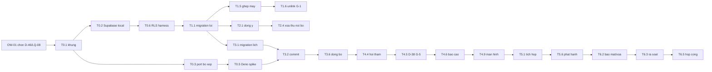

# Dev Plan 15.1 – MVP nấc 1 (A-lite E1)

**Bước:** 15 Dev Planning (sau 12 Kiến trúc, 13 Tech Spec)
**Người soạn:** AI, chưa kiểm chứng độc lập · **Trạng thái:** nháp chờ duyệt · **Bản:** 15/11/2026
**Đi kèm:** `Architecture_12_1_System_Architecture.md` (AD-xx, R-xx, Q-ARC-xx), `Tech_Spec_13_1_MVP_Step1.md` (mục 3 API, mục 6 test, mục 8 AC)

**Lưu ý quan trọng về số ước lượng:** mọi cỡ **S/M/L là ước tính của AI**, chưa đo, chưa kiểm chứng. Quy ước: S = dưới 1 ngày công, M = 1 đến 3 ngày công, L = 3 đến 6 ngày công (`ước tính`). Số người làm: `UNKNOWN` (kế hoạch giả định 1 người làm chính kèm AI hỗ trợ). Đợt (sprint) 1 đến 2 tuần là khung tham khảo, không phải cam kết.

**Ràng buộc từ CLAUDE.md:** mỗi bước một nhánh, một PR, không đẩy thẳng `main`; repo công khai (không khóa, `.env`, `google-services.json`, khóa ký, dữ liệu thật); tạo tài khoản, dự án dịch vụ, chi phí: hỏi chủ sản phẩm trước.

Quy ước nhánh: `nac1/<mã-task>-<slug>`. Mỗi task = một nhánh = một PR.

---

## 1. Việc chủ sản phẩm phải làm hoặc duyệt trước (chặn bắt đầu)

| Mã | Việc | Chặn task | Ghi chú |
|---|---|---|---|
| OW-01 | Chọn D-46a (kênh cài), D-46b (đăng nhập), D-46c (tái dùng `mobile/`), LQ-08 (nơi đặt máy chủ) | T0.2 trở đi, T1.x, T5.6 | Đề xuất ở Architecture §13; AI không quyết |
| OW-02 | Cho phép tạo dự án Supabase (cloud) hoặc chỉ chạy cục bộ ở đợt 0 | T0.2 | Cục bộ không phát sinh phí; cloud: hỏi chi phí (Architecture §13.5) |
| OW-03 | Cho phép tạo dự án Firebase/FCM (hoặc bản thử không đẩy từ xa) | T3.5 | Giá FCM `UNKNOWN` trong nguồn đã tra |
| OW-04 | Cho phép dịch vụ gửi thư (SMTP) nếu chọn đăng nhập email OTP | T1.1 | Giá `UNKNOWN` |
| OW-05 | Duyệt PR tài liệu sửa BL 11.1 (AC-27, BR-133/135) theo D-37 | T4.6 | Q-TS-03 |
| OW-06 | Duyệt tham số mặc định kỹ thuật (mã ghép 10 phút, PIN 6 số, khóa 15 phút, lời mời 72 giờ) | T1.5 | Q-TS-01 |
| OW-07 | Cung cấp ≥3 máy Android khác hãng để đo nhắc giờ | T3.7 | Số máy hiện có `UNKNOWN` |
| OW-08 | Bố trí người duyệt câu chữ an toàn (nội dung CA-14, PA-24) | T4.8 | BR-NTF-080: chưa duyệt thì chỉ dùng kèm lời nói trực tiếp |
| OW-09 | Chỉ định người rà soát độc lập (khác người viết) | T6.3 | |
| OW-10 | Chuẩn bị mẫu phiếu đồng ý giấy, tên người giữ thư mục mã hóa (tối đa 2 người, D-44) | Gate G-3 | |

---

## 2. Cổng (gate) trước khi dùng với gia đình thật

Không cổng nào được ghi PASS trong tài liệu này. Trạng thái là điều kiện cần kiểm.

| Mã | Cổng | Điều kiện | Trạng thái |
|---|---|---|---|
| G-1 | FR-01 xong trước (D-45) | `unlink-device`, PIN, epoch, test FR01-T01..T10 đạt | CHƯA (T1.5, T1.6) |
| G-2 | Pháp lý mở (D-45) | Cổng pháp lý còn mở; không ghi PASS; phụ thuộc luật sư | MỞ |
| G-3 | Điều kiện thử D-45 | Phiếu đồng ý phụ huynh, giải thích và con đồng ý, tối đa 3 gia đình, có ngày kết thúc, dữ liệu tối thiểu theo mục đích đã đồng ý, không GPS/ảnh/ghi âm, lưu và xóa theo D-44, không đặt trên repo công khai, không dùng việc khác | CHƯA |
| G-4 | Xóa dữ liệu | Diễn tập `purge_household` trên dữ liệu giả; job xóa chạy đúng ngày 7 (kể cả sau khi dự án bị tạm dừng) | CHƯA (T6.2) |
| G-5 | D-38 | RLS-D38-01..07 đạt, gồm test không-suy-ngược | CHƯA (T4.5) |
| G-6 | Nội dung an toàn | Câu chữ CA-14/PA-24 được người có thẩm quyền duyệt, hoặc dùng kèm lời nói trực tiếp | CHƯA (T4.8) |
| G-7 | Bí mật | Quét bí mật sạch; không dữ liệu thật trong repo | CHƯA (T6.2) |
| G-8 | Rà soát độc lập | Người khác rà RLS, quyền, xóa | CHƯA (T6.3) |
| G-9 | Máy thật | Nhắc giờ đo trên ≥3 hãng; dry-run Kit 03 trên ≥2 máy | CHƯA (T3.7, T6.1) |
| G-10 | D-43 | `talk-send` tắt; nút chỉ hiện chữ tĩnh và 111 | CHƯA (T4.8) |
| G-11 | Backup và xóa | Quyết định về bản sao lưu so với lời hứa xóa (PR-CON-04 `UNKNOWN`) | MỞ |

---

## 3. Đợt và task

Cột: Mã; Việc; Module (Tech Spec §7); Phụ thuộc; Cỡ (`ước tính`); Tiêu chí xong; Nhánh/PR.

### Đợt 0 – Nền và rủi ro kỹ thuật (khoảng 2 tuần, `ước tính`)

| Mã | Việc | Module | Phụ thuộc | Cỡ | Tiêu chí xong | Nhánh |
|---|---|---|---|---|---|---|
| T0.1 | Dựng khung thư mục `apps/`, `packages/`, `backend/`, `scripts/` (không sửa `mobile/`, `supabase/`) | — | OW-01 (D-46c) | S | Cấu trúc theo Tech Spec §5; CI chạy rỗng | `nac1/t0-1-khung` |
| T0.2 | Dựng Supabase cục bộ (Docker) và khung migration | — | T0.1, OW-02 | M | `supabase start` chạy; migration trống chạy sạch | `nac1/t0-2-supabase-local` |
| T0.3 | Chuyển bộ xếp lịch spike sang `packages/scheduler` (TS thuần), kèm 32 test `TC-*` | F04-G02-M01 | T0.1 | L | 32/32 đạt; golden P1..P8 khớp; chạy bằng `node:test` | `nac1/t0-3-scheduler-port` |
| T0.4 | Sửa múi giờ: `Asia/Ho_Chi_Minh` cố định, `today` truyền vào tham số | F04-G01-M01 | T0.3 | S | Test tất định không phụ thuộc múi giờ máy | `nac1/t0-4-mui-gio` |
| T0.5 | Spike đóng gói bộ xếp vào Edge Function (Deno) và đo độ trễ | F04-G02-M01 | T0.2, T0.3 | M | `scripts/sync-shared.mjs` chạy; hàm trả cùng đầu ra với Node; ghi độ trễ đo được (chưa đặt ngưỡng, Q-TS-05) | `nac1/t0-5-deno-spike` |
| T0.6 | Khung kiểm RLS (JWT theo vai, `policy-matrix.json`) và kiểm giả định Supabase (RLS, schema `private`, pg_cron) | F01-G04-M01 | T0.2 | M | RLS-GEN-01/02 chạy được và thất bại đúng khi thiếu chính sách | `nac1/t0-6-rls-harness` |
| T0.7 | CI: quét bí mật, kiểm tên giả trong seed, chạy test | — | T0.1 | S | PR giả có khóa bị chặn | `nac1/t0-7-ci` |
| T0.8 | Khung Expo hai biến thể `APP_VARIANT=parent|child`, build thử | — | T0.1, OW-01 | M | Hai applicationId; không khóa trong repo | `nac1/t0-8-expo-variants` |

### Đợt 1 – Tài khoản, gia đình, ghép máy, FR-01 (khoảng 2 tuần, `ước tính`)

| Mã | Việc | Module | Phụ thuộc | Cỡ | Tiêu chí xong | Nhánh |
|---|---|---|---|---|---|---|
| T1.1 | Migration lõi: `households`, `members`, `children`, `grants`, `mode_history`, hàm `app.can` và tiện ích | F01-G01-M01, F01-G02-M01, F01-G04-M01 | T0.6, OW-01, OW-04 | L | RLS-GEN, RLS-ROLE cho các bảng này đạt | `nac1/t1-1-migration-loi` |
| T1.2 | Đăng nhập người lớn, `family-create`, `touch-active` | F01-G01-M01 | T1.1 | M | AC-FAM-22, 24, 26 (phần đăng nhập) | `nac1/t1-2-dang-nhap` |
| T1.3 | Hồ sơ con: `child-create/update/delete` (ẩn, không xóa hẳn) | F01-G03-M01 | T1.1 | M | AC-CON-15, 16; AC-FAM-27 | `nac1/t1-3-ho-so-con` |
| T1.4 | Chế độ `mode-set`, chặn `CHILD_DIRECTED` | F01-G05-M01 | T1.3 | S | AC-FAM-17..20 | `nac1/t1-4-mode` |
| T1.5 | Ghép máy: `pair-code-create`, `pair-confirm`, `pair-accept`, PIN (`pin-set`), giới hạn thử | F01-G02-M01, F01-G01-M02 | T1.1, T0.8 | L | AC-FAM-11, 12, 16; FR01-T01, T02 | `nac1/t1-5-ghep-may` |
| T1.6 | `unlink-device`, epoch, hủy token và phiên, idempotent, thông báo tối giản | F01-G01-M02 | T1.5 | L | FR01-T03, T04, T09, T10; AC-FAM-13..15 (cổng G-1) | `nac1/t1-6-unlink` |
| T1.7 | Màn phụ huynh và con cho đăng nhập, ghép, PIN (PA-01, PA-13..15, PA-38, CA-01..03, CA-11, CA-12) | module 1 đến 3 | T1.2, T1.5, T1.6 | L | Chạy trên máy thật theo luồng wireframe đã duyệt | `nac1/t1-7-man-hinh-ghep` |
| T1.8 | Người lớn thứ hai (chỉ xem) – chỉ khung, cờ tắt ở đợt thử | F01-G02-M02 | T1.1 | M | `member-invite` trả `FEATURE_OFF`; RLS NL chỉ xem | `nac1/t1-8-nguoi-lon-2` |

### Đợt 2 – Đồng ý, mục đích, vòng đời (khoảng 1 đến 2 tuần, `ước tính`)

| Mã | Việc | Module | Phụ thuộc | Cỡ | Tiêu chí xong | Nhánh |
|---|---|---|---|---|---|---|
| T2.1 | `consent_events` chỉ-thêm, `purpose_state`, trigger, phụ thuộc mục đích, `purposes` seed (7 mục đích; MD-SUCKHOE không thu) | F01-G04-M02, F07-G06-M01 | T1.1 | L | AC-CON-01..08, 22; RLS-PURPOSE | `nac1/t2-1-dong-y` |
| T2.2 | `consent-withdraw-all` (hai bước xác nhận) | F01-G04-M02 | T2.1 | M | AC-CON-06; rút một mục đích ẩn dữ liệu ngay | `nac1/t2-2-rut-het` |
| T2.3 | Vòng đời: đóng băng 30 ngày (`job-daily`), mở lại, `deletion-request` | F01-G06-M01 | T2.1, T0.2 | L | AC-FAM-21..25; RLS-FROZEN | `nac1/t2-3-dong-bang` |
| T2.4 | `trial_slots`, `purge_household`, `deletion_evidence`, `job-trial-purge`, `export-request` (`BLOCKED_H4`) | F07-G06-M02 | T2.3 | L | AC-CON-17..21, 23..26; diễn tập xóa trên dữ liệu giả | `nac1/t2-4-thu-noi-bo` |
| T2.5 | Audit tối thiểu (`audit_log`) và cơ chế ghi | F01-G04-M02 | T1.1 | M | Không PIN, mã, token, chữ tự do, lựa chọn hỏi thăm | `nac1/t2-5-audit` |
| T2.6 | Màn đồng ý, rút, xóa, đóng băng (PA-02, PA-32..36, PA-39, CA-16..18) | module 7, 9 đến 11 | T2.1 đến T2.4 | L | Luồng khớp wireframe | `nac1/t2-6-man-hinh-dong-y` |

### Đợt 3 – Lập lịch, đồng bộ, nhắc (khoảng 2 tuần, `ước tính`)

| Mã | Việc | Module | Phụ thuộc | Cỡ | Tiêu chí xong | Nhánh |
|---|---|---|---|---|---|---|
| T3.1 | Migration lịch: `schedule_profiles`, `activity_cards`, `schedule_versions`, `schedule_state`, `schedule_answers` | F02-G01-M01, F04-G01-M01 | T1.1 | M | RLS đạt; `schedule_versions` bất biến | `nac1/t3-1-migration-lich` |
| T3.2 | `profile-save`, `schedule-preview`, `schedule-commit` (chạy lại ở máy chủ, giao dịch cùng outbox) | F04-G01-M01, F04-G02-M01..M03 | T0.5, T3.1 | L | AC-04..08, 17, 24; commit idempotent | `nac1/t3-2-commit` |
| T3.3 | Nhắc cục bộ trên máy con, `valid_through` 14 ngày | F04-G07-M01 | T3.2, T0.8 | L | Lên lịch nhắc đúng theo gói đồng bộ; không nhắc trong khối ngủ (D-40) | `nac1/t3-3-nhac-cuc-bo` |
| T3.4 | Module native báo thức buổi sáng (`AlarmManager.setAlarmClock`) | F04-G07-M01 | T3.3 | L | Kêu đúng giờ trên máy thử; rủi ro R-xx ghi nhận | `nac1/t3-4-bao-thuc` |
| T3.5 | FCM data-only `{type,id}`, outbox, `notify-dispatch`, `job-notify-retry`, `push-register` | F04-G07-M01 | T3.2, OW-03 | L | Gửi lại cùng khóa không trùng; payload tối giản | `nac1/t3-5-fcm-outbox` |
| T3.6 | `device-sync`, `device-push-ops`, hàng đợi SQLite, `effectiveDay` dùng chung (TS và SQL) | F04-G04-M01, F06-G01-M01 | T3.2 | L | Ngoại tuyến hiện đúng ngày giai đoạn kết thúc (D-24); Xong/Hoàn tác idempotent | `nac1/t3-6-dong-bo` |
| T3.7 | Đo độ chính xác nhắc giờ trên ≥3 hãng máy | F04-G07-M01 | T3.3, T3.4, OW-07 | M | Ghi số thật vào nhật ký nấc 1 (không ngưỡng đạt/không đạt) | `nac1/t3-7-do-nhac` |
| T3.8 | Màn lịch phụ huynh và con (PA-04..11, CA-04, CA-06, CA-13) | module 12 đến 18, 21 | T3.2, T3.6 | L | Luồng khớp wireframe | `nac1/t3-8-man-hinh-lich` |

### Đợt 4 – Giai đoạn, đề xuất, hỏi thăm, báo cáo, an toàn (khoảng 2 tuần, `ước tính`)

| Mã | Việc | Module | Phụ thuộc | Cỡ | Tiêu chí xong | Nhánh |
|---|---|---|---|---|---|---|
| T4.1 | Giai đoạn: `phase-submit/end`, tối đa 60 ngày, hết hạn theo ngày (`job-daily`) | F04-G02-M03 | T3.2 | L | AC-12..18; TC-D09-1..13 | `nac1/t4-1-giai-doan` |
| T4.2 | Ngoại lệ tuần, khóa lịch (`lock-set`), sửa lịch có khóa | F04-G01-M01 | T3.2 | M | AC-13, 14, 22, 28 | `nac1/t4-2-ngoai-le-khoa` |
| T4.3 | Đề xuất và mong muốn: `change_requests`, `wishes`, `cr-decide`, định tuyến duyệt | F04-G03-M02, F04-G06-M01 | T3.6, T2.1 | L | AC-19..24; AC-NTF-13..16; mong muốn không hết hạn (D-39) | `nac1/t4-3-de-xuat` |
| T4.4 | Hỏi thăm một lần mỗi ngày, `checkin_responses` (private), `child_settings` | F04-G05-M01 | T3.6, T2.1 | M | AC-25, 26; AC-CON-09..11, 13; SAFE-07 | `nac1/t4-4-hoi-tham` |
| T4.5 | D-38: `app.weekly_report`, mốc cắt CN 20:00, test không-suy-ngược (cổng G-5) | F06-G04-M01 | T4.4 | L | RLS-D38-01..07 đạt | `nac1/t4-5-d38` |
| T4.6 | Báo cáo tuần và tiến độ: `weekly-report-get`, `progress-get`, `job-weekly-report`; thay `trend()` theo D-37 | F06-G02-M01..M02, F06-G05-M01..M02 | T4.5, OW-05 | L | AC-NTF-19..26, AC-29 | `nac1/t4-6-bao-cao` |
| T4.7 | Tùy chọn thông báo, lịch sử thay đổi | F04-G07-M02, F04-G06-M02 | T3.5 | M | AC-NTF-08, 09, 11; BR-150 | `nac1/t4-7-tuy-chon-lich-su` |
| T4.8 | Gói nội dung an toàn tĩnh, `keyword-check`, `talk-send` tắt (cổng G-6, G-10) | F07-G01-M01 | OW-08 | M | SAFE-01..06; CA-14 không gọi mạng | `nac1/t4-8-an-toan` |
| T4.9 | Màn giai đoạn, đề xuất, báo cáo, an toàn (PA-16..27, CA-05, CA-08..10, CA-14, CA-15) | module 14, 19, 20, 22 đến 32 | T4.1 đến T4.8 | L | Luồng khớp wireframe | `nac1/t4-9-man-hinh` |

### Đợt 5 – Tích hợp và phát hành thử (khoảng 1 đến 2 tuần, `ước tính`)

| Mã | Việc | Module | Phụ thuộc | Cỡ | Tiêu chí xong | Nhánh |
|---|---|---|---|---|---|---|
| T5.1 | Chạy toàn bộ bộ test (đơn vị, RLS, an toàn) trên CI | tất cả | T4.9 | M | Xanh; mọi AC dẫn ở Tech Spec §8 có test hoặc ghi chú máy thật | `nac1/t5-1-tich-hop` |
| T5.2 | Dry-run Kit 03 với dữ liệu giả trên ≥2 máy thật | tất cả | T5.1 | M | Ghi kết quả; sửa lỗi chặn | `nac1/t5-2-dry-run` |
| T5.3 | Seed `GIA_LAP` (tên giả) cho thử và demo | — | T5.1 | S | Không dữ liệu thật | `nac1/t5-3-seed` |
| T5.4 | Hoàn thiện rà soát nhãn "chưa kiểm chứng" trên mọi màn lịch | F04 | T5.1 | S | Không màn nào hiện lịch như "đạt" (BR-084) | `nac1/t5-4-nhan` |
| T5.5 | Sửa lỗi từ dry-run | — | T5.2 | M | Không lỗi chặn | `nac1/t5-5-sua-loi` |
| T5.6 | Kênh phát hành theo D-46a (tạo APK/bản cài thử, không khóa trong repo) | — | OW-01, T5.5 | M | Cài được trên máy thử; khóa ký ngoài repo | `nac1/t5-6-phat-hanh` |

### Đợt 6 – Cổng an toàn và rà soát (khoảng 1 đến 2 tuần, `ước tính`)

| Mã | Việc | Phụ thuộc | Cỡ | Tiêu chí xong | Nhánh |
|---|---|---|---|---|---|
| T6.1 | Dry-run lần hai trên máy thật, đủ ≥3 hãng cho phần nhắc | T5.6, T3.7 | M | Cổng G-9 có bằng chứng | `nac1/t6-1-dry-run-2` |
| T6.2 | Quét bí mật, rà log, diễn tập xóa (kể cả kịch bản dự án bị tạm dừng) | T2.4, T5.6 | M | Cổng G-4, G-7 có bằng chứng | `nac1/t6-2-bao-mat-xoa` |
| T6.3 | Rà soát độc lập (RLS, quyền, xóa, D-38) | OW-09, T6.2 | M | Báo cáo rà soát; mọi phát hiện nghiêm trọng đã xử lý | `nac1/t6-3-ra-soat` |
| T6.4 | Runbook vận hành thử (mở/đóng `trial_slot`, xóa ngày 7, rút khỏi thử) | T2.4 | S | Người khác làm theo được | `nac1/t6-4-runbook` |
| T6.5 | Họp cổng: đối chiếu G-1 đến G-11 với bằng chứng; chủ sản phẩm quyết | T6.1 đến T6.4 | S | Biên bản; không cổng pháp lý nào ghi PASS khi chưa có luật sư | `nac1/t6-5-hop-cong` |

---

## 4. Đường găng (ước tính)

Đường găng đề xuất: OW-01, T0.1, T0.2, T0.6, T1.1, T3.1, T3.2, T3.6, T4.4, T4.5, T4.6, T4.9, T5.1, T5.6, T6.2, T6.3, T6.5. Việc chạy song song được: nhánh FR-01 (T1.5, T1.6) và nhánh đồng ý/xóa (T2.x) với nhánh lập lịch (T3.x); đo nhắc giờ (T3.7) cần máy thật nên dễ trễ nếu OW-07 chậm.

Tổng cỡ `ước tính`: không cộng thành số tuần cam kết vì số người làm `UNKNOWN`.

---

## 5. Rủi ro tiến độ

| Mã | Rủi ro | Giảm thiểu |
|---|---|---|
| DR-01 | Chủ sản phẩm chưa chọn D-46/LQ-08 | Làm đợt 0 trên Supabase cục bộ và dữ liệu giả; không tạo tài khoản |
| DR-02 | Đóng gói bộ xếp vào Deno gặp vấn đề (R-xx) | T0.5 làm sớm; nếu hỏng thì phương án dự phòng chạy bộ xếp ở máy phụ huynh (hỏi chủ sản phẩm) |
| DR-03 | Nhắc giờ lệch trên nhiều hãng máy | T3.4, T3.7 sớm; ghi số thật, không hứa độ chính xác |
| DR-04 | Gói miễn phí tạm dừng dự án làm job xóa ngày 7 không chạy | T6.2 diễn tập; cân nhắc gói trả phí (Architecture §13.4) |
| DR-05 | BL còn chỗ cũ (AC-27, BR-133/135) | OW-05 trước T4.6 |
| DR-06 | Thiếu người duyệt câu chữ an toàn | OW-08; hoặc dùng kèm lời nói trực tiếp |
| DR-07 | Cổng pháp lý không đóng kịp | Chỉ dùng dữ liệu giả; không mở với gia đình thật |

---

## 6. Câu hỏi mở cho chủ sản phẩm (kèm đề xuất)

(Các câu D-46 và LQ-08 ở Architecture §16, mã `Q-ARC-xx`; câu về tham số kỹ thuật ở Tech Spec §10, mã `Q-TS-xx`.)

| Mã | Câu hỏi | Đề xuất của AI |
|---|---|---|
| Q-DEV-01 | Có làm đợt 0 trước khi chọn D-46, trên Supabase cục bộ và dữ liệu giả, không tạo tài khoản? | Có |
| Q-DEV-02 | Ai làm chính và bao nhiêu giờ mỗi tuần (số người làm hiện `UNKNOWN`)? | Chủ sản phẩm cho biết để đổi cỡ S/M/L thành lịch |
| Q-DEV-03 | Chấp nhận thứ tự đợt (FR-01 ở đợt 1, trước lập lịch)? | Có, theo D-45 |
| Q-DEV-04 | Cho phép Firebase/FCM ở đợt 3 hay chỉ nhắc cục bộ trước? | Nhắc cục bộ trước; FCM sau khi có OW-03 |
| Q-DEV-05 | Nhật ký test nấc 1 đặt ở file mới thay vì `documents/app/ref-nhat-ky-test.md` của Plan A? | Có, file mới |
| Q-DEV-06 | Ai là người rà soát độc lập (OW-09) và người duyệt câu chữ an toàn (OW-08)? | Chủ sản phẩm chỉ định trước đợt 4 |
| Q-DEV-07 | Cho phép nhánh dự phòng nếu T0.5 thất bại (bộ xếp chạy trên máy)? | Chờ kết quả T0.5 rồi hỏi lại |

---

người soạn: AI, chưa kiểm chứng độc lập; trạng thái: nháp chờ duyệt
