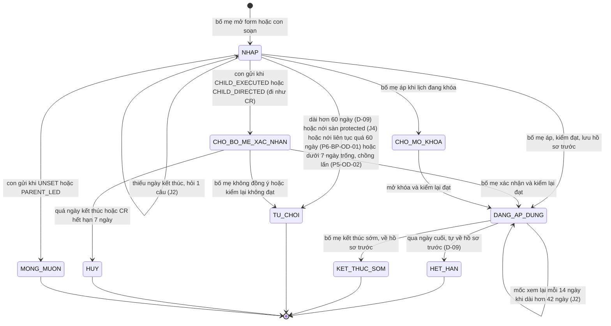
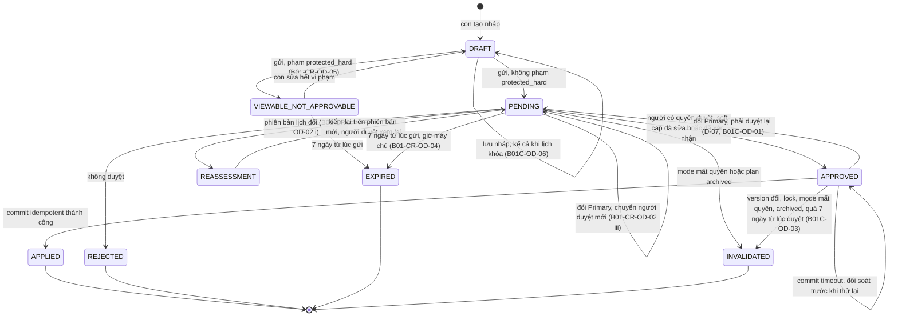
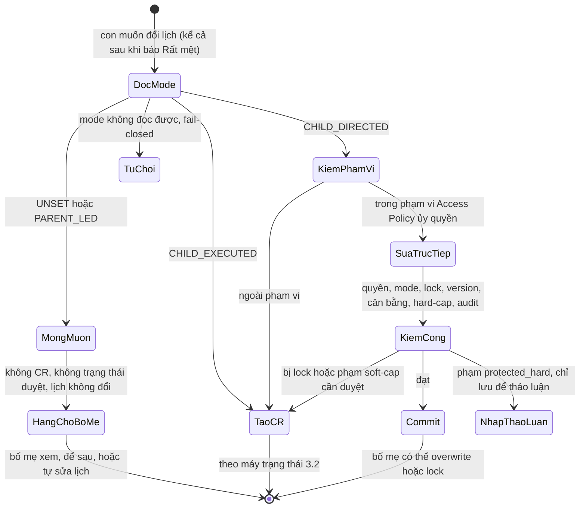
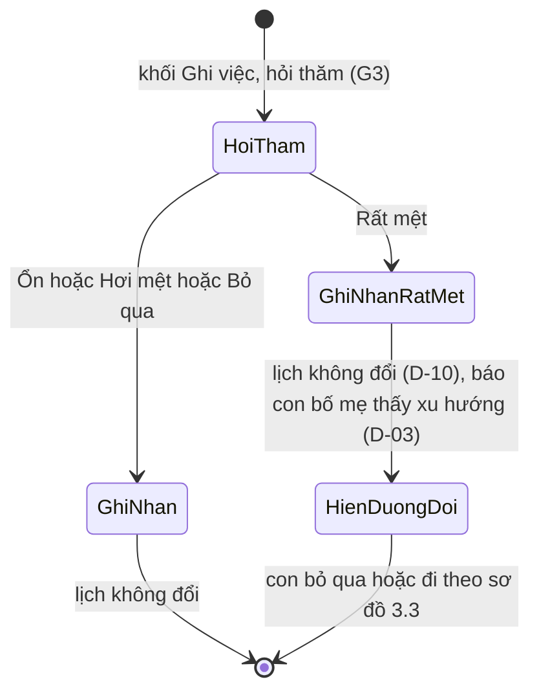
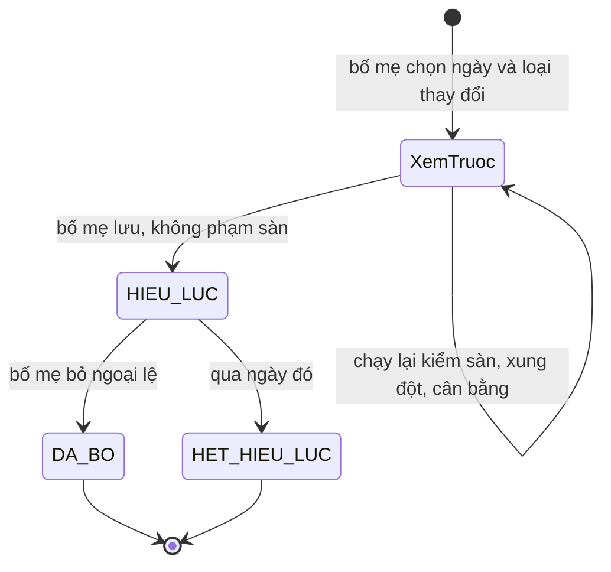

# 11.1 – BUSINESS LOGIC: CÁC MODULE LẬP LỊCH CỦA A-LITE E1

> **Cập nhật lượt 3 (15/11/2026):** BR-135 (ngưỡng gửi xu hướng) **hết hiệu lực**: không cần ngưỡng, xu hướng mệt chỉ tổng hợp trong báo cáo tuần (D-21). BR-133: bỏ phần đếm "theo thứ", chỉ gộp theo đặc điểm lịch (D-37).

- **Ngày:** 15/11/2026.
- **Phạm vi:** bộ xếp lịch tuần xác định (E1, không gọi AI) và các module đi cùng nó trong A-lite E1 (OD-A2 chọn E1 trước).
- **Bản chất:** bản nháp đặc tả nghiệp vụ. Không phải spec chuẩn, không sửa `spec-quy-tac-lap-lich.md` (QT). Chỗ nào khác QT thì ghi ở §11 để sửa QT trước theo quy trình đổi quy tắc.
- **Mã chạy kèm:** `app-design-document/progress/spike-e1-scheduler/` (bản copy của spike E1 đã áp D-02, D-08, D-09, D-10). Thay đổi: `spike-e1-scheduler/CHANGES.md`.
- **Dữ liệu:** chỉ hồ sơ giả lập. Không có dữ liệu trẻ thật. **Cổng pháp lý H4, FR-03 vẫn mở, không coi là PASS** (D-01, CAP-4).

## 0. Nguồn và quy ước

### 0.1 Thứ bậc nguồn khi khác nhau

| Bậc | Nguồn | Viết tắt trong file |
|---|---|---|
| 1 | Sổ quyết định 15/11/2026 (`app-design-document/progress/Owner_Decision_Log_20261115.md`) | D-xx, OD-Ax |
| 2 | Các sổ quyết định `*_APPROVED.md` (P6-BP, B01 CR, B01 Mode State, B01 Plan Structure, B01 Consolidation, P5, Access Policy) qua sổ ràng buộc `app-design-document/progress/Constraint_Register_Approved_Decisions.md` | P6-BP-OD-xx, B01-CR-OD-xx, B01-MS-OD-xx, B01-PS-OD-xx, B01C-OD-xx, P5-OD-xx, AP-OD-xx |
| 3 | `documents/pal/spec-quy-tac-lap-lich.md` (nguồn chuẩn quy tắc) | QT + mã quy tắc (C1, D6, J2…) |
| 4 | `spec-quy-thoi-gian-va-tab-cua-con.md`, `ref-tai-va-phuc-hoi-trong-ngay.md` | TAB §x, NT-xx |
| 5 | `prototype/index.html` (hành vi chuẩn để chuyển sang app) | PROTO |
| 6 | User Flow đợt 1 (`app-design-document/04_User_Flow/User_Flow_04_1_Scheduling_Loop.md`), 03.2 inventory, 03.4 use case | UF, 3.2, UC-xxx |

### 0.2 Mức căn cứ (theo QT)

| Nhãn | Nghĩa |
|---|---|
| [NC] | Có nghiên cứu hoặc khuyến nghị của tổ chức chuyên môn |
| [NL] | Có nghiên cứu ở người lớn hoặc chưa trực tiếp cho trẻ |
| [MĐ] | Mặc định của Pal, chưa kiểm chứng |
| SP | Yêu cầu sản phẩm (không phải căn cứ khoa học) |
| OD | Quyết định của chủ sản phẩm |
| BGD | Chỉ đạo của Bộ GD&ĐT |
| `đề xuất nội bộ` | Do AI đề xuất trong file này, chưa có nguồn duyệt |
| `fail-safe có nhãn` | Mặc định an toàn do AI chọn cho mâu thuẫn còn mở, chờ chủ sản phẩm |

**Mọi con số trong bộ xếp đều mang nhãn `mac_dinh_chua_kiem_chung`** (D-08), kể cả khi quy tắc gốc có [NC]. [NC] nói về căn cứ của quy tắc. Nhãn D-08 nói con số cụ thể chưa được thẩm định (bước 14b).

## 1. Phạm vi

### 1.1 Module trong phạm vi

A-lite E1 có 29 module (OD-A2). File này chỉ đặc tả các module tham gia vòng lập lịch. ID L4 dùng mã `-001` trong 3.2; chưa cấp L4 ổn định.

| L3 | Tên | L4 (3.2) | Vai trò trong E1 | Mức BL ở file này |
|---|---|---|---|---|
| `F04-G02-M01` | Schedule Construction | `F04-G02-M01-001` | Bộ xếp lịch tuần xác định | Đầy đủ |
| `F04-G02-M02` | Schedule Conflict | `F04-G02-M02-001` | Phát hiện trùng giờ, đề nghị thay thế | Đầy đủ |
| `F04-G02-M03` | Balanced Planning Validation | (pending) | Sàn cứng, quỹ, ngưỡng màu, "Giữ mức này", giai đoạn tạm thời (B01C-OD-04), nhãn cân bằng | Đầy đủ |
| `F04-G01-M01` | Plan Structure | `F04-G01-M01-001` | Hồ sơ lịch có phiên bản, lock, commit | Quy tắc nghiệp vụ; kỹ thuật để System Design |
| `F04-G01-M02` | Plan Templates | `F04-G01-M02-001` | Quỹ mặc định theo tuổi, preset | Một phần |
| `F04-G06-M01` | Change Requests | `F04-G06-M01-001` | CR, mong muốn, vô hiệu khi bối cảnh đổi | Đầy đủ |
| `F04-G06-M02` | Change History | `F04-G06-M02-001` | Lịch sử phiên bản, lý do, người duyệt | Giao diện |
| `F04-G03-M02` | Approval Routing | `F04-G03-M02-001` | Chuyển CR tới người có quyền | Giao diện |
| `F04-G05-M01` | Lightweight Check-off | `F04-G05-M01-001` | Bấm Xong; **tín hiệu mệt** (OD-A7) | Phần tín hiệu mệt |
| `F06-G04-M01` | (xu hướng) | `F06-G04-M01-001` | Tổng hợp xu hướng mệt cho phụ huynh (D-03) | Giao diện |
| `F06-G02-M02` | Progress Exceptions | `F06-G02-M02-001` | Ngày ốm, ngày nghỉ không tính chưa hoàn thành | Một quy tắc |
| `F01-G05-M01` | Mode State | `F01-G05-M01-001` | Đọc chế độ hiệu lực của từng con | Chỉ đọc |
| `F01-G04-M01` | Access Policy | `F01-G04-M01-001` | ALLOW/DENY cuối cùng, phạm vi ủy quyền | Chỉ đọc |
| `F04-G07-M01` | Schedule Notifications | `F04-G07-M01-001` | Đặt lại nhắc sau commit | Giao diện |

### 1.2 Ngoài phạm vi

- Pal trò chuyện (F05-G01, F07-G03), trích dữ liệu từ lời kể, sinh lời giải thích: nấc 2 (§10).
- Chấm bài qua ảnh (QT M), chỉ định bác sĩ (H6): cần AI và người duyệt.
- Chuyển chế độ (F01-G05-M02), ghép máy (FR-01): module khác.
- Lớp an toàn (F07-G05-M01): chạy trước mọi ô chữ tự do; E1 không thay nó.

## 2. Thực thể dữ liệu và trạng thái

### 2.1 Danh sách thực thể

| Thực thể | Trường chính | Trạng thái | Module chủ |
|---|---|---|---|
| **Hồ sơ lịch** (`schedule_profile`) | id, child_id, loại (`CHUAN` / `GIAI_DOAN` / `PRESET`), version, thời khóa biểu theo thứ (giờ vào, tan, bữa trưa, bữa phụ ở trường), bán trú, đi lại, danh sách hoạt động, quỹ 2 cột, xác nhận "Giữ mức này" theo ô, cờ `child_device`, `noi_long[]` (chỉ hồ sơ giai đoạn), `family_bar_approved` | `DRAFT` → `ACTIVE` → `SUPERSEDED`; `ARCHIVED` | F04-G01-M01 |
| **Thẻ hoạt động** | id, tên, loại (`hoc_them` / `the_thao` / `nang_khieu` / `khac`), thứ[], bắt đầu, kết thúc, đi lại (cả hai chiều), địa điểm, ghi chú | `ACTIVE`, `DELETED` | F04-G02-M01 (nhập), F02 (bối cảnh) |
| **Quỹ** | 2 cột `wd`/`we` × {`hoc_nha`, `sinh_hoat`, `ngu`, `man_hinh`}; nguồn (`gia_dinh` / `mac_dinh`); nhãn D-08 nếu là mặc định | — | F04-G02-M03 |
| **Khối** (`block`) | bat_dau, ket_thuc, **kind** (kiểu có cấu trúc, xem §2.2), khoi (tên hiển thị), viec[], xac_nhan, tai (`cao`/`vua`/`thap`/`phuc_hoi`), nhom, the_thao, man_hinh, act_id, act_start, act_end, ghi_chu, pinned | `binh_thuong`, `huy` | F04-G02-M01 |
| **Lịch tuần** | child_id, tuần ISO, profile_id + version, ngay{T2..CN: khối[]}, trạng thái từng ngày, `tradeoffs[]`, `questions[]`, `notes[]`, nhãn cân bằng | ngày: `OK` / `DIEU_CHINH_TRONG_DUNG_SAI` / `CAN_BO_ME_CHON` / `XUNG_DOT` | F04-G02-M01 |
| **Đánh đổi** (`tradeoff`) | ngày, kind (`trung_gio`, `act_bed`, `sport_bed`, `bua_xa`, `giam_hoc_nha`, `khong_xep_duoc`), rule, mô tả có số, options[] (≥2), act_id | `MO` → `BO_ME_DA_CHON` | F04-G02-M02/M03 |
| **Câu hỏi cho bố mẹ** | ngày, kind (`g7_bot_hoc_nha`…), rule, mặc định, options[] | `MO` → `DA_TRA_LOI`; hỏi một lần (A2) | F04-G02-M01 |
| **Giai đoạn tạm thời** | id, tên, lý do/purpose, scope (child), nguồn (`bo_me` / `con_de_xuat`), mode lúc gửi, tu_ngay, den_ngay, `noi_long[]`, `ho_so_truoc` (+version), mốc xem lại, quy ước ngày `v1` | §3.1 | F04-G02-M03 (thời hạn, B01C-OD-04); commit F04-G01-M01 |
| **Ngoại lệ chỉ tuần này** | child_id, **ngày cụ thể** (YYYY-MM-DD), khối thay thế, loại (nghỉ buổi, học bù, ốm hủy ngày, khác), lý do | `HIEU_LUC` → `HET_HIEU_LUC` (qua ngày); `DA_BO` | F04-G01-M01 |
| **Mong muốn** (chỉ `UNSET`/`PARENT_LED`) | child_id, loại có sẵn, chữ ngắn (qua lớp an toàn nếu AI xử lý), thời điểm | `DA_GUI` → `DA_XEM` / `DE_SAU` | F04-G06-M01 (hàng chờ), F05-G01 (trao đổi, B01C-OD-08) |
| **Change Request (CR)** | id, idempotency key, người gửi, base version, epoch mode/policy/lock, thời điểm gửi (giờ máy chủ), thay đổi đề xuất, kết quả kiểm, người duyệt, thời điểm duyệt | §3.2 | F04-G06-M01 |
| **Lock** | scope, người khóa, thời điểm, version, lý do | `LOCKED` / `UNLOCKED`; không tự mở (B01C-OD-05) | F04-G01-M01 |
| **Tín hiệu mệt** (hỏi thăm) | child_id, ngày, thứ, lựa chọn (`on` / `hoi_met` / `rat_met` / `bo_qua`), `schedule_changed=false` | ghi một lần, hoàn tác được trong ngày | F04-G05-M01 (OD-A7) |
| **Xu hướng mệt** | cửa sổ 14 ngày, số lần theo thứ, theo đặc điểm lịch | `NGUONG_CHUA_CHOT` / `CHUA_DAT_NGUONG` / `GUI_XU_HUONG` | F06-G04-M01 |

### 2.2 Kiểu khối có cấu trúc (thay regex, giải B-11)

Bộ xếp gán `kind` khi tạo khối. Bộ kiểm tra dùng `kind`, không đoán từ tên tiếng Việt. Regex của PROTO chỉ dùng khi nhập lịch cũ.

| kind | tai mặc định | nhom | Ví dụ tên hiển thị |
|---|---|---|---|
| `truong`, `di_lai` | cao / thap | truong | Học ở trường, Đi học, Về nhà |
| `bua_truong` | thap | truong | Ăn trưa ở trường |
| `hoat_dong` (+ loại thẻ) | cao | hoc_them | Học thêm: Tiếng Anh; Tập thể thao: Karate |
| `ghi_viec_hoi_tham` | thap | sinh_hoat | Ghi lại việc được giao, hỏi thăm |
| `phuc_hoi` | phuc_hoi | choi_nghi | Ăn nhẹ và chơi tự do |
| `hoc_nha` | cao (lớp ≥6, phiên đầu) / vua | hoc_nha | Ôn bài, làm việc cô giao |
| `soan_cap` | vua | sinh_hoat | Soạn cặp |
| `bua_nha`, `bua_phu` | thap | sinh_hoat | Ăn tối cùng gia đình, Bữa phụ nhỏ |
| `van_dong_sang` | vua | choi_nghi | Dậy, vận động buổi sáng |
| `ve_sinh_toi`, `doc_nhat_ky` | thap | sinh_hoat | Vệ sinh buổi tối; Đọc sách và viết nhật ký |
| `man_hinh` | thap | choi_nghi | Màn hình giải trí |
| `choi_tu_do`, `nghi_ngan` | phuc_hoi | choi_nghi | Chơi tự do; Nghỉ ngắn |
| `tat_den` | phuc_hoi | ngu | Tắt đèn, ngủ |
| `ghi_chu_phuong_an` | — | — | Phương án đề xuất, chờ bố mẹ chọn |

## 3. Máy trạng thái

### 3.1 Giai đoạn tạm thời

Đã có code: `phase.js` (`validatePhase`, `submitPhase`, `activatePhase`, `tickPhases`, `endPhaseEarly`), test TC-D09-1…14.

### 3.2 Change Request (con ở `CHILD_EXECUTED`; con ở `CHILD_DIRECTED` khi ngoài phạm vi)

Khi lịch khóa: CR `PENDING` vẫn xem được nhưng không áp (B01-CR-OD-02 ii). Chưa có code CR trong spike.

### 3.3 Đường thay đổi lịch theo chế độ tự chủ

Đã có code phần chọn đường: `fatigue.js` `changePath`, test TC-D10-2, TC-D10-3.

### 3.4 Tín hiệu mệt

### 3.5 Ngoại lệ chỉ tuần này

## 4. Quy tắc nghiệp vụ

Cột **E1**: `có` = bộ xếp hoặc bộ kiểm làm được không cần AI; `một phần`; `không` (§10). Cột **Spike v2**: `có` = đã có code và test; `—` = chưa.

### 4.1 Đầu vào

| ID | Điều kiện | Hành động | Nguồn QT | Quyết định | Căn cứ | E1 | Spike v2 |
|---|---|---|---|---|---|---|---|
| BR-001 | Thiếu tuổi/lớp, giờ vào và tan học, hoặc bán trú | Không dựng lịch; form chỉ ra trường thiếu | B1 | OD-A1 | SP | có | — |
| BR-002 | Bắt đầu lập lịch | Điểm vào là thời khóa biểu của con. Mục tiêu là trường tùy chọn, thiếu không chặn | B3 (`muc_tieu_bo_me`) | OD-A1 | OD | có | có |
| BR-003 | Thẻ hoạt động thiếu thứ hoặc giờ | Không lưu; hỏi 1 câu | E2 | — | SP | có | — |
| BR-004 | Thẻ mới trùng tên + thứ + giờ với thẻ có sẵn | Không tạo trùng | E2 | — | SP | có | — |
| BR-005 | Chọn loại thẻ | Tập có huấn luyện viên → `hoc_them`; vận động vui → `choi_nghi` (không phải thẻ hoạt động cố định) | E6 | — | SP | có | có |
| BR-006 | `child_device = false` | Vẫn dựng lịch đủ cho phụ huynh. Không đặt nhắc trên máy con, không có hỏi thăm, không nút Xong của con; cột xác nhận hiện "Không theo dõi trên máy con" | — | D-11 | OD | có | — |
| BR-007 | Chưa biết giờ ăn trưa ở trường | Giả định 11:15, ghi rõ là giả định | H2, B4 | — | [MĐ] | có | có |
| BR-008 | Thiếu mode của con | Coi là `UNSET`, quyền lịch như `PARENT_LED`, fail-closed | — | B01-MS-OD-04 | OD | có | có |
| BR-009 | Gia đình nhiều con, thao tác không chỉ rõ con | Hỏi con nào; không mặc định áp cho tất cả | — | CLAUDE.md | SP | có | — |

### 4.2 Sàn cứng (`protected_hard`)

| ID | Điều kiện | Hành động | Nguồn QT | Quyết định | Căn cứ | E1 | Spike v2 |
|---|---|---|---|---|---|---|---|
| BR-010 | Mọi đêm | Từ tắt đèn đến giờ dậy hôm sau ≥ 9 giờ (≤12 tuổi) hoặc ≥ 8 giờ (13–18 tuổi). Bộ xếp không bao giờ xếp dưới | C1, D4 | P6-BP-OD-02 | [NC] AASM | có | có |
| BR-011 | Quỹ ngủ bố mẹ nhập dưới mức tối thiểu | Ô Ngủ **không có** "Giữ mức này" (cả cam lẫn đỏ). Dòng chữ ghi số, mốc, nguồn. Bộ xếp dùng mức tối thiểu | C1, D6 | D-02 | [NC] / OD | có | có (TC-D02-1…5) |
| BR-012 | Sau giờ học ở trường, trước khối học ở nhà đầu tiên | Có khối phục hồi ≥15′ (mặc định 30′, thang sửa xuống 20′ rồi 15′) | C2, G3 | — | [NC] NT-01; thời lượng [MĐ] | có | có |
| BR-013 | Hai khối tải cao kề nhau (cách <5′), trừ khối trường | Không xếp; tự sửa thứ tự, không hỏi | C3 | — | [NL] NT-09 | có | có |
| BR-014 | Hai phiên học ở nhà kề nhau | Nghỉ ≥5′ giữa hai phiên (sàn kiểm và mặc định xếp) | C3, F4 | B-1 `fail-safe có nhãn` | [NL] NT-09, [MĐ] | có | có (TC-B1-1, TC-B1-2) |
| BR-015 | Khối học ở nhà trước giờ đi học buổi sáng | Không xếp; chỉ được khi giai đoạn tạm thời nới `truoc_gio_hoc` | C4, J4 | — | [MĐ] | có | có |
| BR-016 | Tập luyện mạnh (`the_thao`) kết thúc <60′ trước tắt đèn | Thử lùi tắt đèn ≤30′ (BR-062). Vẫn không đạt → đánh đổi `sport_bed` (dời, bỏ buổi); không có phương án cắt ngủ | C5 | P6-BP-OD-02 | [NC] NT-05 | có | có |
| BR-017 | Màn hình giải trí | Kết thúc ≥60′ trước tắt đèn; không đặt trước hoặc giữa khối học; thiết bị ngoài phòng ngủ (ghi trong khối vệ sinh) | C6, F5 | — | [NC] NT-06, NT-04 | có | có |
| BR-018 | Mọi ngày | Có ăn sáng, ăn tối, và ăn trưa (ở nhà hoặc ở trường). Không bỏ bữa | C7 | — | [MĐ] | có | có |
| BR-019 | Mọi ngày | Không bỏ hẳn thời gian nghỉ: còn khối phục hồi hoặc chơi tự do | C7 | — | [MĐ] | có | có |
| BR-020 | Bất kỳ yêu cầu vượt sàn (phụ huynh, con, AI, duyệt CR, khẩn cấp) | Từ chối. Không có đường tắt; không ai waive được | C, J4 | P6-BP-OD-02, B01-CR-OD-05 | OD | có | có |
| BR-021 | Hai lần ăn cách >300′ (6 tuổi: >240′) | Đặt bữa phụ 10′ cách bữa chính kế tiếp khoảng 90′ nếu con ở nhà. Con không ở nhà → đánh đổi `bua_xa` với 3 lựa chọn | H2, H3 | — | [NC] AND; mức 4–5h nguồn phổ thông | có | có |

### 4.3 Quỹ thời gian

| ID | Điều kiện | Hành động | Nguồn QT | Quyết định | Căn cứ | E1 | Spike v2 |
|---|---|---|---|---|---|---|---|
| BR-030 | Tính quỹ | 2 cột (ngày đi học, cuối tuần). `truong` từ thời khóa biểu; `hoc_them` từ thẻ (gồm đi lại); `choi_nghi` = 24h trừ các nhóm, bữa ăn tính ½ (bảng quỹ dùng ×0,25 `sinh_hoat`, B-12) | D1–D3 | — | SP | có | có |
| BR-031 | Gia đình chưa nhập quỹ | Dùng quỹ mặc định theo tuổi (§6.2), gắn nhãn `mac_dinh_chua_kiem_chung` | D (quỹ mặc định) | D-08 | [MĐ] | có | có |
| BR-032 | Xếp lịch | Lệch tối đa ±30′ quanh mỗi số; ngủ không thấp hơn số chọn quá 30′ và không dưới BR-010 | D4 | — | [MĐ] | có | có |
| BR-033 | Học ở nhà | Không chấm màu, không trần; chỉ chia phiên (BR-044) | D5 | — | SP | có | có |
| BR-034 | Hiển thị cảnh báo | Màu chỉ trên bảng quỹ. Một dòng chữ dưới ô: số hiện tại, mốc, nguồn. Không popup | D6 | — | SP | có | có (`judge`) |
| BR-035 | Ô đỏ khác ô Ngủ | Có nút "Giữ mức này". Bấm → ô vẫn đỏ, chữ "bố mẹ đã xác nhận", không nhắc lại. Xác nhận gắn theo preset | D6, A2; TAB §1.4, §2.1 | D-02 | SP | có | có (`confirmKeep`) |
| BR-036 | Bất kỳ lúc nào | Bộ xếp không tự tăng học ở nhà; chỉ giảm trong thang sửa | A5 | — | [MĐ] | có | có |
| BR-037 | Tổng các nhóm >24h | Ô Chơi và nghỉ đỏ, kèm số phút vượt | D (bảng ngưỡng) | — | [MĐ] | có | có |

### 4.4 Thứ tự trong ngày

| ID | Điều kiện | Hành động | Nguồn QT | Quyết định | Căn cứ | E1 | Spike v2 |
|---|---|---|---|---|---|---|---|
| BR-040 | Ngày đi học | Giờ dậy = min(giờ dậy mong muốn, giờ phải đi − 30′). Tắt đèn = giờ dậy hôm sau − quỹ ngủ. Hôm sau dậy sớm thì tối nay ngủ sớm | G1, G5 | — | [NC] AASM | có | có |
| BR-041 | Ngày không đi học | Giữ giờ tắt đèn ngày thường; đêm thứ Sáu thêm ≤30′; dậy theo quỹ ngủ; có hoạt động sớm thì dậy sớm hơn. Đêm thứ Sáu và Chủ Nhật dùng cột của ngày bắt đầu đêm (B-5) | G1, G8, D4 | — | [NC] NT-07 / [MĐ] | có | có |
| BR-042 | Buổi sáng còn ≥ 30′ + 15′ | Khối vận động 15–25′. Không đủ → ghi chú. Trẻ dưới 12 tuổi đạp xe ngoài đường có người lớn, mũ bảo hiểm | G2 | — | [MĐ] | có | có |
| BR-043 | Về nhà sau giờ trường | Khối 10′ ghi việc + hỏi thăm, rồi phục hồi (ăn nhẹ, chơi tự do, không màn hình, không giao việc) | G3 | — | [NC] NT-01; [MĐ] | có | có |
| BR-044 | Chia phiên học ở nhà | Mỗi phiên ≤ 30′ (lớp 1–3), 40′ (4–5), 45′ (6–9); phiên ngắn nhất 20′ trừ phần dư | F4 | — | [MĐ] NT-09 | có | có |
| BR-045 | Khối học tải cao sau bữa chính | Cách bữa ≥15′ | H1 | — | [MĐ] | có | có |
| BR-046 | Trong khối ôn | Mẫu việc: ngắn dễ khoảng 5′ → việc cần tập trung nhất → việc nhẹ | F7 | — | [MĐ] NT-08 | một phần (nội dung cụ thể cần AI) | có (mẫu) |
| BR-047 | Buổi tối | Ôn bài → soạn cặp ngay sau (nếu mai đi học; tối CN soạn cho T2) → tự do / màn hình → vệ sinh → đọc 15′ + nhật ký → tắt đèn. Khối cuối trước ngủ tải thấp | G4, F3 | — | [NC] NT-06; [MĐ] | có | có |
| BR-048 | Cuối tuần | Học mới hoặc khó buổi sáng; khoảng trống dài nhất ghi là vận động vui dài | G9 | — | [MĐ] | có | có |
| BR-049 | Tiểu học 2 buổi/ngày | Khối ôn ghi "ôn nhẹ"; không xếp việc nhà trừ khi bố mẹ yêu cầu | G10 | — | BGD | có | có |
| BR-050 | Ngày có học thêm kết thúc sau giờ ăn tối | Bữa phụ chắc trong khối phục hồi; tắt đèn lùi ≤30′ nếu cần; **giữ quỹ học ở nhà** (chỉ giảm trong thang sửa); tạo **1 câu hỏi** cho bố mẹ, 2 phương án, mặc định `giu_quy` | G7 | B-2 `fail-safe có nhãn` | [MĐ] | có | có (TC-B2-1) |
| BR-051 | Khoảng trống còn lại | Chơi tự do; ≤10′ ghi "Nghỉ ngắn" | F6, D3 | — | [NC] NT-02, NT-03 | có | có |
| BR-052 | Bố mẹ bật soạn cặp buổi sáng | Chỉ dời khi sáng còn ≥10′ trống mà không cắt vận động, ăn sáng, giờ ngủ; tối giữ 2–3′ "Xem sổ việc" | G6 | — | [MĐ] | có | — |
| BR-053 | Trẻ 11–15 tuổi | Giữ giờ dậy cuối tuần gần ngày thường. "Ít khối hơn" chưa có số: E1 chưa gộp khối | G8 | — | [NC] NT-07 | một phần | một phần |
| BR-054 | Miền Bắc tháng 12–2 (lạnh), 2–4 (nồm) | Vệ sinh tối +10–15′ trong ±30′ quỹ; vượt thì báo 1 lần, gợi ý preset theo mùa | I1, I3 | — | [MĐ] | có | — |

### 4.5 Hoạt động cố định và xung đột

| ID | Điều kiện | Hành động | Nguồn QT | Quyết định | Căn cứ | E1 | Spike v2 |
|---|---|---|---|---|---|---|---|
| BR-060 | Mỗi hoạt động trong ngày | Đặt đúng giờ, cộng ½ đi lại ở mỗi đầu. Không bao giờ bỏ âm thầm: hoạt động nào không xếp được phải có đánh đổi mang `act_id` | E1, E4 | P6-BP-OD-02 | SP | có | có |
| BR-061 | Hoạt động trùng giờ trường hoặc hoạt động khác | Đánh đổi `trung_gio` (đổi giờ/ngày; bỏ một trong hai, bố mẹ chọn). Các hoạt động khác vẫn xếp | — | UC-010 | SP | có | có |
| BR-062 | Hoạt động kết thúc sau tắt đèn, kể cả khi lùi 30′ | Bỏ khỏi ngày đó trong phương án; đánh đổi `act_bed` (dời, bỏ buổi; không cắt ngủ) | C1, D4 | — | [NC] | có | có |
| BR-063 | Bố mẹ tự sửa danh sách hoạt động | Hiện "Lịch tuần chưa cập nhật" + nút xếp lại. Không tự xếp lại khi chưa được nhờ | E5 | — | SP | có | — |
| BR-064 | Bố mẹ bấm xếp lại sau khi đổi thẻ | Xếp lại cả tuần; chỉ gửi ngày có đổi (BR-141) | E4, K1, K2 | — | SP | có | một phần |

### 4.6 Thang sửa và đánh đổi

| ID | Điều kiện | Hành động | Nguồn QT | Quyết định | Căn cứ | E1 | Spike v2 |
|---|---|---|---|---|---|---|---|
| BR-070 | Ngày không xếp đủ ở bậc trước | Đi theo thang cố định (§5, bước 7). Dừng ở bậc đầu tiên xếp đủ mà không phạm sàn | A1, C, D4, G7 | — | [MĐ] | có | có |
| BR-071 | Xếp được ở bậc 1–4 (trong ±30′) | Trạng thái `DIEU_CHINH_TRONG_DUNG_SAI`; ghi `notes`; không hỏi | D4 | — | [MĐ] | có | có |
| BR-072 | Phải xuống bậc 5 (học ở nhà < quỹ − 30′) hoặc có đánh đổi | `CAN_BO_ME_CHON`. Đưa phương án tính sẵn; không commit thay bố mẹ | C (đoạn đầu), A1 | — | SP | có | có |
| BR-073 | Bậc 6 (bỏ thử từng hoạt động) | `XUNG_DOT`. Lịch hiển thị là phương án đầu tiên giữ đủ sàn, có khối "Phương án đề xuất, chờ bố mẹ chọn"; mọi phương án đều liệt kê | C, A1 | P6-BP-OD-02 | SP | có | có |
| BR-074 | Mọi phương án hiển thị | Không có phương án nào phạm sàn | C | P6-BP-OD-02 | OD | có | có |
| BR-075 | Mỗi đánh đổi | Có ngày, loại, mã quy tắc, số hiện tại và mốc, ≥2 lựa chọn. "Giữ như hiện tại" chỉ có cho mục không phải sàn (`bua_xa`) | A2, D6 | — | SP | có | có |
| BR-076 | Tổng `sinh_hoat` > quỹ + 30′ | Bớt đều 5′ mỗi khối bữa ở nhà và vệ sinh tối, tối đa 4 lần, mỗi bữa không dưới 20′ (`đề xuất nội bộ`, B-4) | D4 | — | [MĐ] | có | có (chưa có sàn 20′) |

### 4.7 Nhãn cân bằng và lưu lịch

| ID | Điều kiện | Hành động | Nguồn QT | Quyết định | Căn cứ | E1 | Spike v2 |
|---|---|---|---|---|---|---|---|
| BR-080 | Gắn nhãn tuần | Có Family Bar đã duyệt, còn hiệu lực → `WITHIN_FAMILY_BAR` / `OUTSIDE_FAMILY_BAR`. Không có → `UNKNOWN` (app default chưa thẩm định, D-08). Không bao giờ `BALANCED` hay `VALID` | — | P6-BP-OD-03, D-08 | OD | có | có |
| BR-081 | Bố mẹ lưu nháp | Luôn lưu được, kể cả `UNKNOWN` hoặc phạm sàn; nháp không phải `ACTIVE` | — | B01-PS-OD-02 | OD | có | — |
| BR-082 | Lịch phạm `protected_hard` | `NOT_APPROVABLE`; không commit | C | B01-CR-OD-05 | OD | có | có |
| BR-083 | Ô đỏ (soft) chưa xác nhận | Yêu cầu "Giữ mức này" hoặc sửa trước khi commit | D6 | — | SP | có | một phần |
| BR-084 | Nhãn `UNKNOWN`, không phạm sàn, mọi ô đỏ đã xác nhận | Cho commit; nhãn "chưa kiểm chứng" hiện cùng lịch; `UNKNOWN` không được hiển thị như "đạt" (`fail-safe có nhãn`, M-07) | — | P6-BP-OD-03, B01-CR-OD-05 | OD + `đề xuất nội bộ` | có | — |

### 4.8 Giai đoạn tạm thời

| ID | Điều kiện | Hành động | Nguồn QT | Quyết định | Căn cứ | E1 | Spike v2 |
|---|---|---|---|---|---|---|---|
| BR-090 | Thiếu ngày kết thúc | Không áp; hỏi 1 câu | J2 | — | SP | có | có |
| BR-091 | Độ dài (YYYY-MM-DD, Asia/Ho_Chi_Minh, tính cả hai đầu) > 60 ngày | Từ chối, nêu ngày kết thúc muộn nhất. Không có luồng xin dài hơn. Áp cả khi không nới gì | J2 | **D-09**, P6-BP-OD-01 | OD | có | có (TC-D09-1…3) |
| BR-092 | Cùng một constraint được nới liên tục (nối các giai đoạn liền hoặc chồng, kể cả đổi mục đích) | Tổng cửa sổ ≤60 ngày; vượt → từ chối | — | P6-BP-OD-01 | OD | có | có |
| BR-093 | Giai đoạn tương tự (cùng scope + constraint + purpose) | Cần ≥7 ngày trống hoàn chỉnh; chồng lấn → từ chối; nêu ngày bắt đầu sớm nhất | — | P5-OD-02, P6-BP-OD-01 | OD | có | có |
| BR-094 | Danh sách nới | Chỉ `truoc_gio_hoc`, `van_dong`, `man_hinh`, `an_uong` (chỉ khi lý do là chỉ định bác sĩ), `tong_gio_hoc`. Mã khác → từ chối | J4, C (cột nới) | P6-BP-OD-02 | SP | có | có (TC-D09-13) |
| BR-095 | Độ dài > 42 ngày | Mốc xem lại mỗi 14 ngày từ ngày bắt đầu (không tính ngày cuối) | J2 | — | SP | có | có (TC-D09-4, 14) |
| BR-096 | Bố mẹ áp, kiểm đạt | Lưu `ho_so_truoc` (id + version); tạo hồ sơ giai đoạn; xếp lại; commit | J2 | D-09 | SP | có | có (TC-D09-5) |
| BR-097 | Hôm nay > ngày kết thúc (chạy hằng ngày ở máy chủ và khi mở app) | **Tự về hồ sơ trước giai đoạn**, rồi báo bố mẹ. Sau đó bố mẹ chọn: giữ lịch đã về (mặc định), nhờ xếp lại, hoặc lưu lịch giai đoạn thành hồ sơ mới (không nới, qua kiểm đủ) | J6 | **D-09** (thắng J6) | OD | có | có (TC-D09-6, 7) |
| BR-098 | Bố mẹ kết thúc sớm | Về hồ sơ trước ngay | — | UF F5-A bước 8 | SP | có | có (TC-D09-8) |
| BR-099 | Đang trong giai đoạn | Không cảnh báo lại các mã đã nới (bộ kiểm lọc theo `noi_long`) | J3 | — | SP | có | có |
| BR-100 | Tạo giai đoạn | Cảnh báo nhẹ đúng 1 lần, kèm 1 cách giữ cân bằng tối thiểu | J2, A2 | — | SP | một phần (câu chữ) | — |
| BR-101 | Lý do có thời hạn | Không phản đối, không giảng giải; form có danh sách lý do | J1 | — | SP | có (form) | — |
| BR-102 | `tong_gio_hoc` đang nới | Không tự đề xuất thêm giờ học | A5 | — | [MĐ] | có | có |
| BR-103 | Con đề xuất giai đoạn | `UNSET`/`PARENT_LED` → thành mong muốn. `CHILD_EXECUTED` → CR loại giai đoạn. `CHILD_DIRECTED` → CR (fail-closed, UF-Q05). Chưa áp, chưa lưu hồ sơ trước tới khi bố mẹ xác nhận và kiểm lại | J5 | B01-MS-OD-02, B01-CR §2 | OD | có | có (TC-D09-9, 10) |
| BR-104 | Lịch đang khóa | Không áp tới khi mở khóa hoặc override có audit | — | B01-PS-OD-04 | OD | có | có (TC-D09-12) |
| BR-105 | Giai đoạn mới chồng giai đoạn khác loại đang chạy cho cùng con | Từ chối; mỗi con một giai đoạn hiệu lực (`đề xuất nội bộ`, UF-Q08) | — | P6-BP §3 (UNKNOWN) | `đề xuất nội bộ` | có | — |
| BR-106 | Đề xuất của con chờ xác nhận quá ngày kết thúc, hoặc CR hết 7 ngày | Hủy (lấy mốc đến trước) | J5 | B01-CR-OD-04 | OD | có | có (TC-D09-11) |

### 4.9 Thay đổi theo chế độ tự chủ

| ID | Điều kiện | Hành động | Nguồn QT | Quyết định | Căn cứ | E1 | Spike v2 |
|---|---|---|---|---|---|---|---|
| BR-110 | Mọi thao tác lịch của con | Máy chủ đọc mode hiệu lực của chính con đó tại thời điểm thao tác | — | B01-MS-OD-01, -03 | OD | có | — |
| BR-111 | `UNSET` / `PARENT_LED` | Con chỉ gửi mong muốn (loại có sẵn + chữ ngắn). Không CR, không trạng thái duyệt, không đổi lịch. API CR từ con → từ chối | L3 (bị giới hạn, M-05) | B01-MS-OD-02, -04; B01-CR §2; B01C-OD-08; D-10 | OD | có | có (`changePath`) |
| BR-112 | `CHILD_EXECUTED` | Con tạo nháp, gửi CR; chưa duyệt thì lịch sống không đổi | — | B01-MS-OD-02 | OD | có | có (`changePath`) |
| BR-113 | `CHILD_DIRECTED`, trong phạm vi ủy quyền | Con sửa trực tiếp, vẫn qua cổng quyền, mode, lock, version, cân bằng, hard-cap, audit. Ngoài phạm vi → CR | — | B01-CR-OD-01, AP-OD-05 | OD | có | có (`changePath`) |
| BR-114 | Người quản lý scope sửa | Sửa trực tiếp, không cần tự duyệt lần hai. Supporter/Observer không duyệt | — | B01-CR-OD-03 | OD | có | — |
| BR-115 | CR phạm `protected_hard` | `VIEWABLE_FOR_DISCUSSION / NOT_APPROVABLE`; không vào hàng tự duyệt | — | B01-CR-OD-05 | OD | có | — |
| BR-116 | CR phạm soft-cap | Chỉ duyệt khi đã sửa hoặc có xác nhận "Giữ mức này" / ngoại lệ hợp lệ | D6 | B01-CR-OD-05 | OD | có | — |
| BR-117 | CR `PENDING` đủ 7 ngày tính từ lúc gửi (giờ máy chủ) | `EXPIRED`; con tạo CR mới được | — | B01-CR-OD-04 | OD | có | — |
| BR-118 | CR `APPROVED` chưa áp đủ 7 ngày tính từ lúc duyệt | `INVALIDATED` | — | B01C-OD-03 | OD | có | — |
| BR-119 | Bối cảnh đổi | Version đổi: `PENDING`→`REASSESSMENT`, `APPROVED`→`INVALIDATED`. Lock: `PENDING` giữ để xem, `APPROVED`→`INVALIDATED`. Đổi Primary: `PENDING` chuyển người duyệt, `APPROVED` phải duyệt lại. Mode mất quyền hoặc archived: cả hai `INVALIDATED` | — | B01-CR-OD-02, D-07 | OD | có | — |
| BR-120 | Đổi Primary Caregiver | Mode và quyền cũ của con giữ nguyên | — | D-07, B01C-OD-01, B01-MS-OD-04 | OD | có | — |
| BR-121 | Commit | Idempotent theo request id + base version. Timeout → đối soát trạng thái thật trước khi thử lại. `APPROVED ≠ APPLIED` | — | B01-CR-OD-04 | OD | có | — |
| BR-122 | Lịch khóa | Chặn mọi commit (con, CR đã duyệt, worker). Không thời hạn tối đa, không tự mở; app nhắc bố mẹ xem lại. AI không lock, không overwrite | — | B01-PS-OD-04, B01C-OD-05, B01-MS-OD-02 | OD | có | — |
| BR-123 | Đang khóa | Vẫn sửa nháp, làm offline; không commit | — | B01C-OD-06 | OD | có | — |
| BR-124 | Con gửi từ máy ngoại tuyến với mode hoặc version cũ | Máy chủ kiểm lại; xung đột → từ chối, không ghi đè im lặng | — | B01-MS regression 7 | OD | có | — |
| BR-125 | Duyệt | Phải là thao tác của người có quyền trên màn duyệt. Lời Pal trong chat không phải bằng chứng duyệt | — | UC-010 | SP | có | — |

### 4.10 Tín hiệu mệt

| ID | Điều kiện | Hành động | Nguồn QT | Quyết định | Căn cứ | E1 | Spike v2 |
|---|---|---|---|---|---|---|---|
| BR-130 | Khối ghi việc + hỏi thăm | Hỏi Ổn / Hơi mệt / Rất mệt; bỏ qua được. Ghi là bản ghi thực hiện của F04-G05-M01 | G3, L2 | OD-A7 | OD | có | có (TC-D10-1) |
| BR-131 | Bất kỳ lựa chọn nào, kể cả Rất mệt | **Không tự đổi lịch**: không đổi khối, quỹ, giờ ngủ; `schedule_changed = false` | G3 (bị thay) | **D-10** | OD | có | có (TC-D10-1, 6) |
| BR-132 | Con chọn Rất mệt | Hiện đường đổi lịch theo mode (sơ đồ 3.3). Lời cho con không hứa đổi ("Lịch hôm nay chưa đổi") | — | D-10 | OD | có | có (TC-D10-2, 3, 4) |
| BR-133 | Gửi phụ huynh | Chỉ **xu hướng mệt liên quan đến lịch**: số lần trong 14 ngày theo thứ và theo đặc điểm lịch (vd có học thêm tối). Không chép lời con, không gắn nhãn cảm xúc | L2; TAB §1.5 | D-03 | OD | có | có (TC-D03-1) |
| BR-134 | Lần đầu con dùng hỏi thăm | Báo con một lần: bố mẹ thấy xu hướng mệt theo ngày, không thấy lời con viết | — | D-03 | OD | có | có |
| BR-135 | Ngưỡng gửi xu hướng | Chưa có nguồn → chưa gửi tới khi chủ sản phẩm chốt (Q-BL-10) | — | D-03; A-lite SG-16 | UNKNOWN | có | có (ngưỡng `null`) |
| BR-136 | Tín hiệu mới từ con (mệt, đói, thiếu giờ chơi) | Không tính là nhắc lại; A2 không chặn | TAB §1.5 | — | SP | có | — |
| BR-137 | Đang trong giai đoạn tạm thời | Tín hiệu mệt vẫn tính vào xu hướng như BR-133 | P (chưa chốt) | — | `đề xuất nội bộ` | có | — |
| BR-138 | Con nhập chữ tự do có dấu hiệu nguy hiểm | Lớp an toàn chạy trước; với con: "nói với người lớn tin cậy", có thể kèm 111. Không thuộc E1 | N1, N2 | D-06 | An toàn | không | — |

### 4.11 Sửa kế hoạch và ngoại lệ chỉ tuần này

| ID | Điều kiện | Hành động | Nguồn QT | Quyết định | Căn cứ | E1 | Spike v2 |
|---|---|---|---|---|---|---|---|
| BR-140 | Có thay đổi | Xác định mọi ngày bị ảnh hưởng, kể cả tối hôm trước và sáng hôm sau | K1, G5 | — | SP | có | một phần |
| BR-141 | Gửi kết quả sửa | Chỉ gửi ngày có đổi; khối không đổi giữ nguyên từng chữ (ghim khối, `pinned`) | K2 | — | SP | có | — |
| BR-142 | Bố mẹ sửa | Form bắt chọn "lâu dài" (sửa hồ sơ) hay "chỉ tuần này" (ngoại lệ, kèm lý do); không đoán | K3, E3 | — | SP | có | — |
| BR-143 | Ngoại lệ chỉ tuần này | Lưu theo **ngày cụ thể**; tự hết hiệu lực khi qua ngày đó (`đề xuất nội bộ`, UF-Q09) | — | — | `đề xuất nội bộ` | có | — |
| BR-144 | Ốm hủy cả ngày | Khối cũ `huy`, giữ tên; thêm khối cho bố mẹ (báo nghỉ, theo dõi sức khỏe, tối quyết định lịch hôm sau). Ngày đó không tính chưa hoàn thành | K4 | F06-G02-M02 | SP | có | — |
| BR-145 | Mọi thay đổi (ngoại lệ, giai đoạn, CR, sửa trực tiếp) | Chạy lại bộ kiểm (sàn, xung đột, cân bằng) trước khi lưu | E4 | — | SP | có | có |

### 4.12 Commit và thông báo

| ID | Điều kiện | Hành động | Nguồn QT | Quyết định | Căn cứ | E1 | Spike v2 |
|---|---|---|---|---|---|---|---|
| BR-150 | Commit | Tạo phiên bản hồ sơ mới (F04-G01-M01); ghi lịch sử: người, lý do, phiên bản (F04-G06-M02) | — | B01-PS-OD-01 | OD | có | — |
| BR-151 | Sau commit thành công | Đặt lại toàn bộ nhắc trên máy con; báo "Lịch mới". Không báo gì trước commit | — | UF §0.6.5 | SP | có | — |
| BR-152 | Dữ liệu cần đưa sang nấc 2 (AI) | Ẩn danh tên con, trường, địa chỉ; qua lớp an toàn trước | — | CLAUDE.md | An toàn | — | — |

**Tổng: 112 quy tắc** (BR-001…009: 9; 010…021: 12; 030…037: 8; 040…054: 15; 060…064: 5; 070…076: 7; 080…084: 5; 090…106: 17; 110…125: 16; 130…138: 9; 140…145: 6; 150…152: 3).

## 5. Thứ tự áp quy tắc trong bộ xếp

Nguyên tắc: **sàn cứng trước, mềm sau, đánh đổi cho bố mẹ chọn sau cùng.** Một bước sau không được làm hỏng điều bước trước đã giữ.

| Bước | Tầng | Việc | Quy tắc |
|---|---|---|---|
| 0 | Đầu vào | Kiểm trường bắt buộc, mode, thiết bị, nhiều con | BR-001…009 |
| 1 | Hồ sơ hiệu lực | Chạy `tickPhases`: hết hạn thì về hồ sơ trước. Chọn hồ sơ hiệu lực (giai đoạn đang chạy hoặc chuẩn). Áp ngoại lệ chỉ tuần này theo ngày | BR-097, BR-143 |
| 2 | Sàn cứng: neo | Giờ dậy, tắt đèn cả tuần theo sàn ngủ; quỹ ngủ dưới sàn thì dùng sàn | BR-010, 011, 040, 041 |
| 3 | Sàn cứng: cố định | Đặt trường, đi lại, bữa ở trường, hoạt động (kiểm C5 và giờ ngủ ngay khi đặt), về nhà + ghi việc + phục hồi, bữa ở nhà, đuôi buổi tối | BR-012, 016, 018, 043, 047, 060…062 |
| 4 | Sàn cứng: bữa phụ | Khoảng cách bữa; bữa phụ hoặc đánh đổi `bua_xa` | BR-021 |
| 5 | Mềm: xếp linh hoạt | Phiên học (nghỉ 5′, cách bữa 15′, buổi sáng cuối tuần), soạn cặp, màn hình (≥60′ trước ngủ), lấp chỗ trống | BR-013…015, 017, 044…051 |
| 6 | Kiểm | Bộ kiểm (`checkDayK` port + kiểm bổ sung) trên kết quả bước 5 | §4.2, BR-145 |
| 7 | Mềm: thang sửa | (1) phục hồi 30′, học = quỹ → (2) phục hồi 20′, học −15′ rồi −30′ → (3) lùi tắt đèn 15′ rồi 30′ nếu ngủ ≥ max(sàn, quỹ − 30′) → (4) phục hồi 15′ → (5) học dưới quỹ − 30′, `CAN_BO_ME_CHON` | BR-070…072 |
| 8 | Đánh đổi | Vẫn không xếp được: loại hoạt động gây xung đột, báo đánh đổi; sau đó bỏ thử từng hoạt động, `XUNG_DOT`, phương án chờ bố mẹ chọn | BR-061, 062, 073…075 |
| 9 | Mềm: khớp quỹ | Bớt đều khối sinh hoạt để vào ±30′ (không dưới 20′/bữa) | BR-076 |
| 10 | Nhãn và câu hỏi | Trạng thái ngày, nhãn cân bằng, câu hỏi G7, ghi chú | BR-050, 080 |
| 11 | Lưu | Nháp luôn lưu; commit chỉ khi không phạm sàn và mọi ô đỏ đã xác nhận | BR-081…084, 121, 122, 150 |

Ghi chú: E1 v2 làm bước 2–10 cho cả tuần trong 0,3–8 ms (spike, 8 hồ sơ giả lập). Bước 1 và 11 mới có code ở phần giai đoạn (`phase.js`), chưa có code commit/CR.

## 6. Thông số

### 6.1 Thông số trong `params.json` (D-08)

Mọi dòng: `status = mac_dinh_chua_kiem_chung`, `quyet_dinh = D-08`, chờ thẩm định ở bước 14b. Nguồn: `spike-e1-scheduler/out/params.json`.

| ID | Khóa | Giá trị | Ý nghĩa | Căn cứ quy tắc gốc |
|---|---|---|---|---|
| PR-01 | `MORNING` | 30′ | Khối sáng (vệ sinh, ăn sáng, thay đồ) | D ngưỡng sinh_hoat [MĐ] |
| PR-02 | `DINNER` | 30′ | Ăn tối | D [MĐ] |
| PR-03 | `LUNCH_HOME` | 30′ | Ăn trưa ở nhà | Áp mốc ăn tối [MĐ] |
| PR-04 | `HYGIENE` | 30′ | Vệ sinh tối | D [MĐ] |
| PR-05 | `READ` | 15′ | Đọc sách + nhật ký | G4 [MĐ] |
| PR-06 | `CHECKIN` | 10′ | Ghi việc + hỏi thăm | G3 [MĐ] |
| PR-07 | `PACK` | 10′ | Soạn cặp | G6 [MĐ] |
| PR-08 | `REC_DEFAULT` | 30′ | Phục hồi mặc định | C2/G3 [NC NT-01], thời lượng [MĐ] |
| PR-09 | `REC_MID` | 20′ | Phục hồi bậc 2 | C2/G3 |
| PR-10 | `REC_FLOOR` | 15′ | Sàn phục hồi, không nới | C2, J4 |
| PR-11 | `BREAK` | 5′ | Nghỉ giữa hai phiên học (B-1 fail-safe) | C3 ∩ F4 [NL NT-09, MĐ] |
| PR-12 | `MEAL_TO_CAO` | 15′ | Cách bữa chính trước khối tải cao | H1 [MĐ] |
| PR-13 | `SPORT_TO_BED` | 60′ | Tập mạnh xong trước tắt đèn | C5 [NC NT-05] |
| PR-14 | `SCREEN_TO_BED` | 60′ | Màn hình xong trước tắt đèn | C6 [NC NT-06] |
| PR-15 | `BED_SHIFT_MAX` | 30′ | Lùi tắt đèn tối đa | G7, D4 [MĐ] |
| PR-16 | `SOFT` | 30′ | Dung sai quanh mỗi số quỹ | D4 [MĐ] |
| PR-17 | `MOTION_MIN` | 15′ | Vận động sáng tối thiểu | G2 [MĐ] |
| PR-18 | `MOTION_MAX` | 25′ | Vận động sáng tối đa | G2 [MĐ] |
| PR-19 | `LUNCH_ASSUME` | 675 (11:15) | Giả định giờ ăn trưa ở trường | H2 |
| PR-20 | `MIN_CHUNK` | 20′ | Phiên học ngắn nhất (B-8) | F4 [MĐ] |
| PR-21 | `SNACK` | 10′ | Khối bữa phụ (B-7) | — [MĐ] |

### 6.2 Con số dùng trong code nhưng chưa nằm trong `params.json` (M-12)

Đề xuất gộp vào `params.json` ở bản sau, cùng nhãn D-08. Riêng sàn ngủ C1 là hằng số bảo vệ [NC], không phải thông số chỉnh.

| ID | Con số | Giá trị | Nguồn | Nơi trong code |
|---|---|---|---|---|
| PR-22 | Phiên học tối đa | 30′ (lớp 1–3), 40′ (4–5), 45′ (6–9) | F4 [MĐ] | `validators.sessionMax` |
| PR-23 | Mốc khoảng cách bữa | 300′; 240′ khi ≤6 tuổi | H2 [NC] + nguồn phổ thông | `scheduler`, `checkDayK` |
| PR-24 | Quỹ mặc định | hoc_nha 10′ × lớp; sinh_hoat 105′/120′; ngu = sàn + 30′/+60′; màn hình 30′/60′ (≤10 tuổi) hoặc 60′/120′ | D (quỹ mặc định) [MĐ]; Cooper | `defaultBudget` |
| PR-25 | Ngưỡng màu | Theo bảng ngưỡng D | D [NC]/[MĐ] | `judge` |
| PR-26 | Cửa sổ xu hướng mệt | 14 ngày | L2, SP | `fatigue.TREND_WINDOW_DAYS` |
| PR-27 | Ngưỡng gửi xu hướng | `null` (UNKNOWN) | — | `fatigue.TREND_MIN_COUNT` |
| PR-28 | Bớt khối sinh hoạt | 5′/lần, tối đa 4 lần; sàn 20′/bữa (`đề xuất nội bộ`) | B-4 | `scheduleWeek` |
| — | Sàn ngủ | 540′ (≤12 tuổi), 480′ (13+) | C1 [NC] AASM | `sleepNeed` |

### 6.3 Mốc thời gian nghiệp vụ (quyết định, không phải thông số chỉnh)

| Mốc | Giá trị | Nguồn |
|---|---|---|
| Giai đoạn tạm thời tối đa | 60 ngày, tính cả hai đầu | D-09, P6-BP-OD-01 |
| Ngày trống giữa giai đoạn tương tự | ≥7 ngày | P5-OD-02 |
| Mốc xem lại | mỗi 14 ngày khi > 42 ngày | J2 |
| CR chờ duyệt | hết hạn sau 7 ngày từ lúc gửi | B01-CR-OD-04 |
| CR đã duyệt chưa áp | hết hiệu lực sau 7 ngày từ lúc duyệt | B01C-OD-03 |
| Quy ước ngày | `v1: YYYY-MM-DD, Asia/Ho_Chi_Minh, inclusive both ends` | P6-BP-OD-01 (versioned) |

## 7. Trường hợp biên

| Mã | Tình huống | Cách xử lý | Nguồn |
|---|---|---|---|
| EC-01 | Quỹ ngủ nhập dưới sàn (cam hoặc đỏ) | Không có "Giữ mức này"; lịch theo sàn; dòng chữ nói rõ | BR-011, D-02 |
| EC-02 | Hoạt động kết thúc sau tắt đèn | Bỏ khỏi phương án ngày đó; đánh đổi; không cắt ngủ | BR-062 |
| EC-03 | Hoạt động qua nửa đêm | Không nhận thẻ (giờ kết thúc phải sau giờ bắt đầu trong cùng ngày) | `đề xuất nội bộ` |
| EC-04 | Hai hoạt động trùng giờ | Đánh đổi `trung_gio`; các hoạt động khác vẫn xếp | BR-061 |
| EC-05 | Không có chỗ cho phục hồi 15′ + ăn tối + vệ sinh + ngủ | `XUNG_DOT`; phương án bỏ thử từng hoạt động; không phương án nào phạm sàn | BR-073, 074 |
| EC-06 | Khoảng bữa xa trọn trong giờ ở trường hoặc trên đường | Đánh đổi `bua_xa` (mang bữa phụ, hỏi trường, giữ như hiện tại) | BR-021 |
| EC-07 | Học 1 buổi, ăn trưa ở nhà | Đặt ăn trưa ngay khi về; bữa không thay phục hồi | H1, BR-018 |
| EC-08 | Ngày lễ giữa tuần, không đi học | Dùng ngoại lệ chỉ tuần này loại "nghỉ học"; ngày đó dùng cột cuối tuần (`đề xuất nội bộ`, Q-BL-15) | — |
| EC-09 | Giai đoạn đúng 60 ngày / 61 ngày | 60 nhận; 61 từ chối, nêu ngày kết thúc muộn nhất | BR-091, TC-D09-1, 2 |
| EC-10 | Mở app nhiều ngày sau khi giai đoạn hết hạn | Vẫn về hồ sơ trước; ngày áp quy tắc tạm dừng đúng ngày cuối (máy chủ chạy hằng ngày) | BR-097, TC-D09-7 |
| EC-11 | Giai đoạn hết hạn khi lịch đang khóa | Vẫn tự về hồ sơ trước vì việc này bỏ phần nới, không thêm rủi ro; ghi audit "hệ thống, theo D-09"; báo bố mẹ (`fail-safe có nhãn`, M-06) | D-09, B01-PS-OD-04 |
| EC-12 | Trong giai đoạn, bố mẹ đổi thời khóa biểu (thay đổi lâu dài) | Ghi vào cả hồ sơ chuẩn (phiên bản mới). Hết hạn thì về **phiên bản mới nhất** của hồ sơ chuẩn, không mang phần nới (`fail-safe có nhãn`, M-09) | D-09, K3 |
| EC-13 | Con đề xuất giai đoạn ở `PARENT_LED` hoặc thiếu mode | Thành mong muốn, không trạng thái duyệt | BR-103, TC-D09-10 |
| EC-14 | Con ở `CHILD_DIRECTED` đề xuất giai đoạn | Đi như CR (fail-closed, UF-Q05) | BR-103 |
| EC-15 | Hai CR cùng base version | CR thứ nhất áp → CR thứ hai `REASSESSMENT` | BR-119 |
| EC-16 | Một CR gửi lặp (mạng chập chờn) | Cùng idempotency key: một CR, không tự xung đột với chính nó (F-021) | BR-121 |
| EC-17 | CR gửi đúng mốc 7 ngày | Hết hạn tính theo giờ máy chủ; ranh giới chính xác do System Design định nghĩa; không duyệt sau mốc | BR-117 |
| EC-18 | Con báo Rất mệt khi lịch đang khóa (`CHILD_DIRECTED`) | Đường đổi là CR chỉ để xem, không áp tới khi mở khóa | BR-132, `CR_KHI_KHOA` |
| EC-19 | Con không có máy nhưng phụ huynh đặt mode `CHILD_EXECUTED` | Mode không có tác dụng vì con không có app; UI nên nói rõ (`đề xuất nội bộ`) | D-11 |
| EC-20 | Con đủ 13 tuổi giữa tuần | Sàn ngủ đổi theo tuổi ở đầu tuần lịch (`đề xuất nội bộ`) | C1 |
| EC-21 | Ngày cuối tuần không có khối hỏi thăm | Không hỏi thăm; xu hướng chỉ tính ngày có khối | BR-130 |
| EC-22 | Học ở nhà ngày có học thêm tối đã còn 0′ sau thang sửa | Không hỏi câu G7 (không còn gì để bớt) | BR-050 |
| EC-23 | Ngoại lệ tuần đè lên ngày trong giai đoạn | Ngoại lệ áp trên hồ sơ hiệu lực của ngày đó (giai đoạn); vẫn qua bộ kiểm | BR-143, 145 |

## 8. Tiêu chí chấp nhận

Mã `TC-…` trỏ tới test đã chạy trong `spike-e1-scheduler/out/test-rules-v2.txt` (32/32 đạt). AC không có mã TC là chưa có test.

### 8.1 Sàn cứng và D-02

- **AC-01** (TC-D02-1). *Given* trẻ 9 tuổi, quỹ ngủ ngày học 480′. *When* bảng quỹ hiển thị. *Then* ô Ngủ đỏ, không có nút "Giữ mức này"; bấm giữ qua API bị từ chối với mã `D-02/C1`.
- **AC-02** (TC-D02-3, 4). *Given* quỹ ngủ dưới sàn (cam hoặc đỏ). *When* xếp lịch. *Then* mọi đêm ngủ ≥ 540′ và có ghi chú `C1/D-02`.
- **AC-03** (TC-D02-2). *Given* màn hình 150′ (đỏ). *When* bố mẹ bấm "Giữ mức này". *Then* ô vẫn đỏ, chữ "bố mẹ đã xác nhận", không nhắc lại.
- **AC-04** (run.js). *Given* 8 hồ sơ giả lập. *When* xếp tuần. *Then* không ngày nào phạm C1, C2 (≥15′), C3, C5, C7 trong lịch hoặc phương án hiển thị.
- **AC-05** (TC-B1-1, 2). *Given* hai phiên học ở nhà. *When* bộ kiểm chạy. *Then* cách 4′ bị báo `x_nghi_giua`; cách 5′ không bị báo.

### 8.2 Thứ tự và quỹ

- **AC-06** (TC-DET-1). *Given* cùng input. *When* xếp hai lần. *Then* kết quả giống hệt.
- **AC-07** (TC-B2-1). *Given* hồ sơ P4 có học thêm tối T3, T5. *When* xếp. *Then* học ở nhà vẫn trong quỹ ±30′, có đúng một câu hỏi `g7_bot_hoc_nha` mỗi ngày đó, mặc định `giu_quy`.
- **AC-08**. *Given* lịch có học ở nhà. *When* xếp. *Then* không phiên nào dài hơn mức tối đa theo lớp; khối tải cao cách bữa chính ≥15′; màn hình kết thúc ≥60′ trước tắt đèn (đã kiểm trong run.js: 0 lỗi bổ sung).
- **AC-09**. *Given* gia đình chưa có Family Bar đã duyệt. *When* tuần được xếp. *Then* nhãn là `UNKNOWN`, không phải `BALANCED`.

### 8.3 Đánh đổi

- **AC-10**. *Given* hoạt động kết thúc sau giờ tắt đèn kể cả khi lùi 30′. *When* xếp. *Then* hoạt động không có trong phương án ngày đó, có đánh đổi mang `act_id`, không có lựa chọn cắt ngủ.
- **AC-11**. *Given* ngày không giữ được sàn với mọi hoạt động. *When* xếp. *Then* trạng thái `XUNG_DOT`, lịch hiển thị có khối "Phương án đề xuất, chờ bố mẹ chọn", không tự commit.

### 8.4 Giai đoạn tạm thời và D-09

- **AC-12** (TC-D09-1, 2, 3). *Given* giai đoạn 61 ngày. *When* gửi. *Then* `TU_CHOI` mã `D-09`, kèm ngày kết thúc muộn nhất; 60 ngày thì nhận.
- **AC-13** (TC-D09-5, 6). *Given* giai đoạn 01/01–30/01 đang áp. *When* hệ thống chạy ngày 30/01. *Then* vẫn hồ sơ giai đoạn. *When* chạy ngày 31/01. *Then* hồ sơ hiệu lực tự về hồ sơ trước, phát sự kiện `het_han_tu_ve_ho_so_truoc`.
- **AC-14** (TC-D09-8). *Given* giai đoạn đang áp. *When* bố mẹ kết thúc sớm. *Then* về hồ sơ trước ngay.
- **AC-15** (TC-D09-9, 10). *Given* con đề xuất giai đoạn. *When* mode `PARENT_LED`/`UNSET`. *Then* thành mong muốn. *When* `CHILD_EXECUTED`. *Then* chờ bố mẹ xác nhận, chưa áp, chưa lưu hồ sơ trước.
- **AC-16** (TC-D09-13). *Given* giai đoạn xin nới `ngu`. *When* gửi. *Then* từ chối mã `J4/OD-02`.
- **AC-17** (TC-D09-12). *Given* lịch đang khóa. *When* bố mẹ áp giai đoạn. *Then* `CHO_MO_KHOA`, lịch không đổi.
- **AC-18**. *Given* giai đoạn tương tự kết thúc 25/11. *When* gửi giai đoạn bắt đầu 30/11. *Then* từ chối, gợi ý bắt đầu sớm nhất 03/12 (đã kiểm trong run.js, hồ sơ P5).

### 8.5 Chế độ, CR, mong muốn

- **AC-19** (TC-D10-2, 3). *Given* con ở `PARENT_LED`. *When* con muốn đổi lịch. *Then* chỉ có "Con muốn nói với bố mẹ"; không tạo CR.
- **AC-20**. *Given* CR `PENDING` gửi lúc T. *When* tới T + 7 ngày theo giờ máy chủ. *Then* `EXPIRED`; không duyệt được.
- **AC-21**. *Given* CR phạm sàn ngủ. *When* phụ huynh mở. *Then* thấy được để thảo luận, nút Duyệt bị khóa (`NOT_APPROVABLE`).
- **AC-22**. *Given* CR `APPROVED` chưa áp. *When* lịch đổi phiên bản hoặc bị khóa. *Then* CR `INVALIDATED`, cần CR mới.
- **AC-23**. *Given* đổi Primary Caregiver. *When* có CR `APPROVED` chưa áp. *Then* phải duyệt lại; mode và quyền của con giữ nguyên.
- **AC-24**. *Given* commit bị timeout sau khi đã ghi. *When* thử lại cùng idempotency key. *Then* không tạo phiên bản trùng.

### 8.6 Tín hiệu mệt và D-10, D-03

- **AC-25** (TC-D10-1, 6). *Given* con chọn "Rất mệt" ở bất kỳ mode nào. *When* bản ghi được lưu. *Then* lịch tuần giống hệt trước đó; bản ghi thuộc F04-G05-M01.
- **AC-26** (TC-D10-4, 5). *Given* con chọn "Rất mệt". *When* app trả lời. *Then* lời không hứa đổi lịch; không khối nào ghi "bỏ phần học theo định hướng".
- **AC-27** (TC-D03-1). *Given* 3 lần Rất mệt, 1 lần nằm ngoài 14 ngày. *When* tính xu hướng. *Then* đếm 2, chia theo thứ và đặc điểm lịch; không có chữ của con; ngưỡng chưa chốt nên chưa gửi.

### 8.7 Ngoại lệ và sửa kế hoạch

- **AC-28**. *Given* bố mẹ đổi chỉ thứ Năm tuần này. *When* lưu. *Then* chỉ thứ Năm (và tối thứ Tư / sáng thứ Sáu nếu bị ảnh hưởng) được gửi; khối không đổi giữ nguyên từng chữ; qua thứ Năm thì ngoại lệ hết hiệu lực.
- **AC-29**. *Given* con ốm hủy cả ngày. *When* lưu. *Then* khối cũ `huy` giữ tên, có khối cho bố mẹ, tóm tắt tuần không tính ngày đó là chưa hoàn thành.

## 9. Kết quả chạy lại spike (v2)

| Chỉ số | Kết quả |
|---|---|
| Giữ sàn cứng | 8/8 hồ sơ |
| Lỗi `checkDayK` | 21, đều `an_xa`, mỗi lỗi đã có đánh đổi (như v1) |
| Lỗi kiểm tra bổ sung | 0 (với sàn nghỉ 5′) |
| Tất định | 8/8 |
| Giờ và tên khối so với v1 | giống hệt 8/8 (chỉ đổi ghi chú) |
| Thời gian | 0,3–8,0 ms mỗi tuần |
| Thử đột biến | 11/12; ca bỏ lọt: tập mạnh kết thúc **sau** giờ tắt đèn (giới hạn `checkDayK`, B-11c) |
| Test quy tắc mới | 32/32 đạt |
| Bảng quy tắc | 88 mục (63 tất định hoàn toàn, 19 một phần, 6 không) |

## 10. Ranh giới E1 và phần cần AI (nấc 2)

| Việc | E1 (không AI) | Nấc 2 (AI) | Ghi chú |
|---|---|---|---|
| Nhập thời khóa biểu, thẻ hoạt động, quỹ | Form có cấu trúc, kiểm trường thiếu, chống trùng | Trích từ lời kể, ảnh thời khóa biểu | Lớp an toàn và ẩn danh chạy trước AI |
| Xếp giờ, thứ tự, sàn, quỹ, thang sửa, đánh đổi | **Toàn bộ** | Không được sửa giờ | Mọi lịch, kể cả do AI đề xuất, phải qua bộ kiểm E1 trước khi lưu |
| Câu hỏi G7, cảnh báo, đánh đổi | Nội dung có cấu trúc + mẫu câu cố định | Diễn đạt văn nói ≤3 câu (A3), có mức căn cứ (A6) | Mẫu câu là phương án dự phòng |
| Nội dung `viec` cụ thể (bài trang nào, đồ mang theo) | Mẫu chung | Đọc sổ liên lạc, thời khóa biểu | |
| Cá nhân hóa theo hồ sơ (B5) | Bảng ánh xạ cờ → tham số (chưa có) | Gắn cờ từ hồ sơ chữ tự do | |
| Giai đoạn tạm thời | Kiểm ngày, độ dài, mã nới, vòng đời | Nhận ra lý do từ lời kể (J1) | |
| "Lâu dài hay chỉ tuần này" (K3) | Form bắt chọn | Phân loại từ lời kể | |
| Tín hiệu mệt, xu hướng | Ghi, đếm, đường đổi theo mode | Nhận ra lời than thở khi con trò chuyện (L4) | |
| An toàn (N1, N2), chỉ định bác sĩ (H6), chấm bài (M) | Nội dung tĩnh 111 | AI + người duyệt | Ngoài E1 |

## 11. Mâu thuẫn còn mở và đề xuất

### 11.1 Blocker của spike

| Mã | Mâu thuẫn | Nguồn | Mặc định trong BL | Đề xuất | Hỏi chủ sản phẩm |
|---|---|---|---|---|---|
| **B-1** | Nghỉ giữa hai khối học: C3 ghi 3–5′, F4 ghi 5–10′; NT-09 ghi 3–5′ | QT dòng 48, 105; ref dòng 147 | **`fail-safe có nhãn`: sàn 5′** ở cả bộ xếp và bộ kiểm (v1 kiểm 3′). 5′ thỏa cả hai câu và chặt hơn sàn 3′ | Thống nhất QT: C3 "≥5′" (sàn), F4 giữ "5–10′" làm khuyến nghị. Không sửa spec gốc trong việc này | Q-BL-01 |
| **B-2** | Ngày học thêm tối: G7 "hỏi bố mẹ có muốn bớt học ở nhà"; prompt PROTO "bỏ ôn bài ở nhà" | QT dòng 120; index.html dòng 519 | **`fail-safe có nhãn`: theo G7** (nguồn chuẩn). Giữ quỹ; chỉ giảm trong thang sửa; 1 câu hỏi có cấu trúc, 2 phương án, mặc định `giu_quy`. Sàn ngủ, phục hồi, C5 đã được giữ ở cả hai phương án, nên giữ quỹ không làm mất an toàn; còn tự bỏ thì đổi số của bố mẹ khi chưa hỏi (D5) | Giữ G7; sửa prompt PROTO cho khớp | Q-BL-02 |
| **B-4** | Thời lượng từng khối sinh hoạt không có trong QT; cộng lại vượt quỹ mặc định cuối tuần | QT dòng 74, 83 | D-08 chốt thời lượng = PR-01…07. Bộ xếp bớt đều 5′ (xảy ra 8 ngày cuối tuần / 8 hồ sơ, mỗi lần 5′). Thêm sàn 20′/bữa (`đề xuất nội bộ`) | (a) Giữ cách bớt đều có sàn 20′; hoặc (b) nâng quỹ mặc định `sinh_hoat` cuối tuần lên 2h15. Đề xuất (a), chờ 14b | Q-BL-03 |
| **B-6** | C2 "phục hồi trước việc học": học thêm ngay sau giờ trường có tính là việc học không? `checkDayK` chỉ xét học ở nhà | QT dòng 47; index.html 580, 599–603 | Giữ như spike: phục hồi đặt ngay khi về; không đủ chỗ thì đặt sau hoạt động gần nhất. Như vậy học thêm ngay sau giờ trường được phép, phục hồi đến sau | **`fail-safe` đề xuất**: coi học thêm tải cao là việc học → cần ≥15′ phục hồi giữa giờ trường và học thêm; không đủ → đánh đổi cho bố mẹ (không tự xếp). Đổi này sẽ làm thêm ngày `CAN_BO_ME_CHON`; chưa code | Q-BL-04 |
| **B-11** | Bộ kiểm PROTO nhận diện khối bằng regex tiếng Việt (vd `/ôn/` khớp "không"; "Karate" không khớp `SPORT`; `tap_muon` bỏ lọt buổi tập kết thúc sau tắt đèn) | index.html 579–632 | Spike đặt tên khối né regex | Dùng `kind` có cấu trúc (§2.2) ở cả bộ xếp và bộ kiểm; regex chỉ cho nhập lịch cũ; sửa `tap_muon` xét cả buổi tập kết thúc sau tắt đèn. Việc kỹ thuật, không cần chủ sản phẩm | Không |

Các blocker khác của spike: B-3 (màn hình theo quỹ, không cố định theo tuổi), B-5 (đêm thứ Sáu/CN theo ngày bắt đầu đêm), B-7, B-8 (thời lượng khối, nay thuộc D-08), B-10 (UI không dùng chữ "cân bằng" cho màu xanh khi ngưỡng là [MĐ]), B-12 (×0,25): giữ xử lý tạm của spike. **B-9 đã giải bằng D-09**, còn việc đưa trần 60 ngày vào QT J2.

### 11.2 Mâu thuẫn mới phát hiện khi soạn BL

| Mã | Mâu thuẫn | Nguồn | Mặc định trong BL | Đề xuất | Hỏi |
|---|---|---|---|---|---|
| M-01 | D-10 cấm tự đổi lịch khi "Rất mệt"; QT G3 và TAB §4 vẫn ghi "kéo dài nghỉ, bỏ phần học định hướng"; PROTO dòng 1038 nói với con "Tối nay mình chỉ làm phần cô giao thôi" | D-10; QT G3 dòng 116; TAB §4; index.html 1038, 517 | Theo D-10 (mới hơn). Spike v2 đã bỏ câu hứa trong ghi chú khối | Sửa QT G3, TAB §4 trước, rồi sửa lời trong PROTO | Không (D-10 đã quyết); cần đồng bộ tài liệu |
| M-02 | D-09: hết hạn **tự** về hồ sơ trước. QT J6, TAB §3 bước 5, PROTO `checkPeriodExpiry`: báo bố mẹ 3 lựa chọn, chưa đổi gì | D-09; QT J6 dòng 155 | Theo D-09. Sau khi về, bố mẹ chọn: giữ (mặc định), nhờ xếp lại, hoặc lưu lịch giai đoạn thành hồ sơ mới **không nới** | Sửa QT J6 | Không; cần đồng bộ |
| M-03 | Ngưỡng màu Ngủ có vùng cam (thiếu ≤30′), tức coi ngủ dưới tối thiểu là "cảnh báo". C1, D4 và D-02 nói không được dưới tối thiểu | QT D bảng ngưỡng dòng 72; C1; D-02 | **`fail-safe có nhãn`**: mọi giá trị dưới sàn (cam lẫn đỏ) đều không giữ được; bộ xếp dùng sàn | (a) Chặn nhập dưới sàn; hoặc (b) cho nhập, hiện cam, lịch vẫn theo sàn. Đề xuất (b) + dòng chữ "lịch sẽ dùng mức tối thiểu" | Q-BL-05 |
| M-04 | OD-A1 bắt đầu từ thời khóa biểu, mục tiêu tùy chọn; UC-007 (3.4) có điều kiện trước là "mục tiêu đã duyệt" | OD-A1; 3.4 dòng 117, 201 | Theo OD-A1 | Lập change proposal cho UC-007 (biến thể không mục tiêu); không sửa canonical trong việc này | Q-BL-14 |
| M-05 | QT L3, TAB §4 cho mọi con "gửi đề xuất"; B01-MS-OD-02, B01-CR §2, D-10: ở `PARENT_LED` chỉ có mong muốn | QT L3 dòng 172; TAB §4 | Theo quyết định (mới hơn) | Sửa QT L3, TAB §4, nhãn nút PROTO (đã có trong UF §8.3) | Không |
| M-06 | D-09 tự về hồ sơ trước khi hết hạn; B01-PS-OD-04, B01C-OD-05: lock chặn mọi commit | D-09; B01-PS-OD-04 | **`fail-safe có nhãn`**: vẫn tự về (bỏ phần nới là hướng an toàn hơn), audit là hành động hệ thống theo D-09, báo bố mẹ | Ghi ngoại lệ này vào hợp đồng lock | Q-BL-06 |
| M-07 | P6-BP-OD-03 và B01-CR-OD-05: `UNKNOWN` không phải PASS. D-08: mọi mặc định chưa kiểm chứng, nên gia đình chưa có Family Bar luôn `UNKNOWN`. Nếu `UNKNOWN` chặn commit thì gần như không gia đình nào lưu được lịch | P6-BP-OD-03; B01-CR-OD-05; B01-PS-OD-02; D-08 | **`fail-safe có nhãn`**: cho commit khi không phạm sàn và mọi ô đỏ đã xác nhận; nhãn "chưa kiểm chứng" luôn hiện; không bao giờ hiện như "đạt" (BR-084) | Chủ sản phẩm xác nhận cách hiểu "không PASS nhưng được dùng" | Q-BL-07 |
| M-08 | D-10: muốn đổi lịch thì "phải đi qua bước đề xuất". B01-CR-OD-01: `CHILD_DIRECTED` được sửa trực tiếp trong phạm vi, không cần CR | D-10; B01-CR-OD-01 | Theo đường thường của mode: `CHILD_DIRECTED` sửa trực tiếp trong phạm vi (qua đủ cổng), ngoài phạm vi thì CR. D-10 được hiểu là "không có thay đổi tự động" | Nếu chủ sản phẩm muốn chặt hơn: mọi đổi lịch xuất phát từ "Rất mệt" ở `CHILD_DIRECTED` đều thành CR | Q-BL-08 |
| M-09 | D-09 "về hồ sơ lịch trước giai đoạn": nếu trong giai đoạn bố mẹ đổi thời khóa biểu (lâu dài), về bản trước sẽ mất thay đổi đó | D-09; K3 | **`fail-safe có nhãn`**: về phiên bản mới nhất của hồ sơ chuẩn (có thay đổi lâu dài), không mang phần nới | — | Q-BL-09 |
| M-10 | Xác nhận giai đoạn từ con: J5 "chờ bố mẹ xác nhận" không có hạn; CR có hạn 7 ngày | QT J5; B01-CR-OD-04 | Hủy khi tới mốc đến trước (ngày kết thúc hoặc 7 ngày) | — | Không (suy từ hai nguồn đã duyệt) |
| M-11 | D-03 quyết báo xu hướng, nhưng không có ngưỡng số lần; A-lite cấm dùng ngưỡng chưa có nguồn | D-03; A-lite SG-16 | Ngưỡng `null`, chưa gửi | Chủ sản phẩm chọn ngưỡng và gắn nhãn [MĐ] | Q-BL-10 |
| M-12 | D-08 nói dùng `params.json`, nhưng một số con số nằm ngoài file đó (phiên tối đa, mốc bữa, quỹ mặc định, ngưỡng màu) | D-08; `validators.js` | Coi cùng nhãn D-08 (§6.2) | Gộp vào `params.json` ở bản sau | Không (kỹ thuật) |
| M-13 | Hai giai đoạn khác loại chồng nhau: chưa có quy tắc | P6-BP §3; UF-Q08 | Từ chối, mỗi con một giai đoạn hiệu lực (BR-105) | — | Q-BL-11 |
| M-14 | Ngoại lệ "chỉ tuần này": PROTO lưu theo thứ, không tự hết | UF-Q09; PROTO `cap_nhat_ngay` | Lưu theo ngày cụ thể, tự hết khi qua ngày (BR-143) | — | Q-BL-12 |

### 11.3 Cần đồng bộ tài liệu (không sửa trong việc này)

Theo QT "Cách dùng file này": sửa QT trước, rồi PROTO và skill.

| Chỗ | Đổi gì | Theo |
|---|---|---|
| QT G3; TAB §4; index.html 517, 1038 | Bỏ "Rất mệt → kéo dài nghỉ, bỏ học định hướng"; thay bằng "ghi nhận, không tự đổi, con gửi mong muốn/đề xuất theo chế độ" | D-10 |
| QT D6; TAB §1.4; index.html 838 | Ô Ngủ không có "Giữ mức này" | D-02 |
| QT J2, J6; TAB §3 | Trần 60 ngày; hết hạn tự về hồ sơ trước | D-09, P6-BP-OD-01 |
| QT L2, TAB §1.5 | Báo xu hướng mệt liên quan đến lịch; con được biết | D-03 |
| QT L3; TAB §4; index.html 1051 | `PARENT_LED` chỉ gửi mong muốn | B01-MS-OD-02, B01-CR §2 |
| QT (mới) | Con không có máy: chỉ phần phụ huynh | D-11 |
| QT C3/F4 | Thống nhất khoảng nghỉ | B-1 (chờ Q-BL-01) |
| index.html 519 | "bỏ ôn bài" → theo G7 | B-2 (chờ Q-BL-02) |

## 12. Câu hỏi cho chủ sản phẩm

| Mã | Câu hỏi | Lựa chọn | Mặc định đang dùng | Đề xuất của AI |
|---|---|---|---|---|
| Q-BL-01 | B-1: nghỉ giữa hai phiên học bao nhiêu? | (a) sàn 5′; (b) sàn 5′, mục tiêu 10′; (c) sàn 3′ theo C3 | (a) | (a). Rẻ nhất, thỏa cả C3 lẫn F4. (b) tốn thêm 5′ mỗi lần nghỉ mà chưa có nguồn |
| Q-BL-02 | B-2: ngày có học thêm tối, xử lý học ở nhà ra sao? | (a) theo G7: giữ quỹ + hỏi một lần; (b) theo prompt: tự bỏ ôn bài; (c) tự bỏ phần học định hướng bố mẹ, giữ bài cô giao, bố mẹ bật lại được | (a) | (a). Không đổi số của bố mẹ khi chưa hỏi; sàn đã được giữ. Nếu chọn (b) hoặc (c) thì sửa QT G7 trước |
| Q-BL-03 | B-4: khi các khối sinh hoạt vượt quỹ mặc định cuối tuần | (a) bớt đều 5′, sàn 20′/bữa; (b) nâng quỹ mặc định cuối tuần lên 2h15 | (a) | (a), chờ thẩm định 14b |
| Q-BL-04 | B-6: học thêm ngay sau giờ trường có cần ≥15′ phục hồi trước không? | (a) có, không đủ chỗ thì đánh đổi; (b) không, phục hồi sau học thêm | (b) (như spike) | (a), vì là cách hiểu bảo vệ hơn của C2; cần code thêm |
| Q-BL-05 | M-03: quỹ ngủ dưới tối thiểu ≤30′ | (a) chặn nhập; (b) cho nhập, hiện cam, lịch theo sàn | (b), không có "Giữ mức này" | (b) |
| Q-BL-06 | M-06: giai đoạn hết hạn khi lịch đang khóa | (a) vẫn tự về, audit hệ thống; (b) chờ mở khóa | (a) | (a) |
| Q-BL-07 | M-07: lịch có nhãn `UNKNOWN` có được commit không? | (a) được, nếu không phạm sàn và ô đỏ đã xác nhận, luôn hiện "chưa kiểm chứng"; (b) chỉ lưu nháp | (a) | (a). (b) làm app không dùng được tới khi có thẩm định |
| Q-BL-08 | M-08: `CHILD_DIRECTED` + "Rất mệt" | (a) theo đường thường của mode; (b) luôn thành CR | (a) | (a) |
| Q-BL-09 | M-09: hết hạn giai đoạn thì về bản nào? | (a) phiên bản mới nhất của hồ sơ chuẩn; (b) đúng bản lưu lúc bắt đầu | (a) | (a) |
| Q-BL-10 | M-11: ngưỡng gửi xu hướng mệt cho phụ huynh | Số lần "Rất mệt" trong 14 ngày (chủ sản phẩm chọn, gắn [MĐ]) | chưa gửi | Chọn một số và gắn [MĐ]; nếu cần ví dụ: 3 lần/14 ngày (`đề xuất nội bộ`, chưa có nguồn) |
| Q-BL-11 | M-13: hai giai đoạn khác loại chồng nhau | (a) từ chối; (b) cho chồng, hợp danh sách nới, mỗi constraint vẫn ≤60 ngày | (a) | (a) cho E1 |
| Q-BL-12 | M-14: ngoại lệ chỉ tuần này | (a) theo ngày, tự hết; (b) theo thứ như PROTO | (a) | (a) |
| Q-BL-13 | UF-Q06: mong muốn ở `PARENT_LED` có hết hạn, có báo con "bố mẹ đã xem"? | (a) không hết hạn, báo "đã xem"; (b) hết hạn sau N ngày | không hết hạn, chưa báo | (a) |
| Q-BL-14 | M-04: UC-007 khi không có mục tiêu | Lập change proposal cho biến thể "từ thời khóa biểu" | — | Lập change proposal |
| Q-BL-15 | EC-08: ngày nghỉ lễ giữa tuần dùng cột quỹ nào? | (a) cột cuối tuần; (b) cột ngày đi học | (a) | (a) |

---

người soạn: AI, chưa kiểm chứng độc lập; trạng thái: nháp chờ duyệt
