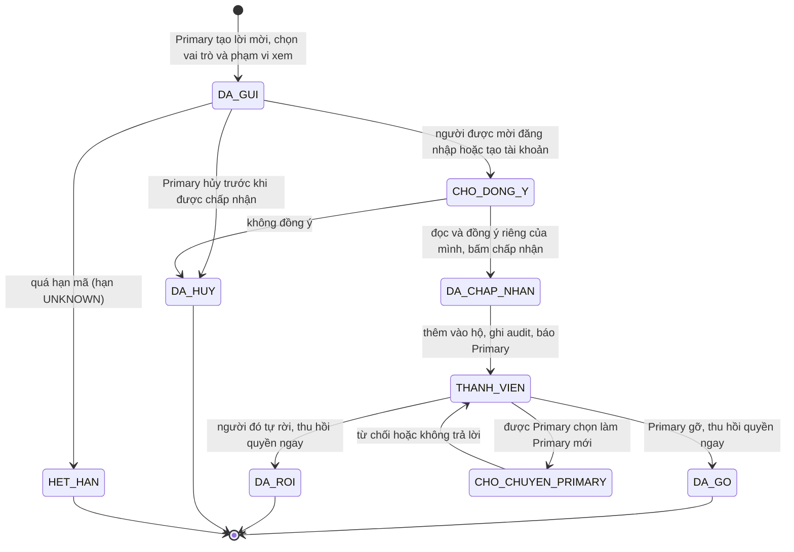
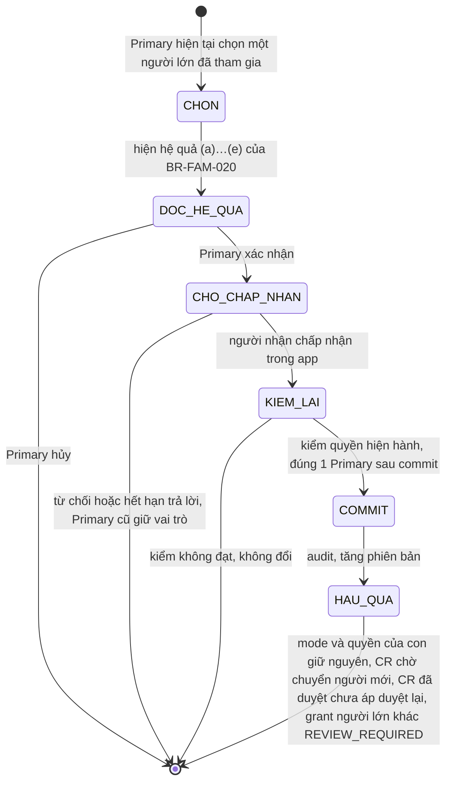
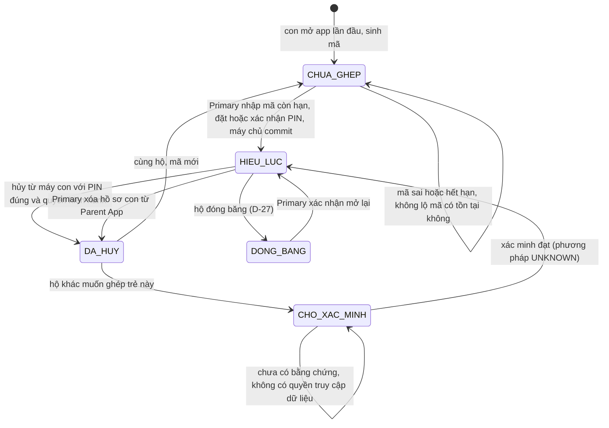
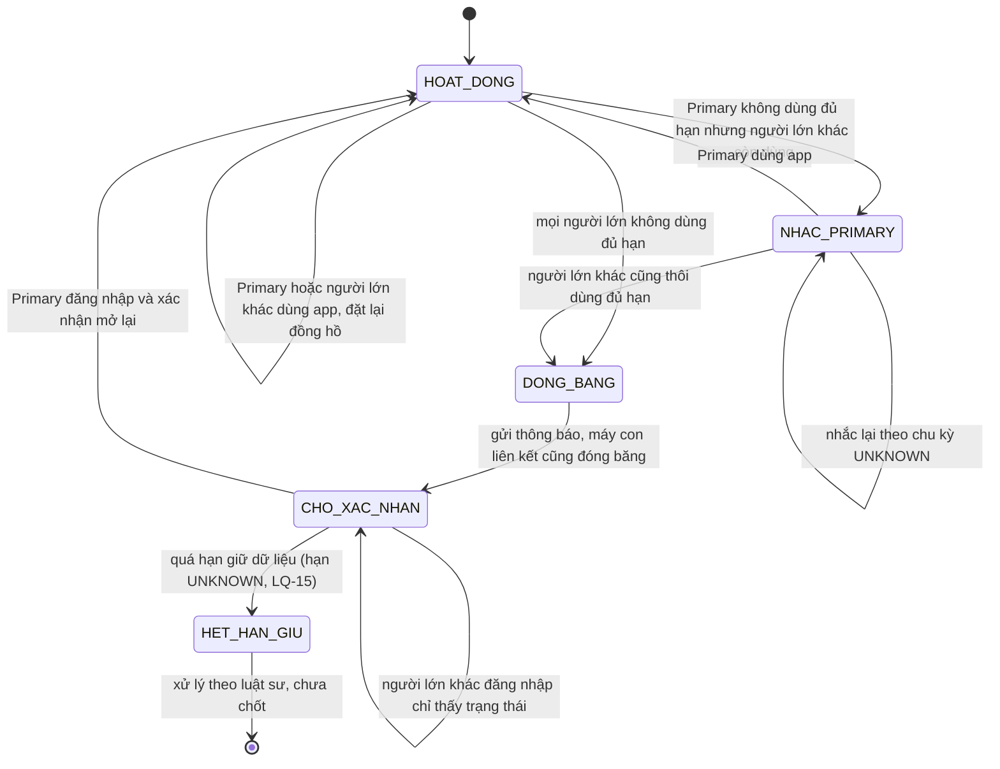
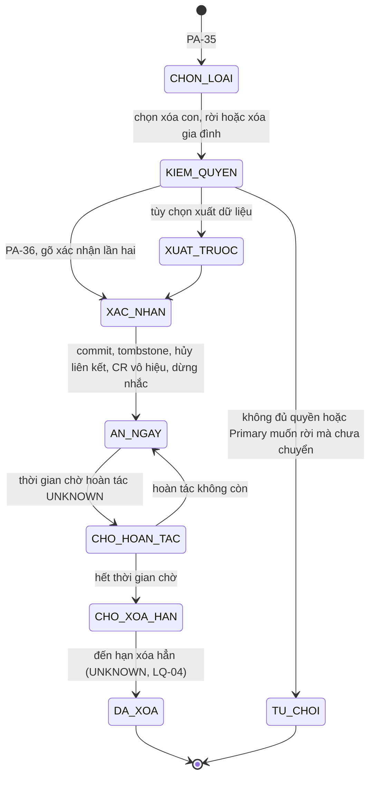

# 11.2 – BUSINESS LOGIC: GIA ĐÌNH, THÀNH VIÊN VÀ QUYỀN TRUY CẬP CỦA A-LITE E1

- **Ngày:** 15/11/2026.
- **Phạm vi:** gia đình, vai trò, mời và gỡ thành viên tối thiểu (D-22), ghép máy con và Parent PIN (FR-01), đổi người quản lý chính (D-07), chế độ tự chủ (D-19), đóng băng tài khoản khi không dùng (D-27), khôi phục tài khoản, rời gia đình, xóa hồ sơ con.
- **Bản chất:** bản nháp đặc tả nghiệp vụ, đi cùng `Business_Logic_11_1_Scheduling_E1_DRAFT.md` (gọi tắt **BL 11.1**). Không phải spec chuẩn. Không sửa nguồn chuẩn. Chỗ nào khác nguồn thì ghi ở §11 để sửa nguồn trước.
- **Dữ liệu:** chỉ hồ sơ giả lập (bé "Na", "Bin"; phụ huynh "chị Hoa", "anh Minh"). Không dùng dữ liệu trẻ thật. **Cổng pháp lý H4, FR-03 vẫn mở, không coi là PASS** (D-01, CAP-4). `LEGAL_UNKNOWN` không có nghĩa là được phép (CAP-1, PA-OD-04).
- **Mã quy tắc:** `BR-FAM-xxx` (riêng file này, không trùng `BR-xxx` của BL 11.1). Thông số: `PR-FAM-xx`. Trường hợp biên: `EC-FAM-xx`. Tiêu chí chấp nhận: `AC-FAM-xx`. Mâu thuẫn: `M-FAM-xx`. Câu hỏi: `Q-FAM-xx`.

## 0. Nguồn và quy ước

### 0.1 Thứ bậc nguồn khi khác nhau

| Bậc | Nguồn | Viết tắt |
|---|---|---|
| 1 | Sổ quyết định 15/11/2026 (`app-design-document/progress/Owner_Decision_Log_20261115.md`) | D-xx, OD-Ax |
| 2 | Các sổ quyết định `*_APPROVED.md` qua sổ ràng buộc `Constraint_Register_Approved_Decisions.md` (CRG) | AP-OD-xx (Access Policy), P5-OD-xx, P5-R-FC, CL-OD-xx (Consent Ledger), B01-MS-OD-xx (Mode State), B01-CR-OD-xx, B01-PS-OD-xx, B01C-OD-xx, PBA-OD-xx (Purpose-bound Access), FR01-x, OD-03, REM-HRW, CAP-x, C-xx, OC-xx |
| 3 | `documents/pal/spec-quy-tac-lap-lich.md` (QT), `spec-quy-thoi-gian-va-tab-cua-con.md` (TAB) | QT + mã (J, K, L, N), TAB §x |
| 4 | User Flow `04_User_Flow/User_Flow_04_1_Scheduling_Loop.md` (UF1) và `User_Flow_04_2_Remaining_Flows.md` (UF2) | F1…F5, G1…G10, PA-xx, CA-xx, UF-Qxx |
| 5 | BL 11.1 | BR-xxx, EC-xx |
| 6 | `progress/Legal_Question_Pack.md` | LQ-xx |

Quyết định 15/11/2026 thắng mọi nguồn cũ. Phần UF2 viết trước D-27 và D-28; chỗ UF2 khác D-27, D-28 thì theo sổ quyết định (ghi ở §11.3).

### 0.2 Mức căn cứ

Dùng cùng nhãn với BL 11.1 §0.2: `OD`, `SP` (yêu cầu sản phẩm), `An toàn`, `đề xuất nội bộ`, `fail-safe có nhãn`. Thêm:

| Nhãn | Nghĩa |
|---|---|
| `UNKNOWN` | Nguồn không có số hoặc cách làm. Mô hình hóa như tham số chưa chốt (§6), mặc định fail-closed |
| `PHÁP LÝ` | Chờ ý kiến luật sư (LQ-xx). Không đánh PASS |

Không có `[NC]`/`[NL]`/`[MĐ]` ở file này vì không có quy tắc nào dựa trên nghiên cứu khoa học. Mọi con số chưa có nguồn đều là `UNKNOWN` hoặc `đề xuất nội bộ`.

## 1. Phạm vi

### 1.1 Module trong phạm vi

| L3 | Tên | Vai trò trong file này | Mức BL |
|---|---|---|---|
| `F01-G01-M01` | Account Access | Tạo tài khoản, đăng nhập, khôi phục | Đầy đủ (phương pháp khôi phục `UNKNOWN`) |
| `F01-G01-M02` | Session Security | Phiên, đăng xuất từng máy, token máy con | Quy tắc nghiệp vụ |
| `F01-G02-M01` | Family Structure | Hộ gia đình, ghép máy, hủy liên kết | Đầy đủ |
| `F01-G02-M02` | Member Relationships | Mời, gỡ, tự rời. **Ngoài A-lite v2; vào E1 ở mức tối thiểu theo D-22** | Tối thiểu |
| `F01-G03-M01` | Core Identity | Hồ sơ con (xóa hồ sơ con) | Phần xóa |
| `F01-G04-M01` | Access Policy | ALLOW/DENY, vai trò, đổi Primary | Đầy đủ (mặc định từ chối) |
| `F01-G04-M02` | Consent Ledger | Chỉ phần ghi nhận khi mời, đổi Primary. Phần chính ở BL 11.3 | Mối nối |
| `F01-G05-M01` | Mode State | Đặt và đọc chế độ tự chủ | Đầy đủ |
| `F01-G05-M02` | Mode Transitions | Con xin đổi chế độ. **Ngoài E1** | Không |
| `F01-G06-M01` | Lifecycle Controls | Đóng băng, xóa hồ sơ con, rời gia đình, xóa gia đình | Đầy đủ |
| `F04-G03-M02` | Approval Routing | Chuyển CR khi đổi Primary | Mối nối với BL 11.1 |
| `F04-G07-M01` | Schedule Notifications | Thông báo về thành viên, đóng băng. Phần chính ở BL 11.4 | Mối nối |

### 1.2 Ngoài phạm vi

- Con xin đổi chế độ (F01-G05-M02), `CHILD_DIRECTED` (ẩn, D-19).
- Gói, thanh toán, quyền lợi (F01-G06-M02/M03, K7 của UF2).
- Người dùng từ 18 tuổi tự quản (AP-OD-04, F3-X8, G4-X4).
- Phương pháp xác minh khi ghép trẻ sang hộ khác (FR-01 mục 4, LQ-03): chỉ ghi trạng thái chờ xác minh.
- Pal trò chuyện, nhật ký riêng của con (nấc 2).
- Thời hạn lưu và xóa hẳn: BL 11.3.

### 1.3 Mối nối với BL 11.1 và màn hình

| Điểm nối | BL 11.1 | File này | Màn (UF1 §7, UF2 §14) |
|---|---|---|---|
| Mode hiệu lực của con | BR-008, BR-110, BR-111…113 | BR-FAM-040…049 | PA-12 |
| Đổi Primary giữ mode và quyền con | BR-120 | BR-FAM-022 | PA-30, PA-31 |
| CR chuyển người duyệt; CR đã duyệt phải duyệt lại | BR-119, BR-117, BR-118 | BR-FAM-023 | PA-17 |
| Đổi mode làm con mất quyền thì CR vô hiệu | BR-119 | BR-FAM-043 | PA-12 |
| Con không có máy | BR-006, EC-19 | BR-FAM-037 | PA-03 |
| Lock chặn mọi commit; không tự mở | BR-122, BR-123 | BR-FAM-026, BR-FAM-056 | PA-26 |
| Giai đoạn tạm thời tự về khi hết hạn | BR-097, EC-11 | BR-FAM-056 | PA-19 |
| Không có Primary hợp lệ thì chặn sửa kế hoạch | BR-081, BR-082, BR-150 | BR-FAM-002, BR-FAM-072 | PA-11 |
| Đặt lại nhắc sau commit | BR-151 | BR-FAM-052, BR-FAM-080 | CA-06 |
| Xóa hồ sơ con: CR vô hiệu, dừng nhắc | BR-119, BR-151 | BR-FAM-080 | PA-35, PA-36, CA-17 |
| Xử lý nhiều con | BR-009 | BR-FAM-006 | PA-08 |

## 2. Thực thể dữ liệu và trạng thái

### 2.1 Danh sách thực thể

| Thực thể | Trường chính | Trạng thái | Module chủ |
|---|---|---|---|
| **Gia đình** (`household`) | id, tên gia đình, cờ `trial_d01` (thử nội bộ), trạng thái đóng băng, `last_adult_active_at` | §3.4 | F01-G02-M01 |
| **Thành viên người lớn** (`member`) | id, tài khoản, vai trò (`PRIMARY` / `SUPPORTER` / `OBSERVER`), cách Pal gọi, grants[], `last_active_at`, thời điểm vào, thời điểm rời | `DA_THAM_GIA` → `DA_GO` / `DA_ROI`; grants: `ACTIVE` / `REVIEW_REQUIRED` / `THU_HOI` | F01-G02-M02, F01-G04-M01 |
| **Grant** | member_id, child_id, resource, action, purpose, scope, thời điểm cấp, thu hồi | như trên | F01-G04-M01 |
| **Hồ sơ con** | id, tên gọi, tuổi/lớp, mode, `child_device`, binding hiện tại | `HOAT_DONG` → `CHO_XOA` (tombstone) → `DA_XOA` | F01-G03-M01 |
| **Lời mời** | id, người mời, vai trò, con và loại dữ liệu được xem, hạn, mã dùng một lần | `DA_GUI` → `DA_CHAP_NHAN` / `DA_HUY` / `HET_HAN` | F01-G02-M02 |
| **Yêu cầu chuyển Primary** | người cũ, người mới, thời điểm, phiên bản | `CHO_CHAP_NHAN` → `HOAN_TAT` / `TU_CHOI` / `HET_HAN` | F01-G04-M01 (AP-OD-03) |
| **Liên kết máy con** (`binding`) | child_id, device_id, epoch, thời điểm ghép, người ghép | `CHUA_GHEP` → `HIEU_LUC` → `DA_HUY`; `CHO_XAC_MINH` (hộ khác) | F01-G02-M01 |
| **Mã ghép** | child_id (phía máy con), hạn, dùng một lần | `CON_HAN` → `DA_DUNG` / `HET_HAN` | F01-G02-M01 |
| **Parent PIN** | gắn tài khoản người chăm sóc có quyền; chỉ lưu dạng băm; số lần sai | — | F01-G01-M02 |
| **Mode của con** | child_id, mode (`UNSET` / `PARENT_LED` / `CHILD_EXECUTED`), người đổi, thời điểm, mode cũ | ghi nhận từng lần đổi | F01-G05-M01 |
| **Trạng thái đóng băng** | household_id, `FROZEN_AT`, lý do (`KHONG_DUNG_30_NGAY`), người xác nhận mở lại, thời điểm | §3.4 | F01-G06-M01 |
| **Yêu cầu xóa** (`deletion_request`) | loại (`HO_SO_CON` / `NGUOI_LON_ROI` / `GIA_DINH`), người yêu cầu, phạm vi, thời điểm chấp nhận đầu tiên, tombstone, hạn xóa hẳn (`UNKNOWN`) | §3.5 | F01-G06-M01 (chi tiết BL 11.3) |
| **Audit thành viên** | sự kiện, người làm, thời điểm, không có PIN, không có mã ghép, không có nội dung riêng | bất biến | F01-G04-M02, F07 (B01C-OD-07) |

### 2.2 Bảng vai trò và quyền trong E1

Mặc định từ chối (CAP-2). Ô "theo grant" nghĩa là chỉ làm được khi Primary đã cấp đúng resource, action, purpose, scope. Ô trống `fail-safe có nhãn` nghĩa là nguồn không nói rõ, chọn hướng hạn chế hơn.

| Hành động | Primary | Supporter / Observer | Con | Nguồn |
|---|---|---|---|---|
| Xem lịch có hiệu lực | có | theo grant | có (lịch của mình) | AP-OD-02 |
| Xem ✓ Xong và giờ | có | theo grant | có | AP-OD-02, G1 |
| Xem xu hướng mệt liên quan lịch | có | **không** nếu chưa được cấp riêng | có (thấy mình được báo gì, CA-16) | D-03, G1-X3 |
| Xem lựa chọn hỏi thăm từng ngày | **không** | **không** | có (CA-13) | D-03, UF-Q18 |
| Sửa hồ sơ con, thẻ hoạt động, quỹ, commit lịch | có | **không** (`fail-safe có nhãn`) | không (trừ `CHILD_DIRECTED`, ẩn) | AP-OD-05, P5-OD-03, M-FAM-02 |
| Duyệt hoặc không duyệt CR | có | **không** | không | B01-CR-OD-03 |
| Khóa và mở khóa lịch | có | **không** | không | B01-PS-OD-04, G2-X5 |
| Đổi mode của con | có | **không** | không | B01-MS R1, G5-X4 |
| Mời, gỡ thành viên | có | không (tự rời được) | không | AP-OD-01 (suy), G4 |
| Đổi Primary | có (chọn người nhận) | chấp nhận khi được chọn | không | AP-OD-03 |
| Ghép máy con (nhập mã) | có | không | con sinh mã | FR-01 |
| Hủy liên kết từ máy con | có người chăm sóc có quyền + PIN | không | không (cần PIN) | FR-01 mục 1 |
| Rút đồng ý | có (đồng ý do caregiver quản lý) | chỉ đồng ý của chính mình | không | CL-OD-02, G6-X1 |
| Xuất dữ liệu của con | có | không | không | UF-Q43 (đề xuất) |
| Xóa hồ sơ con, xóa gia đình | có | không | không | G9 |
| Gửi mong muốn, đề xuất | — | — | có, theo mode | B01-MS-OD-02 |
| Tự làm việc, bấm Xong, hỏi thăm | — | — | có, mọi mode | B01-MS-OD-02 |

## 3. Máy trạng thái

### 3.1 Lời mời và thành viên (D-22)

### 3.2 Đổi người quản lý chính (D-07)

### 3.3 Liên kết máy con (FR-01)

### 3.4 Đóng băng tài khoản (D-27)

### 3.5 Xóa hồ sơ con, rời gia đình, xóa gia đình

## 4. Quy tắc nghiệp vụ

Cột **Căn cứ**: `OD`, `SP`, `An toàn`, `đề xuất nội bộ`, `fail-safe có nhãn`, `UNKNOWN`, `PHÁP LÝ`.

### 4.1 Gia đình và vai trò

| ID | Điều kiện | Hành động | Nguồn | Quyết định | Căn cứ | Màn |
|---|---|---|---|---|---|---|
| BR-FAM-001 | Người lớn tạo gia đình lần đầu | Người tạo là Primary. Mỗi gia đình có **đúng một** Primary hiệu lực. Ghi đồng ý `SELF_DECLARED` trước khi tạo hồ sơ con. Vai trò trong app **không** đồng nghĩa người giám hộ hợp pháp | UF1 F1; UF2 G4 | AP-OD-01, CL-OD-01 | OD | PA-01…03 |
| BR-FAM-002 | Không có Primary hợp lệ, hoặc có hơn một người cùng quyền trên một scope | Chặn sửa kế hoạch (fail-closed). Observer không tự nâng quyền. Con vẫn gửi mong muốn hoặc đề xuất; máy chủ vẫn nhận, chờ tới khi có người có quyền | UF2 G4-X2, G4-X3 | P5-OD-03, P5-R-FC | OD | PA-11 |
| BR-FAM-003 | Primary xem dữ liệu của con | Chỉ dữ liệu học tập, phát triển trong scope. Không đọc Journal hay tin an toàn chỉ vì vai trò. E1 không có Journal | UF2 G1 | AP-OD-02 | OD | PA-21 |
| BR-FAM-004 | Supporter hoặc Observer thao tác | Không duyệt CR, không khóa, không đổi mode, không rút đồng ý của người khác, không mời, không đổi Primary. Sửa kế hoạch: **không** (nguồn không cấp). Chỉ thấy phần được cấp | UF2 G2-X5, G5-X4, G6-X1 | B01-CR-OD-03 | OD + `fail-safe có nhãn` (sửa kế hoạch) | PA-28 |
| BR-FAM-005 | Dữ liệu riêng của một người lớn (cách Pal gọi, liên hệ, ghi chú riêng) | Không đưa cho người lớn khác, kể cả Primary mới. E1 gần như không có dữ liệu loại này; áp từ nấc 2 | CLAUDE.md; UF2 G4-X6 | — | An toàn | PA-33 |
| BR-FAM-006 | Gia đình nhiều con, thao tác không chỉ rõ con | Hỏi con nào, không đoán, không áp cho tất cả. Mỗi con có mode, liên kết máy, xóa riêng | CLAUDE.md | — | SP | PA-08 |
| BR-FAM-007 | Người dùng từ 18 tuổi tự quản | Không áp quyền caregiver; Parent PIN không tạo quyền người chăm sóc đối với người lớn tự quản. Ngoài phạm vi E1 (lớp 1–9) | UF2 G4-X4; UF1 F3-X8 | AP-OD-04, FR01-1 | OD | — |
| BR-FAM-008 | Quyền truy cập mọi loại | Mặc định từ chối. Kiểm quyền và mục đích **trước** khi đọc, suy luận, tra cache hay gọi dịch vụ ngoài. Một điểm ALLOW/DENY duy nhất ở máy chủ. Nút ẩn trên UI không thay kiểm quyền | CRG CAP-2, C-06 | CAP-2 | OD | — |
| BR-FAM-009 | Vai trò mới tạo cho người lớn | Vai trò chỉ gồm `PRIMARY`, `SUPPORTER`, `OBSERVER`. Không tạo vai trò thứ tư | UF2 G4 | AP-OD-01 | OD | PA-29 |

### 4.2 Mời và gỡ thành viên tối thiểu (D-22)

| ID | Điều kiện | Hành động | Nguồn | Quyết định | Căn cứ | Màn |
|---|---|---|---|---|---|---|
| BR-FAM-010 | Primary bấm "Mời người lớn" | Chọn vai trò (Supporter hoặc Observer), chọn con, chọn loại dữ liệu được xem (học tập, phát triển trong scope). **Không** cấp Journal, nội dung riêng, thông tin an toàn. Mỗi quyền ghi đủ resource, action, purpose, scope. Chỉ Primary mời được | UF2 G4 6.1 | D-22, AP-OD-02 | OD + `đề xuất nội bộ` (chỉ Primary mời, suy từ AP-OD-01) | PA-28, PA-29 |
| BR-FAM-011 | Tạo lời mời | Mã dùng một lần, có hạn, chống chiếm tài khoản, không để người lạ biết một ID. Hạn: `PR-FAM-01` (`UNKNOWN`). Primary hủy được trước khi chấp nhận | UF2 G4-X5 | CL-OD-01 | OD; hạn `UNKNOWN` | PA-29 |
| BR-FAM-012 | Người được mời nhận lời mời | Đăng nhập hoặc tạo tài khoản; đọc và đồng ý **riêng của mình** (không thừa hưởng đồng ý của Primary); rồi chấp nhận. Không đồng ý → không vào hộ | UF2 G4 6.1 bước 4; UF1 F1-X7 | CL-OD-01 | OD | PA-31, PA-02 |
| BR-FAM-013 | Chấp nhận thành công | Thêm vào hộ, cấp đúng grant đã chọn, ghi audit, báo Primary **sau commit** | UF2 G4 6.1 bước 5 | — | SP | PA-15 |
| BR-FAM-014 | Primary gỡ một Supporter hoặc Observer | Thu hồi mọi quyền ngay ở máy chủ; phiên của người đó mất quyền ở lần gọi kế; thông báo chưa gửi cho người đó bị hủy; **không xóa dữ liệu của con**; ghi audit; báo người bị gỡ ở mức tối thiểu | UF2 G4 6.3 | D-22, G3-X4 | OD | PA-28 |
| BR-FAM-015 | Supporter hoặc Observer tự rời | Như BR-FAM-014, do chính họ làm. Dữ liệu riêng của họ xử lý theo BL 11.3 | UF2 G4 6.3 | — | SP | PA-35 |
| BR-FAM-016 | Primary muốn rời | Phải chuyển Primary trước (BR-FAM-020…) hoặc xóa gia đình (BR-FAM-083). Không cho để lại gia đình không có Primary. Primary là người lớn duy nhất: chỉ có xóa gia đình | UF2 G4 6.3 bước 3 | P5-OD-03 (suy) | `fail-safe có nhãn`, UF-Q40 | PA-35 |
| BR-FAM-017 | Một tài khoản đã thuộc gia đình khác được mời | E1: mỗi tài khoản thuộc **một** gia đình. Từ chối lời mời, nêu rõ lý do | — | — | `fail-safe có nhãn` (Q-FAM-04) | PA-31 |
| BR-FAM-018 | Số người lớn tối đa trong một gia đình | `PR-FAM-02` (`UNKNOWN`). Tới khi chốt: không đặt trần riêng của sản phẩm; Primary vẫn là người duy nhất mời | — | — | `UNKNOWN` | — |
| BR-FAM-019 | Lời mời gửi nhầm người | Primary hủy trước khi chấp nhận; sau khi chấp nhận thì gỡ theo BR-FAM-014 | UF2 G4-X5 | — | SP | PA-28 |

### 4.3 Đổi người quản lý chính (D-07)

| ID | Điều kiện | Hành động | Nguồn | Quyết định | Căn cứ | Màn |
|---|---|---|---|---|---|---|
| BR-FAM-020 | Primary chọn một người lớn đã tham gia làm Primary mới | Hiện rõ hệ quả: (a) quyền đã cấp cho con giữ nguyên; (b) đồng ý cũ giữ nguyên; (c) CR chờ chuyển cho người mới, CR đã duyệt chưa áp phải duyệt lại; (d) quyền xem của người lớn khác chuyển `REVIEW_REQUIRED`; (e) Primary cũ trở thành Supporter, grant `REVIEW_REQUIRED`. Chỉ Primary khởi tạo | UF2 G4 6.2 | D-07, AP-OD-03 | OD; (d) và (e) `fail-safe có nhãn` | PA-30 |
| BR-FAM-021 | Người được chọn | Phải **chấp nhận** trong app mới đổi. Từ chối hoặc không trả lời (hạn `PR-FAM-03`, `UNKNOWN`) thì không đổi, Primary cũ giữ vai trò. Xác minh thêm: `UNKNOWN`; chỉ ghi rõ "không chứng minh giám hộ" | UF2 G4 6.2 bước 3, G4-X1 | MR-016/017 | `UNKNOWN`, `PHÁP LÝ` | PA-31 |
| BR-FAM-022 | Commit đổi Primary | **Mode và quyền cũ của con giữ nguyên**: không tạm ngưng, không chuyển `REVIEW_REQUIRED`. Phần "grant cũ chuyển `REVIEW_REQUIRED`" của AP-OD-02 không áp cho quyền của trẻ | UF2 G4; BL 11.1 BR-120 | **D-07**, B01C-OD-01, B01-CL-OD-03, B01-MS-OD-04 | OD | PA-12 |
| BR-FAM-023 | Có CR đang chờ hoặc đã duyệt chưa áp lúc đổi Primary | CR `PENDING` chuyển cho người duyệt mới. CR `APPROVED` chưa áp quay lại `PENDING`, phải duyệt lại. Hạn 7 ngày không tính lại | BL 11.1 §3.2, BR-119 | D-07, B01-CR-OD-02 iii | OD | PA-17 |
| BR-FAM-024 | Đồng ý đã ghi trước đổi Primary | Giữ nguyên. Primary mới muốn đổi thì tạo sự kiện đồng ý mới. Có lịch sử không có nghĩa là hợp lệ về pháp lý | UF2 G6-X3 | CL-OD-03 | OD; `PHÁP LÝ` (LQ-02 câu 3) | PA-32 |
| BR-FAM-025 | Sau đổi Primary, grant của người lớn khác | Chuyển `REVIEW_REQUIRED`: **từ chối cho tới khi Primary mới xác nhận lại** (CAP-2). Supporter không thấy xu hướng mệt nếu chưa được cấp riêng | UF2 G4 6.2, UF-Q30 | AP-OD-02 | `fail-safe có nhãn` (UF-Q30 chờ Owner) | PA-28 |
| BR-FAM-026 | Đổi Primary khi lịch đang khóa | Khóa giữ nguyên. Người mới thấy khóa và người đã khóa. Không tự mở | UF2 G2-X4 | B01C-OD-05 | `đề xuất nội bộ` | PA-26 |
| BR-FAM-027 | Commit xong | Báo người lớn liên quan sau commit. Báo con bằng câu ngắn "Người quản lý lịch của con bây giờ là [tên gọi]". Thông báo tối thiểu | UF2 G4 6.2 bước 5 | — | `đề xuất nội bộ` (UF-Q29) | PA-15, CA-04 |
| BR-FAM-028 | Parent PIN sau đổi Primary | Máy chủ kiểm quyền **hiện hành** khi hủy liên kết, nên PIN của Primary cũ không còn đủ. Primary mới đặt PIN của mình. Quy trình đặt, đổi, khôi phục PIN: `UNKNOWN` | FR-01 mục 1 | FR01-1 | `fail-safe có nhãn`; quy trình `UNKNOWN` | PA-14 |
| BR-FAM-029 | Đổi Primary thực hiện | Một giao dịch có phiên bản và audit; kiểm lại quyền trước mọi thay đổi; sau commit luôn đúng một Primary. Gửi lặp cùng khóa thì không tạo hai lần | UF2 G4 6.2 bước 4 | AP-OD-01, P5-OD-03 | OD | — |

### 4.4 Ghép máy con và Parent PIN (FR-01)

| ID | Điều kiện | Hành động | Nguồn | Quyết định | Căn cứ | Màn |
|---|---|---|---|---|---|---|
| BR-FAM-030 | Con mở app lần đầu | Child App sinh **mã ghép mới**, dùng một lần, có hạn (`PR-FAM-04`, `UNKNOWN`). Chưa ghép thì **không** hiện chương trình của phụ huynh | UF1 F3 4.1 | CL-OD-01, FR-01 mục 3 | OD; hạn `UNKNOWN` | CA-01, CA-02 |
| BR-FAM-031 | Phụ huynh nhập mã | Chọn con trước (PA-08). Kiểm: tài khoản hợp lệ, quyền với hồ sơ con, mã còn hạn, máy chưa có liên kết hiệu lực. Mã sai hoặc hết hạn: một thông báo chung, không lộ mã có tồn tại không | UF1 F3-X1 | CL-OD-01 | OD | PA-13 |
| BR-FAM-032 | Ghép thành công | Tạo liên kết hiệu lực (epoch mới), ghi audit, dùng mã xong thì hủy mã. Một con tại một thời điểm có tối đa một liên kết hiệu lực. Con đã có liên kết hiệu lực ở hộ khác: **từ chối**, kể cả có mã | UF1 F3 4.3 | FR-01 mục 5, FR01-T08 | OD | PA-13 |
| BR-FAM-033 | Ghép | Chỉ là **liên kết định danh**, không chứng minh thẩm quyền pháp lý. Parent App lập kế hoạch được trước khi ghép | UF1 F3 | CL-OD-01 | OD; `PHÁP LÝ` (LQ-03) | — |
| BR-FAM-034 | Hủy liên kết từ máy con | Cần Parent PIN đúng **và** quyền tài khoản hiện hành **và** epoch. PIN là kiểm tra thêm, không thay quyền ở máy chủ. Con biết phiên hoặc mở được Cài đặt không đủ. PIN sai: không hủy, giới hạn số lần thử ở máy chủ (`PR-FAM-05`, `UNKNOWN`) | UF1 F3 4.2, F3-X2 | FR01-1 | OD; số lần `UNKNOWN` | CA-11, CA-12 |
| BR-FAM-035 | Hủy có hiệu lực | Chỉ khi **máy chủ** commit; máy con ngoại tuyến không tự coi là đã hủy. Commit đúng một lần (idempotent). Tăng epoch, vô hiệu token cũ. **Không xóa dữ liệu của con, không cấp quyền Journal.** Thông báo tối giản cho phụ huynh (không PIN, không mã, không lý do riêng); gửi thất bại thì thử lại, không đảo ngược việc hủy | UF1 F3 4.2, F3-X3, F3-X4 | FR01-1, FR01-2 | OD | PA-15 |
| BR-FAM-036 | Ghép lại | Cùng hộ: luồng bình thường với **mã mới**; mã và token cũ vô hiệu. Hộ khác sau khi hộ cũ đã hủy hợp lệ: cần xác minh mới **riêng cho trẻ này**; trong lúc chờ là `CHO_XAC_MINH`, **không** có quyền truy cập dữ liệu; hộ mới không thừa hưởng dữ liệu hay quyền của hộ cũ. Phương pháp xác minh: `UNKNOWN`, không tự đặt yêu cầu giấy tờ | UF1 F3 4.3 | FR-01 mục 4, 5; FR01-T05, T06 | `UNKNOWN`, `PHÁP LÝ` (LQ-03) | PA-13 |
| BR-FAM-037 | Con chưa có máy (`child_device = false`) | App yêu cầu con có thiết bị riêng. Chưa có máy: chỉ dùng phần lập lịch phía phụ huynh (BL 11.1 BR-006). **Không** cho dùng chung máy phụ huynh làm máy con. Khi con có máy sau này: ghép bình thường | UF1 F3-X5 | D-11 | OD; không dùng chung máy: `fail-safe có nhãn` (UF-Q17) | PA-03 |
| BR-FAM-038 | Ghép hoặc hủy xong | Phụ huynh nhận thông báo sau commit: "Đã ghép máy của [tên gọi]", "Máy của [tên gọi] đã hủy liên kết". Không chứa mã, PIN | UF1 F3 bước 7 | FR01-2 | OD | PA-15 |
| BR-FAM-039 | Máy con từ chối quyền thông báo | Vẫn ghép được. Phụ huynh được báo "nhắc trên máy con đang tắt" (BL 11.4) | UF1 F3-X7 | — | `đề xuất nội bộ` | CA-15 |
| BR-FAM-090 | Pilot gia đình thật | FR-01 (tài khoản, ghép, PIN) **phải xong trước** khi thử. Mã gia đình chỉ dùng cho spike kỹ thuật | UF1 §0.5 | OD-A8, D-04, D-18 | OD | PA-01 |

### 4.5 Chế độ tự chủ

| ID | Điều kiện | Hành động | Nguồn | Quyết định | Căn cứ | Màn |
|---|---|---|---|---|---|---|
| BR-FAM-040 | Đổi mode của con | Chỉ Primary. Mỗi con một mode. AI không đổi mode. Supporter: không có nút, API từ chối | UF2 G5 | B01-MS-OD-01, B01-MS R1 | OD | PA-12 |
| BR-FAM-041 | Con mới tạo, hoặc mode không đọc được | `UNSET`, quyền lịch như `PARENT_LED`. Không phải mode thứ tư. Fail-closed | UF1 §0.3 | B01-MS-OD-04 | OD | — |
| BR-FAM-042 | Màn chọn mode ở E1 | Chỉ hiện `PARENT_LED` và `CHILD_EXECUTED`, mô tả bằng lời dễ hiểu. `CHILD_DIRECTED` **ẩn**, và máy chủ **từ chối** đặt mode này ở E1 (không chỉ ẩn nút). Nếu gặp giá trị `CHILD_DIRECTED` trong dữ liệu, hiệu lực coi như `PARENT_LED` | UF2 G5 7.1; BL 11.1 BR-113 | D-19, UF-Q23 | OD; xử lý dữ liệu lạ `fail-safe có nhãn` | PA-12 |
| BR-FAM-043 | Đổi mode làm con **mất** quyền (ví dụ về `PARENT_LED`) | Báo trước hệ quả. Sau commit: CR `PENDING` và CR `APPROVED` chưa áp đều `INVALIDATED`. Mong muốn đã gửi giữ nguyên trong hàng chờ | UF2 G5 7.1 bước 3 | B01-CR-OD-02 iv | OD | PA-12, PA-17 |
| BR-FAM-044 | Đổi mode làm con **được thêm** quyền | Có hiệu lực từ commit. Không tự biến mong muốn cũ thành CR | UF2 G5 | B01-MS-OD-02 | `đề xuất nội bộ` | PA-12 |
| BR-FAM-045 | Commit mode | Ghi mode cũ, mode mới, người đổi, giờ máy chủ, audit. Báo con sau commit kèm câu giải thích quyền mới bằng lời dễ hiểu | UF2 G5 7.1 bước 5 | B01-MS-OD-04 | OD; báo con `đề xuất nội bộ` (UF-Q31) | CA-04 |
| BR-FAM-046 | Chọn mode | Không dùng tuổi cứng làm điều kiện. Primary quyết theo từng con | UF2 G5 7.1 bước 2 | B01-PS-OD-03 | OD | PA-12 |
| BR-FAM-047 | Mọi mode | Con vẫn tự làm việc đã duyệt, báo trạng thái, bấm Xong, trả lời hỏi thăm, gửi mong muốn theo mode. Mode **không** xóa các quyền này | UF1 §0.3 | B01-MS-OD-02 | OD | CA-04 |
| BR-FAM-048 | Con ngoại tuyến gửi theo mode cũ | Máy chủ đọc mode hiện hành khi nhận; mode không còn cho phép thì từ chối, không ghi đè im lặng | UF2 G5-X2; BL 11.1 BR-124 | B01-MS regression 7 | OD | CA-08, CA-09 |
| BR-FAM-049 | Con xin đổi mode | Ngoài E1 (F01-G05-M02). Không có nút | UF2 G5 | UF-Q31 | `đề xuất nội bộ` | — |

### 4.6 Đóng băng khi người quản lý chính không dùng (D-27)

| ID | Điều kiện | Hành động | Nguồn | Quyết định | Căn cứ | Màn |
|---|---|---|---|---|---|---|
| BR-FAM-050 | Định nghĩa "dùng app" | Một thao tác có chủ đích của người lớn đã đăng nhập ở Parent App (mở app, đăng nhập, bấm). **Không tính**: Child App hoạt động, đồng bộ nền, tác vụ hệ thống (hết hạn giai đoạn, hết hạn CR), mở thông báo mà chưa vào app. Ghi `last_active_at` theo giờ máy chủ. Tạo tài khoản tính là một lần dùng | — | D-27 | `fail-safe có nhãn` (Q-FAM-01) | — |
| BR-FAM-051 | Hạn không dùng | "Một tháng" = `PR-FAM-06` = 30 ngày liên tục kể từ lần dùng gần nhất, tính theo giờ máy chủ. Kiểm chạy hằng ngày | — | D-27 | `đề xuất nội bộ` (con số 30 ngày là cách hiểu của AI) | — |
| BR-FAM-052 | Primary không dùng đủ hạn **và** có người lớn khác dùng trong cùng cửa sổ | **Không đóng băng.** Chỉ nhắc Primary (nội dung tối thiểu). Chu kỳ nhắc lại: `PR-FAM-07` (`UNKNOWN`). Lịch, nhắc trên máy con vẫn chạy | — | D-27 | OD; chu kỳ `UNKNOWN` | PA-15 |
| BR-FAM-053 | Mọi người lớn không dùng đủ hạn | **Đóng băng** gia đình: tài khoản Primary, các tài khoản người lớn khác, **mọi liên kết máy con**. Gửi thông báo; chờ Primary xác nhận mở lại | — | D-27 | OD | — |
| BR-FAM-054 | Khi đóng băng | **Giữ nguyên dữ liệu**, không xóa, không ẩn thêm. Không xử lý mới: không nhận ghi nhận từ máy con, không xếp lịch, không commit, không gửi nhắc khối, không gửi báo cáo. Lịch cuối cùng vẫn nằm trong dữ liệu | — | D-27 | OD | — |
| BR-FAM-055 | Máy con của gia đình đóng băng | Hiện màn tạm dừng bằng lời dễ hiểu ("Lịch đang tạm dừng. Con hãy nói với bố mẹ mở lại ứng dụng"). Không nêu chi tiết nhạy cảm. Nút "Con cần giúp đỡ" và nội dung an toàn tĩnh **vẫn dùng được** | UF2 G8-X1 | D-27, D-26, OD-03a | OD; an toàn tĩnh `An toàn` | CA-14 |
| BR-FAM-056 | Đồng hồ trong lúc đóng băng | CR hết hạn theo giờ máy chủ như thường (7 ngày). Giai đoạn tạm thời hết hạn vẫn **tự về** hồ sơ chuẩn (bỏ phần nới là hướng an toàn hơn, giống EC-11 của BL 11.1), ghi audit "hệ thống, theo D-09". Khóa lịch giữ nguyên. Mọi thao tác này không phải "dùng app" | BL 11.1 EC-11, BR-097 | D-09, D-27 | `fail-safe có nhãn` (Q-FAM-02) | — |
| BR-FAM-057 | Mở lại | Chỉ **Primary** mở lại, bằng thao tác xác nhận rõ ràng sau khi đăng nhập (đăng nhập thôi không đủ). Người lớn khác đăng nhập khi đóng băng chỉ thấy trạng thái và có thể nhắc Primary, **không** mở lại được (không tự nâng quyền) | — | D-27, P5-OD-03 | OD + `fail-safe có nhãn` (người lớn khác) | PA-37 |
| BR-FAM-058 | Sau khi mở lại | Máy con tiếp tục nhận lịch hiện hành. Nhắc khối chạy từ thời điểm đó, không bù các nhắc đã qua. CR đã `EXPIRED` không khôi phục. Ngày đóng băng không tính là "chưa hoàn thành" trong báo cáo tuần | BL 11.1 BR-144 (tương tự) | D-27 | `đề xuất nội bộ` | PA-21 |
| BR-FAM-059 | Hạn giữ dữ liệu khi đóng băng | `PR-FAM-08` = `UNKNOWN` (LQ-15 câu 1). Tới khi chốt: **không tự xóa**. Khi luật sư chốt: hết hạn thì ẩn hay xóa theo đó | — | D-27 | `UNKNOWN`, `PHÁP LÝ` | — |
| BR-FAM-060 | Báo trước khi đóng băng | `PR-FAM-09` = `UNKNOWN` (LQ-15 câu 2). Nhánh mặc định: không báo trước, báo khi đóng băng (D-27). Kênh gửi thông báo cho tài khoản không mở được app: `UNKNOWN` | — | D-27 | `UNKNOWN`, `PHÁP LÝ` | — |
| BR-FAM-061 | Gia đình thuộc thử nội bộ D-01 | Cùng quy tắc đóng băng. Hết hạn thử thì xóa theo D-01 (BL 11.3), không chờ đóng băng | — | D-01, D-27 | OD | — |
| BR-FAM-062 | Đang đóng băng, người dùng mở thông báo an toàn tĩnh hoặc "Hỗ trợ khẩn cấp" | Vẫn hiện (không cần mạng). Quota, đóng băng không chặn nội dung an toàn tĩnh | UF2 G3-X7, G8-X1 | CRG E-D02, PkD-P2 | An toàn | PA-24 |

### 4.7 Khôi phục tài khoản và phiên

| ID | Điều kiện | Hành động | Nguồn | Quyết định | Căn cứ | Màn |
|---|---|---|---|---|---|---|
| BR-FAM-070 | Người lớn không vào được | Chọn cách khôi phục. Phương pháp (email, số điện thoại…): `PR-FAM-10` = `UNKNOWN`. Không tiết lộ tài khoản có tồn tại không | UF2 G10 | UF-Q41 | `UNKNOWN` | PA-37 |
| BR-FAM-071 | Khôi phục xong | Vô hiệu mọi phiên cũ. Khôi phục **không** cho đặt lại Parent PIN mà bỏ qua kiểm quyền. Gia đình đang đóng băng: hiện thẳng màn xác nhận mở lại (BR-FAM-057), khôi phục không tự mở | UF2 G10 bước 2, 4 | FR-01 | `đề xuất nội bộ` (vô hiệu phiên); mở lại: `fail-safe có nhãn` | PA-37 |
| BR-FAM-072 | Primary không khôi phục được | Không ai tự nâng quyền; chặn sửa kế hoạch; quy trình hỗ trợ thủ công có xác minh: `UNKNOWN`. Xem M-FAM-01 về lịch trên máy con | UF2 G4-X2, G10-X1 | P5-OD-03, UF-Q29 | `UNKNOWN` | — |
| BR-FAM-073 | Xem phiên đăng nhập | Danh sách máy đang đăng nhập, đăng xuất từng máy. Đăng xuất máy phụ huynh **không** hủy liên kết máy con | UF2 G10 bước 3 | FR-01 | SP | PA-38 |
| BR-FAM-074 | Đăng nhập lạ | Báo người dùng. Cơ chế phát hiện: `UNKNOWN` | UF2 G10-X2 | — | `UNKNOWN` | PA-38 |

### 4.8 Xóa hồ sơ con, rời gia đình, xóa gia đình

Chi tiết xem, sửa, xuất, thời hạn xóa: BL 11.3. Ở đây chỉ phần vòng đời gia đình và thành viên.

| ID | Điều kiện | Hành động | Nguồn | Quyết định | Căn cứ | Màn |
|---|---|---|---|---|---|---|
| BR-FAM-080 | Primary xóa hồ sơ một con | Xác nhận lần hai (gõ xác nhận). Sau commit: hủy liên kết máy con (không cần PIN vì làm từ Parent App), CR `PENDING` và `APPROVED` chưa áp `INVALIDATED`, dừng nhắc trên máy con, **ẩn ngay** khỏi mọi màn và báo cáo (tombstone), xóa hẳn theo hạn `PR-FAM-11` (`UNKNOWN`). Máy con hiện "Máy này không còn kết nối với gia đình" | UF2 G9 | B01-CR-OD-02 (archive), FR-01 mục 3 | OD; không cần PIN `đề xuất nội bộ`; hạn `UNKNOWN`, `PHÁP LÝ` | PA-35, PA-36, CA-17 |
| BR-FAM-081 | Trước khi xóa | Cho tùy chọn xuất dữ liệu (BL 11.3). Không bắt buộc | UF2 G9 bước 2 | — | SP | PA-34 |
| BR-FAM-082 | Người lớn không phải Primary rời gia đình | Thu hồi quyền của mình; không xóa dữ liệu của con; dữ liệu riêng của chính họ xử lý theo BL 11.3 | UF2 G9 | — | SP | PA-35 |
| BR-FAM-083 | Primary xóa cả gia đình và tài khoản | Chỉ Primary. Còn người lớn khác: **bắt buộc đề nghị chuyển Primary trước** (Primary có thể từ chối đề nghị); báo trước cho người lớn khác; quyền của họ bị thu hồi khi commit | UF2 G9-X1 | UF-Q40 | `fail-safe có nhãn` (UF-Q40 chờ Owner) | PA-35, PA-36 |
| BR-FAM-084 | Thời gian chờ hoàn tác sau khi xóa | `PR-FAM-12` = `UNKNOWN` (UF-Q39). Nếu có, phải ≤ hạn pháp lý (REM-LB). Trong lúc chờ dữ liệu vẫn ẩn, không xử lý | UF2 G9 bước 6 | REM-LB | `UNKNOWN`, `PHÁP LÝ` | PA-36 |
| BR-FAM-085 | Yêu cầu xóa gửi lặp hoặc mất phản hồi | Idempotent; giữ thời điểm chấp nhận đầu tiên | UF2 G7-X1, G9-X3 | B02 R2 (bản REVIEW) | `đề xuất nội bộ` | — |
| BR-FAM-086 | Con muốn xóa tài khoản gia đình | Không được. Con chỉ hủy liên kết máy với Parent PIN | UF2 G9-X4 | FR-01 mục 1 | OD | CA-11 |
| BR-FAM-087 | Có nghĩa vụ lưu theo luật dài hơn yêu cầu xóa | Hạn chế mục đích và quyền; giải thích đúng; **không hứa "đã xóa hết"** khi chưa xóa hẳn | UF2 G9-X5 | 03.4 §6.2 | `PHÁP LÝ` | PA-36 |
| BR-FAM-088 | Xóa hồ sơ con | Lịch sử thay đổi lịch (PA-25) và nhật ký ngày xóa **cùng** hồ sơ con; không xóa từng dòng lịch sử | UF2 G7 9.1, UF-Q36 | — | `fail-safe có nhãn` (UF-Q36) | PA-25 |
| BR-FAM-089 | Gia đình thử nội bộ D-01 hết hạn thử | Xóa theo điều kiện D-01 (BL 11.3 §BR-CON-080) | UF2 G7-X5, G9-X7 | D-01 | OD (điều kiện do AI đề xuất, chờ chủ sản phẩm xem) | — |

**Tổng: 78 quy tắc** (BR-FAM-001…009: 9; 010…019: 10; 020…029: 10; 030…039: 10; 040…049: 10; 050…062: 13; 070…074: 5; 080…089: 10; 090: 1).

Ghi chú mã: `BR-FAM-090` thuộc nhóm ghép máy (§4.4) nhưng đánh số riêng để không đổi số các quy tắc khác.

## 5. Thứ tự kiểm khi người lớn hoặc con thao tác

Một lần kiểm cho mọi lệnh ghi (nguyên tắc: từ chối trước, ghi sau, thông báo sau cùng).

| Bước | Việc | Quy tắc |
|---|---|---|
| 1 | Xác thực phiên; hộ có đóng băng không | BR-FAM-053, 055 |
| 2 | Có đúng một Primary hợp lệ không (lệnh sửa kế hoạch, đổi mode, duyệt) | BR-FAM-002 |
| 3 | Vai trò và grant của người thao tác (mặc định từ chối, grant `REVIEW_REQUIRED` coi như không có) | BR-FAM-008, 025, bảng §2.2 |
| 4 | Chọn đúng con; nhiều con thì hỏi | BR-FAM-006 |
| 5 | Mode hiệu lực của con (nếu là thao tác của con) | BR-FAM-041, 042, 048 |
| 6 | Khóa lịch, phiên bản (lệnh commit lịch, nối BL 11.1 BR-121…123) | BL 11.1 |
| 7 | Ghi, audit, idempotent | BR-FAM-029, 085 |
| 8 | Thông báo sau commit (BL 11.4) | BR-FAM-013, 027, 038 |

## 6. Thông số chưa chốt

| ID | Thông số | Giá trị | Nguồn | Mặc định khi chưa chốt |
|---|---|---|---|---|
| PR-FAM-01 | Hạn lời mời thành viên | `UNKNOWN` | UF2 G4 6.1 | Không có mặc định số; lời mời chỉ dùng một lần. Trước pilot phải có số |
| PR-FAM-02 | Số người lớn tối đa mỗi gia đình | `UNKNOWN` | — | Không đặt trần riêng |
| PR-FAM-03 | Hạn người được chọn trả lời yêu cầu làm Primary | `UNKNOWN` | UF2 G4-X1 | Không tự đổi khi chưa chấp nhận |
| PR-FAM-04 | Hạn mã ghép của máy con | `UNKNOWN` | UF1 F3 bước 2 | Một lần; hết hạn thì sinh mã mới |
| PR-FAM-05 | Số lần nhập PIN sai tối đa | `UNKNOWN` | UF1 F3-X2 | Giới hạn ở máy chủ; không hủy khi sai |
| PR-FAM-06 | Số ngày không dùng để đóng băng | 30 ngày (`đề xuất nội bộ`, D-27 ghi "một tháng") | D-27 | 30 ngày |
| PR-FAM-07 | Chu kỳ nhắc Primary khi người lớn khác còn dùng | `UNKNOWN` | D-27 | Một lần mỗi chu kỳ không dùng; chưa lặp |
| PR-FAM-08 | Thời hạn giữ dữ liệu khi đóng băng | `UNKNOWN` | LQ-15 câu 1 | Không tự xóa |
| PR-FAM-09 | Báo trước khi đóng băng và kênh | `UNKNOWN` | LQ-15 câu 2 | Báo khi đóng băng |
| PR-FAM-10 | Phương pháp khôi phục tài khoản | `UNKNOWN` | UF-Q41 | Chưa mở luồng cho gia đình thật |
| PR-FAM-11 | Hạn xóa hẳn dữ liệu ngoài Journal | `UNKNOWN` (60 ngày chỉ duyệt cho Journal, CP-07; **không** dùng cho dữ liệu khác) | LQ-04 | Ẩn ngay, không hứa xóa hết, không xóa hẳn dữ liệu thật |
| PR-FAM-12 | Thời gian chờ hoàn tác khi xóa | `UNKNOWN` | UF-Q39 | Không có hoàn tác |

## 7. Trường hợp biên

| Mã | Tình huống | Cách xử lý | Nguồn |
|---|---|---|---|
| EC-FAM-01 | Người được chọn làm Primary không trả lời | Không đổi; Primary cũ giữ vai trò | BR-FAM-021 |
| EC-FAM-02 | Primary không còn dùng app, có người lớn khác dùng | Không đóng băng; chỉ nhắc Primary. Kế hoạch bị chặn sửa vì chỉ Primary sửa được; hướng giải quyết xem M-FAM-03 | BR-FAM-052, 004 |
| EC-FAM-03 | Primary không dùng, **không** ai dùng | Đóng băng cả hộ; máy con liên kết cũng dừng | BR-FAM-053 |
| EC-FAM-04 | Người lớn khác đăng nhập sau khi hộ đã đóng băng | Thấy trạng thái, nhắc được Primary, không mở lại được | BR-FAM-057 |
| EC-FAM-05 | Con dùng app hằng ngày nhưng cả hai phụ huynh không mở Parent App 30 ngày | Vẫn đóng băng (Child App không tính là dùng). Rủi ro: con mất lịch. Xem Q-FAM-03 | BR-FAM-050 |
| EC-FAM-06 | Giai đoạn tạm thời hết hạn lúc đóng băng | Vẫn tự về hồ sơ chuẩn, audit hệ thống | BR-FAM-056 |
| EC-FAM-07 | Đổi Primary, trong lúc có CR `APPROVED` chưa áp | CR quay `PENDING`, duyệt lại | BR-FAM-023 |
| EC-FAM-08 | Hai CR cùng chờ lúc đổi Primary | Cả hai chuyển người mới; vẫn theo EC-15 của BL 11.1 | BR-FAM-023 |
| EC-FAM-09 | Nhập mã ghép trong khi con đã ghép ở hộ khác | Từ chối | BR-FAM-032 |
| EC-FAM-10 | Hủy liên kết khi máy con ngoại tuyến | Chưa có hiệu lực tới khi máy chủ commit | BR-FAM-035 |
| EC-FAM-11 | Máy chủ commit hủy xong nhưng mất phản hồi, thử lại | Đúng một lần hủy, đúng một lần tăng epoch | BR-FAM-035 |
| EC-FAM-12 | Ghép nhầm con (bé Bin ghép vào hồ sơ bé Na) | Hủy liên kết (PIN) rồi ghép lại đúng con. PA-13 bắt chọn con trước khi nhập mã | BR-FAM-031, UF1 F3-X6 |
| EC-FAM-13 | Primary đặt `CHILD_EXECUTED` nhưng con chưa có máy | Mode không có tác dụng; UI nói rõ | BL 11.1 EC-19, BR-FAM-037 |
| EC-FAM-14 | Dữ liệu chứa `CHILD_DIRECTED` (nhập từ nguồn khác) | Hiệu lực `PARENT_LED`; máy chủ không cho đặt | BR-FAM-042 |
| EC-FAM-15 | Primary là người lớn duy nhất, muốn rời | Chỉ xóa gia đình | BR-FAM-016 |
| EC-FAM-16 | Gỡ Supporter đang có thông báo chờ gửi | Hủy thông báo đó | BR-FAM-014 |
| EC-FAM-17 | Mất phản hồi khi gửi lời mời, gửi lặp | Một lời mời có hiệu lực; lời cũ hủy | BR-FAM-011 |
| EC-FAM-18 | Xóa hồ sơ con trong lúc lịch đang khóa | Xóa vẫn được (không phải commit lịch); lock kết thúc cùng hồ sơ | BR-FAM-080 |
| EC-FAM-19 | Tài khoản bị mời đã thuộc gia đình khác | Từ chối (E1 một tài khoản một hộ) | BR-FAM-017 |
| EC-FAM-20 | Con hủy liên kết máy rồi ngay lập tức hộ khác muốn ghép | `CHO_XAC_MINH`, không có quyền truy cập | BR-FAM-036 |
| EC-FAM-21 | Hộ đóng băng, cha mẹ thứ hai (đã bị gỡ trước đó) đăng nhập | Không còn quyền; không thấy gì | BR-FAM-014 |
| EC-FAM-22 | Đổi Primary giữa một giai đoạn tạm thời | Giai đoạn giữ nguyên; người mới thấy mốc xem lại | BL 11.1 §3.1 |

## 8. Tiêu chí chấp nhận

Chưa có test chạy (không có spike cho module này). Mọi AC là đề xuất để viết test.

### 8.1 Vai trò và mời

- **AC-FAM-01.** *Given* chị Hoa là Primary của gia đình có bé Na. *When* anh Minh (Supporter, được cấp xem lịch) gọi API duyệt CR. *Then* từ chối, không có thay đổi lịch.
- **AC-FAM-02.** *Given* gia đình có hai người cùng quyền trên một scope (lỗi dữ liệu). *When* chị Hoa bấm Lưu lịch. *Then* chặn commit; bé Na vẫn gửi được mong muốn và máy chủ nhận.
- **AC-FAM-03.** *Given* chị Hoa mời anh Minh với vai trò Supporter xem lịch của bé Na. *When* anh Minh chấp nhận nhưng không đồng ý điều khoản. *Then* không vào hộ, không có grant.
- **AC-FAM-04.** *Given* anh Minh là Supporter. *When* chị Hoa gỡ anh Minh. *Then* mọi grant bị thu hồi ngay ở máy chủ, thông báo chờ gửi cho anh Minh bị hủy, dữ liệu của bé Na không bị xóa.
- **AC-FAM-05.** *Given* một tài khoản đã thuộc gia đình khác. *When* được mời. *Then* từ chối với lý do rõ.

### 8.2 Đổi Primary (D-07)

- **AC-FAM-06.** *Given* bé Na đang `CHILD_EXECUTED`, có CR `APPROVED` chưa áp. *When* chị Hoa chuyển Primary cho anh Minh và anh Minh chấp nhận. *Then* mode của bé Na vẫn `CHILD_EXECUTED`, CR về `PENDING` và anh Minh phải duyệt lại, đúng một Primary.
- **AC-FAM-07.** *Given* anh Minh chưa chấp nhận. *When* hết hạn trả lời. *Then* chị Hoa vẫn là Primary.
- **AC-FAM-08.** *Given* đổi Primary xong. *When* bà ngoại (Supporter) mở xu hướng mệt. *Then* bị từ chối (grant `REVIEW_REQUIRED`) tới khi anh Minh xác nhận lại.
- **AC-FAM-09.** *Given* đồng ý đã ghi bởi chị Hoa. *When* đổi Primary. *Then* đồng ý cũ còn nguyên, không có sự kiện đồng ý mới tự sinh.
- **AC-FAM-10.** *Given* chị Hoa là Primary duy nhất. *When* chị bấm rời gia đình. *Then* chỉ có lựa chọn xóa gia đình.

### 8.3 Ghép máy và PIN

- **AC-FAM-11.** *Given* mã ghép đã dùng một lần. *When* dùng lại. *Then* báo chung "mã không đúng hoặc hết hạn", không lộ mã có tồn tại không.
- **AC-FAM-12.** *Given* máy của bé Bin đã ghép ở hộ A. *When* hộ B nhập mã. *Then* từ chối.
- **AC-FAM-13.** *Given* PIN sai. *When* hủy liên kết. *Then* không hủy, không lộ dữ liệu, số lần sai tăng ở máy chủ.
- **AC-FAM-14.** *Given* máy con ngoại tuyến bấm hủy với PIN đúng. *When* máy chủ chưa nhận. *Then* liên kết vẫn `HIEU_LUC`.
- **AC-FAM-15.** *Given* hủy liên kết thành công. *When* kiểm dữ liệu. *Then* dữ liệu của con không bị xóa, token cũ vô hiệu, thông báo cho phụ huynh không chứa mã hay PIN.
- **AC-FAM-16.** *Given* hộ A đã hủy hợp lệ. *When* hộ B nhập mã mới. *Then* trạng thái `CHO_XAC_MINH`, hộ B không đọc được dữ liệu.

### 8.4 Mode

- **AC-FAM-17.** *Given* chị Hoa mở PA-12. *When* xem lựa chọn. *Then* chỉ thấy `PARENT_LED` và `CHILD_EXECUTED`; gọi API đặt `CHILD_DIRECTED` bị từ chối.
- **AC-FAM-18.** *Given* bé Na `CHILD_EXECUTED` có CR `PENDING`. *When* chị Hoa đổi về `PARENT_LED`. *Then* CR `INVALIDATED`; mong muốn đã gửi còn trong hàng chờ.
- **AC-FAM-19.** *Given* anh Minh là Supporter. *When* gọi API đổi mode. *Then* từ chối.
- **AC-FAM-20.** *Given* hồ sơ mới chưa có mode. *When* bộ xếp đọc mode. *Then* `UNSET` và con chỉ gửi mong muốn.

### 8.5 Đóng băng (D-27)

- **AC-FAM-21.** *Given* chị Hoa không dùng app 30 ngày, anh Minh có mở app ngày thứ 20. *When* kiểm hằng ngày. *Then* không đóng băng; chị Hoa nhận nhắc.
- **AC-FAM-22.** *Given* cả chị Hoa và anh Minh không dùng 30 ngày. *When* kiểm hằng ngày. *Then* đóng băng; thông báo gửi; máy bé Na hiện màn tạm dừng; nút "Con cần giúp đỡ" vẫn dùng được; dữ liệu còn nguyên.
- **AC-FAM-23.** *Given* gia đình đóng băng. *When* anh Minh đăng nhập. *Then* thấy trạng thái, không có nút mở lại.
- **AC-FAM-24.** *Given* gia đình đóng băng. *When* chị Hoa đăng nhập rồi bấm xác nhận mở lại. *Then* trạng thái `HOAT_DONG`, máy bé Na nhận lịch hiện hành, nhắc khối chạy từ lúc đó, không bù nhắc cũ.
- **AC-FAM-25.** *Given* đóng băng, giai đoạn tạm thời đến ngày hết hạn. *When* hệ thống chạy. *Then* hồ sơ hiệu lực về hồ sơ chuẩn, audit ghi "hệ thống, D-09"; việc này không tính là chị Hoa dùng app.
- **AC-FAM-26.** *Given* bé Na dùng Child App mỗi ngày nhưng không phụ huynh nào mở Parent App. *When* đủ 30 ngày. *Then* đóng băng (hoạt động của Child App không đặt lại đồng hồ).

### 8.6 Xóa và rời

- **AC-FAM-27.** *Given* chị Hoa xóa hồ sơ bé Na. *When* xác nhận lần hai. *Then* hồ sơ ẩn ngay khỏi mọi màn và báo cáo, máy bé Na hiện "không còn kết nối", CR `PENDING` và `APPROVED` chưa áp `INVALIDATED`, không hứa "đã xóa hết".
- **AC-FAM-28.** *Given* yêu cầu xóa gửi hai lần. *When* xử lý. *Then* một yêu cầu, thời điểm chấp nhận là lần đầu.
- **AC-FAM-29.** *Given* bé Na gọi API xóa gia đình. *When* gửi. *Then* từ chối.
- **AC-FAM-30.** *Given* Primary xóa gia đình còn anh Minh. *When* bắt đầu. *Then* app đề nghị chuyển Primary trước và báo trước cho anh Minh.

## 9. Mối nối với BL 11.1 và User Flow

### 9.1 Điều BL 11.1 cần từ file này

| BL 11.1 | Cần | Nơi giải |
|---|---|---|
| BR-008, BR-110 | Mode hiệu lực đọc ở máy chủ, `UNSET` khi thiếu | BR-FAM-041, 042 |
| BR-113 (`CHILD_DIRECTED`) | Ở E1 không bao giờ xảy ra | BR-FAM-042 |
| BR-119, BR-120 | Đổi Primary, đổi mode vô hiệu CR | BR-FAM-022, 023, 043 |
| BR-122 (lock) | Ai khóa, Primary đổi khi khóa | BR-FAM-004, 026 |
| BR-006, EC-19 | Con không máy | BR-FAM-037 |
| BR-097, EC-11 | Hết hạn giai đoạn vẫn tự về, kể cả đóng băng | BR-FAM-056 |
| BR-124 | Ngoại tuyến gửi theo mode cũ | BR-FAM-048 |

### 9.2 Màn hình (UF1 §7, UF2 §14)

PA-01…03, PA-08, PA-12…15, PA-17, PA-24, PA-26, PA-28…31, PA-35…38; CA-01…04, CA-11, CA-12, CA-14, CA-17.

## 10. Ranh giới E1 và nấc 2

| Việc | E1 | Nấc 2 |
|---|---|---|
| Mời và gỡ thành viên | Có, tối thiểu | Thêm vai trò, nhóm, nhiều gia đình |
| Mode | `PARENT_LED`, `CHILD_EXECUTED` | `CHILD_DIRECTED`, con xin đổi mode |
| Khôi phục, PIN | Quy tắc, phương pháp `UNKNOWN` | Chốt cùng System Design |
| Dữ liệu riêng của người lớn (cảm xúc phụ huynh) | Chưa có | Mặc định riêng, không đưa cho người lớn khác |
| Lớp an toàn khi chat | Nội dung tĩnh | AI sau lớp an toàn |

## 11. Mâu thuẫn còn mở và đề xuất

### 11.1 Mâu thuẫn giữa quyết định và nguồn

| Mã | Mâu thuẫn | Nguồn | Mặc định trong BL | Đề xuất | Hỏi |
|---|---|---|---|---|---|
| M-FAM-01 | D-27: đóng băng thì tài khoản của con liên kết đóng băng theo, máy con dừng. UF2 G4-X2 và G10-X1: Primary không khôi phục được thì con "vẫn dùng lịch đã commit" | D-27; UF2 G4-X2, G10-X1 | Theo D-27 (mới hơn): máy con dừng khi đóng băng. Trường hợp Primary mất liên lạc nhưng chưa đủ 30 ngày: con vẫn dùng | Sửa UF2 G4-X2, G10-X1 cho khớp D-27 | Không (đã quyết); cần đồng bộ |
| M-FAM-02 | Supporter được xem lịch nhưng không sửa, không duyệt. Nhiều nhà "hai bố mẹ" cùng muốn chỉnh lịch (lý do của UF-Q26). AP-OD-01 chỉ cho một Primary | AP-OD-01; B01-CR-OD-03; UF-Q26 | Supporter chỉ xem theo grant | Chấp nhận ở E1. Muốn hai người cùng sửa thì hoán đổi Primary (BR-FAM-020) | Q-FAM-05 |
| M-FAM-03 | Primary không dùng nhưng người lớn khác dùng: không đóng băng (D-27), nhưng kế hoạch bị chặn sửa vì chỉ Primary sửa được (P5-OD-03). Không có đường nào để người lớn khác tiếp tục việc | D-27; P5-OD-03 | Chỉ nhắc Primary; người lớn khác đề nghị Primary đổi quyền | Cho người lớn khác nút "Nhờ chuyển người quản lý chính" (gửi đề nghị cho Primary, không tự nâng quyền) | Q-FAM-06 |
| M-FAM-04 | UF2 G6 bước 4 ghi mặc định "rút đồng ý thì lịch chỉ xem, máy con ngừng nhận" cho **mọi** rút. D-28 (mới hơn): rút phần nào tắt phần đó, rút toàn bộ thì ngừng thu | UF2 G6; D-28 | Theo D-28 (xem BL 11.3) | Sửa UF2 G6 bước 4 và UF-Q33 | Không |
| M-FAM-05 | UF2 G4 6.2 (d): quyền xem người lớn khác `REVIEW_REQUIRED`; D-07 chỉ loại trừ quyền của trẻ. CL-OD-03 ghi "tinh giản" AP-OD-02. UF-Q30 chưa có quyết định | AP-OD-02; CL-OD-03; D-07; OC-03 | `REVIEW_REQUIRED` = từ chối tới khi Primary mới xác nhận | Giữ | Q-FAM-07 |
| M-FAM-06 | Bốn L3 nền (F01-G04-M01, F01-G04-M02, F01-G05-M01, F07-G06-M01) chưa kiểm độc lập; F01-G02-M02 ngoài A-lite v2 nhưng D-22 đưa vào E1 | CRG cổng B-7; D-22 | Dùng như đã duyệt ở mức spec; ghi chờ kiểm | Lập change proposal đưa F01-G02-M02 vào danh sách E1 | Không |
| M-FAM-07 | Hai chỗ định nghĩa "Primary cũ sau khi chuyển": nguồn không nói Primary cũ trở thành gì | AP-OD-03 | Primary cũ → Supporter, grant `REVIEW_REQUIRED` | Cho Primary mới quyết có giữ quyền xem cho người cũ hay không | Q-FAM-07 |

### 11.2 Cần đồng bộ tài liệu (không sửa trong việc này)

| Chỗ | Đổi gì | Theo |
|---|---|---|
| UF2 G4-X2, G10-X1 | Con dừng theo đóng băng, không "vẫn dùng" vô hạn | D-27 |
| UF2 G6 bước 4, UF-Q33 | Rút từng phần = tắt đúng tính năng | D-28 |
| UF2 UF-Q26, UF-Q23, UF-Q24, UF-Q37 | Đánh dấu đã quyết | D-22, D-19, D-20, D-26 và D-30 |
| UF2 G2 (UF-Q27) | Quyết khóa lịch có vào E1 hay không (chưa có quyết định) | — |

## 12. Câu hỏi cho chủ sản phẩm

| Mã | Câu hỏi | Lựa chọn | Mặc định đang dùng | Đề xuất của AI |
|---|---|---|---|---|
| Q-FAM-01 | Thế nào là "dùng app" để tính 1 tháng? | (a) thao tác có chủ đích của người lớn ở Parent App; (b) cả Child App; (c) chỉ cần mở app | (a) | (a). Nếu (b) thì app của con giữ gia đình sống mãi dù phụ huynh bỏ rơi; nếu (c) thì mở thông báo cũng tính |
| Q-FAM-02 | Trong lúc đóng băng, đồng hồ có chạy (CR hết hạn, giai đoạn tự về)? | (a) chạy; (b) tạm dừng hết | (a) | (a). Bỏ phần nới là hướng an toàn; CR hết hạn không gây hại |
| Q-FAM-03 | Con dùng app mỗi ngày nhưng phụ huynh không mở app 1 tháng: có đóng băng không? Có cần nhắc phía con? | (a) đóng băng đúng D-27; (b) báo con trước vài ngày để con nhắc bố mẹ | (a) | (a) cộng một dòng nhắc con trước khi đóng băng (số ngày `UNKNOWN`). Hỏi vì con mất lịch bất ngờ |
| Q-FAM-04 | Một tài khoản có thể thuộc nhiều gia đình (ví dụ bà ngoại giúp hai nhà)? | (a) không ở E1; (b) có | (a) | (a). Đơn giản, ít rủi ro rò dữ liệu giữa nhà |
| Q-FAM-05 | Hai bố mẹ cùng muốn sửa lịch: chấp nhận mô hình một Primary và Supporter chỉ xem ở E1? | (a) chấp nhận; (b) thêm vai trò đồng quản lý | (a) | (a). (b) đụng AP-OD-01 (đúng một Primary) và phải qua luật sư (LQ-02) |
| Q-FAM-06 | Người lớn khác có nút "Nhờ chuyển người quản lý chính" khi Primary không dùng? | (a) có; (b) không | (b) | (a). Chỉ gửi đề nghị, không tự nâng quyền |
| Q-FAM-07 | Sau đổi Primary: Primary cũ và người lớn khác có tự giữ quyền xem không (UF-Q30)? | (a) `REVIEW_REQUIRED`, từ chối tới khi Primary mới xác nhận; (b) giữ nguyên | (a) | (a), khớp AP-OD-02 và D-07 (chỉ loại trừ quyền của trẻ) |
| Q-FAM-08 | Khóa lịch (UF-Q27) có vào E1 không? | (a) có, khóa thủ công đơn giản; (b) không | (a) như UF2 | (a), vì BR-122 của BL 11.1 đã mô tả |
| Q-FAM-09 | Số ngày chính xác của "một tháng" và có báo trước khi đóng băng không | (a) 30 ngày, không báo trước; (b) 30 ngày, báo trước N ngày | (a) | Chờ LQ-15 câu 2; trước mắt (a) |
| Q-FAM-10 | Xóa hồ sơ con từ Parent App có cần PIN không? | (a) không (đã đăng nhập, gõ xác nhận hai lần); (b) có | (a) | (a) |

---

người soạn: AI, chưa kiểm chứng độc lập; trạng thái: nháp chờ duyệt
