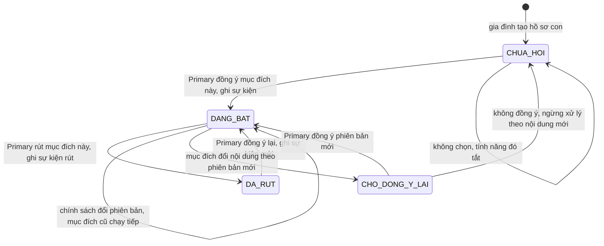
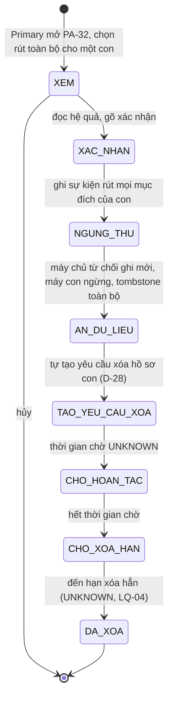
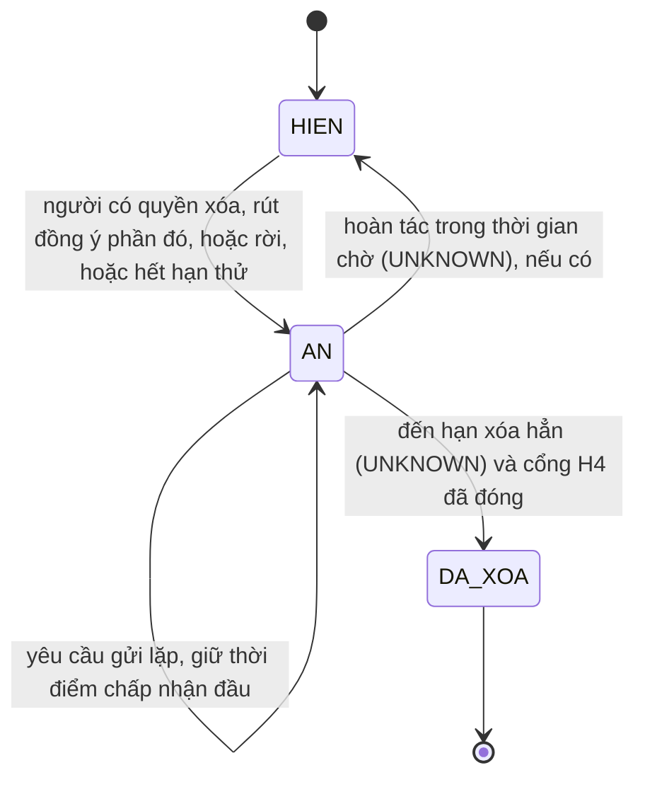
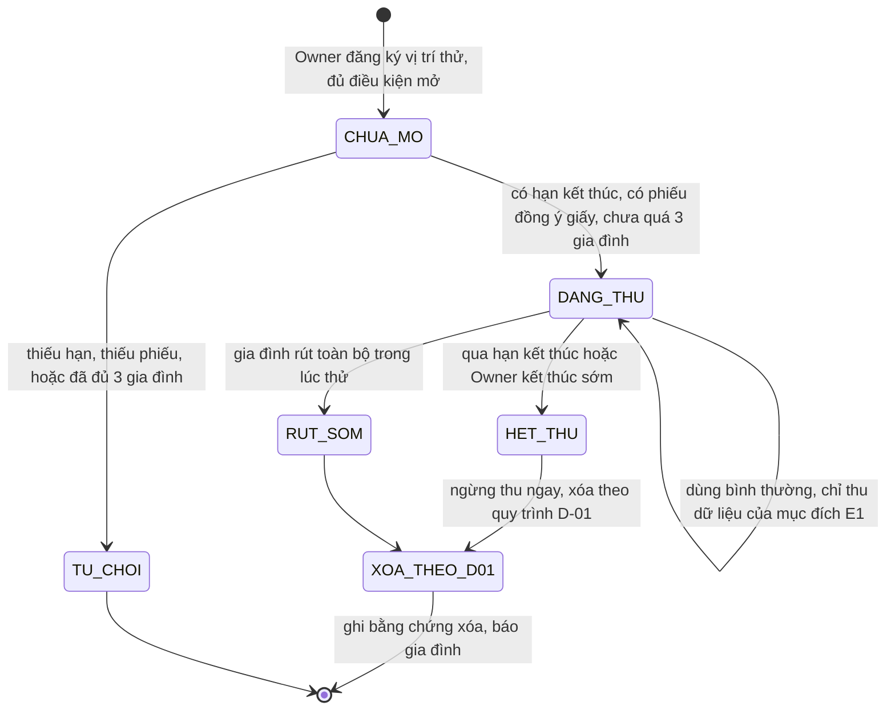

# 11.3 – BUSINESS LOGIC: ĐỒNG Ý, DỮ LIỆU VÀ QUYỀN RIÊNG CỦA A-LITE E1

> **Cập nhật lượt 3 (15/11/2026):** các câu hỏi Q-FAM, Q-CON, Q-NTF đã được chủ sản phẩm trả lời theo đề xuất; xem sổ quyết định mục 7 (D-33..D-46). Chỗ nào file này khác sổ quyết định thì theo sổ.

- **Ngày:** 15/11/2026.
- **Phạm vi:** đồng ý (consent) theo mục đích; rút đồng ý từng phần và toàn bộ (D-28); xem, sửa, xóa, xuất dữ liệu; thời hạn giữ và xóa (mô hình hóa như tham số chưa chốt); quyền riêng của con (bố mẹ thấy gì); ngoại lệ thử nội bộ D-01.
- **Bản chất:** bản nháp đặc tả nghiệp vụ, đi cùng `Business_Logic_11_1_Scheduling_E1_DRAFT.md` (**BL 11.1**) và `Business_Logic_11_2_Family_and_Access_DRAFT.md` (**BL 11.2**). Không phải spec chuẩn, **không phải ý kiến pháp lý**. Chỗ nào khác nguồn thì ghi ở §11.
- **Dữ liệu:** chỉ hồ sơ giả lập (bé "Na", "Bin"; phụ huynh "chị Hoa", "anh Minh"). **Cổng pháp lý H4 và FR-03 vẫn mở, không coi là PASS** (D-01, CAP-4, REM-LB). `LEGAL_UNKNOWN` không có nghĩa là được phép (PA-OD-04).
- **Mã:** `BR-CON-xxx` (quy tắc), `PR-CON-xx` (thông số), `EC-CON-xx`, `AC-CON-xx`, `M-CON-xx`, `Q-CON-xx`. Không trùng mã của BL 11.1 và BL 11.2.

## 0. Nguồn và quy ước

### 0.1 Thứ bậc nguồn khi khác nhau

| Bậc | Nguồn | Viết tắt |
|---|---|---|
| 1 | Sổ quyết định 15/11/2026 (`progress/Owner_Decision_Log_20261115.md`) | D-xx |
| 2 | Sổ ràng buộc `Constraint_Register_Approved_Decisions.md` (CRG) và các sổ APPROVED mà nó dẫn | CL-OD-xx (Consent Ledger), PBA-OD-xx (Purpose-bound Access), AP-OD-xx, CP-07, CAP-x, C-xx, OC-xx, REM-LB, REM-HRW, E-D04, B02 (bản REVIEW, chưa duyệt) |
| 3 | `documents/pal/spec-quy-tac-lap-lich.md` (QT), `spec-quy-thoi-gian-va-tab-cua-con.md` (TAB) | QT L2, N3 |
| 4 | User Flow 04.1 (UF1) và 04.2 (UF2) | G6, G7, G9; PA-xx, CA-xx; UF-Qxx |
| 5 | BL 11.1, BL 11.2 | BR-xxx, BR-FAM-xxx |
| 6 | `progress/Legal_Question_Pack.md` | LQ-xx |

UF2 viết trước D-27, D-28; chỗ UF2 khác sổ quyết định thì theo sổ (ghi ở §11.2).

### 0.2 Mức căn cứ

Dùng nhãn của BL 11.1 §0.2: `OD`, `SP`, `An toàn`, `đề xuất nội bộ`, `fail-safe có nhãn`. Thêm:

| Nhãn | Nghĩa |
|---|---|
| `UNKNOWN` | Nguồn không có số hoặc cách làm. Mô hình hóa là tham số chưa chốt (§6); mặc định fail-closed |
| `PHÁP LÝ` | Chờ ý kiến luật sư (LQ-xx). Không đánh PASS. Chưa chi tiền luật sư (D-17) nên mục này giữ `UNKNOWN` |

File này không có nhãn [NC]/[NL]/[MĐ] vì không có quy tắc dựa trên nghiên cứu khoa học.

## 1. Phạm vi

### 1.1 Module trong phạm vi

| L3 | Tên | Vai trò | Mức BL |
|---|---|---|---|
| `F01-G04-M02` | Consent Ledger | Ghi sự kiện đồng ý và rút, theo mục đích, theo con | Đầy đủ |
| `F07-G06-M01` | Purpose-bound Access | Kiểm mục đích trước khi đọc hoặc xử lý | Đầy đủ |
| `F07-G06-M02` | Retention & Export | Tombstone, hạn xóa, xuất | Đầy đủ (hạn `UNKNOWN`) |
| `F01-G06-M01` | Lifecycle Controls | Yêu cầu xóa, xuất; phối hợp BL 11.2 | Đầy đủ |
| `F01-G04-M01` | Access Policy | Ai thấy gì | Chỉ đọc |
| `F02-G01-M01` | Intake | Sửa dữ liệu hồ sơ có nguồn | Quy tắc sửa |
| `F06-G05-M01` | Audience Views | Báo cáo theo quyền phụ huynh và con | Phần quyền riêng |

### 1.2 Ngoài phạm vi

- Journal riêng của con, Pal trò chuyện, ảnh, ghi âm, vùng GPS (nấc 2; có cổng riêng: FR-03, purpose vị trí C-08).
- Quyết định căn cứ pháp lý (LQ-01), hình thức đồng ý hợp lệ (LQ-02), thời hạn xóa đúng luật (LQ-04). File này chỉ nói app làm gì **trong lúc** các câu đó còn mở.
- Gói, thanh toán (người trả tiền không có quyền dữ liệu; PkD-P2; ngoài A-lite).

### 1.3 Mối nối với BL 11.1, BL 11.2 và màn hình

| Điểm nối | BL 11.1 / 11.2 | File này | Màn |
|---|---|---|---|
| Con không có máy: không có hỏi thăm, ✓ | BR-006; BR-FAM-037 | BR-CON-022 | PA-03 |
| Hỏi thăm sau giờ học, "Rất mệt" không đổi lịch | BR-130…132 | BR-CON-023, 033 | CA-05 |
| Con được báo bố mẹ nhận xu hướng (D-03) | BR-134 | BR-CON-030, 031 | CA-05, CA-16 |
| Báo cáo tuần, xu hướng mệt | BR-133, BR-135 (BR-135 bị D-21 thay, xem BL 11.4) | BR-CON-024, 032 | PA-21 |
| Lịch tuần chưa cập nhật sau khi sửa dữ liệu | BR-063, BR-064 | BR-CON-042 | PA-33, PA-07 |
| Nháp luôn lưu được | BR-081 | BR-CON-043 | PA-10 |
| CR vô hiệu khi bối cảnh đổi | BR-119 (thêm lý do rút đồng ý) | BR-CON-025 | PA-17 |
| Xóa hồ sơ con, rời gia đình, đóng băng | BR-FAM-054, 080…089 | BR-CON-050…059, 070 | PA-35, PA-36, CA-17 |
| Đồng ý khi đổi Primary | BR-FAM-024 | BR-CON-008 | PA-32 |
| Ẩn danh trước khi gửi AI | BR-152 | BR-CON-092 | — |
| Con nói về nguy hiểm | BR-138; BL 11.4 | BR-CON-035 | CA-14 |

## 2. Thực thể dữ liệu và trạng thái

### 2.1 Danh sách thực thể

| Thực thể | Trường chính | Trạng thái | Module chủ |
|---|---|---|---|
| **Mục đích** (`purpose`) | id, tên dễ hiểu, dữ liệu dùng, phụ thuộc, lõi hay tùy chọn, phiên bản danh mục, **trạng thái duyệt** (`CHUA_DUYET` / `DA_DUYET`) | `CHUA_DUYET` cho mọi mục ở E1 (PBA-OD-02) | F07-G06-M01 |
| **Phiên bản chính sách** | id, ngày hiệu lực, danh sách mục đích | — | F01-G04-M02 |
| **Sự kiện đồng ý** (`consent_event`) | chủ thể (người lớn), người ghi, phiên bản chính sách, mục đích, phạm vi (con), thời điểm giờ máy chủ, loại `SELF_DECLARED`, loại sự kiện (`DONG_Y` / `RUT`), tham chiếu giấy (D-01, không chứa dữ liệu cá nhân) | **bất biến**, chỉ thêm | F01-G04-M02 |
| **Trạng thái mục đích** (suy ra từ sổ) | (con, mục đích) | `CHUA_HOI` → `DANG_BAT` → `DA_RUT`; `DA_RUT` → `DANG_BAT` bằng sự kiện đồng ý mới | F01-G04-M02 |
| **Mốc con đã xem** | child_id, thời điểm bấm "Con hiểu rồi" ở CA-16 | ghi một lần mỗi phiên bản nội dung | F01-G04-M02 |
| **Cài đặt hỏi thăm của con** | child_id, `lời_mời_hỏi_thăm = bật/tắt` | thuộc về con; **không phải đồng ý** | F04-G05-M01 |
| **Mục dữ liệu** | loại (bảng 4.4), chủ, nguồn (`bo_me` / `con` / `he_thong`), phiên bản, cờ "giả định" | `HIEN` → `AN` (tombstone) → `DA_XOA` | F01-G06-M01, F07-G06-M02 |
| **Tombstone** | mục, người yêu cầu, thời điểm chấp nhận (đầu tiên), lý do (`XOA` / `RUT_DONG_Y` / `ROI` / `HET_THU`), hạn xóa hẳn (`UNKNOWN`) | `AN` | F07-G06-M02 |
| **Yêu cầu xóa** | loại, phạm vi, người yêu cầu, thời điểm chấp nhận, trạng thái | §3.3 | F01-G06-M01 |
| **Yêu cầu xuất** | người yêu cầu, phạm vi (gia đình / một con), trạng thái, hạn tải (`UNKNOWN`) | `XEP_HANG` → `DANG_CHAY` → `SAN_SANG` → `HET_HAN_TAI` | F07-G06-M02 |
| **Gia đình thử nội bộ** (`trial_d01`) | household_id, hạn kết thúc (`UNKNOWN`), tham chiếu phiếu đồng ý giấy, ngày kết thúc thực, trạng thái | §3.4 | F01-G04-M02 (đề xuất nội bộ) |

### 2.2 Danh mục mục đích đề xuất cho E1

`đề xuất nội bộ`. Danh mục mục đích **chưa được chủ sản phẩm duyệt** (PBA-OD-02; cổng B-4): các mục dưới đây chỉ là ứng viên, không phải whitelist. Tới khi duyệt, mọi mục có trạng thái `CHUA_DUYET`, và app vẫn chỉ chạy với dữ liệu giả lập hoặc gia đình thử D-01.

| Mã mục đích | Tên người dùng thấy | Dữ liệu | Phụ thuộc | Loại |
|---|---|---|---|---|
| MD-LICH | Lập và xem lịch cho con | Hồ sơ con (tuổi/lớp, giờ học, nơi ở), thẻ hoạt động, quỹ giờ, lịch, lịch sử thay đổi | — | **Lõi** |
| MD-DONGBO | Đồng bộ lịch sang máy của con và nhắc giờ | Liên kết máy, lịch đã commit, lời nhắc | MD-LICH | Tùy chọn |
| MD-XONG | Ghi con đã bấm Xong và giờ | Nhật ký ngày (✓, giờ, hoàn tác) | MD-DONGBO | Tùy chọn |
| MD-MET | Hỏi thăm sau giờ học và xu hướng mệt | Lựa chọn Ổn / Hơi mệt / Rất mệt, xu hướng | MD-DONGBO | Tùy chọn |
| MD-MONGMUON | Con gửi mong muốn hoặc đề xuất cho bố mẹ | Mong muốn (loại có sẵn), CR | MD-DONGBO | Tùy chọn |
| MD-BAOCAO | Báo cáo tuần cho bố mẹ | Tổng hợp từ MD-XONG, ngoại lệ, giai đoạn; xu hướng mệt chỉ khi MD-MET đang bật | MD-XONG | Tùy chọn |
| MD-SUCKHOE | Thông tin sức khỏe của con (dị ứng, thuốc) | Trường sức khỏe | MD-LICH | Tùy chọn; **ẩn khi dùng dữ liệu thật** cho tới khi có purpose ID duyệt (C-07, UF-Q16) |

Ví dụ của D-28 khớp bảng: "rút đồng ý ghi mệt thì tắt nút báo mệt, lịch vẫn chạy" = rút MD-MET.

## 3. Máy trạng thái

### 3.1 Trạng thái một mục đích của một con

### 3.2 Rút đồng ý toàn bộ

### 3.3 Vòng đời một mục dữ liệu bị xóa

### 3.4 Gia đình thử nội bộ D-01

## 4. Quy tắc nghiệp vụ

### 4.1 Đồng ý theo mục đích

| ID | Điều kiện | Hành động | Nguồn | Quyết định | Căn cứ | Màn |
|---|---|---|---|---|---|---|
| BR-CON-001 | Primary tạo hồ sơ con lần đầu | Hiện từng mục đích riêng (bảng §2.2) với lời dễ hiểu. MD-LICH là lõi: không đồng ý thì không tạo hồ sơ con. Mục tùy chọn **không chọn sẵn**: chưa chọn thì tính năng đó tắt. Lúc tạo phải thấy rõ "rút phần nào chỉ tắt phần đó" | UF1 F1 bước 2; UF2 G6 | D-28; LQ-14 câu 1 | `fail-safe có nhãn` (không chọn sẵn); tách theo mục đích: OD | PA-02 |
| BR-CON-002 | Ghi một lần đồng ý | Một `consent_event` cho mỗi (mục đích, con): chủ thể, người ghi, phiên bản chính sách, thời điểm giờ máy chủ, loại `SELF_DECLARED`. Sổ **bất biến**, không sửa lịch sử; rút là sự kiện mới | UF2 G6 8.1 | CL-OD-01, CRG §1 mục 2 | OD | PA-32 |
| BR-CON-003 | Hiển thị đồng ý | Luôn kèm câu: "đã ghi đồng ý **không** có nghĩa là đã đủ căn cứ xử lý". Mục đích chưa duyệt ghi "đang chờ duyệt" | UF2 G6 8.1 bước 1 | CL INV-6, PBA-OD-02 | OD | PA-32 |
| BR-CON-004 | Đồng ý do người tự khai là cha mẹ | Không xác minh tư cách giám hộ ở onboarding thường. Vai trò trong app không phải giám hộ pháp lý | UF1 F1 | CL-OD-01 | OD; `PHÁP LÝ` (LQ-02) | PA-02 |
| BR-CON-005 | Chính sách đổi phiên bản | Mục đích **cũ không đổi nội dung** chạy tiếp. Mục đích mới hoặc đổi nội dung: **không xử lý dữ liệu mới theo nội dung mới** cho tới khi Primary đồng ý; dữ liệu và lịch hiện có vẫn xem được. Gửi thông báo "chính sách có phiên bản mới" | UF2 G6 8.1 bước 2 | UF-Q33 | `fail-safe có nhãn` (chờ Owner) | PA-32 |
| BR-CON-006 | Mọi lệnh đọc hoặc xử lý dữ liệu con | Kiểm trước: mục đích tương ứng đang `DANG_BAT` và được duyệt cho người đang thao tác. `LEGAL_UNKNOWN` không phải ALLOW. Tra cache cũng kiểm quyền. "Đã cache" không phải "đã được duyệt" | CRG CAP-2, L3C-05, PBA-OD-04 | PA-OD-04 | OD | — |
| BR-CON-007 | Người lớn khác (Supporter, Observer) | Mỗi người có đồng ý của **chính mình** (BL 11.2 BR-FAM-012). Người lớn khác chỉ rút đồng ý của chính mình | UF2 G6-X1 | CL-OD-02 | OD | PA-31, PA-32 |
| BR-CON-008 | Đổi Primary | Đồng ý cũ giữ nguyên. Primary mới muốn đổi phạm vi thì tạo sự kiện mới. Không tự sinh sự kiện | UF2 G6-X3 | CL-OD-03 | OD; `PHÁP LÝ` (LQ-02 câu 3) | PA-32 |
| BR-CON-009 | Dữ liệu thật khi căn cứ pháp lý `UNKNOWN` | Không xử lý. Ngoại lệ có giới hạn: gia đình thử D-01 (§4.8). Cổng H4, FR-03 vẫn mở | UF2 G6-X4 | PA-OD-04, D-01, D-18 | OD | — |
| BR-CON-010 | Trường sức khỏe (dị ứng, thuốc) | Ẩn khỏi form khi dùng dữ liệu thật tới khi có purpose ID duyệt cho MD-SUCKHOE | UF1 F1 bước 9 | C-07, UF-Q16 | `fail-safe có nhãn` | PA-06 |

### 4.2 Rút đồng ý (D-28)

| ID | Điều kiện | Hành động | Nguồn | Quyết định | Căn cứ | Màn |
|---|---|---|---|---|---|---|
| BR-CON-020 | Ai rút | Chỉ Primary rút đồng ý do caregiver quản lý (theo từng con, từng mục đích). Người lớn khác chỉ rút của mình. Con không rút đồng ý của bố mẹ ở E1 | UF2 G6 | CL-OD-02 | OD | PA-32 |
| BR-CON-021 | Primary rút **một mục đích tùy chọn** | Chỉ **tắt đúng tính năng đó**. Lịch vẫn chạy và không xếp lại. Ghi sự kiện rút. Mục đích phụ thuộc vào mục đích đã rút cũng tắt theo (bảng §2.2). Dữ liệu đã thu của mục đích đó: **ẩn ngay** (tombstone) khỏi mọi màn và báo cáo, không dùng nữa; xóa hẳn theo hạn `PR-CON-01` (`UNKNOWN`) | UF2 G6 | **D-28**, LQ-14 | OD; ẩn dữ liệu cũ `fail-safe có nhãn` (Q-CON-03) | PA-32 |
| BR-CON-022 | Rút MD-DONGBO | Máy con ngừng nhận lịch mới và ngừng nhắc; MD-XONG, MD-MET, MD-MONGMUON tắt theo. Lịch phía phụ huynh vẫn chạy, giống trường hợp con không có máy (D-11, BL 11.1 BR-006). Liên kết máy giữ, trạng thái tạm dừng | BL 11.1 BR-006 | D-28, D-11 | `đề xuất nội bộ` | PA-32, CA-04 |
| BR-CON-023 | Rút MD-MET | Ẩn câu hỏi Ổn / Hơi mệt / Rất mệt trên máy con. Khối "Ghi việc" vẫn có. Ngừng tính xu hướng; mục xu hướng biến khỏi PA-21. Lịch giữ nguyên | BL 11.1 BR-130, BR-133 | D-28 (ví dụ) | OD | CA-05, PA-21 |
| BR-CON-024 | Rút MD-XONG hoặc MD-BAOCAO | MD-XONG: bỏ nút Xong, báo cáo ghi "chưa có dữ liệu", không ghi "không làm". MD-BAOCAO: ngừng thông báo "Tóm tắt tuần" và ẩn PA-21; dữ liệu nền còn theo mục đích khác | BL 11.4 | D-28 | `đề xuất nội bộ` | PA-21 |
| BR-CON-025 | Rút MD-MONGMUON | Bỏ nút "Con muốn nói với bố mẹ" và "Đề xuất". CR đang `PENDING` hoặc `APPROVED` chưa áp: `INVALIDATED` với lý do `RUT_DONG_Y` (thêm vào bảng vô hiệu của BL 11.1 §3.2, BR-119). Mong muốn đã gửi bị ẩn như dữ liệu đã rút | BL 11.1 BR-119 | D-28 | `đề xuất nội bộ`; đồng bộ BL 11.1 | CA-08, PA-16 |
| BR-CON-026 | Rút MD-LICH (lõi) hoặc chọn "Rút toàn bộ" | = rút toàn bộ (BR-CON-027) | UF2 G6 | D-28 | OD | PA-32 |
| BR-CON-027 | **Rút toàn bộ** cho một con | Ngừng thu ngay: máy chủ từ chối ghi mới cho con đó (trừ xóa, xuất, sự kiện đồng ý), máy con ngừng và hiện CA-17, CR vô hiệu, nhắc dừng, mọi dữ liệu của con vào tombstone. **Tự tạo yêu cầu xóa hồ sơ con** (D-28 "tiến tới xóa") sau màn xác nhận lần hai; thời gian chờ `PR-CON-08`; xóa hẳn theo hạn `PR-CON-01` | UF2 G9 | **D-28**, LQ-04 | OD; hạn `UNKNOWN`, `PHÁP LÝ` | PA-32, PA-36 |
| BR-CON-028 | Báo hệ quả trước khi rút | Màn hiện đúng: tắt gì, giữ gì, dữ liệu cũ ra sao ("ẩn ngay; xóa hẳn theo hạn sẽ công bố"), có đồng ý lại được không. Không hứa "đã xóa hết" khi chưa xóa hẳn | 03.4 §6.2 | — | SP | PA-32 |
| BR-CON-029 | Đồng ý lại sau khi rút | Ghi sự kiện đồng ý mới. Thu lại **từ lúc đó**; dữ liệu cũ đã ẩn **không** tự hiện lại | — | — | `fail-safe có nhãn` (Q-CON-03) | PA-32 |
| BR-CON-029a | Chủ thể khác phản đối (ví dụ người giám hộ không có trong app) | Không bỏ qua chỉ vì UI chỉ có nút cho Primary. Kênh tiếp nhận: `UNKNOWN`. Trước mắt hiện thông tin liên hệ hỗ trợ tĩnh | UF2 G6-X2 | CL INV-8 | `UNKNOWN`, `PHÁP LÝ` (LQ-02) | PA-32 |

### 4.3 Quyền riêng của con và ai thấy gì

| ID | Điều kiện | Hành động | Nguồn | Quyết định | Căn cứ | Màn |
|---|---|---|---|---|---|---|
| BR-CON-030 | Sau khi ghép, và khi mục đích hoặc quyền đổi | Con thấy CA-16 "Những gì bố mẹ thấy" bằng lời dễ hiểu. **Nội dung dựng từ bảng quyền thật**, không viết tay, để không lệch thực tế. Con bấm "Con hiểu rồi" thì ghi mốc; không chặn dùng app nếu con không bấm | UF2 G6 8.2 | D-03 | OD; câu chữ `đề xuất nội bộ`; assent theo tuổi `UNKNOWN` (MR-017) | CA-16 |
| BR-CON-031 | Lần đầu con thấy câu hỏi thăm | Luôn có dòng nhỏ cố định: bố mẹ được báo "con hay mệt vào những ngày có lịch dày" ở mức tổng hợp tuần, **không** thấy con chọn gì từng ngày. Chỉ hiện câu hỏi khi con đã thấy dòng này | UF1 F4 bước 6 | D-03 | OD (trẻ được biết); câu chữ `đề xuất nội bộ` | CA-05 |
| BR-CON-032 | Phụ huynh xem dữ liệu hỏi thăm | Chỉ **xu hướng tổng hợp theo tuần** (D-21) trong báo cáo; **không** hiện lựa chọn từng ngày, không cảm xúc, không nguyên văn. Mức chia nhỏ của xu hướng: BL 11.4 (tránh suy ngược ra từng ngày) | G1-X6; UF-Q18 | D-03, D-21 | OD | PA-21 |
| BR-CON-033 | Con chọn "Rất mệt" | Không đổi lịch (BR-131 của BL 11.1). Bản ghi chỉ hiện cho con (CA-13) | BL 11.1 BR-131 | D-10 | OD | CA-13 |
| BR-CON-034 | Con tắt lời mời hỏi thăm | Là **cài đặt của con**, không phải đồng ý; không sinh `consent_event`. Phụ huynh không thấy con đã tắt hay mở, chỉ thấy báo cáo "chưa có ghi nhận" | UF1 F4 bước 6 | 02.5 R3 | `đề xuất nội bộ` | CA-05, CA-11 |
| BR-CON-035 | Con bấm "Con cần giúp đỡ" | **Không ghi lại**, không báo gia đình, không mở hồ sơ, không tự liên hệ. Không có bản ghi nào trong nhật ký ngày, hỏi thăm, báo cáo hay xuất dữ liệu | UF2 G8 10.2 | D-26, D-30, OD-03a, REM-HRW | OD | CA-14 |
| BR-CON-036 | Con gửi "Con cần nói chuyện" (chỉ khi con bấm) | Nội dung là câu cố định kèm tên gọi của con. Chỉ tới người con chọn. Bản ghi trên máy chủ chỉ để giao tin: không nằm trong nhật ký, báo cáo hay xuất; xóa khi giao xong hoặc hết hạn `PR-CON-12` (`UNKNOWN`). Chi tiết nút: BL 11.4 | QT N3 | D-26, D-30 | OD; vòng đời bản ghi `fail-safe có nhãn` | CA-14 |
| BR-CON-037 | Supporter hoặc Observer | Mặc định **không** thấy xu hướng mệt, mong muốn, đề xuất của con. Chỉ thấy khi Primary cấp đúng mục đích. Không bao giờ thấy lựa chọn hỏi thăm từng ngày | UF2 G1-X3 | UF-Q30 | `fail-safe có nhãn` | PA-28 |
| BR-CON-038 | Một người lớn nhìn dữ liệu riêng của người lớn khác | Không (cách Pal gọi, liên hệ, ghi chú riêng). Primary mới không thấy dữ liệu riêng của Primary cũ | UF2 G4-X6 | CLAUDE.md | An toàn | PA-33 |
| BR-CON-039 | Quy tắc suy ngược | Không được hiển thị hay xuất dữ liệu cho phép **dựng lại** thứ đã chặn (ví dụ liệt kê từng ngày "Rất mệt" qua thứ tự hoặc ngày). Kiểm bằng test sinh dữ liệu | CRG CP-07 (cấm suy luận gián tiếp làm lộ Journal; áp tương tự cho hỏi thăm) | — | `đề xuất nội bộ` | PA-21, PA-34 |

#### Bảng ai thấy gì (E1)

| Dữ liệu | Con | Primary | Supporter / Observer |
|---|---|---|---|
| Lịch có hiệu lực | có | có | theo grant |
| ✓ Xong và giờ | có | có | theo grant |
| Lựa chọn hỏi thăm từng ngày | **có** (CA-13) | **không** | **không** |
| Xu hướng mệt liên quan lịch (tuần) | biết là bố mẹ nhận (CA-16) | có | không, trừ khi cấp riêng |
| Mong muốn, đề xuất của con | có | có | không, trừ khi cấp |
| Lịch sử thay đổi lịch | không | có | không |
| Nút "Con cần giúp đỡ" được bấm | không ghi | không biết | không biết |
| Dữ liệu riêng của người lớn khác | không | không | không |

### 4.4 Xem và sửa

Loại dữ liệu và quyền theo UF2 G7 9.1.

| Loại | Xem | Sửa | Xóa |
|---|---|---|---|
| Hồ sơ con (tuổi/lớp, giờ học, nơi ở, trường tùy chọn) | Primary | Primary | Trường tùy chọn: Primary xóa được. Trường bắt buộc: chỉ sửa |
| Thẻ hoạt động | Primary | Primary | Primary |
| Quỹ giờ, preset | Primary | Primary | Primary |
| Lịch có hiệu lực | Primary, người được cấp | qua BL 11.1 | Không xóa riêng; xóa cùng hồ sơ con |
| Lịch sử thay đổi (PA-25) | Primary | Không | Không xóa từng dòng; xóa cùng hồ sơ con |
| Nhật ký ngày (✓, giờ) | Primary, con | Con dùng Hoàn tác trong ngày | Theo hồ sơ con |
| Hỏi thăm sau giờ học | **Chỉ con** | Không | Con yêu cầu xóa: `UNKNOWN` (Q-CON-05) |
| Mong muốn, đề xuất | Primary, con | Không | Theo hồ sơ con hoặc rút mục đích |
| Sự kiện đồng ý | Người ghi | Không (thêm sự kiện mới) | Không |
| Thông tin của chính người lớn | Chính người đó | Có | Có |

| ID | Điều kiện | Hành động | Nguồn | Quyết định | Căn cứ | Màn |
|---|---|---|---|---|---|---|
| BR-CON-040 | Mọi lệnh xem | Kiểm quyền và mục đích trước khi đọc. Hiện kèm nguồn (`bo_me` / `con` / `he_thong`) và cờ "giả định" | UF2 G7 9.2 | CAP-2 | OD | PA-33 |
| BR-CON-041 | Sửa | Ghi **phiên bản mới**, giữ nguồn. Không sửa trực tiếp bản cũ | UF2 G7 bước 3 | F02-G01-M01 | SP | PA-33 |
| BR-CON-042 | Sửa dữ liệu dùng cho lịch (giờ học, thẻ hoạt động, quỹ) | Hiện "Lịch tuần chưa cập nhật" + nút xếp lại; **không tự xếp lại** | BL 11.1 BR-063 | QT E5 | SP | PA-07 |
| BR-CON-043 | Sửa hay xóa lúc lịch đang khóa | Cho sửa nháp; không commit (BL 11.1 BR-123) | BL 11.1 | B01C-OD-06 | OD | PA-10 |
| BR-CON-044 | Xem dữ liệu của người lớn khác | Chỉ phần được cấp và dữ liệu của chính mình | UF2 G7-X7 | AP-OD-02 | OD | PA-33 |
| BR-CON-045 | Con xem dữ liệu của mình | Tuần của con, ✓ con đã bấm, hỏi thăm con đã chọn (CA-13). Không điểm, không so sánh | UF2 G1 3.1 bước 7 | — | `đề xuất nội bộ` | CA-13 |

### 4.5 Xóa

| ID | Điều kiện | Hành động | Nguồn | Quyết định | Căn cứ | Màn |
|---|---|---|---|---|---|---|
| BR-CON-050 | Người có quyền xóa một mục | Xác nhận. **Ẩn ngay** khỏi mọi màn, báo cáo, xuất, tìm kiếm, cache (tombstone). Dữ liệu dẫn xuất (tóm tắt, xu hướng) tính lại hoặc ẩn. Xóa hẳn theo hạn `PR-CON-01` (`UNKNOWN`). **Không hứa** "đã xóa hết" khi chưa xóa hẳn | UF2 G7 bước 4 | 03.4 §6.2, B02 (REVIEW) | OD (ẩn ngay: B02 chưa duyệt) + `PHÁP LÝ` | PA-33 |
| BR-CON-051 | Xóa thẻ hoạt động hoặc trường dùng cho lịch | Hiện "Lịch tuần chưa cập nhật" (BR-CON-042). Trường bắt buộc không xóa được, chỉ sửa | QT E5 | — | SP | PA-07 |
| BR-CON-052 | Yêu cầu xóa gửi lặp hoặc mất phản hồi | Idempotent; giữ thời điểm chấp nhận đầu tiên | UF2 G7-X1 | B02 R2 | `đề xuất nội bộ` | — |
| BR-CON-053 | Người không có quyền yêu cầu xóa | Không có tác dụng | UF2 G7-X2 | B02 R2 | `đề xuất nội bộ` | — |
| BR-CON-054 | Xóa trong lúc đang xuất | Bản xuất bỏ mục đã xóa | UF2 G7-X3 | B02 R1 | `đề xuất nội bộ` | — |
| BR-CON-055 | Nghĩa vụ lưu theo luật dài hơn yêu cầu xóa | Hạn chế mục đích và quyền truy cập; giải thích đúng, không hứa xóa ngay | UF2 G7-X4 | 03.4 §6.2 | `PHÁP LÝ` | PA-36 |
| BR-CON-056 | Dữ liệu thật khi cổng H4 chưa đóng | **Không chạy xóa hẳn và xuất** cho dữ liệu thật. Ngoại lệ: gia đình thử D-01 xóa theo §4.8. Dữ liệu giả lập: xóa hẳn được để kiểm thử | UF2 G7-X5 | CRG cổng B-2 | OD | — |
| BR-CON-057 | Con muốn xóa dữ liệu hỏi thăm của mình | Nhánh mặc định: con **xóa được** từng lựa chọn của chính mình (dữ liệu do con tạo); xóa thì xu hướng tính lại, không cần báo bố mẹ | UF2 UF-Q35 | — | `đề xuất nội bộ`, `UNKNOWN` (Q-CON-05) | CA-13 |
| BR-CON-058 | Xóa hồ sơ con, rời, xóa gia đình | Luồng ở BL 11.2 §4.8 (BR-FAM-080…089) | UF2 G9 | — | — | PA-35 |
| BR-CON-059 | Đóng băng tài khoản | Giữ nguyên dữ liệu (BR-FAM-054). Không xóa, không ẩn thêm, hạn giữ `UNKNOWN` | BL 11.2 | D-27 | `UNKNOWN`, `PHÁP LÝ` (LQ-15) | — |

### 4.6 Xuất

| ID | Điều kiện | Hành động | Nguồn | Quyết định | Căn cứ | Màn |
|---|---|---|---|---|---|---|
| BR-CON-060 | Ai xuất | Chỉ Primary, cho gia đình hoặc một con. Người lớn khác chỉ xuất dữ liệu của chính mình | UF2 G7 9.2 bước 5 | UF-Q43 | `fail-safe có nhãn` | PA-34 |
| BR-CON-061 | Yêu cầu xuất | Xếp hàng. Khi chạy: kiểm lại tombstone, bỏ mục đã xóa. Định dạng: `PR-CON-07` (`UNKNOWN`; đề xuất bảng đọc được) | UF2 G7 | B02 R1 | `UNKNOWN` | PA-34 |
| BR-CON-062 | Nội dung bản xuất | **Không gồm**: lựa chọn hỏi thăm từng ngày của con (chỉ xu hướng tổng hợp), dữ liệu riêng của người lớn khác, mã ghép, PIN, nội dung nút "Con cần giúp đỡ" (không ghi). Không để xuất trở thành cửa vòng qua D-03 | D-03; CLAUDE.md | D-03 | `fail-safe có nhãn`; xem M-CON-03 | PA-34 |
| BR-CON-063 | Bản xuất sẵn sàng | Thông báo "Bản xuất đã sẵn sàng" không chứa nội dung. Hạn tải `PR-CON-06` (`UNKNOWN`); hết hạn thì xóa file | UF2 G7 bước 6 | E-D04 | `UNKNOWN` | PA-15 |
| BR-CON-064 | Dữ liệu thật khi cổng H4 chưa đóng | Không chạy xuất cho dữ liệu thật, ngoài gia đình thử D-01 | UF2 G7-X5 | CRG cổng B-2 | OD | — |

### 4.7 Thời hạn giữ và xóa (mô hình tham số)

| ID | Điều kiện | Hành động | Nguồn | Quyết định | Căn cứ | Màn |
|---|---|---|---|---|---|---|
| BR-CON-070 | Hạn xóa hẳn là tham số `PR-CON-01` | Mỗi bản ghi tombstone mang `han_xoa_han` = giá trị tham số **tại thời điểm chấp nhận yêu cầu**. Tham số `UNKNOWN` → trạng thái `CHO_QUYET_HAN`, giữ ẩn, **không tự xóa hẳn**, không hiển thị ngày xóa | LQ-04 | REM-LB | `UNKNOWN`, `PHÁP LÝ` | — |
| BR-CON-071 | Khi tham số được chốt | Chạy lại cho tombstone cũ: hạn = ngày chấp nhận + hạn chốt; nếu đã quá hạn thì xóa hẳn ngay và ghi bằng chứng | LQ-04 | — | `đề xuất nội bộ` | — |
| BR-CON-072 | Mốc 60 ngày | Mốc "ẩn ngay, xóa hẳn sau 60 ngày" chỉ duyệt cho **Journal** (CP-07). **Không** dùng làm hạn cho dữ liệu khác. Mốc 60 ngày không được đè lên hạn pháp lý sớm hơn | CRG CP-07, REM-LB | PA-OD-03 | OD | — |
| BR-CON-073 | Hạn phản hồi yêu cầu xóa, rút đồng ý, xuất | `PR-CON-02`. Hai nguồn tham khảo ghi khác nhau (LQ-04 câu 1) nên **không dùng con số nào**; hiện "chúng tôi sẽ phản hồi trong thời hạn quy định" | LQ-04 | — | `UNKNOWN`, `PHÁP LÝ` | PA-36 |
| BR-CON-074 | Bản sao lưu, nhật ký kiểm toán | Hạn xóa `PR-CON-04` (`UNKNOWN`). Audit không chứa nội dung riêng, PIN, mã ghép (B01C-OD-07) | LQ-04 câu 4 | B01C-OD-07 | `UNKNOWN`, `PHÁP LÝ` | — |
| BR-CON-075 | Giữ bản đã ẩn danh để thống kê | Không dùng cho tới khi LQ-14 câu 2 có trả lời. Không ẩn danh để thay cho xóa | LQ-14 | — | `fail-safe có nhãn` | — |
| BR-CON-076 | Thời gian lưu khi đang dùng bình thường | `PR-CON-11` (`UNKNOWN`). Mặc định: giữ khi hồ sơ con còn hoạt động; chỉ thu trường cần cho mục đích đang bật (BR-CON-090) | — | — | `UNKNOWN` | — |
| BR-CON-077 | Thông báo | Nhật ký gửi thông báo chỉ ghi loại, người nhận, giờ, kết quả; không ghi nội dung riêng | UF2 G3 5.4 | E-D04 | OD | — |

### 4.8 Ngoại lệ thử nội bộ D-01

Điều kiện tối thiểu của D-01 do AI đề xuất, **chờ chủ sản phẩm xem**. D-18 quyết ngoại lệ áp cho A-lite E1 và FR-01 phải xong trước khi thử. **Cổng H4, FR-03 vẫn mở, không PASS.** Ngoại lệ không áp cho pilot rộng hơn.

| ID | Điều kiện | Hành động | Nguồn | Quyết định | Căn cứ | Màn |
|---|---|---|---|---|---|---|
| BR-CON-080 | Hệ thống có hai loại dữ liệu: `GIA_LAP` và `THU_NOI_BO_D01` | Không có loại "thật rộng". Gia đình chỉ được tạo thật khi có vị trí thử được Owner mở. Không vị trí thì chỉ tạo dữ liệu giả lập | D-01 | D-01, D-18, PA-OD-04 | OD + `đề xuất nội bộ` (cách chặn) | — |
| BR-CON-081 | Số gia đình thử | Tối đa **3** (`PR-CON-10`). Gia đình thứ 4: từ chối | D-01 | D-01 | OD (điều kiện chờ Owner xem) | — |
| BR-CON-082 | Mở vị trí thử | Bắt buộc có: hạn kết thúc `PR-CON-09` (`UNKNOWN`: Owner phải chọn, thiếu thì không mở), tham chiếu phiếu đồng ý giấy của bố mẹ (chỉ mã tham chiếu, không lưu bản scan hay dữ liệu cá nhân trong app) | D-01 | D-01 | OD + `đề xuất nội bộ` | — |
| BR-CON-083 | Giải thích cho trẻ | Trẻ được giải thích bằng lời dễ hiểu: CA-16 và buổi giải thích trực tiếp ngoài app. Sự đồng thuận của trẻ theo tuổi: `UNKNOWN` (MR-017) | D-01 | D-01 | OD; `PHÁP LÝ` | CA-16 |
| BR-CON-084 | Chỉ thu dữ liệu cần thiết | Giới hạn trong các mục đích E1 của §2.2. Bản D-01 gốc nói "5 tính năng thử" (Plan A đã dừng, D-31); thay bằng danh mục E1 (M-CON-02) | D-01; D-31 | D-01 | `fail-safe có nhãn` | — |
| BR-CON-085 | Không dùng cho mục đích khác | Không phân tích thêm, không chia sẻ, không dùng để huấn luyện, không gửi dịch vụ AI hay công cụ tìm kiếm nước ngoài khi chưa ẩn danh | D-01; CLAUDE.md | D-01 | OD | — |
| BR-CON-086 | Hết hạn thử hoặc Owner kết thúc sớm | **Ngừng thu ngay.** Xóa hẳn toàn bộ dữ liệu của gia đình thử theo quy trình D-01 (kể cả khi `PR-CON-01` còn `UNKNOWN`), ghi bằng chứng xóa, báo gia đình | D-01; UF2 G7-X5, G9-X7 | D-01 | OD | — |
| BR-CON-087 | Gia đình thử rút toàn bộ giữa chừng | Ngừng thu ngay (BR-CON-027). Xóa hẳn theo quy trình D-01 **không chờ hết hạn thử** (nhánh an toàn: giữ dữ liệu lâu hơn cần thiết là rủi ro) | — | D-01, D-28 | `fail-safe có nhãn` (Q-CON-07) | PA-32 |
| BR-CON-088 | Không đưa dữ liệu lên repo công khai | Quy tắc quy trình: không commit khóa, `.env`, dữ liệu thật của trẻ. Ví dụ test dùng tên giả | D-01; CLAUDE.md | D-01 | OD | — |
| BR-CON-089 | Đóng băng gia đình thử | Áp BR-FAM-061: hết hạn thử thì xóa theo D-01, không chờ đóng băng | BL 11.2 | D-01, D-27 | OD | — |

### 4.9 Tối thiểu hóa và dịch vụ ngoài

| ID | Điều kiện | Hành động | Nguồn | Quyết định | Căn cứ | Màn |
|---|---|---|---|---|---|---|
| BR-CON-090 | Thu dữ liệu | Chỉ trường cần cho mục đích đang bật. Trường bắt buộc: tuổi/lớp, giờ vào và tan học, bán trú (BL 11.1 BR-001). Mọi trường khác là tùy chọn, bỏ qua được | BL 11.1 BR-001; QT B3 | CAP-2 | SP | PA-04…06 |
| BR-CON-091 | Child App E1 | **Không có ô chữ tự do.** Chỉ lựa chọn có sẵn và câu mẫu. Không ảnh, không ghi âm, không vị trí | UF1 §0.6 mục 1; UF-Q15 | A-lite SG-10 | `fail-safe có nhãn` | CA-08 |
| BR-CON-092 | E1 | Không gọi AI, không gửi tên con, trường, địa chỉ ra dịch vụ ngoài. Khi lên nấc 2: ẩn danh và lớp an toàn trước (BL 11.1 BR-152) | CLAUDE.md | OD-05 | An toàn | — |
| BR-CON-093 | Máy chủ và dịch vụ hạ tầng đặt ở nước ngoài | Chuyển dữ liệu ra nước ngoài là câu hỏi pháp lý riêng (LQ-08). Vị trí đặt hạ tầng của E1: `UNKNOWN` trong tài liệu này. Tới khi trả lời, dữ liệu thật chỉ ở gia đình thử D-01 | LQ-08 | — | `UNKNOWN`, `PHÁP LÝ` | — |
| BR-CON-094 | Ô chữ tự do của phụ huynh (ghi chú thẻ, lý do thay đổi, tên giai đoạn) | Lưu như dữ liệu thường; bộ kiểm từ khóa khẩn chạy trước khi lưu (BL 11.4). Kết quả khớp **không** ghi thành nhãn hồ sơ | UF2 G8 10.5 | UF-Q38 | `đề xuất nội bộ` | PA-07a |
| BR-CON-095 | Đo lường | Nếu cần, chỉ đếm tổng hợp không định danh | UF2 G8 | — | `đề xuất nội bộ` | — |
| BR-CON-096 | Người trả tiền (nếu có gói sau này) | Không vì trả tiền mà có quyền dữ liệu; hạ gói không xóa tiến độ | CRG L3C-03, PkD-P2 | — | OD (ngoài E1) | — |

**Tổng: 77 quy tắc** (đếm theo số dòng BR-CON trong các bảng 4.1…4.9).

## 5. Thứ tự áp khi một lệnh chạm dữ liệu con

| Bước | Việc | Quy tắc |
|---|---|---|
| 1 | Phiên hợp lệ, hộ không đóng băng, hồ sơ con chưa bị ẩn | BL 11.2 BR-FAM-053; BR-CON-050 |
| 2 | Mục đích tương ứng `DANG_BAT` và đã qua phiên bản chính sách hiện hành | BR-CON-005, 006 |
| 3 | Vai trò và grant của người làm | BL 11.2 §2.2; BR-CON-037 |
| 4 | Phạm vi dữ liệu theo "bảng ai thấy gì" | BR-CON-032, 039 |
| 5 | Ghi (phiên bản mới) hoặc tombstone; sự kiện đồng ý chỉ thêm | BR-CON-002, 041, 050 |
| 6 | Tính lại dữ liệu dẫn xuất; hủy cache | BR-CON-050 |
| 7 | Thông báo sau commit, không chứa nội dung | BR-CON-063, 077 |

## 6. Thông số chưa chốt

| ID | Thông số | Giá trị | Nguồn | Mặc định khi chưa chốt |
|---|---|---|---|---|
| PR-CON-01 | Hạn xóa hẳn dữ liệu ngoài Journal | `UNKNOWN` | LQ-04 | Ẩn ngay; không xóa hẳn dữ liệu thật; không hứa ngày |
| PR-CON-02 | Hạn phản hồi và hoàn tất yêu cầu xóa, rút, xuất | `UNKNOWN`. LQ-04 liệt kê hai bộ số khác nhau trong hai nguồn tham khảo chưa kiểm; không chọn bộ nào | LQ-04 câu 1 | Câu chữ chung "trong thời hạn quy định" |
| PR-CON-03 | Hạn giữ khi đóng băng | `UNKNOWN` (cùng PR-FAM-08) | LQ-15 | Không tự xóa |
| PR-CON-04 | Hạn xóa bản sao lưu và nhật ký kiểm toán | `UNKNOWN` | LQ-04 câu 4 | Audit tối thiểu, không nội dung riêng |
| PR-CON-05 | Dữ liệu cũ của phần đã rút: xóa hẳn và thống kê ẩn danh | `UNKNOWN` | LQ-14 câu 2 | Ẩn, không dùng thống kê |
| PR-CON-06 | Hạn tải bản xuất | `UNKNOWN` | UF2 G7 | Chưa mở tải cho dữ liệu thật |
| PR-CON-07 | Định dạng xuất | `UNKNOWN` | UF-Q43 | Bảng đọc được (đề xuất) |
| PR-CON-08 | Thời gian chờ hoàn tác (cùng PR-FAM-12) | `UNKNOWN` | UF-Q39 | Không có hoàn tác |
| PR-CON-09 | Hạn kết thúc thử D-01 | `UNKNOWN` (Owner chọn) | D-01 | Không mở vị trí thử khi thiếu hạn |
| PR-CON-10 | Số gia đình thử tối đa | 3 (điều kiện D-01 do AI đề xuất, chờ chủ sản phẩm xem) | D-01 | 3 |
| PR-CON-11 | Thời gian lưu khi dùng bình thường | `UNKNOWN` | — | Giữ khi hồ sơ con còn hoạt động |
| PR-CON-12 | Hạn giữ bản ghi giao tin "Con cần nói chuyện" | `UNKNOWN` | D-26, D-30 | Xóa ngay khi giao xong |

## 7. Trường hợp biên

| Mã | Tình huống | Cách xử lý | Nguồn |
|---|---|---|---|
| EC-CON-01 | Rút MD-XONG khi báo cáo tuần đang bật | Báo cáo ghi "chưa có dữ liệu", không ghi "không làm" | BR-CON-024 |
| EC-CON-02 | Rút MD-MET khi đã có xu hướng trong báo cáo tuần trước | Mục xu hướng không còn xuất hiện; dữ liệu cũ ẩn | BR-CON-021, 023 |
| EC-CON-03 | Rút MD-DONGBO khi con đang có CR chờ | CR `INVALIDATED` (MD-MONGMUON tắt theo) | BR-CON-022, 025 |
| EC-CON-04 | Rút rồi đồng ý lại ngay trong ngày | Dữ liệu cũ không hiện lại; thu mới từ lúc đồng ý lại | BR-CON-029 |
| EC-CON-05 | Primary rút toàn bộ nhưng còn người lớn khác | Rút toàn bộ **của con đó**; người lớn khác mất quyền xem con đó; đồng ý của họ cho chính họ giữ nguyên | BR-CON-027, 020 |
| EC-CON-06 | Supporter rút đồng ý của mình | Mất quyền xem; hồ sơ con và đồng ý của Primary không đổi | BR-CON-007 |
| EC-CON-07 | Con tắt lời mời hỏi thăm, mục đích MD-MET vẫn bật | Không có dữ liệu mệt; báo cáo "chưa có ghi nhận" | BR-CON-034 |
| EC-CON-08 | Phụ huynh xóa hồ sơ rồi tạo lại cùng tên | Hồ sơ mới; dữ liệu cũ vẫn tombstone, không nối lại | BR-CON-050 |
| EC-CON-09 | Chính sách đổi phiên bản khi gia đình đã đóng băng | Chờ Primary mở lại; hiện đồng ý lại trước khi dùng mục đích mới | BR-CON-005, BL 11.2 |
| EC-CON-10 | Yêu cầu xuất và xóa cùng lúc | Xóa thắng; bản xuất bỏ mục đã xóa | BR-CON-054 |
| EC-CON-11 | Bản xuất đã tải, sau đó xóa | Bản đã tải ngoài quyền kiểm soát của app; màn xóa nêu rõ điều này | BR-CON-028 |
| EC-CON-12 | Phụ huynh đòi xem lựa chọn "Rất mệt" từng ngày | Không có; chỉ xu hướng tuần. Hướng dẫn tới giải thích; xem M-CON-03 | BR-CON-032, 062 |
| EC-CON-13 | Tham số `PR-CON-01` chốt sau khi đã có tombstone | Chạy lại theo BR-CON-071 | BR-CON-071 |
| EC-CON-14 | Gia đình thử D-01 quá hạn kết thúc mà chưa xóa | Hệ thống ngừng thu và chặn đăng nhập mục đích; xóa theo quy trình; cảnh báo cho Owner | BR-CON-086 |
| EC-CON-15 | Gia đình thử thứ 4 | Từ chối tạo | BR-CON-081 |
| EC-CON-16 | Hộ khác muốn ghép trẻ vừa bị rút toàn bộ | Hồ sơ đã tombstone; ghép mới là hồ sơ mới, qua xác minh (BL 11.2 BR-FAM-036) | BR-CON-027 |
| EC-CON-17 | Người giám hộ không có trong app phản đối | Hiện kênh liên hệ tĩnh; xử lý do con người, không do app | BR-CON-029a |

## 8. Tiêu chí chấp nhận

Chưa có test chạy. Mọi AC là đề xuất để viết test.

### 8.1 Đồng ý và rút (D-28)

- **AC-CON-01.** *Given* chị Hoa tạo hồ sơ bé Na và chỉ bật MD-LICH, MD-DONGBO, MD-XONG. *When* app chạy hằng ngày. *Then* không có câu hỏi hỏi thăm trên máy bé Na và không có mục xu hướng trong báo cáo.
- **AC-CON-02.** *Given* MD-MET đang bật, bé Na có 2 lần "Rất mệt". *When* chị Hoa rút MD-MET. *Then* câu hỏi thăm biến khỏi CA-05, lịch tuần của bé Na **không đổi**, mục xu hướng biến khỏi PA-21, dữ liệu hỏi thăm cũ ẩn, có một sự kiện rút trong sổ.
- **AC-CON-03.** *Given* chị Hoa rút MD-DONGBO. *When* kiểm. *Then* máy bé Na ngừng nhận lịch mới và ngừng nhắc, MD-XONG, MD-MET, MD-MONGMUON tắt theo, lịch phía phụ huynh vẫn xếp và lưu được.
- **AC-CON-04.** *Given* bé Na ở `CHILD_EXECUTED` có CR `PENDING`. *When* chị Hoa rút MD-MONGMUON. *Then* CR `INVALIDATED` với lý do `RUT_DONG_Y`.
- **AC-CON-05.** *Given* anh Minh là Supporter. *When* anh rút đồng ý của chị Hoa. *Then* từ chối; anh chỉ rút được đồng ý của chính mình.
- **AC-CON-06.** *Given* chị Hoa rút toàn bộ cho bé Na và gõ xác nhận. *When* commit. *Then* máy chủ từ chối ghi mới cho bé Na, máy bé Na hiện CA-17, mọi dữ liệu của bé Na ẩn, một yêu cầu xóa hồ sơ con được tạo, màn không hứa "đã xóa hết".
- **AC-CON-07.** *Given* chị Hoa rút MD-MET rồi đồng ý lại. *When* thu lại. *Then* chỉ thu từ lúc đồng ý lại; dữ liệu cũ đã ẩn không hiện.
- **AC-CON-08.** *Given* chính sách có phiên bản mới thêm một mục đích. *When* chị Hoa chưa đồng ý. *Then* lịch và dữ liệu cũ vẫn xem được, không có dữ liệu mới được thu theo mục đích mới.

### 8.2 Quyền riêng của con

- **AC-CON-09.** *Given* bé Na đã chọn "Rất mệt" ba ngày. *When* chị Hoa mở PA-21, PA-33 và xuất dữ liệu. *Then* không màn nào hay file nào liệt kê lựa chọn từng ngày; chỉ có xu hướng tổng hợp tuần (nếu MD-MET bật).
- **AC-CON-10.** *Given* bé Na mở CA-13. *When* xem. *Then* thấy các lựa chọn hỏi thăm của mình.
- **AC-CON-11.** *Given* bé Na bấm "Con cần giúp đỡ". *When* kiểm máy chủ, nhật ký, báo cáo và xuất. *Then* không có dấu vết của lần bấm.
- **AC-CON-12.** *Given* nội dung CA-16 được dựng từ bảng quyền. *When* Primary đổi grant của anh Minh. *Then* CA-16 đổi theo và vẫn khớp quyền thật.
- **AC-CON-13.** *Given* bé Na chưa thấy dòng báo ở CA-05. *When* tới khối hỏi thăm. *Then* dòng báo hiện trước khi có câu hỏi.
- **AC-CON-14.** *Given* anh Minh là Supporter chưa được cấp mục đích xu hướng. *When* mở PA-21. *Then* không có mục xu hướng mệt.

### 8.3 Xem, sửa, xóa, xuất

- **AC-CON-15.** *Given* chị Hoa sửa giờ tan học của bé Na. *When* lưu. *Then* ghi phiên bản mới, PA-07 hiện "Lịch tuần chưa cập nhật", không tự xếp lại.
- **AC-CON-16.** *Given* chị Hoa xóa một thẻ hoạt động. *When* xác nhận. *Then* thẻ ẩn ngay khỏi mọi màn và báo cáo; chưa có chữ "đã xóa hết".
- **AC-CON-17.** *Given* cùng một yêu cầu xóa gửi hai lần. *When* xử lý. *Then* một yêu cầu, thời điểm chấp nhận là lần đầu.
- **AC-CON-18.** *Given* tham số hạn xóa hẳn là `UNKNOWN`. *When* một mục đã tombstone. *Then* trạng thái `CHO_QUYET_HAN`, không tự xóa, không hiện ngày xóa.
- **AC-CON-19.** *Given* tham số hạn được chốt sau đó. *When* chạy lại. *Then* mỗi tombstone có hạn = ngày chấp nhận + hạn chốt; mục đã quá hạn bị xóa hẳn kèm bằng chứng.
- **AC-CON-20.** *Given* dữ liệu thật (không thuộc gia đình thử D-01) và cổng H4 mở. *When* gọi xóa hẳn hoặc xuất. *Then* chặn; chỉ ẩn.
- **AC-CON-21.** *Given* xuất đang chạy, một mục bị xóa giữa chừng. *When* xuất xong. *Then* file không chứa mục đó.
- **AC-CON-22.** *Given* chị Hoa là Primary. *When* gọi API ghi sửa vào bản ghi sự kiện đồng ý cũ. *Then* từ chối; chỉ thêm được sự kiện mới.

### 8.4 Thử nội bộ D-01

- **AC-CON-23.** *Given* đã có 3 gia đình thử. *When* tạo gia đình thử thứ 4. *Then* từ chối.
- **AC-CON-24.** *Given* chưa có hạn kết thúc hoặc tham chiếu phiếu đồng ý. *When* Owner mở vị trí thử. *Then* từ chối.
- **AC-CON-25.** *Given* gia đình thử đến hạn kết thúc. *When* hệ thống chạy. *Then* ngừng thu, xóa toàn bộ dữ liệu theo quy trình D-01, ghi bằng chứng, dù `PR-CON-01` còn `UNKNOWN`.
- **AC-CON-26.** *Given* gia đình thử rút toàn bộ giữa chừng. *When* xác nhận. *Then* ngừng thu ngay và xóa theo quy trình D-01 không chờ hết hạn thử.

## 9. Mối nối với BL 11.1, BL 11.2 và User Flow

### 9.1 Điều BL 11.1 cần từ file này

| BL 11.1 | Cần | Nơi giải |
|---|---|---|
| BR-081 (nháp) | Nháp không bị chặn bởi sửa/xóa | BR-CON-043 |
| BR-063, BR-064 | Sửa dữ liệu → lịch chưa cập nhật | BR-CON-042, 051 |
| BR-119 (vô hiệu CR) | Thêm lý do `RUT_DONG_Y` | BR-CON-025 |
| BR-130…135 | Hỏi thăm theo mục đích MD-MET; BR-135 (ngưỡng) bị D-21 thay | BR-CON-023, 031, 032 |
| BR-134 | Con được biết | BR-CON-031 |
| BR-144, F06-G02-M02 | Ngày không tính chưa hoàn thành, kể cả ngày đóng băng và ngày chưa có ghi nhận | BR-CON-024; BL 11.2 BR-FAM-058 |
| BR-152 | Ẩn danh khi lên nấc 2 | BR-CON-092 |

### 9.2 Màn hình

PA-02, PA-06, PA-15, PA-21, PA-25, PA-32…36; CA-05, CA-11, CA-13, CA-14, CA-16, CA-17.

## 10. Ranh giới E1 và nấc 2

| Việc | E1 | Nấc 2 |
|---|---|---|
| Đồng ý theo mục đích | Có, danh mục `CHUA_DUYET` | Thêm mục đích vị trí, ảnh, ghi âm, Pal; mỗi mục có cổng riêng |
| Journal riêng của con | Không có | Có chính sách riêng (CL-OD-04, CP-07, 60 ngày) |
| Chữ tự do của con | Không | Có lớp an toàn, FR-03 |
| Xóa hẳn dữ liệu thật | Chỉ gia đình thử D-01 | Sau khi H4 đóng |
| Ẩn danh trước AI | Không cần (không AI) | Bắt buộc |

## 11. Mâu thuẫn còn mở và đề xuất

### 11.1 Mâu thuẫn giữa nguồn

| Mã | Mâu thuẫn | Nguồn | Mặc định trong BL | Đề xuất | Hỏi |
|---|---|---|---|---|---|
| M-CON-01 | UF2 G6 bước 4 (mặc định cũ): rút đồng ý thì lịch "chỉ xem", máy con ngừng nhận, **không tự xóa**. D-28 (mới hơn): rút phần nào tắt phần đó; rút toàn bộ thì ngừng thu và **tiến tới xóa** | UF2 G6; D-28 | Theo D-28 | Sửa UF2 G6 bước 4, UF-Q33 | Không |
| M-CON-02 | D-01 viết cho Plan A ("chỉ thu dữ liệu cần cho 5 tính năng thử"). Plan A dừng (D-31) nhưng D-18 áp D-01 cho E1 | D-01; D-18; D-31 | Thay "5 tính năng" bằng danh mục mục đích E1 (§2.2) | Chủ sản phẩm xác nhận điều kiện D-01 viết lại cho E1 | Q-CON-07 |
| M-CON-03 | D-03 và UF-Q18: phụ huynh không thấy lựa chọn hỏi thăm từng ngày. Nhưng người đại diện theo pháp luật có thể có quyền truy cập dữ liệu của con (LQ-01, LQ-02 chưa trả lời). Xuất dữ liệu mở đường cho yêu cầu đó | D-03; LQ-01, LQ-02 | Xuất và xem **không** gồm lựa chọn từng ngày | Thêm câu vào Legal Question Pack: quyền tiếp cận của cha mẹ đối với dữ liệu hỏi thăm của con, và cách giải thích cho con | Q-CON-04 |
| M-CON-04 | PBA-OD-02: danh mục mục đích chưa duyệt (chỉ ứng viên). Cổng B-4. Nhưng đồng ý "theo mục đích" (D-28) cần danh mục | PBA-OD-02; D-28; CRG B-4 | Dùng danh mục đề xuất nội bộ, `CHUA_DUYET`; chỉ chạy với dữ liệu giả lập hoặc gia đình thử | Chủ sản phẩm duyệt danh mục §2.2 (hoặc sửa) | Q-CON-02 |
| M-CON-05 | CL-OD-02: chỉ Primary rút đồng ý do caregiver quản lý. LQ-02 hỏi người giám hộ khác hoặc trẻ có quyền phản đối. UF2 G6-X2: "không bỏ qua" nhưng chưa có kênh | CL-OD-02; UF2 G6-X2 | Kênh `UNKNOWN`, hiện liên hệ tĩnh | Chờ LQ-02 | Q-CON-08 |
| M-CON-06 | Mốc 60 ngày "ẩn ngay, xóa hẳn" chỉ duyệt cho Journal (CP-07) nhưng UF2 và A-lite có lúc dùng như hạn chung | CP-07; REM-LB | Không dùng 60 ngày cho dữ liệu khác | Giữ | Không |
| M-CON-07 | B02 (ẩn ngay bằng tombstone) là bản REVIEW, chưa duyệt, nhưng UF2 dựa vào đó | B02 (REVIEW) | Dùng như đề xuất nội bộ | Duyệt B02 hoặc ghi lại trong CRG | Không |
| M-CON-08 | D-28 rút từng phần → ẩn dữ liệu cũ của phần đó. UF2 G6 (cũ): không tự xóa dữ liệu. Chưa rõ dữ liệu cũ ẩn có được khôi phục khi đồng ý lại | D-28; UF2 G6 | Ẩn, không khôi phục tự động | Chủ sản phẩm chọn | Q-CON-03 |
| M-CON-09 | Hạ tầng của E1 có thể ở nước ngoài (chưa ghi trong nguồn nào) nên LQ-08 áp cho dữ liệu thật dù không dùng AI | LQ-08 | `UNKNOWN`; dữ liệu thật chỉ ở gia đình thử | Ghi vị trí hạ tầng vào tài liệu thiết kế hệ thống | Q-CON-09 |

### 11.2 Cần đồng bộ tài liệu (không sửa trong việc này)

| Chỗ | Đổi gì | Theo |
|---|---|---|
| UF2 G6 bước 4, UF-Q33 | Rút từng phần = tắt đúng tính năng; rút toàn bộ = ngừng thu, tiến tới xóa | D-28 |
| `Legal_Question_Pack.md` | Thêm câu: quyền tiếp cận của người đại diện với dữ liệu hỏi thăm của con; khôi phục dữ liệu đã ẩn khi đồng ý lại | M-CON-03, M-CON-08 |
| BL 11.1 §3.2, BR-119 | Thêm lý do vô hiệu `RUT_DONG_Y` | BR-CON-025 |
| D-01 | Viết lại điều kiện cho E1 (bỏ "5 tính năng") | D-18, D-31 |

## 12. Câu hỏi cho chủ sản phẩm

| Mã | Câu hỏi | Lựa chọn | Mặc định đang dùng | Đề xuất của AI |
|---|---|---|---|---|
| Q-CON-01 | Mục đích tùy chọn khi tạo hồ sơ con: chọn sẵn hay để trống? | (a) để trống, phụ huynh tự bật; (b) chọn sẵn, bỏ được | (a) | (a). Chọn sẵn dễ bị coi là đồng ý ngầm. Đổi giá: nhiều gia đình sẽ thiếu tính năng cho tới khi bật |
| Q-CON-02 | Danh mục 7 mục đích ở §2.2 có dùng làm danh mục E1 không? | (a) dùng; (b) gộp bớt (ví dụ gộp MD-XONG và MD-BAOCAO); (c) khác | (a) | (a). Mỗi mục có thể tắt riêng ứng với ví dụ D-28 |
| Q-CON-03 | Rút một phần: dữ liệu cũ của phần đó ra sao, và khi đồng ý lại có hiện lại không? | (a) ẩn ngay, không tự hiện lại; (b) xóa ngay; (c) ẩn nhưng hiện lại khi đồng ý lại | (a) | (a), cho tới khi LQ-14 trả lời |
| Q-CON-04 | Phụ huynh có được xem hoặc xuất lựa chọn hỏi thăm từng ngày của con không? | (a) không (D-03); (b) có, nếu pháp luật yêu cầu | (a) | (a), và thêm câu vào Legal Question Pack |
| Q-CON-05 | Con có được xóa dữ liệu hỏi thăm của chính mình (UF-Q35)? | (a) có, từng lựa chọn; (b) không | (a) tạm | (a). Dữ liệu do con tạo; bố mẹ chỉ thấy xu hướng |
| Q-CON-06 | Rút toàn bộ: tự tạo yêu cầu xóa, hay chỉ ngừng thu và hỏi lại? | (a) tự tạo yêu cầu xóa sau xác nhận hai lần (đúng D-28); (b) ngừng thu, hỏi lại | (a) | (a), kèm thời gian chờ hoàn tác khi chốt được |
| Q-CON-07 | Điều kiện thử nội bộ D-01 viết lại cho E1 (bảng §4.8) có đúng ý không? Hạn kết thúc là ngày nào? Gia đình rút giữa chừng có xóa ngay không? | (a) đúng, xóa ngay khi rút; (b) giữ tới hết hạn thử | (a) | (a). Giữ dữ liệu lâu hơn cần thiết là rủi ro lớn hơn |
| Q-CON-08 | Kênh tiếp nhận phản đối từ người giám hộ khác hoặc từ con | Chờ LQ-02 | Liên hệ hỗ trợ tĩnh | Chờ luật sư; trong lúc thử D-01 thì xử lý bằng tay |
| Q-CON-09 | Hạ tầng E1 đặt ở đâu và có chuyển dữ liệu ra nước ngoài không? | Thông tin kỹ thuật | `UNKNOWN` | Ghi rõ trước khi mở gia đình thử đầu tiên |
| Q-CON-10 | Chưa chi tiền luật sư (D-17): có ngưỡng nào mà lúc đó phải hỏi luật sư dù chỉ thử nội bộ? | (a) hỏi trước khi có gia đình thứ 4 hoặc trước pilot rộng; (b) không | — | (a) |

---

người soạn: AI, chưa kiểm chứng độc lập; trạng thái: nháp chờ duyệt
