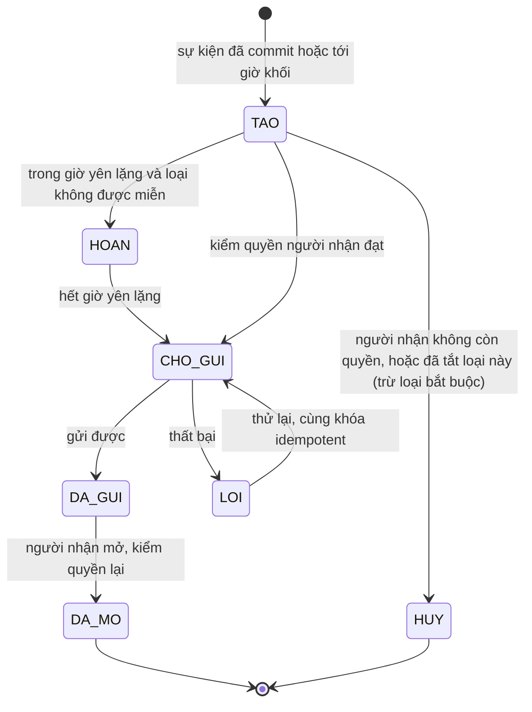
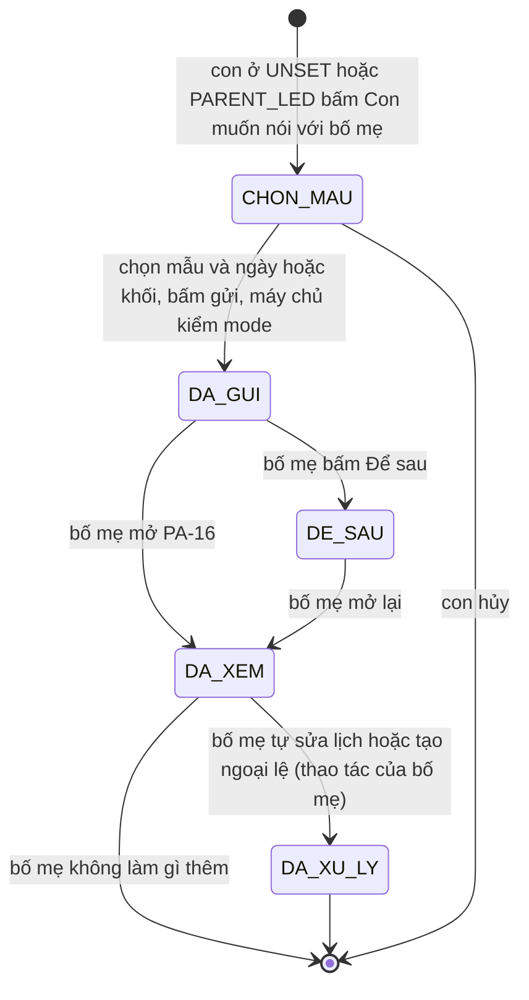
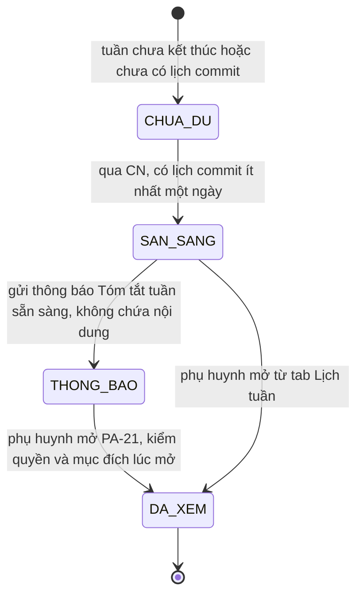
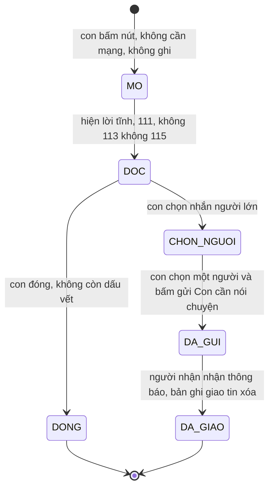

# 11.4 – BUSINESS LOGIC: NHẮC GIỜ, THÔNG BÁO, BÁO CÁO TUẦN, MONG MUỐN VÀ AN TOÀN CỦA A-LITE E1

- **Ngày:** 15/11/2026.
- **Phạm vi:** nhắc giờ theo khối; thông báo cho phụ huynh và cho con; báo cáo tuần (gồm xu hướng mệt liên quan lịch, số ngày đánh dấu Xong); giờ yên lặng; mong muốn của con qua mẫu cố định và vòng xem của bố mẹ; nút "Con cần giúp đỡ"; lời an toàn theo người nhận.
- **Bản chất:** bản nháp đặc tả nghiệp vụ, đi cùng `Business_Logic_11_1_Scheduling_E1_DRAFT.md` (**BL 11.1**), `Business_Logic_11_2_Family_and_Access_DRAFT.md` (**BL 11.2**), `Business_Logic_11_3_Consent_and_Data_DRAFT.md` (**BL 11.3**). Không phải spec chuẩn. Chỗ nào khác nguồn thì ghi ở §11.
- **Dữ liệu:** chỉ hồ sơ giả lập (bé "Na", "Bin"; phụ huynh "chị Hoa", "anh Minh"). **Cổng pháp lý H4, FR-03 vẫn mở, không coi là PASS** (D-01, CAP-4). Nội dung an toàn cần chuyên gia duyệt (cổng B-6): mọi câu chữ trong file này là `đề xuất nội bộ`.
- **Mã:** `BR-NTF-xxx`, `PR-NTF-xx`, `EC-NTF-xx`, `AC-NTF-xx`, `M-NTF-xx`, `Q-NTF-xx`. Không trùng mã BL 11.1, 11.2, 11.3.

## 0. Nguồn và quy ước

### 0.1 Thứ bậc nguồn khi khác nhau

| Bậc | Nguồn | Viết tắt |
|---|---|---|
| 1 | Sổ quyết định 15/11/2026 (`progress/Owner_Decision_Log_20261115.md`) | D-xx |
| 2 | Sổ ràng buộc `Constraint_Register_Approved_Decisions.md` (CRG) và sổ APPROVED mà nó dẫn | OD-03a/b, E-D04, E-D02, PkD-P2, REM-HRW, CP-17, B01-MS-OD, B01-CR-OD, B01C-OD |
| 3 | `documents/pal/spec-quy-tac-lap-lich.md` (QT), `spec-quy-thoi-gian-va-tab-cua-con.md` (TAB), `documents/app/spec-phuong-an-a-app-android.md` (PA, đã tạm dừng theo D-31, chỉ lấy phần kỹ thuật nhắc giờ) | QT G3, K4, L1…L3, N1…N3; TAB §1.5, §4; PA §6, §7 |
| 4 | User Flow 04.1 (UF1) và 04.2 (UF2) | F4, F5-B, G1, G3, G8; PA-xx, CA-xx; UF-Qxx |
| 5 | BL 11.1, 11.2, 11.3 | BR-xxx, BR-FAM-xxx, BR-CON-xxx |

Quyết định 15/11/2026 thắng mọi nguồn cũ. **D-21 thay phần "ngưỡng" của D-03.** BR-135 của BL 11.1 (ngưỡng `null`, chưa gửi) vì vậy hết hiệu lực (xem §11.1).

### 0.2 Mức căn cứ

Dùng nhãn của BL 11.1 §0.2: `OD`, `SP`, `An toàn`, `đề xuất nội bộ`, `fail-safe có nhãn`; và `UNKNOWN`, `PHÁP LÝ` như BL 11.2. File này không có quy tắc dựa trên nghiên cứu khoa học nên không dùng [NC]/[NL]/[MĐ]. Mọi con số chưa có nguồn là `UNKNOWN`.

## 1. Phạm vi

### 1.1 Module trong phạm vi

| L3 | Tên | Vai trò | Mức BL |
|---|---|---|---|
| `F04-G07-M01` | Schedule Notifications | Nhắc khối, báo thức sáng, thông báo sự kiện | Đầy đủ |
| `F04-G07-M02` | Notification Preferences | Bật tắt từng loại, giờ yên lặng | Đầy đủ (giờ yên lặng `UNKNOWN`) |
| `F04-G05-M01` | Lightweight Check-off | ✓ Xong, Hoàn tác, hỏi thăm (BL 11.1 §3.4) | Mối nối |
| `F06-G01-M01` | Activity Event Log | Nguồn của báo cáo | Chỉ đọc |
| `F06-G02-M01` / `-M02` | Progress Rules / Exceptions | Đếm ngày Xong, ngày không tính thiếu | Đầy đủ |
| `F06-G04-M01` | Deterministic Trends | Xu hướng mệt liên quan lịch (D-03, D-21) | Đầy đủ |
| `F06-G05-M01` / `-M02` | Audience Views / Summary Rendering | Báo cáo theo người xem | Đầy đủ |
| `F04-G06-M01` | Change Requests | Nhận mong muốn có cấu trúc (D-20, UF-Q24) | Phần mong muốn |
| `F04-G03-M02` | Approval Routing | Chuyển mong muốn, CR tới người có quyền | Giao diện |
| `F07-G05-M01` | Safety Triage | Ở E1 chỉ nội dung tĩnh và bộ kiểm từ khóa | Phần tĩnh |
| `F07-G01-M01` | Content CMS | Kho nội dung an toàn tĩnh | Mối nối |

### 1.2 Ngoài phạm vi

- Pal trò chuyện, nhận ra lời than thở (QT L4), báo đói, thời tiết, vùng GPS, ảnh, ghi âm (nấc 2).
- Human Response Workflow (F07-G05-M02): hoãn (REM-HRW).
- Chữ tự do của con (E1 không có; UF-Q15).
- Lớp an toàn trước AI: chỉ ghi khung (§10).

### 1.3 Mối nối với BL 11.1, 11.2, 11.3 và màn hình

| Điểm nối | BL khác | File này | Màn |
|---|---|---|---|
| Đặt lại nhắc sau commit | BL 11.1 BR-151 | BR-NTF-005 | CA-06 |
| Con không có máy: không nhắc | BL 11.1 BR-006 | BR-NTF-010 | PA-03 |
| Khối "Ghi việc + hỏi thăm" | BL 11.1 BR-043, BR-130 | BR-NTF-007 | CA-05 |
| "Rất mệt" không đổi lịch; đường mong muốn | BL 11.1 BR-131, 132, 111 | BR-NTF-045 | CA-05, CA-08 |
| Xu hướng mệt, con được biết | BL 11.1 BR-133, 134; BL 11.3 BR-CON-031, 032 | BR-NTF-055…060 | PA-21, CA-05 |
| Ngưỡng xu hướng | BL 11.1 BR-135 (thay bằng D-21) | BR-NTF-058 | PA-21 |
| Ngày ốm, nghỉ không tính thiếu | BL 11.1 BR-144 | BR-NTF-051 | PA-21 |
| Giai đoạn kết thúc, mốc xem lại | BL 11.1 BR-095, 097 | BR-NTF-022, 023 | PA-19 |
| CR hết hạn, vô hiệu | BL 11.1 BR-117, 118, 119 | BR-NTF-024 | CA-10 |
| Khóa lịch, nhắc xem lại khóa | BL 11.1 BR-122 | BR-NTF-025 | PA-26 |
| Thông báo thành viên, đổi Primary, ghép máy | BL 11.2 BR-FAM-013, 027, 038 | BR-NTF-026 | PA-15 |
| Đóng băng và nhắc Primary | BL 11.2 BR-FAM-052…055 | BR-NTF-027, 028 | PA-15, CA-04 |
| Chính sách đổi phiên bản, bản xuất sẵn sàng | BL 11.3 BR-CON-005, 063 | BR-NTF-029 | PA-32, PA-34 |
| Bấm "Con cần giúp đỡ" không ghi | BL 11.3 BR-CON-035, 036 | BR-NTF-070…080 | CA-14 |
| Ô chữ tự do của phụ huynh, kiểm từ khóa | BL 11.3 BR-CON-094 | BR-NTF-065 | PA-07a, PA-24 |

## 2. Thực thể dữ liệu và trạng thái

### 2.1 Danh sách thực thể

| Thực thể | Trường chính | Trạng thái | Module chủ |
|---|---|---|---|
| **Lời nhắc khối** | child_id, block_id, giờ hẹn, nút Xong (có/không), id lịch + phiên bản | `DA_HEN` → `DA_BAO` / `HUY` (lịch đổi, khối hủy) | F04-G07-M01 |
| **Báo thức sáng** | child_id, ngày, giờ dậy từ lịch | như trên | F04-G07-M01 |
| **Thông báo** | id, loại (bảng 4.2), người nhận, child_id (tên gọi), khóa idempotent, thời điểm tạo, sự kiện nguồn (đã commit), nội dung tối thiểu | `TAO` → `CHO_GUI` → `DA_GUI` → `DA_MO`; `HOAN` (giờ yên lặng) / `LOI` / `HUY` | F04-G07-M01 |
| **Tùy chọn thông báo** | người lớn, loại, bật/tắt, giờ yên lặng (`UNKNOWN`) | — | F04-G07-M02 |
| **Nhật ký gửi** | loại, người nhận, giờ hẹn, giờ thật, kết quả; **không** lưu nội dung riêng | bất biến | F04-G07-M01 |
| **Mong muốn** | child_id, mẫu (mã mẫu cố định), ngày hoặc khối liên quan (chọn từ danh sách), thời điểm | `DA_GUI` → `DA_XEM` / `DE_SAU` / `DA_XU_LY` | F04-G06-M01 (D-20) |
| **Bản ghi hỏi thăm** | child_id, ngày, lựa chọn (`on` / `hoi_met` / `rat_met` / `bo_qua`), `schedule_changed = false` | ghi một lần, hoàn tác trong ngày | F04-G05-M01 (OD-A7) |
| **Báo cáo tuần** | child_id, tuần ISO (T2–CN, Asia/Ho_Chi_Minh), tính **khi mở** từ nhật ký sự kiện | `CHUA_DU` / `SAN_SANG` | F06-G05-M01/M02 |
| **Xu hướng mệt** | child_id, tuần, số ngày "Rất mệt", chia theo **đặc điểm lịch** (không theo thứ, không theo ngày) | tính khi dựng báo cáo | F06-G04-M01 |
| **Tin "Con cần nói chuyện"** | từ con, tới một người lớn trong gia đình, câu cố định, thời điểm | `DA_GUI` → `DA_GIAO`; xóa khi giao xong hoặc hết hạn `PR-NTF-09` | F04-G07-M01 (BL 11.3 BR-CON-036) |

### 2.2 Đặc điểm lịch dùng cho xu hướng

`đề xuất nội bộ`. Chỉ các nhãn suy ra **xác định** từ lịch (không đoán, không AI), chờ chủ sản phẩm và người thẩm định chốt danh sách.

| Nhãn | Cách suy ra từ lịch của ngày đó |
|---|---|
| `hoc_them_toi` | Có thẻ hoạt động `hoc_them` kết thúc sau giờ ăn tối (cùng điều kiện G7 của BL 11.1 BR-050) |
| `the_thao` | Có thẻ `the_thao` |
| `tan_hoc_muon` | Giờ tan học muộn hơn mốc `PR-NTF-12` (`UNKNOWN`) |
| `hoc_2_buoi` | Học hai buổi một ngày |
| `ngay_thuong_khac` | Ngày đi học không có nhãn nào ở trên |
| `cuoi_tuan` | Ngày không đi học |

## 3. Máy trạng thái

### 3.1 Thông báo

### 3.2 Mong muốn của con (mẫu cố định)

Mong muốn không có trạng thái "duyệt" hay "từ chối", không đổi lịch, không hết hạn (mặc định, Q-NTF-04). Chỉ có CR chính thức ở `CHILD_EXECUTED` (BL 11.1 §3.2).

### 3.3 Báo cáo tuần

### 3.4 Nút "Con cần giúp đỡ"

## 4. Quy tắc nghiệp vụ

### 4.1 Nhắc giờ theo khối

| ID | Điều kiện | Hành động | Nguồn | Quyết định | Căn cứ | Màn |
|---|---|---|---|---|---|---|
| BR-NTF-001 | Lịch đã commit, con có máy ghép | Mỗi khối lịch thành một lời nhắc **cục bộ trên máy con**, hẹn trước, chạy được khi ngoại tuyến. Khối loại "con bấm Xong" có nút **Xong** ngay trên thông báo | UF1 F4 bước 1; PA §2 | OD-A2 (không AI) | SP | CA-06 |
| BR-NTF-002 | Loại khối nào có nhắc | Mặc định mọi khối con nhìn thấy, **trừ** khối `huy` và khối loại chỉ cho bố mẹ. Danh sách theo `kind`: `PR-NTF-01` (`UNKNOWN`, cần chốt) | BL 11.1 §2.2 | — | `UNKNOWN` | CA-06 |
| BR-NTF-003 | Buổi sáng ngày có giờ dậy | **Báo thức sáng** theo giờ dậy trong lịch, reo cả khi máy im lặng, không cần quyền `SCHEDULE_EXACT_ALARM`. Ngày không đi học: theo giờ dậy của lịch cuối tuần | PA §2 | — | SP | CA-06 |
| BR-NTF-004 | Giờ nhắc so với giờ khối | Nhắc **đúng giờ bắt đầu khối** (độ sớm `PR-NTF-02`, `UNKNOWN`). Thiếu quyền báo chính xác thì nhắc sớm vài phút (`PR-NTF-03`, `UNKNOWN`). "Lệch ≤1 phút" là mục tiêu thử của Plan A, **không** phải quy tắc sản phẩm | UF2 G3-X1, X2 | — | `UNKNOWN` | CA-15 |
| BR-NTF-005 | Commit lịch thành công (BL 11.1 BR-151) | **Đặt lại toàn bộ** lời nhắc từ phiên bản lịch mới; hủy lời nhắc cũ; báo con "Lịch có thay đổi". **Không** báo trước commit. Gửi thất bại thì thử lại, không nhân đôi | BL 11.1 BR-151; UF1 §0.6 mục 5 | — | SP | CA-06 |
| BR-NTF-006 | Ngoại lệ chỉ tuần này, ngày ốm hủy cả ngày | Lời nhắc của khối `huy` bị xóa; khối thay thế có nhắc theo BR-NTF-002 | BL 11.1 BR-144 | — | SP | CA-04 |
| BR-NTF-007 | Khối "Ghi việc và hỏi thăm" | Nhắc như khối thường. Khối này có phần hỏi thăm chỉ khi MD-MET đang bật (BL 11.3 BR-CON-023) và con chưa tắt lời mời; con bỏ qua thì **không hỏi lặp** | BL 11.1 BR-130; 02.5 R3 | D-28 | OD | CA-05 |
| BR-NTF-008 | Con không mở app, không bấm gì | Không nhắc dồn, không nhắc lại, không coi là thất bại. Phụ huynh thấy "chưa ghi nhận", không thấy "không làm" | UF1 F4-X6 | — | `đề xuất nội bộ` | CA-04 |
| BR-NTF-009 | Con từ chối quyền thông báo | Không có nhắc; tab Hôm nay vẫn dùng được; hiện hướng dẫn bật lại. Phụ huynh nhận **một** thông báo "nhắc trên máy con đang tắt" | UF1 F4-X1, F3-X7 | — | `đề xuất nội bộ` | CA-15 |
| BR-NTF-010 | Con không có máy (`child_device = false`) | Không có nhắc, không báo thức, không hỏi thăm, không nút Xong. Lịch phía phụ huynh vẫn đủ. Không dùng chung máy phụ huynh làm máy con | BL 11.1 BR-006; BL 11.2 BR-FAM-037 | D-11 | OD | PA-03 |
| BR-NTF-011 | Tiết kiệm pin làm nhắc trễ | Màn hướng dẫn bỏ tối ưu pin theo hãng. Trạng thái thật vẫn xem được trong app | UF1 F4-X3 | — | SP | CA-15 |
| BR-NTF-012 | Con bấm Xong trên thông báo hoặc trong app | Ghi hoàn thành + giờ (F04-G05-M01 → F06-G01-M01). **Hoàn tác** xóa ghi nhận khối đó trong ngày. Ngoại tuyến: ghi trên máy, đồng bộ khi có mạng; **không** phải sửa lịch | UF1 F4 bước 2, 5; F4-X5 | — | SP | CA-04 |
| BR-NTF-013 | Hộ đóng băng hoặc mục đích MD-DONGBO bị rút | Lời nhắc ngừng; lịch trên máy con không cập nhật (BL 11.2 BR-FAM-054; BL 11.3 BR-CON-022). Báo thức **không** tự reo sau khi hệ thống đã hủy | — | D-27, D-28 | OD | CA-04 |

### 4.2 Thông báo theo loại và người nhận

"Bắt buộc" = người nhận không tắt được (BR-NTF-032). Mọi thông báo: chỉ gửi **sau commit**, kiểm quyền người nhận trước khi gửi và khi mở (E-D04), nội dung xem trước trên màn khóa không chứa dữ liệu riêng, có tên gọi của con khi gia đình nhiều con.

| ID | Loại | Người nhận | Kích hoạt | Nội dung tối thiểu | Bắt buộc | Giờ yên lặng | Nguồn |
|---|---|---|---|---|---|---|---|
| BR-NTF-020 | Nhắc khối, báo thức sáng | Con | Tới giờ khối | Tên khối, nút Xong | không (con tắt được ở hệ điều hành) | **miễn** | PA §2; G3-X5 |
| BR-NTF-021 | Lịch mới hoặc lịch đổi | Con | Commit lịch | "Lịch có thay đổi" | không | theo tùy chọn | UF1 F2 bước 15 |
| BR-NTF-022 | Giai đoạn tạm thời hết hạn, lịch đã về như trước | Phụ huynh có quyền | Commit khôi phục (D-09) | Tên giai đoạn | không | hoãn | D-09; UF1 F5-A |
| BR-NTF-023 | Mốc xem lại giai đoạn (mỗi 14 ngày khi >42 ngày) | Primary | BL 11.1 BR-095 | "Nhắc xem lại giai đoạn [tên]" | không | hoãn | QT J2 |
| BR-NTF-024 | Kết quả đề xuất (duyệt, không duyệt, hết hạn, vô hiệu) | Con | Trạng thái CR đổi | Trạng thái | không | hoãn | B01-CR; UF2 G3 |
| BR-NTF-025 | Nhắc xem lại khóa lịch | Primary | Định kỳ `PR-NTF-04` (`UNKNOWN`, UF-Q28) | "Lịch của [tên gọi] đang khóa từ…" | không | hoãn | B01C-OD-05 |
| BR-NTF-026 | Mong muốn hoặc đề xuất của con | Primary (và người có quyền) | Ghi xong mong muốn hoặc CR | "Con gửi một mong muốn" hoặc "Con có một đề xuất". **Không** ghi nội dung, **không** ghi "mệt" | không | hoãn | UF2 G3 5.1; BR-NTF-046 |
| BR-NTF-027 | Thành viên vào, gỡ, đổi Primary; ghép, hủy liên kết máy | Người lớn liên quan; con (đổi Primary) | Commit | Tối thiểu, không mã, không PIN | **có** (ghép, hủy) | hoãn | BL 11.2 BR-FAM-013, 027, 038 |
| BR-NTF-028 | Nhắc Primary khi không dùng; thông báo đóng băng | Primary; người lớn khác | BL 11.2 BR-FAM-052, 053 | Tối thiểu; nêu cách mở lại | **có** | hoãn không áp dụng (gửi khi đóng băng) | D-27 |
| BR-NTF-029 | Chính sách có phiên bản mới; bản xuất sẵn sàng; yêu cầu xóa xong | Người yêu cầu hoặc Primary | Trạng thái đổi | Lời mời xem, không chứa nội dung | không | hoãn | BL 11.3 |
| BR-NTF-030 | Tóm tắt tuần sẵn sàng | Phụ huynh có quyền xem báo cáo | Lịch gửi `PR-NTF-05` (`UNKNOWN`) | "Tóm tắt tuần của [tên gọi]", **không** kèm số hay xu hướng | không | hoãn | UC-015; UF-Q11 |
| BR-NTF-031 | "Con cần nói chuyện" | Người lớn con chọn | Con bấm gửi (BR-NTF-076) | "[tên gọi] cần nói chuyện với bạn" | **có** | **miễn** | D-26, D-30 |
| BR-NTF-031a | Lời an toàn tĩnh, "Hỗ trợ khẩn cấp" | — (màn tĩnh, không phải thông báo đẩy) | — | — | luôn mở được | — | OD-03; G8 |

### 4.3 Tùy chọn, giờ yên lặng, gửi và lỗi

| ID | Điều kiện | Hành động | Nguồn | Quyết định | Căn cứ | Màn |
|---|---|---|---|---|---|---|
| BR-NTF-032 | Tùy chọn thông báo | Người lớn bật hoặc tắt từng loại. **Loại bắt buộc** (bảng 4.2) không tắt được: ghép/hủy liên kết, đóng băng, "Con cần nói chuyện" | UF2 G3 5.2 bước 2 | — | `đề xuất nội bộ` (danh sách bắt buộc) | PA-27 |
| BR-NTF-033 | Giờ yên lặng của người lớn | Nguồn **không có** giờ mặc định (`PR-NTF-06` = `UNKNOWN`). Mặc định: **tắt**, người lớn tự đặt. Trong giờ yên lặng: thông báo loại không miễn bị **hoãn** tới hết giờ; **miễn**: nhắc khối của con, báo thức sáng, "Con cần nói chuyện" | UF2 G3-X5, UF-Q11 | — | `UNKNOWN`; miễn `đề xuất nội bộ` | PA-27 |
| BR-NTF-034 | Giờ yên lặng cho máy con | Phụ huynh đặt (nhánh mặc định). Giờ yên lặng của máy con chỉ hoãn thông báo **không phải** nhắc khối và báo thức. Con tắt riêng được lời mời hỏi thăm (BR-NTF-007). Ai đặt: `UNKNOWN` (UF-Q32) | UF2 G3 bước 3 | — | `UNKNOWN` | PA-27, CA-11 |
| BR-NTF-035 | Trước mỗi lần gửi | Kiểm quyền và mục đích của **người nhận** hiện tại. Mất quyền giữa lúc tạo và lúc gửi: không gửi. Mở thông báo: kiểm lại | UF2 G3 bước 4, G3-X4 | E-D04 | OD | — |
| BR-NTF-036 | Nội dung xem trước | Không chứa dữ liệu riêng: không số liệu, không xu hướng, không lựa chọn hỏi thăm, không từ "mệt", không mã, không PIN. Tên gọi của con có thể hiện; tùy chọn ẩn tên trên màn khóa: `PR-NTF-07` (`UNKNOWN`) | UF2 G3 bước 4 | E-D04 | OD; ẩn tên `UNKNOWN` | — |
| BR-NTF-037 | Gửi thất bại | Thử lại, idempotent theo khóa; không tạo hành động lặp; trạng thái thật vẫn xem trong app. Ghi nhật ký (giờ hẹn, giờ thật, kết quả), không ghi nội dung | UF2 G3-X3, X7; PA §6 | — | SP | — |
| BR-NTF-038 | Gia đình nhiều con | Mỗi thông báo ghi tên gọi của con liên quan; **không gộp** làm mất tên | UF2 G3-X6 | — | SP | — |
| BR-NTF-039 | Quota hoặc hạn mức gói | Không chặn nội dung an toàn tĩnh. E1 chưa có gói | CRG E-D02, PkD-P2 | — | An toàn | — |
| BR-NTF-039a | Người nhận chưa cấp quyền thông báo của hệ điều hành | Không gửi đẩy; app vẫn đúng; hiện hướng dẫn bật. Thông báo bắt buộc vẫn hiện trong app khi mở | UF2 G3 bước 1 | — | SP | PA-23 |

### 4.4 Mong muốn của con qua mẫu cố định và vòng xem của bố mẹ (D-20)

| ID | Điều kiện | Hành động | Nguồn | Quyết định | Căn cứ | Màn |
|---|---|---|---|---|---|---|
| BR-NTF-040 | Mode hiệu lực của con (BL 11.2 BR-FAM-041) là `UNSET` hoặc `PARENT_LED` | Con chỉ có "Con muốn nói với bố mẹ": chọn **mẫu có sẵn**, chọn ngày hoặc khối liên quan từ danh sách, gửi. **Không chữ tự do.** Không tạo CR, không trạng thái duyệt, không đổi lịch | UF1 F5-B B1.1; BL 11.1 BR-111 | D-20, B01-MS-OD-02, B01-CR §2 | OD | CA-08 |
| BR-NTF-041 | Mẫu mong muốn | Danh sách cố định `PR-NTF-08`. Khởi đầu: "Con mệt, con muốn nghỉ thêm hôm nay"; "Con muốn thêm giờ chơi"; "Con muốn đổi giờ một việc". Câu chữ do chuyên gia duyệt. Thêm mẫu mới = đổi nội dung, qua chủ sản phẩm | UF1 F5-B B1.1 | D-20 | `đề xuất nội bộ` | CA-08 |
| BR-NTF-042 | Module chủ | F04-G06-M01 nhận và giữ hàng chờ. Ghi thành change request L3 (UF-Q24). B01C-OD-08 (qua AI của F05) chỉ áp từ nấc 2 | UF2 UF-Q24; CRG C-04 | D-20 | OD | — |
| BR-NTF-043 | Máy chủ nhận mong muốn | Đọc mode hiện hành của con (BL 11.1 BR-110). Mode là `CHILD_EXECUTED`: nút "Con muốn nói với bố mẹ" thay bằng đề xuất CR (BL 11.1); API mong muốn **vẫn từ chối** từ mode khác `UNSET`/`PARENT_LED`. Con ở `PARENT_LED` gọi API CR: từ chối | BL 11.1 BR-111; F5B-X8 | B01-MS regression 4 | OD | CA-08 |
| BR-NTF-044 | Ngoại tuyến gửi theo mode cũ | Máy chủ kiểm lại mode; sai thì từ chối, không ghi đè im lặng | BL 11.1 BR-124 | B01-MS regression 7 | OD | CA-08 |
| BR-NTF-045 | Con chọn "Rất mệt" ở hỏi thăm (`PARENT_LED`/`UNSET`) | Lời mẫu không hứa đổi lịch: "Lịch hôm nay chưa đổi." Nút "Nhắn bố mẹ" mở CA-08 với mẫu mệt có sẵn. Chọn gửi thì tạo mong muốn; không gửi thì không ghi gì thêm. `CHILD_EXECUTED`: nút đề xuất CR (BL 11.1) | UF1 F4 bước 7 | D-10 | OD | CA-05, CA-08 |
| BR-NTF-046 | Phụ huynh nhận thông báo mong muốn | Nội dung chung "Con gửi một mong muốn", **không** nêu loại, **không** chữ "mệt" (khớp BR-NTF-036). Loại mong muốn chỉ hiện khi **mở PA-16** | UF2 G3 5.1 | E-D04, D-03 | `đề xuất nội bộ` | PA-15, PA-16 |
| BR-NTF-047 | Bố mẹ xem PA-16 | Hiện mong muốn, loại, ngày hoặc khối liên quan, giờ gửi. Hành động: **Để sau**; hoặc tự sửa lịch (ngoại lệ chỉ tuần này, giai đoạn, lịch mẫu). Sửa lịch là thao tác của bố mẹ, **không phải duyệt** | UF1 F5-B B1.2 | B01-CR §2 | OD | PA-16 |
| BR-NTF-048 | Mong muốn không ai xem | Không hết hạn, không đổi lịch. Con thấy "đã gửi". Báo con "bố mẹ đã xem" khi `DA_XEM`: nhánh mặc định **có**, câu trung tính, không nói bố mẹ đã quyết gì (Q-NTF-04) | UF1 F5B-X11, UF-Q06; Q-BL-13 | — | `fail-safe có nhãn` | CA-08 |
| BR-NTF-049 | Con gửi nhiều lần cùng mẫu cùng ngày | Gộp thành một dòng cho cùng (mẫu, ngày); không tăng số thông báo. Số mong muốn tối đa mỗi ngày: `PR-NTF-10` (`UNKNOWN`), không đặt trần tới khi chốt | — | — | `đề xuất nội bộ` | CA-08 |
| BR-NTF-050 | Con đề xuất giai đoạn tạm thời ở `PARENT_LED`/`UNSET` | Là mong muốn (BL 11.1 BR-103); mẫu "đổi nhiều ngày" nếu chủ sản phẩm thêm. Chưa áp, chưa lưu hồ sơ trước | BL 11.1 BR-103 | — | OD | CA-08 |

### 4.5 Báo cáo tuần và xu hướng mệt (D-03, D-21)

| ID | Điều kiện | Hành động | Nguồn | Quyết định | Căn cứ | Màn |
|---|---|---|---|---|---|---|
| BR-NTF-051 | Dựng báo cáo tuần | Nguồn là nhật ký sự kiện (F06-G01-M01). Tuần ISO, T2–CN, Asia/Ho_Chi_Minh, **tính khi mở** từ nhật ký, không lưu bản chụp có số liệu. Điều kiện: có lịch commit ít nhất một ngày. Ghi rõ đây là **tự báo cáo** của con, không phải tiến bộ năng lực | UF2 G1 3.1; 03.4 §6.4 | — | SP | PA-21 |
| BR-NTF-052 | **Số ngày đánh dấu Xong** | Hiện dạng "Con đánh dấu Xong ở X trên Y ngày". **Y** = số ngày trong tuần có ít nhất một khối loại "con bấm Xong" **và** không thuộc ngày bị loại (BR-NTF-053). **X** = số ngày trong Y có ít nhất một ✓ chưa Hoàn tác. Không phần trăm, không màu, không chấm điểm, không xếp hạng | UF1 F4 bước 3; TAB §4; CLAUDE.md | — | `đề xuất nội bộ` (cách đếm) | PA-21 |
| BR-NTF-053 | Ngày bị loại khỏi Y (không tính là chưa hoàn thành) | Ngày ốm hủy cả ngày, ngày nghỉ (ngoại lệ "nghỉ buổi"), ngày giảm tải, ngày trước khi lịch commit, ngày hộ đóng băng, ngày chưa đồng bộ từ máy con, ngày không có khối cần con xác nhận | BL 11.1 BR-144; QT K4; BL 11.2 BR-FAM-058 | F06-G02-M02 | SP | PA-21 |
| BR-NTF-054 | Không có dữ liệu | Hiện "chưa có ghi nhận", **không** "không làm". Con không có máy: "chưa có dữ liệu từ máy con", không có mục xu hướng. Mục đích MD-XONG hoặc MD-BAOCAO đã rút: mục đó không hiện | UF2 G1-X1, X2; BL 11.3 BR-CON-024 | D-11, D-28 | SP | PA-21 |
| BR-NTF-055 | Báo cáo không bao giờ có | Điểm tổng, so sánh với trẻ khác, xếp hạng, nhãn tính cách, chẩn đoán, từ "lười", "kém", "tốt hơn", biểu tượng thưởng phạt, thang màu về hành vi của con | TAB §4; QT A4; CLAUDE.md | — | SP | PA-21 |
| BR-NTF-056 | Nội dung khác của báo cáo | Ngày có ngoại lệ, giai đoạn tạm thời đang chạy, số mong muốn con gửi (chỉ số đếm, mở PA-16 mới xem nội dung), "Xem lịch sử thay đổi" (PA-25), nút "Điều chỉnh" (F2, F5-A, F5-C, PA-16) | UF2 G1 bước 3…6 | — | SP | PA-21, PA-25 |
| BR-NTF-057 | Xu hướng mệt liên quan lịch | Chỉ trong **báo cáo tuần**, **không** báo lẻ tẻ, không có thông báo riêng, không có từng ngày. Điều kiện hiện: MD-MET và MD-BAOCAO đang bật; người xem có quyền xu hướng (Primary; người lớn khác chỉ khi được cấp riêng); tuần có ít nhất một lần "Rất mệt" chưa hoàn tác | D-03, D-21; QT L2; TAB §1.5 | D-21 | OD | PA-21 |
| BR-NTF-058 | **Không có ngưỡng** | D-21 bỏ ngưỡng của D-03: không đặt "n lần mới báo". BR-135 của BL 11.1 hết hiệu lực. Không đặt ngưỡng nào khác trong file này. Rủi ro khi chỉ có 1 lần: xem M-NTF-02, Q-NTF-01 | D-21 | D-21 | OD | PA-21 |
| BR-NTF-059 | Nội dung xu hướng | Một câu số liệu: số ngày con báo "Rất mệt" trong tuần, **chia theo đặc điểm lịch** (§2.2), ví dụ "tuần này con báo rất mệt 2 ngày, cả 2 ngày đều có học thêm buổi tối". **Không** nêu thứ hay ngày cụ thể, không chép lời con, không gắn cảm xúc, không kết luận nguyên nhân. Kèm **một** câu hỏi về bối cảnh và **một** đề xuất cụ thể, đều là câu mẫu cố định theo nhãn lịch | QT L2; TAB §1.5; BL 11.1 BR-133 | D-03 | OD; chia theo thứ của BL 11.1 BR-133 **bị thay** bằng chia theo đặc điểm lịch (`fail-safe có nhãn`, M-NTF-01) | PA-21 |
| BR-NTF-060 | Con được biết | Lần đầu hỏi thăm có dòng cố định (BL 11.3 BR-CON-031). CA-16 mô tả đúng: bố mẹ thấy xu hướng tuần, không thấy từng ngày. Nội dung dựng từ bảng quyền thật | BL 11.3 | D-03 | OD | CA-05, CA-16 |
| BR-NTF-061 | Tín hiệu mệt ở các trạng thái khác | Trong giai đoạn tạm thời vẫn tính như bình thường (BL 11.1 BR-137). "Rất mệt" nhiều ngày liền: mỗi lần là tín hiệu mới, không là "nhắc lại"; vẫn **không đổi lịch** (D-10) | BL 11.1 BR-136, 137; UF1 F4-X13 | D-10 | OD | — |
| BR-NTF-062 | Người xem là Supporter hoặc Observer | Chỉ phần được cấp. Mặc định không có xu hướng mệt, không có số mong muốn. Không bao giờ thấy lựa chọn hỏi thăm từng ngày | UF2 G1-X3; BL 11.3 BR-CON-037 | UF-Q30 | `fail-safe có nhãn` | PA-21 |
| BR-NTF-063 | Con xem tuần của mình (CA-13) | Chỉ việc của con, ✓ con đã bấm, hỏi thăm con đã chọn, ngày nghỉ không bị tính thiếu. Không điểm, không so sánh | UF2 G1 bước 7; TAB §4 | — | SP | CA-13 |
| BR-NTF-064 | Thông báo "Tóm tắt tuần sẵn sàng" | Chỉ khi báo cáo `SAN_SANG`. Không kèm số. Tần suất và giờ gửi `PR-NTF-05` (`UNKNOWN`; nhánh mặc định: sẵn sàng sau Chủ Nhật, gửi theo tùy chọn). Thất bại thì PA-21 vẫn mở được từ tab | UF2 G1-X5 | UF-Q11 | `UNKNOWN` | PA-21 |

### 4.6 An toàn theo người nhận

| ID | Điều kiện | Hành động | Nguồn | Quyết định | Căn cứ | Màn |
|---|---|---|---|---|---|---|
| BR-NTF-065 | Người lớn mở "Hỗ trợ khẩn cấp" (luôn có, không cần mạng), hoặc chữ tự do trong Parent App khớp danh sách dấu hiệu khẩn | Hiện PA-24: **115** cấp cứu (khó thở, co giật, bất tỉnh), **113** công an (nguy hiểm an ninh), **111** bảo vệ trẻ em (bạo hành, xâm hại trẻ), chọn theo tình huống. Với ô chữ: một dòng ngay dưới ô, **không popup**, vẫn cho lưu. Không chẩn đoán, không nêu liều thuốc, không gợi ý trả phí, không tự gọi (bấm số chỉ mở trình gọi của máy). Khớp nhầm thì chỉ hiện dòng thông tin, **không** ghi nhãn rủi ro vào hồ sơ | QT N1, N2; UF2 G8 10.1 | D-06, OD-03b | An toàn; danh sách từ khóa `UNKNOWN` (cổng B-6, UF-Q38) | PA-24 |
| BR-NTF-066 | Phụ huynh nhập dấu hiệu bạo hành trẻ | Hiện **111** trước | UF2 G8-X4 | OD-03b | An toàn | PA-24 |
| BR-NTF-067 | Trẻ cần lời an toàn (E1: chỉ qua nút "Con cần giúp đỡ") | Hiện **"Con hãy nói với một người lớn con tin cậy"**, có thể kèm **111**. **Không** hiện 113, 115. Không chẩn đoán, không tự liên hệ, không mở hồ sơ, không gọi Claude | QT N2, N3; UF2 G8 10.2 | D-06, OD-03a | An toàn | CA-14 |
| BR-NTF-068 | Nội dung an toàn tĩnh | Lưu sẵn trên máy, hiện được khi ngoại tuyến. Quota, đóng băng, rút đồng ý **không** chặn. Câu chữ và danh sách từ khóa cần chuyên gia duyệt trước khi chạy thật | UF2 G8-X1; BL 11.2 BR-FAM-062 | CRG E-D02, cổng B-6 | An toàn | PA-24, CA-14 |
| BR-NTF-069 | Nghi người chăm sóc là nguồn nguy hại | Không mặc định báo cho chính người đó. E1 không có chữ tự do của con nên chưa phát sinh; áp từ nấc 2 | CRG CP-17 | REM-HRW | An toàn | — |

### 4.7 Nút "Con cần giúp đỡ" (QT N3; D-26, D-30)

| ID | Điều kiện | Hành động | Nguồn | Quyết định | Căn cứ | Màn |
|---|---|---|---|---|---|---|
| BR-NTF-070 | Vị trí nút | Cố định, luôn thấy, ở CA-04 hoặc CA-11 (UF-Q37). Mở được khi ngoại tuyến, khi hộ đóng băng, khi mục đích đã rút | UF2 G8 10.2 | D-26 | OD; vị trí `đề xuất nội bộ` | CA-04, CA-11, CA-14 |
| BR-NTF-071 | Con bấm nút | Hiện CA-14 (BR-NTF-067). **Không ghi lại** việc con mở: không nhật ký, không sự kiện, không số đếm, không dấu thời gian | QT N3 | D-26 (b), D-30 | OD | CA-14 |
| BR-NTF-072 | Con bấm nút | **Không tự báo** bố mẹ hay gia đình, vì người gây hại có thể ở trong nhà. Không tự báo ai khác | QT N3; UF2 G8 | D-26, D-30, REM-HRW | OD | CA-14 |
| BR-NTF-073 | Con bấm nút | App **gợi ý** con báo bố mẹ, có nút gửi sẵn "Con cần nói chuyện". Con **không muốn** báo bố mẹ thì chọn **người lớn khác con tin** | QT N3 | D-26, D-30 | OD | CA-14 |
| BR-NTF-074 | Danh sách người nhận trong app | Người lớn đã tham gia gia đình (tên gọi). Không có ai ngoài bố mẹ: chỉ còn lời tĩnh và 111, và (nếu chủ sản phẩm chọn) cách nhắn bằng ứng dụng nhắn tin của máy (BR-NTF-075) | UF2 G4 | — | `đề xuất nội bộ` (Q-NTF-06) | CA-14 |
| BR-NTF-075 | Nhắn người lớn ngoài app | `đề xuất nội bộ`: nút mở bảng chia sẻ của máy với câu mẫu sẵn "Con cần nói chuyện với bạn"; con tự chọn người nhận; app không thấy người nhận, không ghi | QT N3 ("người lớn khác con tin") | D-30 | `đề xuất nội bộ`, `chờ Owner quyết` | CA-14 |
| BR-NTF-076 | Con bấm gửi "Con cần nói chuyện" | **Chỉ khi con bấm.** Một lần chạm, không hỏi lại bằng câu dài. Nội dung cố định, kèm tên gọi của con. Chỉ tới người con chọn, **không** tới ai khác. Không hạn chế số lần | QT N3 | D-30 | OD | CA-14 |
| BR-NTF-077 | Bản ghi giao tin | Chỉ để chuyển tin. Không vào nhật ký ngày, báo cáo, hỏi thăm, xuất dữ liệu (BL 11.3 BR-CON-036). Xóa khi giao xong hoặc hết hạn `PR-NTF-09` (`UNKNOWN`). Con không có "mục đã gửi" | QT N3 | D-26 | `fail-safe có nhãn` | CA-14 |
| BR-NTF-078 | Người nhận nhận tin | Thông báo bắt buộc, miễn giờ yên lặng, không bị chặn bởi quota hay đóng băng. Mở ra PA-24 kèm câu hướng dẫn ngắn do chuyên gia duyệt. **Không** hiện cho người lớn khác trong gia đình | UF2 G3 | D-30 | `đề xuất nội bộ`; câu chữ cần chuyên gia | PA-15, PA-24 |
| BR-NTF-079 | Con ở lại màn hình | Con có thể đóng bất kỳ lúc nào; không có phản hồi dạng "đã báo" lộ ra cho người khác; không khóa app của con | QT N3 | D-26 | OD | CA-14 |
| BR-NTF-080 | Câu chữ nút và màn | Cần **chuyên gia duyệt** (QT N3). Trước khi duyệt: chỉ chạy với dữ liệu giả lập hoặc gia đình thử D-01, kèm lời nói trực tiếp cho gia đình | QT N3; CRG cổng B-6 | D-26 | An toàn | CA-14 |
| BR-NTF-081 | Nấc 2: con nói về tự hại bằng chữ hoặc giọng nói | Cùng nguyên tắc: lớp an toàn chạy trước, chỉ lời tĩnh, **gợi ý** con báo bố mẹ, **không** tự báo. Không thuộc E1 | D-30 | D-30 | OD (khung) | — |

**Tổng: 77 quy tắc** (đếm theo số dòng BR-NTF trong các bảng 4.1…4.7).

## 5. Thứ tự áp khi một sự kiện tạo thông báo

| Bước | Việc | Quy tắc |
|---|---|---|
| 1 | Sự kiện đã **commit** (không có thông báo trước commit) | BR-NTF-005, 035 |
| 2 | Người nhận còn quyền; loại không bị tắt hoặc là loại bắt buộc | BR-NTF-032, 035 |
| 3 | Giờ yên lặng, trừ loại miễn | BR-NTF-033 |
| 4 | Dựng nội dung tối thiểu, không dữ liệu riêng | BR-NTF-036 |
| 5 | Gửi, ghi nhật ký, thử lại idempotent | BR-NTF-037 |
| 6 | Người nhận mở: kiểm quyền lại rồi mở đúng màn | BR-NTF-035 |

Với nút "Con cần giúp đỡ": **không** đi qua các bước này (không ghi), chỉ bước gửi của BR-NTF-076 mới vào bước 2 (loại bắt buộc, miễn giờ yên lặng).

## 6. Thông số chưa chốt

| ID | Thông số | Giá trị | Nguồn | Mặc định khi chưa chốt |
|---|---|---|---|---|
| PR-NTF-01 | Loại khối nào có nhắc | `UNKNOWN` | PA §2 ("mỗi khối") | Mọi khối con thấy, trừ khối `huy` và khối chỉ cho bố mẹ |
| PR-NTF-02 | Độ sớm của nhắc so với giờ khối | `UNKNOWN` | PA §2 | 0 phút (đúng giờ bắt đầu) |
| PR-NTF-03 | Nhắc sớm khi thiếu quyền báo chính xác | `UNKNOWN` ("vài phút", PA §7) | PA §7 | Nhắc sớm, chưa có số |
| PR-NTF-04 | Chu kỳ nhắc xem lại khóa | `UNKNOWN` | UF-Q28 | Chưa nhắc lặp |
| PR-NTF-05 | Ngày giờ và tần suất gửi thông báo tóm tắt tuần | `UNKNOWN` | UF-Q11 | Sẵn sàng sau Chủ Nhật; gửi theo tùy chọn |
| PR-NTF-06 | Giờ yên lặng mặc định | `UNKNOWN` (nguồn không có) | UF-Q11 | Tắt; người lớn tự đặt |
| PR-NTF-07 | Ẩn tên con trên màn khóa | `UNKNOWN` | E-D04 | Hiện tên gọi, nội dung chung |
| PR-NTF-08 | Danh sách mẫu mong muốn | 3 mẫu khởi đầu (`đề xuất nội bộ`) | UF1 F5-B | 3 mẫu |
| PR-NTF-09 | Hạn giữ bản ghi giao tin "Con cần nói chuyện" | `UNKNOWN` | D-26 | Xóa khi giao xong |
| PR-NTF-10 | Số mong muốn tối đa mỗi ngày | `UNKNOWN` | — | Không có trần |
| PR-NTF-11 | Danh sách từ khóa dấu hiệu khẩn của phụ huynh | `UNKNOWN`, cần chuyên gia | UF-Q38 | Bộ kiểm chạy với danh sách ngắn do chuyên gia duyệt; chưa duyệt thì chỉ có nút "Hỗ trợ khẩn cấp" |
| PR-NTF-12 | Mốc "tan học muộn" cho nhãn lịch | `UNKNOWN` | — | Bỏ nhãn `tan_hoc_muon` cho tới khi chốt |

## 7. Trường hợp biên

| Mã | Tình huống | Cách xử lý | Nguồn |
|---|---|---|---|
| EC-NTF-01 | Lịch đổi lúc 15:00 trong khi lời nhắc 16:00 đã hẹn | Hủy mọi lời nhắc cũ, đặt lại theo lịch mới | BR-NTF-005 |
| EC-NTF-02 | Commit thành công nhưng thông báo "Lịch có thay đổi" gửi lỗi | Lịch vẫn có hiệu lực; thử lại; tab Hôm nay luôn đúng | BR-NTF-037 |
| EC-NTF-03 | Con bấm Xong khi ngoại tuyến, đồng bộ sau tuần | Báo cáo tuần lấy theo ngày thực tế của sự kiện; tuần chưa đồng bộ ghi "chưa có dữ liệu" | BR-NTF-012, 053 |
| EC-NTF-04 | Con "Rất mệt" ở `CHILD_EXECUTED`, lịch khóa | Đường CR chỉ để xem, không áp (EC-18 của BL 11.1) | BL 11.1 |
| EC-NTF-05 | Tuần chỉ có đúng 1 ngày "Rất mệt" | Vẫn hiện (D-21), chia theo đặc điểm lịch, không nêu ngày. Rủi ro suy ngược: M-NTF-02 | BR-NTF-058, 059 |
| EC-NTF-06 | Con chọn "Rất mệt" rồi Hoàn tác trong ngày | Không tính vào xu hướng | BR-NTF-057 |
| EC-NTF-07 | Tuần có ngày ốm hủy cả ngày | Ngày đó loại khỏi Y; không "chưa hoàn thành" | BR-NTF-053 |
| EC-NTF-08 | Hộ đóng băng giữa tuần | Các ngày sau đóng băng loại khỏi Y; báo cáo tuần ghi rõ "tạm dừng" | BR-NTF-053 |
| EC-NTF-09 | Nhiều con: phụ huynh mở PA-21 chưa chọn con | Hỏi con nào; không đoán | BL 11.2 BR-FAM-006 |
| EC-NTF-10 | Giờ yên lặng của chị Hoa trùm giờ báo thức bé Na | Báo thức và nhắc khối vẫn chạy (máy con) | BR-NTF-033 |
| EC-NTF-11 | Hộ đóng băng, con bấm "Con cần giúp đỡ" rồi gửi "Con cần nói chuyện" | Nút và gửi vẫn hoạt động; người nhận nhận thông báo bắt buộc | BR-NTF-070, 078 |
| EC-NTF-12 | Con chỉ có một người lớn trong gia đình và người đó là nguồn gây hại | Con thấy lời tĩnh và 111; có thể chọn nhắn người ngoài app (nếu BR-NTF-075 được duyệt); app không tự báo ai | BR-NTF-072, 074, 075 |
| EC-NTF-13 | Người nhận "Con cần nói chuyện" đã bị gỡ khỏi gia đình lúc đó | Không giao; con thấy lỗi chung "chưa gửi được", không lộ lý do | BR-NTF-035 |
| EC-NTF-14 | Người lớn tắt hết thông báo | Loại bắt buộc vẫn gửi | BR-NTF-032 |
| EC-NTF-15 | Phụ huynh nhập chữ khẩn vào ghi chú thẻ | Dòng thông tin dưới ô; vẫn lưu được; không nhãn hồ sơ | BR-NTF-065 |
| EC-NTF-16 | Mong muốn gửi ngay trước khi bố mẹ đổi mode sang `CHILD_EXECUTED` | Mong muốn vẫn ở hàng chờ; không tự thành CR | BL 11.2 BR-FAM-044 |
| EC-NTF-17 | Con không có máy nhưng phụ huynh bật báo cáo tuần | Báo cáo ghi "chưa có dữ liệu từ máy con"; không xu hướng | BR-NTF-054 |
| EC-NTF-18 | Giai đoạn tạm thời có nới màn hình, con "Rất mệt" | Vẫn tính vào xu hướng | BR-NTF-061 |

## 8. Tiêu chí chấp nhận

Chưa có test chạy (không có spike cho module này; riêng `fatigue.js` của spike E1 có TC-D03-1, TC-D10-1…6 cho phần hỏi thăm). Mọi AC khác là đề xuất để viết test.

### 8.1 Nhắc giờ

- **AC-NTF-01.** *Given* lịch của bé Na đã commit, máy ghép. *When* tới giờ khối "Ôn bài". *Then* có một lời nhắc cục bộ với nút Xong; mất mạng vẫn nhắc.
- **AC-NTF-02.** *Given* chị Hoa lưu lịch mới. *When* commit thành công. *Then* mọi lời nhắc cũ trên máy bé Na bị hủy, lời nhắc mới được đặt, bé Na nhận "Lịch có thay đổi"; trước commit không có thông báo nào.
- **AC-NTF-03.** *Given* bé Bin không có máy. *When* lịch commit. *Then* không có lời nhắc nào; phụ huynh vẫn xem được lịch đủ.
- **AC-NTF-04.** *Given* bé Na từ chối quyền thông báo. *When* ghép xong. *Then* chị Hoa nhận đúng một thông báo "nhắc trên máy con đang tắt".
- **AC-NTF-05.** *Given* bé Na bỏ qua hỏi thăm. *When* ngày sau. *Then* không hỏi lặp, không nhắc dồn.
- **AC-NTF-06.** *Given* bé Na bấm Xong nhầm. *When* bấm Hoàn tác. *Then* ghi nhận bị xóa và không tính vào báo cáo.

### 8.2 Thông báo và giờ yên lặng

- **AC-NTF-07.** *Given* anh Minh đã bị gỡ khỏi gia đình lúc thông báo đang chờ. *When* tới lúc gửi. *Then* không gửi.
- **AC-NTF-08.** *Given* chị Hoa đặt giờ yên lặng 22:00–06:00. *When* có thông báo "giai đoạn kết thúc" lúc 23:00. *Then* hoãn tới 06:00. *When* có nhắc khối của bé Na lúc 23:00 hoặc "Con cần nói chuyện". *Then* gửi ngay.
- **AC-NTF-09.** *Given* chị Hoa chưa đặt giờ yên lặng. *When* kiểm tùy chọn. *Then* giờ yên lặng đang tắt (không có mặc định).
- **AC-NTF-10.** *Given* thông báo mong muốn của con. *When* hiện trên màn khóa. *Then* nội dung chỉ "Con gửi một mong muốn", không có chữ "mệt", không số liệu.
- **AC-NTF-11.** *Given* chị Hoa tắt mọi loại thông báo. *When* có hủy liên kết máy con. *Then* vẫn gửi (loại bắt buộc).
- **AC-NTF-12.** *Given* gửi thông báo lỗi lần đầu. *When* thử lại. *Then* người nhận chỉ nhận một thông báo (cùng khóa idempotent).

### 8.3 Mong muốn

- **AC-NTF-13.** *Given* bé Na ở `PARENT_LED`. *When* chọn mẫu "Con muốn thêm giờ chơi" và gửi. *Then* mong muốn vào PA-16, không có CR, lịch không đổi, không có nút Duyệt.
- **AC-NTF-14.** *Given* bé Na ở `PARENT_LED`. *When* gọi API tạo CR. *Then* từ chối.
- **AC-NTF-15.** *Given* mong muốn chưa ai xem 10 ngày. *When* kiểm. *Then* còn nguyên, không hết hạn, không đổi lịch.
- **AC-NTF-16.** *Given* chị Hoa mở PA-16. *When* bấm "Để sau". *Then* trạng thái `DE_SAU`, bé Na không nhận câu nào nói bố mẹ đã quyết.
- **AC-NTF-17.** *Given* bé Na chọn "Rất mệt". *When* app trả lời. *Then* lời không hứa đổi lịch ("Lịch hôm nay chưa đổi"), lịch tuần giống hệt trước đó.
- **AC-NTF-18.** *Given* máy bé Na ngoại tuyến gửi mong muốn theo mode cũ `CHILD_EXECUTED` nhưng mode hiện hành là `PARENT_LED`. *When* máy chủ nhận. *Then* từ chối.

### 8.4 Báo cáo tuần

- **AC-NTF-19.** *Given* bé Na có khối cần Xong ở 5 ngày, bấm Xong ở 4 ngày, 1 ngày ốm hủy cả ngày. *When* chị Hoa mở PA-21. *Then* hiện "Con đánh dấu Xong ở 4 trên 5 ngày" (ngày ốm không tính), không phần trăm, không màu, không từ chấm điểm.
- **AC-NTF-20.** *Given* bé Na chưa bấm gì cả tuần. *When* mở PA-21. *Then* "chưa có ghi nhận", không "không làm".
- **AC-NTF-21.** *Given* bé Na "Rất mệt" 2 ngày, cả 2 ngày có `hoc_them_toi`. *When* mở PA-21. *Then* một câu số liệu kèm đặc điểm lịch, không nêu thứ hay ngày, không chép lời con, có một câu hỏi và một đề xuất mẫu.
- **AC-NTF-22.** *Given* bé Na "Rất mệt" 1 ngày. *When* mở PA-21. *Then* vẫn hiện xu hướng (không ngưỡng, D-21), không có thông báo riêng nào về lần mệt đó trước đó.
- **AC-NTF-23.** *Given* chị Hoa rút MD-MET. *When* mở PA-21. *Then* không có mục xu hướng.
- **AC-NTF-24.** *Given* anh Minh là Supporter không được cấp xu hướng. *When* mở PA-21. *Then* không có xu hướng, không có số mong muốn.
- **AC-NTF-25.** *Given* "Rất mệt" đã Hoàn tác trong ngày. *When* dựng báo cáo. *Then* không tính.
- **AC-NTF-26.** *Given* thông báo "Tóm tắt tuần sẵn sàng". *When* hiện trên màn khóa. *Then* không chứa số hay xu hướng.

### 8.5 An toàn và nút "Con cần giúp đỡ"

- **AC-NTF-27.** *Given* bé Na bấm "Con cần giúp đỡ" khi ngoại tuyến. *When* xem màn. *Then* chỉ có lời "nói với người lớn con tin cậy" và có thể 111, không có 113, 115.
- **AC-NTF-28.** *Given* bé Na đã bấm nút. *When* kiểm máy chủ, nhật ký ngày, báo cáo, xuất dữ liệu, thông báo của chị Hoa. *Then* không dấu vết nào.
- **AC-NTF-29.** *Given* bé Na mở CA-14. *When* chưa bấm gửi. *Then* không ai được báo.
- **AC-NTF-30.** *Given* bé Na chọn anh Minh và bấm gửi "Con cần nói chuyện". *When* giao. *Then* chỉ anh Minh nhận, chị Hoa không nhận, bản ghi giao tin bị xóa sau khi giao, bé Na không có mục "đã gửi" lưu lại.
- **AC-NTF-31.** *Given* hộ đóng băng. *When* bé Na gửi "Con cần nói chuyện". *Then* vẫn giao, miễn giờ yên lặng.
- **AC-NTF-32.** *Given* chị Hoa nhập "bị đánh" vào ghi chú thẻ. *When* lưu. *Then* một dòng thông tin dưới ô với 111, không popup, vẫn lưu, hồ sơ không có nhãn rủi ro.
- **AC-NTF-33.** *Given* chị Hoa mở "Hỗ trợ khẩn cấp". *When* xem. *Then* 115, 113, 111 kèm khi nào gọi số nào; bấm số chỉ mở trình gọi, không tự gọi, không có gợi ý trả phí.

## 9. Mối nối với BL 11.1 và User Flow

### 9.1 Điều BL 11.1 và 11.3 cần từ file này

| Nguồn | Cần | Nơi giải |
|---|---|---|
| BL 11.1 BR-151 | Đặt lại nhắc, báo "Lịch mới" sau commit | BR-NTF-005 |
| BL 11.1 BR-130…132 | Hỏi thăm, "Rất mệt" không đổi lịch, đường theo mode | BR-NTF-007, 045 |
| BL 11.1 BR-133…135 | Xu hướng; ngưỡng bị D-21 thay | BR-NTF-057…059 |
| BL 11.1 BR-111, 103 | Mong muốn ở `PARENT_LED`/`UNSET` | BR-NTF-040…050 |
| BL 11.1 BR-138 | Chữ nguy hiểm: lớp an toàn | BR-NTF-065…069 |
| BL 11.2 BR-FAM-052…055 | Nhắc và thông báo đóng băng | BR-NTF-028 |
| BL 11.3 BR-CON-035, 036 | Không ghi; vòng đời tin giao | BR-NTF-071, 077 |

### 9.2 Màn hình

PA-15, PA-16, PA-21, PA-23, PA-24, PA-25, PA-27; CA-04, CA-05, CA-06, CA-08, CA-10, CA-11, CA-13, CA-14, CA-15, CA-16.

## 10. Ranh giới E1 và nấc 2

| Việc | E1 | Nấc 2 |
|---|---|---|
| Lời của app | Câu mẫu cố định (≤3 câu theo QT A3) | Diễn đạt bằng AI sau lớp an toàn |
| Mong muốn của con | Mẫu cố định, không chữ tự do | Chữ ngắn, Pal giúp diễn đạt (F5B-X9) |
| Xu hướng mệt | Đếm xác định, câu mẫu | Nhận ra lời than thở khi con trò chuyện (QT L4) |
| An toàn trẻ | Nút tĩnh, không ghi | Lớp an toàn trên chữ, giọng nói; vẫn không tự báo (D-30) |
| Báo đói, thời tiết, GPS | Không | Có, qua cổng riêng |
| Giờ yên lặng | Tham số `UNKNOWN` | Chốt cùng chính sách thông báo |

## 11. Mâu thuẫn còn mở và đề xuất

### 11.1 Mâu thuẫn giữa quyết định và nguồn

| Mã | Mâu thuẫn | Nguồn | Mặc định trong BL | Đề xuất | Hỏi |
|---|---|---|---|---|---|
| M-NTF-01 | BL 11.1 BR-133 chia xu hướng "theo thứ và theo đặc điểm lịch" (số lần trong 14 ngày). CA-16 và UF-Q18 hứa với con "bố mẹ không thấy con chọn gì **từng ngày**". Chia theo thứ cho phép suy ra ngày. D-21 chỉ cho báo cáo **tuần**; QT L2 ghi "rơi vào những ngày có lịch nào" | BL 11.1 BR-133; QT L2; D-03, D-21 | Chỉ báo theo tuần và theo **đặc điểm lịch**, không nêu thứ, không nêu ngày | Sửa BL 11.1 BR-133 và QT L2 theo hướng này | Q-NTF-02 |
| M-NTF-02 | D-21 "không cần ngưỡng" (hiện từ 1 lần). QT L2: "không kết luận từ một ngày". Với 1 lần, đặc điểm lịch của ngày đó cộng với lịch tuần đủ để phụ huynh biết đó là ngày nào | D-21; QT L2; BL 11.3 BR-CON-039 | Theo D-21 (không ngưỡng); câu trung tính, không nêu ngày, không kết luận | Chủ sản phẩm xác nhận chấp nhận rủi ro này, hoặc chỉ hiện từ 2 lần trong tuần (đây sẽ là ngưỡng, nên cần chủ sản phẩm quyết) | Q-NTF-01 |
| M-NTF-03 | D-03 và D-21 cho báo cáo tuần có xu hướng mệt. UF2 G1 bước 4, UF-Q20 ghi "chưa có ngưỡng thì không hiện" | UF2 G1; D-21 | Theo D-21 | Sửa UF2 G1 bước 4 và UF-Q20 | Không |
| M-NTF-04 | Thông báo "Con gửi một mong muốn" khi bé chọn mẫu "mệt": D-21 nói không báo lẻ tẻ cảm xúc. Nhưng mong muốn là do **con chủ động gửi** (F5B-X10) và PA-16 hiện loại mong muốn | D-21; UF1 F5B-X10 | Thông báo đẩy trung tính; loại chỉ hiện khi mở PA-16 | Giữ. Chủ sản phẩm xác nhận con chủ động gửi mẫu "mệt" thì phụ huynh được thấy ở PA-16 | Q-NTF-03 |
| M-NTF-05 | UF2 G8 nêu bộ kiểm từ khóa trên chữ phụ huynh (E1) cần chuyên gia duyệt danh sách (cổng B-6). Chưa có chuyên gia (D-17 chưa chi tiền) | UF-Q38; D-17 | Danh sách `UNKNOWN`; chưa duyệt thì chỉ có nút "Hỗ trợ khẩn cấp" | Chủ sản phẩm chọn người duyệt nội bộ tạm cho vòng thử D-01 | Q-NTF-07 |
| M-NTF-06 | D-30: con chọn "người lớn khác con tin". Trong E1 người nhận chỉ là người lớn đã tham gia gia đình. Nếu người gây hại là người lớn duy nhất, app không còn đường nhắn | D-26, D-30; QT N3 | Lời tĩnh + 111; nhắn ngoài app qua bảng chia sẻ là đề xuất | Chủ sản phẩm quyết có làm bảng chia sẻ không | Q-NTF-06 |
| M-NTF-07 | BR-NTF-077: D-26 "không ghi lại" nhưng giao tin cần bản ghi tạm | D-26 | Bản ghi tạm chỉ để giao, xóa khi giao xong | Chủ sản phẩm xác nhận cách hiểu "không ghi lại" áp cho nhật ký, không áp cho bản ghi giao tin | Q-NTF-06 |
| M-NTF-08 | QT N3 ghi nút ở "app của con" nhưng UF2 UF-Q37 vẫn `chờ Owner quyết` và CA-14 còn đánh nấc 2 | QT N3; UF-Q37; UF1 §7.2 | Có trong E1 (QT đã sửa theo D-26, D-30) | Sửa UF1 §7.2 CA-14 thành E1, UF-Q37 thành đã quyết | Không |

### 11.2 Cần đồng bộ tài liệu (không sửa trong việc này)

| Chỗ | Đổi gì | Theo |
|---|---|---|
| BL 11.1 BR-133, BR-135 | Bỏ chia theo thứ; bỏ ngưỡng `null` | D-21, M-NTF-01 |
| QT L2 | Bỏ "rơi vào những ngày có lịch nào" thành "đặc điểm lịch" | M-NTF-01 |
| UF2 G1 bước 4, UF-Q20 | Xu hướng hiện không ngưỡng, trong báo cáo tuần | D-21 |
| UF1 §7.2 CA-14, UF-Q37 | Đưa vào E1, đánh dấu đã quyết | D-26, D-30 |
| UF2 UF-Q24 | Đánh dấu đã quyết (F04-G06-M01) | D-20 |

## 12. Câu hỏi cho chủ sản phẩm

| Mã | Câu hỏi | Lựa chọn | Mặc định đang dùng | Đề xuất của AI |
|---|---|---|---|---|
| Q-NTF-01 | Xu hướng mệt hiện cả khi chỉ có 1 lần "Rất mệt" trong tuần (đúng D-21), dù phụ huynh có thể đoán ra ngày đó? | (a) giữ D-21, hiện từ 1 lần; (b) hiện từ 2 lần trong tuần (là một ngưỡng) | (a) | (a) vì là quyết định của bạn; ghi chú rủi ro. (b) bảo vệ con hơn, đổi giá là báo chậm hơn |
| Q-NTF-02 | Xu hướng chia theo **đặc điểm lịch** thay vì theo thứ có đúng ý không? Danh sách §2.2 có dùng không? | (a) theo đặc điểm lịch; (b) theo thứ như BL 11.1 | (a) | (a), để khớp lời hứa với con "không thấy từng ngày" |
| Q-NTF-03 | Con chủ động gửi mẫu "Con mệt, con muốn nghỉ thêm" thì phụ huynh thấy nội dung đó ở PA-16 có được không, dù D-21 nói không báo lẻ tẻ? | (a) được, vì con chủ động; thông báo đẩy vẫn trung tính; (b) không hiện loại | (a) | (a) |
| Q-NTF-04 | Mong muốn: có báo con "bố mẹ đã xem", có hết hạn không (Q-BL-13)? | (a) báo "đã xem", không hết hạn; (b) không báo, không hết hạn; (c) hết hạn sau N ngày | (a) | (a), câu trung tính không nói bố mẹ đã quyết gì |
| Q-NTF-05 | Giờ yên lặng mặc định và tần suất, giờ gửi tóm tắt tuần? | Số do chủ sản phẩm chọn | Tắt; sẵn sàng sau Chủ Nhật | Chọn khi thử gia đình đầu tiên; ghi `mặc định chưa kiểm chứng` |
| Q-NTF-06 | Nút "Con cần giúp đỡ": (1) cho con nhắn người lớn ngoài app qua bảng chia sẻ của máy? (2) bản ghi giao tin tạm có đúng ý "không ghi lại"? | (1) a có / b không; (2) a đúng / b không lưu gì (chỉ đẩy trực tiếp, mất tin nếu lỗi) | (1) b; (2) a | (1) a, vì có thể người gây hại là người lớn duy nhất trong nhà. (2) a, để tin không bị mất |
| Q-NTF-07 | Ai duyệt câu chữ an toàn (nút, PA-24, danh sách từ khóa) khi chưa chi tiền chuyên gia (D-17)? | (a) chuyên gia quen biết, duyệt nội bộ cho vòng thử D-01; (b) chưa chạy phần này | (b) | (a). Không có duyệt thì không cho con dùng nút với gia đình thật |
| Q-NTF-08 | Danh sách thông báo bắt buộc (không tắt được): ghép/hủy liên kết, đóng băng, "Con cần nói chuyện" có đủ? | (a) đủ; (b) thêm / bớt | (a) | (a) |
| Q-NTF-09 | Nhãn lịch "tan học muộn" cần mốc giờ: bỏ nhãn này ở E1 hay chọn mốc? | (a) bỏ; (b) mốc do chủ sản phẩm chọn | (a) | (a), tránh thêm con số chưa có nguồn |

---

người soạn: AI, chưa kiểm chứng độc lập; trạng thái: nháp chờ duyệt
