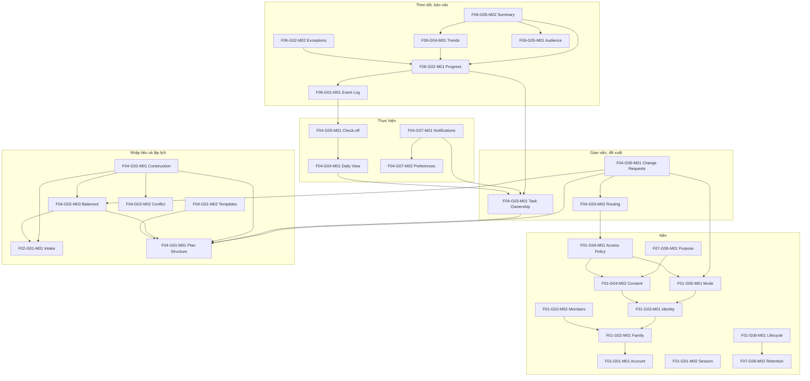

# Danh sách module nấc 1 (A-lite E1), bản chốt theo quyết định 15/11/2026

> **Cập nhật lượt 3 (15/11/2026):** chủ sản phẩm duyệt MQ-01, MQ-02 (nấc 1 = **32 module**, D-33); hoãn chuyển người quản lý chính (D-34); các câu MQ-03..MQ-10 theo đề xuất, xem sổ quyết định mục 7 (D-33..D-46).

**Bước:** Product Blueprint, chuẩn bị Kiến trúc thông tin (IA) và System Design cho nấc 1
**Người soạn:** AI, chưa kiểm chứng độc lập · **Trạng thái:** nháp chờ duyệt · **Bản:** 15/11/2026
**Đi kèm:** `IA_06_1_Information_Architecture.md` (cùng thư mục)
**Không thuộc phạm vi:** thiết kế giao diện, API, mô hình dữ liệu, thuật toán, chọn công nghệ. Không tạo Feature ID mới. Không đánh PASS cổng pháp lý nào. Không quyết thay chủ sản phẩm: chỗ nguồn thiếu hay mâu thuẫn thì chọn nhánh an toàn (fail-closed), gắn nhãn, đưa vào mục 9 kèm đề xuất.

---

## 0. Tóm tắt một trang

**Nấc 1 là gì.** Phụ huynh điền biểu mẫu có cấu trúc (thời khóa biểu, hoạt động cố định, quỹ giờ). Thuật toán tất định xếp lịch tuần, không AI. Lịch đồng bộ sang app riêng của con. Con bấm "Xong", được hỏi thăm sau giờ học. Phụ huynh nhận tóm tắt tuần. Con phải có máy riêng (D-11). Đây là nấc 1 của PA-3 (D-16). Pal trò chuyện là nấc 2.

**Con số.**

| Hạng mục | Số lượng | Ghi chú |
|---|---|---|
| Module A-lite v2 (gốc) | 29 | SHARED 2, MINIMAL 12, FULL 13, POLICY_OPERATIONAL 2; 0 module AI (A03 §1) |
| Thêm đã quyết | 1 | `F01-G02-M02` Member Relationships, mức MINIMAL (D-22) |
| **Danh sách chốt của nấc 1** | **30** | SHARED 2, MINIMAL 13, FULL 13, POLICY_OPERATIONAL 2; 0 module AI |
| Đề xuất thêm, chờ chủ sản phẩm | 2 | `F04-G06-M02` Change History, `F07-G01-M01` Content CMS (mức MINIMAL). Nếu duyệt: 32 |
| Đề xuất đổi mức | 1 | `F06-G04-M01` FULL xuống MINIMAL (hệ quả của D-21). Nếu duyệt: FULL 12 |
| Ngoài nấc 1 | xem mục 6 | Pal chat, ảnh, ghi âm, vùng GPS, báo đói, thời tiết, `CHILD_DIRECTED`, Journal, mục tiêu, gói… |

**Điều cần nhớ.**
1. Quyết định 15/11 làm đổi phạm vi của phần lớn module so với A-lite v2 (mục 3, cột "Thay đổi"); mức chi tiết chỉ đổi ở một chỗ (dòng 28, đề xuất). Thay đổi lớn nhất: D-19 ẩn `CHILD_DIRECTED`; D-20 mong muốn của con qua mẫu cố định; D-21 mệt chỉ tổng hợp trong báo cáo tuần, không ngưỡng; D-22 mời, gỡ thành viên; D-27 đóng băng tài khoản; D-28 rút đồng ý từng phần; D-26/D-30 nút "Con cần giúp đỡ".
2. **Thứ tự bắt buộc: FR-01 (tài khoản, ghép máy, Parent PIN, kiểm quyền phía máy chủ) làm trước khi thử với gia đình thật** (D-18, OD-A8). Mã gia đình chỉ dùng cho spike kỹ thuật không có người dùng thật.
3. Không cổng pháp lý nào PASS: MR-016 (căn cứ xử lý), H4 (thời hạn xóa), FR-03, danh mục mục đích, thẩm định số khẩn. Thử nội bộ chạy dưới ngoại lệ D-01 (tối đa 3 gia đình). 8 điều kiện của D-01 do AI đề xuất, chủ sản phẩm chưa xem.
4. D-17 (chưa chi tiền cho luật sư, chuyên gia) khiến nhiều cổng mở lâu hơn: câu chữ an toàn cho trẻ cần "chuyên gia duyệt" (D-26) nhưng chưa có kinh phí. Nhánh an toàn: tính năng gửi "Con cần nói chuyện" chỉ bật khi câu chữ đã được duyệt (mục 9, MQ-09).
5. Bốn chỗ User Flow chưa theo kịp quyết định mới: D-21 (bỏ ngưỡng), D-22 (mời thành viên), D-26/D-30 (nút giúp đỡ có gửi), D-27/D-28 (đóng băng, rút từng phần). IA bổ sung màn mới cho các chỗ này, gắn nhãn "MỚI, chờ duyệt".

---

## 1. Nguồn và cách đọc

**Thứ bậc khi nguồn khác nhau:** sổ quyết định 15/11 bản mới nhất (ODL, có D-31, D-32) thắng mọi nguồn cũ. Sau đó: sổ L4 và sổ quyết định APPROVED cũ; rồi tài liệu thiết kế; rồi tài liệu kiểm toán (đề xuất).

| Mã dẫn | File (chỉ đọc) |
|---|---|
| ODL | `app-design-document/progress/Owner_Decision_Log_20261115.md` (bản ở nhánh pr26, có D-31, D-32) |
| A03, A06, A07, A08 | `app-design-document/progress/phase-3-scoring/audit/03_A_Lite_Workflow_Validation.md`, `06_MVP_Readiness_Summary.md`, `07_Proposed_Change_Register.md` (PC-01..PC-16), `08_Research_Gaps_and_Decisions.md` (OD-A1..A8) |
| PC | `.../audit/data/phase_c.json` (danh sách 29 module và mức chi tiết), `.../audit/data/phase_b.json` (cạnh phụ thuộc v2) |
| INV | `.../review/data/inventory_106.json` (tên module) |
| MVP | `app-design-document/progress/MVP_Options_for_Owner_Decision.md` (mục 4: U-01..U-17; PA-1, PA-2, PA-3; câu hỏi Q1..Q10) |
| UF1, UF2 | `app-design-document/04_User_Flow/User_Flow_04_1_Scheduling_Loop.md`, `User_Flow_04_2_Remaining_Flows.md` |
| BL | `app-design-document/progress/Business_Logic_11_1_Scheduling_E1_DRAFT.md` |
| CRG | `app-design-document/progress/Constraint_Register_Approved_Decisions.md` |
| LQP | `app-design-document/progress/Legal_Question_Pack.md` |
| SPK | `app-design-document/progress/spike-e1-scheduler/Spike_E1_Scheduler_Report.md` |

**Ký hiệu mức** (theo `phase_c.json` `alite_v2_granularity_by_module`): `FULL` đủ năng lực của module; `MINIMAL` chỉ năng lực tối thiểu cho vòng lõi; `SHARED` dịch vụ nền dùng chung; `POLICY` (POLICY_OPERATIONAL) chủ yếu là quy trình, runbook, chính sách vận hành.

**Ký hiệu khác:** `[MỚI]` do quyết định 15/11, chưa có trong A-lite v2. `[ĐỀ XUẤT]` do AI đề xuất, chờ chủ sản phẩm. `UNKNOWN` nguồn không có số hay quyết định. ID L4 chưa cấp ổn định (BL §1.1: dùng `-001` tạm theo 3.2); bảng dưới chỉ ghi L3, L4 dạng `<L3>-001`.

---

## 2. Vòng lõi của nấc 1

Vòng lõi theo A03 §2, đã áp quyết định 15/11.

```mermaid
flowchart LR
  S0["0 Nền: tài khoản, ghép máy, đồng ý"] --> S1["1 Hồ sơ và đầu vào: thời khóa biểu, thẻ hoạt động"]
  S1 --> S2["2 Quỹ thời gian: 6 nhóm, preset, sàn, trần mềm"]
  S2 --> S3["3 Dựng lịch E1: mẫu, thứ tự, xê dịch 30 phút, kiểm xung đột và cân bằng"]
  S3 --> S4["4 Phê duyệt: phụ huynh lưu là duyệt; con gửi mong muốn hoặc đề xuất"]
  S4 --> S5["5 Thực hiện: Hôm nay, nhắc việc"]
  S5 --> S6["6 Ghi nhận: nút Xong"]
  S6 --> S7["7 Phản hồi: hỏi thăm sau giờ học"]
  S7 --> S8["8 Đánh giá: tóm tắt tuần, xu hướng mệt liên quan lịch"]
  S8 --> S9["9 Điều chỉnh: giai đoạn tạm thời, đổi chỉ tuần này, khóa lịch"]
  S9 --> S2
```

Khác với A03 §2: bước 4 không còn `CHILD_DIRECTED`; bước 7 "Rất mệt" không tự giảm tải (D-10); bước 8 không ngưỡng đếm (D-21); bước 9 hết hạn thì tự về lịch chuẩn mới nhất, không còn 3 lựa chọn (D-09, D-24).

---

## 3. Bảng module nấc 1 (30 module chốt)

Cột "Phụ thuộc": `*` là phụ thuộc cứng (HARD) theo `phase_b.json` `edges_v2`; không `*` là mềm. `(ngoài)` là module nằm ngoài danh sách nấc 1 (xem mục 6). Cột "Màn hình": mã `PA-xx`, `CA-xx` từ `User_Flow_04_1` §7 và `User_Flow_04_2` §14; `[MỚI]` là màn do IA bổ sung (xem `IA_06_1`, mục 1.3).

### 3.1 Nền: định danh, phân quyền, đồng ý, vòng đời

Nhóm này gồm các gói nền `B_AUTHZ`, `B_CHILD_SCOPE`, `B_LIFECYCLE` (MVP §1.2). **FR-01 nằm ở đây và phải xong trước thử với gia đình thật** (D-18).

| # | Mã L3 | Tên | Vai trò trong vòng lõi | Mức | Thay đổi so với A-lite v2 và lý do | Phụ thuộc | Màn hình |
|---|---|---|---|---|---|---|---|
| 1 | `F01-G01-M01` | Account Access | Bước 0: tài khoản người lớn, đăng nhập, khôi phục | SHARED | Mức không đổi. Dùng tài khoản FR-01 cho mọi thử với gia đình thật; mã gia đình chỉ cho spike (OD-A8 b, D-04, D-18, U-06). Thêm: đóng băng và mở lại (D-27). Phương pháp khôi phục `UNKNOWN` (UF-Q41) | không | PA-01, PA-37, PA-38, PA-39 `[MỚI]` |
| 2 | `F01-G01-M02` | Session Security | Bước 0: phiên máy, token, binding epoch, kiểm Parent PIN phía máy chủ | SHARED | Mức không đổi. Thêm: kiểm quyền phía máy chủ và thông báo hủy liên kết tối giản cho Parent App (CRG C-14, U-06). PIN chỉ là kiểm tra thêm, không thay kiểm quyền (FR01-1) | không | PA-14, PA-15, PA-38, CA-11, CA-12 |
| 3 | `F01-G02-M01` | Family Structure | Bước 0 và 1: hộ gia đình, hồ sơ con gắn hộ, ghép máy con | MINIMAL | Thêm cờ "con có thiết bị riêng" và nhánh "chỉ phần phụ huynh" (D-11, U-16). Ghép với hộ khác: từ chối (một hộ, FR-01 mục 5; MVP §1.4); xác minh hộ mới `NEEDS_POLICY/LEGAL` nằm ngoài nấc 1 | `F01-G01-M01`* | PA-03, PA-13, PA-35, CA-01, CA-02, CA-03, CA-17 |
| 4 | `F01-G02-M02` | Member Relationships | Bước 0: mời người lớn, nhận lời mời, gỡ, tự rời | MINIMAL | **[MỚI]** đưa vào nấc 1 ở mức tối thiểu (D-22). Phạm vi chốt: mời, nhận mời, gỡ, tự rời. Chuyển người quản lý chính chưa chốt, mặc định hoãn (MQ-04) | `F01-G02-M01`* | PA-28, PA-29, PA-31 |
| 5 | `F01-G03-M01` | Core Identity | Bước 1: hồ sơ con (tên gọi, tuổi, lớp) | FULL | Mức không đổi. Trường sức khỏe (dị ứng, thuốc) ẩn khi dùng dữ liệu thật tới khi có purpose ID đã duyệt (CRG C-07; UF-Q16). Dùng tên giả khi thử nghiệm kỹ thuật | `F01-G02-M01`* | PA-04, PA-06, PA-33 |
| 6 | `F01-G04-M01` | Access Policy | Nền: một điểm ALLOW/DENY duy nhất, mặc định từ chối | MINIMAL | Mức không đổi. Thêm: quyền đã cấp cho con giữ nguyên khi đổi người quản lý (D-07, U-12); tài khoản đóng băng thì từ chối (D-27); người lớn khác không xem xu hướng mệt nếu chưa được cấp (UF-Q30); người quản lý chính không đọc tin an toàn chỉ vì vai trò (CRG AP-OD-02). Hợp đồng tối thiểu theo CRG C-06 | `F01-G05-M01`*, `F01-G04-M02`* | mọi màn |
| 7 | `F01-G04-M02` | Consent Ledger | Bước 0: ghi đồng ý, ghi rút | MINIMAL | **Đổi phạm vi:** đồng ý và rút đồng ý ghi theo từng tính năng, không chỉ theo con (D-28). Thay nhánh "lịch chỉ xem" của UF-Q33 khi rút một phần: rút phần nào tắt phần đó, lịch vẫn chạy. Rút toàn bộ thì ngừng thu, tiến tới xóa; thời hạn xóa chờ luật sư (D-28, D-29) | `F01-G03-M01`* | PA-02, PA-32, CA-16 |
| 8 | `F01-G05-M01` | Mode State | Bước 4: chế độ tự chủ của từng con | MINIMAL | Chỉ `PARENT_LED` (gồm `UNSET`) và `CHILD_EXECUTED`; `CHILD_DIRECTED` ẩn (D-19, UF-Q23). Con xin đổi chế độ (`F01-G05-M02`) ngoài nấc 1 (UF-Q31) | `F01-G03-M01`* | PA-12, CA-08, CA-09 |
| 9 | `F07-G06-M01` | Purpose-bound Access | Nền: kiểm mục đích trước khi đọc | MINIMAL | Mức không đổi. Danh mục mục đích chưa duyệt thì hiện "đang chờ duyệt", không coi là cho phép (PBA-OD-02, PBA-OD-04) | `F01-G04-M02`* | PA-32, PA-33 |
| 10 | `F01-G06-M01` | Lifecycle Controls | Nền: xóa, rời gia đình, đóng băng | POLICY | **Thêm chức năng thật tối thiểu** (không chỉ runbook): đóng băng tài khoản sau 1 tháng không dùng, giữ nguyên dữ liệu (D-27); rút đồng ý toàn bộ thì ngừng thu (D-28). Thời hạn giữ và xóa `UNKNOWN`, chờ luật sư (H4, D-29). Bị chặn pháp lý khi dùng dữ liệu thật (A03 §1) | `F07-G06-M02`* | PA-35, PA-36, PA-39 `[MỚI]`, CA-17, CA-18 `[MỚI]` |
| 11 | `F07-G06-M02` | Retention & Export | Nền: xuất dữ liệu, xóa hẳn theo hạn | POLICY | Mức không đổi. Xóa hẳn và xuất với dữ liệu thật bị chặn H4. Thử nội bộ D-01: xóa khi kết thúc bằng runbook thủ công, ẩn ngay (tombstone, B02 bản REVIEW). Bị chặn pháp lý khi dùng dữ liệu thật (A03 §1) | không | PA-33, PA-34, PA-35 |

### 3.2 Nhập liệu và lập lịch (bước 1 đến 3)

| # | Mã L3 | Tên | Vai trò trong vòng lõi | Mức | Thay đổi so với A-lite v2 và lý do | Phụ thuộc | Màn hình |
|---|---|---|---|---|---|---|---|
| 12 | `F02-G01-M01` | Intake & Updates | Bước 1: nhập thời khóa biểu, thẻ hoạt động, tuổi/lớp | MINIMAL | Điểm bắt đầu là thời khóa biểu; mục tiêu là trường tùy chọn, không có module Goal (OD-A1 a, U-01). Nhập có cấu trúc, không Pal chat. Khối dùng `kind` có cấu trúc thay regex (BL B-11, M-12). Chủ thẻ hoạt động: giữ module này; `F02-G04-M01` là ứng viên khác (A03 SG-02; MQ-11) | không | PA-04, PA-05, PA-06, PA-07, PA-07a, PA-08 |
| 13 | `F04-G01-M02` | Plan Templates | Bước 2: quỹ mặc định theo tuổi, preset, mẫu theo lớp | FULL | Mức không đổi. Quỹ mặc định là [MĐ], gắn nhãn "mặc định chưa kiểm chứng", chờ thẩm định bước 14b (D-08, U-13). Thi cử, Nghỉ hè là ngoại lệ có hạn, không phải Standard Bar dài hạn (SC-001-D03) | `F04-G01-M01`*; `F03-G03-M01` (ngoài, mềm) | PA-09 |
| 14 | `F04-G02-M03` | Balanced Planning Validation | Bước 2, 5, 9: sàn cứng, quỹ, ngưỡng màu, "Giữ mức này", giai đoạn tạm thời | MINIMAL | Ô Ngủ không có "Giữ mức này" (D-02, U-08). Giai đoạn tối đa 60 ngày liên tục, cách nhau ≥7 ngày trống, không gia hạn (D-09, U-14); hết hạn tự về lịch chuẩn mới nhất, không mang phần nới, kể cả khi lịch khóa hay máy ngoại tuyến (D-24). Cho lưu lịch có thông số chưa kiểm chứng nếu không phạm sàn, luôn hiện nhãn "chưa kiểm chứng" (D-25). Ô Ngủ cam: nhánh an toàn, lịch vẫn xếp đủ mức tối thiểu (UF-Q14) | `F02-G01-M01`*, `F04-G01-M01`*; `F03-G03-M01` (ngoài, mềm) | PA-09, PA-10, PA-18, PA-19 |
| 15 | `F04-G02-M01` | Schedule Construction | Bước 3: bộ xếp lịch tuần tất định | FULL (E1) | Khôi phục E1 và đưa vào nấc 1 (PC-01, OD-A2 c, D-16). Thông số mặc định từ `out/params.json`, nhãn "mặc định chưa kiểm chứng" (D-08). **Bốn thông số D-23:** nghỉ giữa hai phiên học ≥5 phút; ngày học thêm tối thì hỏi bố mẹ một lần có bớt học ở nhà không, không tự bỏ; học thêm ngay sau giờ trường cần ≥15 phút phục hồi trước (cần code thêm, BL Q-BL-04); mỗi bữa chính ≥20 phút. Spike tự báo cáo lõi khả thi (SPK §1), chưa kiểm chứng độc lập; chất lượng thật chưa đo (CA-03) | `F04-G01-M01`*, `F02-G01-M01`*, `F04-G02-M03`*, `F04-G02-M02`* | PA-09, PA-10 |
| 16 | `F04-G02-M02` | Schedule Conflict | Bước 3: phát hiện chồng giờ, gợi ý slot khác | FULL | Mức không đổi. Chiều cạnh đã sửa: dựng lịch gọi kiểm xung đột (PC-05, P-E02) | không (được `F04-G02-M01` gọi) | PA-10 |
| 17 | `F04-G01-M01` | Plan Structure | Bước 4 và 9: lịch mẫu tuần có phiên bản, lock, commit | MINIMAL | Tách `DRAFT_SAVED` với `ACTIVE`; lịch phạm `protected_hard_cap` không kích hoạt được (CRG C-05, D-02). Lưu = phê duyệt ở `PARENT_LED`/`UNSET`. Khóa lịch thủ công đơn giản, bỏ "lock precedence" phức tạp (UF-Q27, A03 §5). Hết hạn giai đoạn là commit của hệ thống, ghi lịch sử (D-24). Mục tiêu và gợi ý đã duyệt là phụ thuộc mềm, không bắt buộc (OD-A1) | `F03-G04-M01` (ngoài, mềm), `F03-G05-M02` (ngoài, mềm) | PA-10, PA-11, PA-26 |

### 3.3 Giao việc, phê duyệt, đề xuất của con (bước 4)

| # | Mã L3 | Tên | Vai trò trong vòng lõi | Mức | Thay đổi so với A-lite v2 và lý do | Phụ thuộc | Màn hình |
|---|---|---|---|---|---|---|---|
| 18 | `F04-G03-M01` | Task Ownership | Bước 4 và 5: khối nào do ai làm, cách xác nhận (Xong, tự ghi, chờ bố mẹ) | FULL | Mức không đổi. Ở nấc 1, khối có cách xác nhận ảnh hay giọng nói hiện nút "Xong" thay thế (UF1 F4 bước 4) | `F04-G01-M01`*, `F04-G02-M01` (mềm, P-E01) | PA-10, PA-11, CA-04 |
| 19 | `F04-G03-M02` | Approval Routing | Bước 4: chuyển mong muốn, đề xuất tới người có quyền | MINIMAL | Một người duyệt. Không có Primary hợp lệ thì chặn sửa kế hoạch nhưng vẫn nhận đề xuất (CRG C-03). Người lớn hỗ trợ (Supporter, Observer) không duyệt (CR-OD-03) | `F01-G04-M01`* | PA-16, PA-17 |
| 20 | `F04-G06-M01` | Change Requests | Bước 4: Change Request của con ở `CHILD_EXECUTED`; mong muốn của con ở `PARENT_LED` | MINIMAL (mở rộng) | **Mong muốn của con qua mẫu cố định (lựa chọn có sẵn, không chữ tự do), giao module này, ghi thành change request L3** (D-20, UF-Q24, CRG C-04). Bảng vô hiệu khi đổi version, lock, người chăm sóc, mode, archive; hiệu lực tối đa 7 ngày kể từ lúc duyệt; `APPROVED` khác `APPLIED`; commit idempotent (D-07, U-12). Bỏ luồng sửa trực tiếp và lock của `CHILD_DIRECTED` (D-19) | `F04-G03-M02`*, `F04-G02-M03`*, `F04-G01-M01`*, `F01-G05-M01`* | PA-16, PA-17, CA-08, CA-09, CA-10 |

### 3.4 Thực hiện (bước 5 đến 7)

| # | Mã L3 | Tên | Vai trò trong vòng lõi | Mức | Thay đổi so với A-lite v2 và lý do | Phụ thuộc | Màn hình |
|---|---|---|---|---|---|---|---|
| 21 | `F04-G04-M01` | Daily Task View | Bước 5: tab "Hôm nay" của con, nhãn "Bây giờ", tiến độ x/y, không điểm | FULL | Chỉ nút "Xong" và "Hoàn tác"; ảnh, giọng nói, báo đói, thời tiết là nấc 2. Máy con giữ bản sao lịch chuẩn và lịch giai đoạn để về đúng ngày khi ngoại tuyến (D-24). Con không có máy thì không có màn này (D-11) | `F04-G03-M01`* | CA-04, CA-13 |
| 22 | `F04-G05-M01` | Lightweight Check-off | Bước 6 và 7: bấm Xong; hỏi thăm "Ổn / Hơi mệt / Rất mệt" | FULL | Chủ của tín hiệu mệt (OD-A7 a, U-05). **"Rất mệt" chỉ ghi nhận, không tự đổi lịch** (D-10, U-15); con đi qua mong muốn hoặc đề xuất. Báo đói thuộc nấc 2. Lời mời hỏi thăm tùy chọn, tắt được; tắt khi phụ huynh rút đồng ý phần này (D-28) | `F04-G04-M01`* | CA-04, CA-05 |
| 23 | `F04-G07-M01` | Schedule Notifications | Bước 5: nhắc theo khối, báo thức, đặt lại nhắc sau commit, thông báo giữa hai máy | FULL | Thêm loại thông báo: đóng băng và mở lại (D-27). Thông báo chỉ gửi sau commit (UF1 §0.6). Nhắc lệch +45 giây trong test Plan A ngày 05/11 (MVP §1.1), mục tiêu ≤1 phút không phải quy tắc sản phẩm. Plan A dừng (D-31), số đo vẫn là tham khảo | `F04-G03-M01`*, `F04-G07-M02`* | CA-06, CA-15, PA-15, PA-23, CA-20 `[MỚI]` |
| 24 | `F04-G07-M02` | Notification Preferences | Bước 5: tùy chọn thông báo, giờ yên lặng | MINIMAL | Giờ yên lặng mặc định `UNKNOWN` (UF-Q11, UF-Q32). Loại bắt buộc không tắt được: ghép/hủy liên kết, đóng băng, an toàn tĩnh (UF2 G3) | không | PA-27, PA-23, CA-15 |

### 3.5 Theo dõi và báo cáo (bước 6 đến 8)

| # | Mã L3 | Tên | Vai trò trong vòng lõi | Mức | Thay đổi so với A-lite v2 và lý do | Phụ thuộc | Màn hình |
|---|---|---|---|---|---|---|---|
| 25 | `F06-G01-M01` | Activity Event Log | Bước 6: nhật ký sự kiện (Xong, giờ, hoàn tác) | FULL | Không lưu vị trí, ảnh, ghi âm ở nấc 1. Ghi nhận theo từng tính năng đồng ý (D-28) | `F04-G05-M01`*; `F06-G01-M02` (ngoài, mềm) | PA-11, PA-21, CA-13 |
| 26 | `F06-G02-M01` | Progress Rules | Bước 8: tính tiến độ từ nhật ký | FULL | Mức không đổi. Ghi rõ đây là tự báo cáo, không phải tiến bộ năng lực (03.4 §6.4) | `F06-G01-M01`*, `F04-G03-M01`* | PA-21 |
| 27 | `F06-G02-M02` | Progress Exceptions | Bước 8: ngày ốm, nghỉ, giảm tải không tính "chưa xong" | FULL | Mức không đổi (PC-04) | `F06-G02-M01`* | PA-21, PA-20 |
| 28 | `F06-G04-M01` | Deterministic Trends | Bước 8: tổng hợp xu hướng mệt liên quan lịch cho báo cáo tuần | FULL, **đề xuất MINIMAL** | **Chỉ tổng hợp trong báo cáo cuối tuần, không báo lẻ tẻ, không cần ngưỡng** (D-21, thay phần ngưỡng của D-03). Không hiện lựa chọn từng ngày, không cảm xúc, không nguyên văn (D-03). Hệ quả: không còn phát hiện mẫu 2 tuần theo ngưỡng, nên mức MINIMAL là đề xuất (MQ-05). Nội dung cụ thể của tóm tắt khi không có ngưỡng: chờ chủ sản phẩm (MQ-05) | `F06-G02-M01`* | PA-21 |
| 29 | `F06-G05-M01` | Audience Views | Bước 8: ai thấy phần nào của báo cáo | MINIMAL | Mức không đổi. Phụ huynh chính thấy xu hướng; người lớn hỗ trợ không thấy nếu chưa được cấp (UF-Q30); con thấy tuần của mình và dòng giải thích bố mẹ thấy gì (D-03, CA-16) | không | PA-21, CA-13, CA-16 |
| 30 | `F06-G05-M02` | Summary Rendering | Bước 8: dựng tóm tắt tuần | FULL | Mức không đổi. Tần suất và giờ gửi tóm tắt `UNKNOWN` (UF-Q11). Câu chữ cố định theo quy tắc Pal, không sinh bằng AI (UF1 §0.6 mục 6) | `F06-G02-M01`*, `F06-G05-M01`*, `F06-G04-M01` | PA-21, PA-25 |

**Đếm kiểm:** mục 3.1 có 11 dòng, 3.2 có 6, 3.3 có 3, 3.4 có 4, 3.5 có 6; tổng 30. SHARED: dòng 1, 2. POLICY: dòng 10, 11. MINIMAL: dòng 3, 4, 6, 7, 8, 9, 12, 14, 17, 19, 20, 24, 29 (13). FULL: dòng 5, 13, 15, 16, 18, 21, 22, 23, 25, 26, 27, 28, 30 (13).

### 3.6 Đề xuất thêm (chờ chủ sản phẩm duyệt)

| # | Mã L3 | Tên | Vai trò | Mức | Vì sao đề xuất, và nếu không thêm thì sao | Màn hình |
|---|---|---|---|---|---|---|
| P1 | `F04-G06-M02` | Change History | Bước 4 và 9: lịch sử phiên bản lịch, ai lưu, khi nào, lý do | MINIMAL | UF1 F2 bước 14 và UF2 G1 giao lịch sử cho module này, nhưng A-lite v2 không có (A03 §3 dòng "Schedule revisions" ghi nó, danh sách 29 thì không). BL §1.1 đưa vào E1 ("Giao diện"). Cần cho audit đổi mode, CR, hết hạn giai đoạn (D-24). Nếu không thêm: chỉ giữ phiên bản trong `F04-G01-M01` và bỏ PA-25 (MQ-01) | PA-25 |
| P2 | `F07-G01-M01` | Content CMS (gói nội dung tĩnh) | Nền an toàn: nội dung tĩnh 115/113/111 cho người lớn; lời an toàn cho trẻ | MINIMAL | PA-24 và CA-14 đều thuộc nấc 1 (D-06; D-26 đưa nút "Con cần giúp đỡ" vào Child App). Nội dung phải tách theo người nhận (D-06) và lưu sẵn trên máy, dùng được ngoại tuyến (UF2 G8-X1). A-lite v2 chỉ tính module này ở biến thể Plan A. Chỉ cần gói nội dung cố định, chưa cần quy trình biên tập (`F07-G02-M01` vẫn ngoài). Nếu không thêm: nội dung nằm cứng trong app, không có chủ module (MQ-02) | PA-24, CA-14 |

Phương án thay thế cho dò từ khóa trên ô chữ tự do của phụ huynh: UF1 §0.6 mục 1 đề xuất bộ kiểm từ khóa [E1] (`F07-G05-M01`). Đề xuất của tài liệu này là **không dò từ khóa ở nấc 1**; thay bằng lối vào "Hỗ trợ khẩn cấp" cố định và dòng nhắc dưới các ô chữ tự do, vì danh sách từ khóa cần thẩm định (cổng B-6), chưa có kinh phí (D-17), và dò sót tạo cảm giác an toàn giả. `F07-G05-M01` còn nằm trong nhóm bị chặn pháp lý của biến thể Plan A (PC `plana_legal_blocked`). Xem MQ-02.

---

## 4. Phụ thuộc giữa các module

Ghi chú:
1. **Đường găng của nấc 1 (theo thứ tự xây):** `F01-G01-M01` → `F01-G02-M01` → `F01-G03-M01` → `F01-G04-M02` → `F01-G05-M01` → `F01-G04-M01` (FR-01 và nền, xong trước thử); song song `F02-G01-M01` → `F04-G01-M01` → `F04-G02-M03` → `F04-G02-M01` + `F04-G02-M02`; rồi `F04-G03-M01` → `F04-G04-M01` → `F04-G05-M01` → `F06-G01-M01` → `F06-G02-M01` → các module báo cáo.
2. `F04-G01-M01` và `F04-G02-M01` có phụ thuộc mềm vào module ngoài nấc 1 (`F03-G04-M01`, `F03-G05-M02`, `F03-G03-M01`). Với OD-A1 (mục tiêu tùy chọn), nấc 1 không cần chúng; mẫu theo tuổi lấy từ `F04-G01-M02`.
3. Cạnh E029 đã đổi chiều: dựng lịch gọi kiểm xung đột (PC-05, P-E02). PC-05 và PC-06 (cạnh P-E01..P-E06) vẫn ở trạng thái đề xuất, chờ rà MR-040 (A07).
4. Thông báo "Con cần nói chuyện" (D-26, D-30) cần `F04-G07-M01` và một chỗ định tuyến tới người lớn con chọn. Chưa có module chủ: MQ-03.
5. Phụ thuộc kỹ thuật ngoài danh sách module (gửi đẩy, hạ tầng máy chủ, lưu trữ) thuộc System Design, không bàn ở đây.

---

## 5. Quyết định 15/11 đã áp vào danh sách

| Mã | Nội dung (rút gọn) | Module bị tác động | Ghi chú |
|---|---|---|---|
| OD-A1 (a) | Bắt đầu từ thời khóa biểu; mục tiêu tùy chọn | `F02-G01-M01`, `F04-G01-M01`; `F03-G04-M01` ngoài | UC-007 vẫn có điều kiện "mục tiêu đã duyệt" trong 3.4: cần change proposal (BL Q-BL-14, chưa quyết) |
| OD-A2 (c) | A-lite E1 trước, 29 module, không AI | cả danh sách | |
| OD-A3 (a) | Ánh xạ vùng GPS vào `F08-G04-M01/M02`… | ngoài nấc 1 | Vùng GPS là nấc 2; Plan A dừng (D-31) |
| OD-A6 (b) | Hội thoại Pal: `F07-G03` entry, `F03-G05` outcome | ngoài nấc 1 | Chỉ nấc 2 |
| OD-A7 (a) | Tín hiệu mệt, đói thuộc `F04-G05` | `F04-G05-M01` | Báo đói là nấc 2 |
| OD-A8 (b), D-04 | Mã gia đình chỉ cho spike; FR-01 trước pilot gia đình thật | `F01-G01-M01/M02`, `F01-G02-M01`, `F01-G04-M01` | |
| D-01, D-18 | Ngoại lệ thử nội bộ có giới hạn; áp cho A-lite E1; FR-01 xong trước thử | cổng (mục 7) | 8 điều kiện do AI đề xuất, chờ chủ sản phẩm xem |
| D-02 | Ô Ngủ không có "Giữ mức này" | `F04-G02-M03`, `F04-G01-M01` | |
| D-03, D-21 | Báo xu hướng mệt liên quan lịch; chỉ trong báo cáo cuối tuần; không ngưỡng; trẻ được biết | `F06-G04-M01`, `F06-G05-M01/M02`, `F04-G05-M01` | Ngưỡng UF-Q20 đóng |
| D-06 | Lời an toàn tách theo người nhận | `F07-G01-M01` (đề xuất) | Trẻ: "nói với người lớn tin cậy", có thể 111; người lớn: 115, 113, 111 |
| D-07 | Đổi người quản lý chính: quyền cũ của con giữ nguyên | `F01-G04-M01`, `F04-G06-M01` | |
| D-08, D-25 | Thông số mặc định chưa kiểm chứng; lưu được, luôn hiện nhãn | `F04-G02-M01`, `F04-G02-M03`, `F04-G01-M02` | Thẩm định bước 14b chưa có kinh phí (D-17) |
| D-09, D-24 | Giai đoạn ≤60 ngày; hết hạn tự về lịch chuẩn mới nhất | `F04-G02-M03`, `F04-G01-M01`, `F04-G04-M01`, `F04-G07-M01` | Máy ngoại tuyến phải về đúng ngày |
| D-10 | "Rất mệt" không tự đổi lịch | `F04-G05-M01`, `F04-G06-M01` | Spec chuẩn QT G3, TAB §4 còn trái; D-15 giao sửa |
| D-11 | App yêu cầu con có thiết bị | `F01-G02-M01`, `F04-G04-M01` | Không máy: chỉ phần phụ huynh |
| D-19 | `CHILD_DIRECTED` ẩn | `F01-G05-M01`, `F04-G06-M01` | CA-09b không có |
| D-20 | Mong muốn của con qua mẫu cố định, giao `F04-G06-M01` | `F04-G06-M01` | Ghi thành change request L3 (việc chưa làm) |
| D-22 | Mời, gỡ thành viên ở mức tối thiểu | `F01-G02-M02` | |
| D-23 | Bốn thông số lập lịch | `F04-G02-M01`, `F04-G02-M02` | Nhãn "mặc định chưa kiểm chứng" |
| D-26, D-30 | "Con cần giúp đỡ": mặc định không ghi, không tự báo; con có thể gửi "Con cần nói chuyện" cho người lớn con chọn, gợi ý bố mẹ | `F07-G01-M01` (đề xuất), `F04-G07-M01`; chủ gửi chưa gán | MQ-03, MQ-09 |
| D-27 | Đóng băng tài khoản sau 1 tháng không dùng | `F01-G06-M01`, `F01-G01-M01`, `F04-G07-M01` | Không đóng băng nếu người lớn khác còn dùng |
| D-28, D-29 | Rút đồng ý từng phần chỉ tắt tính năng đó | `F01-G04-M02`, `F01-G06-M01`, các module có tính năng tắt được | Thêm LQ-14, LQ-15 vào LQP |
| D-31 | Dừng Plan A (app Expo 5 tính năng) | ngoài nấc 1 | `mobile/`, `supabase/` giữ để tham khảo, không dựng tiếp |
| D-12..D-17, D-32 | Quy trình (PR, prototype giữ nguyên, sửa spec, chọn PA-3, chưa chi tiền, agent) | không phải module | D-15 giao sửa `spec-quy-tac-lap-lich.md`, `spec-quy-thoi-gian-va-tab-cua-con.md`, CLAUDE.md, skill |

### 5.1 Trạng thái các thay đổi U-01..U-17 (MVP §4)

| Mã | Tình trạng sau 15/11 |
|---|---|
| U-01 (OD-A1 a) | Đã áp (mục 5). Cần change request cho UC-007 |
| U-02 (OD-A2 c, mốc chuyển nấc 2 M1..M10) | Đã áp; mốc M1..M10 là đề xuất của MVP §2 PA-3, chưa duyệt |
| U-03 (OD-A3 a, vùng GPS) | Đã duyệt ánh xạ, nhưng vùng GPS ngoài nấc 1 và Plan A dừng (D-31) |
| U-04 (OD-A6 b) | Chỉ nấc 2 |
| U-05 (OD-A7 a) | Đã áp |
| U-06 (OD-A8 b, D-04) | Đã áp, được D-18 siết: FR-01 trước thử gia đình thật |
| U-07 (D-01) | Đã áp; **Q2 và Q3 của MVP §5 được D-18 đóng**: ngoại lệ áp cho A-lite E1 và phải xong FR-01 trước. Đề xuất (a) cho Q3 trước đây (dùng mã gia đình) không còn dùng |
| U-08 (D-02) | Đã áp |
| U-09 (D-03) | Đã áp, bị D-21 thay phần ngưỡng |
| U-10 (D-05) | Không ảnh hưởng nấc 1 (không tra mạng) |
| U-11 (D-06) | Đã áp; thêm D-26, D-30 |
| U-12 (D-07) | Đã áp vào `F04-G06-M01`, `F01-G04-M01` |
| U-13 (D-08) | Đã áp, kèm D-23, D-25 |
| U-14 (D-09) | Đã áp, kèm D-24 (thay đề xuất Q6 của MVP: hết hạn tự về, không còn 3 lựa chọn) |
| U-15 (D-10) | Đã áp |
| U-16 (D-11) | Đã áp |
| U-17 (trạng thái A06) | Adversarial MVP Review (OD-A5) chưa thấy bản ghi hoàn thành trong repo |

### 5.2 Trạng thái các thay đổi PC-01..PC-16 (A07) trong danh sách này

A07 ghi mọi mục là `PROPOSED`. Danh sách này áp như sau; riêng việc duyệt từng mục không có bản ghi riêng (OD-A4 chỉ duyệt các mục `CONFIRMED_SOURCE`, mục `JUDGMENT` chờ OD-A5).

| PC | Cách áp trong danh sách nấc 1 |
|---|---|
| PC-01 `F04-G02-M01` E1 | Có (dòng 15) |
| PC-02 `F04-G02-M03`, `F03-G03-M01` | Có cho `F04-G02-M03`; `F03-G03-M01` ngoài (mềm) |
| PC-03 `F04-G06-M01`, `F04-G03-M02`, `F01-G05-M01` | Có, thu hẹp theo D-19, mở rộng theo D-20 |
| PC-04 `F06-G04-M01`, `F06-G02-M02` | Có, `F06-G04-M01` đổi theo D-21; chủ tín hiệu mệt = `F04-G05` (OD-A7) |
| PC-05, PC-06 (cạnh) | Dùng chiều mới; còn chờ rà MR-040 |
| PC-07 (mincap) | Dùng cột Mức; còn chờ addendum phương pháp |
| PC-08 `B_AI_GATE` | Áp: nấc 1 không có đường E2 nên không cần gói AI |
| PC-09 | Chỉ ghi lại |
| PC-10 chi phí AI | Chỉ liên quan nấc 2 |
| PC-11 vùng GPS | Ngoài nấc 1 |
| PC-12 hội thoại Pal | Ngoài nấc 1 (OD-A6) |
| PC-13 rubric R1.2 | Không đổi danh sách |
| PC-14 `F02-G05-M02` | Ngoài nấc 1; tín hiệu mệt về `F04-G05` |
| PC-15 `F04-G02-M03`, `F03-G03-M01` | Có (60/7 ngày, `protected_hard`/`family_hard`, Bar `UNKNOWN`, chỉ sàn ngủ là [NC]) |
| PC-16 hai biến thể | Chọn A-lite E1 (29, nay 30) làm nấc 1; Plan-A (40) là nấc 2 |

---

## 6. NGOÀI nấc 1 (để nấc 2 hoặc sau)

| Hạng mục | Module / mã | Để khi nào | Lý do, nguồn |
|---|---|---|---|
| Pal trò chuyện với phụ huynh, nhập lịch bằng lời, Pal diễn đạt đánh đổi | `F07-G03-M01/M02`, `F05-G01`, `F03-G05`, PA-22 | Nấc 2 | OD-A2 (c), OD-A6 (b). Cần: kho tri thức đã duyệt, phạm vi OD-05, kiểm đầu ra trước khi phát. Plan A dừng (D-31) nên **chưa có lịch cho nấc 2** |
| Gói AI: Policy Evaluation, Model Evaluation, Execution Budget, Editorial Workflow | `F07-G04-M01/M02`, `F07-G03-M02`, `F07-G02-M01` | Nấc 2 | Nấc 1 không có đường E2 (PC-08) |
| Lớp an toàn trước AI (kiểm chữ tự do, kiểm đầu ra) | `F07-G05-M01` | Nấc 2 (hoặc nấc 1 nếu MQ-02 chọn dò từ khóa) | Chặn pháp lý khi chữ của trẻ (FR-03, CRG C-10) |
| Human Response Workflow | `F07-G05-M02` | Hoãn | REM-HRW: luồng an toàn của trẻ không tự báo gia đình |
| Chụp ảnh bài làm, AI nhận xét ảnh | `F04-G05-M02`, `F06-G07-M01` | Nấc 2; AI chấm ảnh chỉ pilot có kiểm soát | CRG C-13, CP-06-6 |
| Ghi âm, "Kể cho Pal" | `F07-G03-M03` | Nấc 2 | CRG C-12 (có phải Journal không) |
| Vùng GPS (Nhà, Trường, nơi học thêm) | `F08-G04-M01/M02` | Nấc 2 | Chưa có purpose "vị trí" (CRG C-08), LQ-06, C-15 |
| Báo đói; nhắc thời tiết "Soạn cặp" | `F04-G05-M01` phần mở rộng, `F04-G04-M01` | Nấc 2 | UF1 F4 bước 8, 9 |
| `CHILD_DIRECTED` và luồng sửa trực tiếp, khóa theo phạm vi ủy quyền | `F01-G05-M01`, `F04-G06-M01` | Sau nấc 1 | D-19 (ẩn) |
| Con xin đổi chế độ | `F01-G05-M02` | Sau nấc 1 | UF-Q31 |
| Mục tiêu phát triển, xem lại mục tiêu | `F03-G04-M01`, `F03-G06`, `F06-G06-M01/M02` | Tùy chọn / sau | OD-A1 (a); UC-005, UC-006, UC-016 |
| Danh mục giai đoạn phát triển | `F03-G03-M01` | Tùy chọn | Phụ thuộc mềm; mẫu theo lớp dùng `F04-G01-M02` |
| Hỏi dần hồ sơ bổ sung theo nguồn | `F02-G01-M02` | Sau | UF1 F1 liên kết |
| Nguồn dữ liệu của sự kiện | `F06-G01-M02` | Tùy chọn | Phụ thuộc mềm |
| Con xem và phản đối nhận định về mình | `F02-G05-M01/M02` | Ngoài A-lite | UC-004, K8, PC-14 |
| Nhật ký riêng và insight của con (Journal) | `F05-G04..G06`, `F07-G06-M02` phần Journal | Ngoài A-lite (W3) | UC-013, UC-014, K3 |
| Con trò chuyện với Pal | `F05-G01-M01/M02` | Ngoài A-lite (W3) | FR-03 chặn thật; UC-011, UC-012 |
| Gói trả phí, quyền lợi | `F01-G06-M02/M03`, `F07-G07-M02` | Ngoài A-lite | UC-023, K7; chưa chốt giá |
| Chuyển người quản lý chính (PA-30) | `F01-G02-M02` phần chuyển | **Hoãn (mặc định)** | Xác minh người mới `UNKNOWN` (LQ-02, LQ-03); xem MQ-04 |
| Ghép khác hộ, xác minh quyền quản lý trẻ | `F01-G02-M01` phần FR-01B | Sau | `NEEDS_POLICY/LEGAL`; nấc 1 từ chối |
| Máy trạng thái CR đầy đủ (TTL, lock precedence, OUTCOME_UNKNOWN), engine Access Policy đầy đủ, xóa nhiều tầng | `F04-G06-M01`, `F01-G04-M01`, `F01-G06-M01` | Sau | A03 §5 "quá mức cho pilot"; giữ phần đã duyệt (CR-OD-02, B01C-OD-03) |
| Họp gia đình, việc một lần, nhập lịch ngoài, thanh toán, check-in cảm xúc chung | `F06-G06-M01` và khác | Sau | A03 §5; PS-OD-04 |
| Hướng dẫn cho nấc 2 trong prototype, skill | `prototype/index.html`, skill `lap-lich-sinh-hoat-tre` | Quy trình | D-14: giữ prototype nguyên; D-15: sửa spec, CLAUDE.md rồi skill |

---

## 7. Cổng pháp lý và an toàn phải qua trước thử nội bộ

**Không cổng nào PASS.** Bảng này chỉ ghi điều kiện trước khi thử với dữ liệu thật của trẻ. Các cổng pháp lý chặn dữ liệu thật; ngoại lệ D-01 cho phép thử có giới hạn nhưng không biến cổng thành đạt và không áp cho pilot rộng hơn.

Thứ tự đề xuất (từ trên xuống):

| # | Cổng / điều kiện | Trạng thái theo nguồn | Chặn gì | Nguồn |
|---|---|---|---|---|
| 1 | **FR-01 xong trước:** tài khoản người lớn, ghép máy con, Parent PIN, kiểm quyền phía máy chủ, thông báo hủy liên kết tối giản | Bắt buộc (quyết định). Chưa xây. Phương pháp khôi phục, thời hạn mã ghép, số lần thử PIN: `UNKNOWN` (UF-Q10, UF-Q41) | Mọi thử với gia đình thật | D-18, OD-A8 (b), D-04, CRG C-14, FR-01 |
| 2 | Chủ sản phẩm xem và chốt **8 điều kiện của D-01**; viết lại điều kiện "chỉ thu dữ liệu cần cho 5 tính năng thử" cho các chức năng của nấc 1 | Điều kiện do AI đề xuất, chờ chủ sản phẩm xem. Câu chữ "5 tính năng" thuộc Plan A (MQ-06) | Thử nội bộ | ODL D-01, D-18; MVP §1.3 |
| 3 | Phiếu đồng ý của bố mẹ và lời giải thích cho trẻ bằng lời dễ hiểu (CA-16) | Chưa soạn. Điều 20 NĐ 13/2023 cần người có chuyên môn xác nhận còn hiệu lực (LQ-02); chưa có kinh phí luật sư (D-17) | Thử nội bộ | D-01; LQP LQ-02; UF2 G6; UF-Q42 |
| 4 | **Giới hạn D-01:** tối đa 3 gia đình; hạn kết thúc; xóa khi kết thúc; không đưa dữ liệu lên repo công khai; không dùng mục đích khác | Chưa có ngày kết thúc, chưa có runbook xóa | Thử nội bộ | D-01, B02 (bản REVIEW) |
| 5 | Adversarial MVP Review do phiên Claude khác (OD-A5) | Chưa thấy bản ghi đã làm | Bắt đầu phát triển theo phương án đã chọn | OD-A5; A06 §8; MVP §1.3 |
| 6 | Câu chữ an toàn tĩnh (người lớn 115/113/111; trẻ "nói với người lớn tin cậy", có thể 111) được người có chuyên môn duyệt; danh sách số khẩn được xác minh | Chưa duyệt (cổng B-6). D-17 chưa chi tiền. Nhánh an toàn: chỉ phát hành đúng câu OD-03a, tắt tính năng gửi "Con cần nói chuyện" tới khi câu chữ được duyệt | PA-24, CA-14, CA-19 | OD-03a, OD-03b, D-06, D-26, D-30; CRG B-6 |
| 7 | Căn cứ pháp lý xử lý dữ liệu trẻ (MR-016, LQ-01, LQ-02, LQ-11) | UNKNOWN | Dữ liệu thật ngoài ngoại lệ D-01 | CRG B-1; PA-OD-04 |
| 8 | H4: thời hạn xóa (LQ-04), thời hạn giữ khi đóng băng (LQ-15), thời hạn xóa khi rút đồng ý (LQ-14) | Mở. D-29 thêm LQ-14, LQ-15 | Xóa hẳn và xuất với dữ liệu thật; chốt hạn giữ khi đóng băng | CRG B-2; LQP; D-27, D-28, D-29 |
| 9 | FR-03: xử lý yêu cầu của trẻ khi chưa rõ căn cứ | Mở. Nấc 1 tránh bằng cách không có chữ tự do phía con (UF-Q15). Nút "Con cần giúp đỡ" gửi mẫu cố định, không chữ tự do (xem MQ-09) | Mọi ô chữ của trẻ | CRG B-3, C-10; LQP LQ-09 |
| 10 | Danh mục mục đích (sức khỏe, vị trí) | Chưa duyệt. Nấc 1: ẩn trường sức khỏe, không thu vị trí | Hồ sơ sức khỏe; vùng GPS | CRG B-4, C-07, C-08; LQ-06, LQ-07 |
| 11 | Chuyển dữ liệu ra nước ngoài (máy chủ, dịch vụ đẩy thông báo) | UNKNOWN | Cả A-lite E1 | LQP LQ-08 |
| 12 | PIA / DPIA | Chưa làm | Dữ liệu thật | MR-021, LQ-05 |
| 13 | Bốn module nền chưa kiểm độc lập: `F01-G04-M01`, `F01-G04-M02`, `F01-G05-M01`, `F07-G06-M01` | Mở | Độ tin cậy của lõi định danh | A03 §1; CRG B-7 |
| 14 | Thẩm định thông số mặc định [MĐ] và Bar mặc định (bước 14b) | Chưa có kinh phí (D-17). Nhãn "chưa kiểm chứng" luôn hiện; D-25 cho phép lưu | Gỡ nhãn "chưa kiểm chứng" | D-08, D-25; CRG B-6 |

**Cổng kỹ thuật cần đo, không phải cổng pháp lý:** độ tin cậy nhắc việc trên Android (đã đo +45 giây trong Plan A; mục tiêu ≤1 phút; Plan A dừng), chất lượng lịch E1 với phụ huynh thật (CA-03), tái dùng mã `mobile/` (UNKNOWN).

---

## 8. Câu hỏi đã được quyết định, còn mở, và hệ quả lên module

### 8.1 Đã đóng bởi quyết định 15/11

| Câu hỏi | Quyết định | Ghi chú |
|---|---|---|
| MVP Q1, Q2, Q3 | PA-3 (D-16); D-01 áp cho E1, FR-01 trước (D-18) | |
| MVP Q4 (chế độ pilot) | Ẩn `CHILD_DIRECTED` (D-19) | |
| MVP Q5, UF-Q24 | Mẫu cố định, giao `F04-G06-M01` (D-20) | Còn việc ghi change request L3 |
| MVP Q8 | Chưa chi tiền (D-17) | |
| MVP Q9 | Sửa spec, CLAUDE.md, skill (D-15); prototype giữ nguyên (D-14) | |
| UF-Q20 | Không ngưỡng (D-21) | |
| UF-Q23, UF-Q19, UF-Q05 | `CHILD_DIRECTED` ẩn (D-19) nên không phát sinh | |
| UF-Q26 | Có, mức tối thiểu (D-22) | |
| UF-Q37 | Nút "Con cần giúp đỡ" có trong Child App (D-26, D-30) | Thay đổi so với đề xuất của UF: có gửi tùy chọn |
| UF-Q21 | Về đúng ngày kể cả máy ngoại tuyến, kể cả lịch khóa (D-24) | |
| BL Q-BL-01..04 | Theo D-23 | Nghỉ ≥5 phút; hỏi một lần bớt học tối; ≥15 phút phục hồi; ≥20 phút/bữa |
| BL Q-BL-06, Q-BL-07, Q-BL-09 | Theo D-24, D-25 | |
| BL Q-BL-10 | Không ngưỡng (D-21) | |
| BL Q-BL-08 | Không phát sinh (D-19) | |

### 8.2 Còn mở, ảnh hưởng nấc 1

| Mã | Câu hỏi | Mặc định đang dùng trong tài liệu này |
|---|---|---|
| UF-Q06, Q-BL-13 | Mong muốn ở `PARENT_LED` có hết hạn, có báo con "bố mẹ đã xem"? | Không hết hạn; chưa báo |
| UF-Q08, Q-BL-11 | Hai giai đoạn khác loại chồng nhau | Từ chối, mỗi con một giai đoạn |
| UF-Q09, Q-BL-12 | Ngoại lệ "chỉ tuần này" tự hết khi nào | Theo ngày, tự hết khi qua ngày |
| UF-Q10, Q11, Q12 | Mã ghép, PIN, giờ yên lặng, tần suất tóm tắt, ngoại tuyến | `UNKNOWN`, giao System Design |
| UF-Q14, Q-BL-05 | Ô Ngủ cam | Cảnh báo; lịch vẫn xếp đủ mức tối thiểu |
| UF-Q16 | Trường sức khỏe | Ẩn khi dùng dữ liệu thật |
| UF-Q17 | Dùng chung máy phụ huynh làm máy con | Không |
| UF-Q18 | Phụ huynh xem lựa chọn từng ngày | Không |
| UF-Q22 | Báo xu hướng mệt trong giai đoạn tạm thời | Có, vì là tín hiệu mới (nay chỉ trong báo cáo tuần) |
| UF-Q25 | CR đổi lịch "hôm nay" không được duyệt trong ngày | Giữ chờ tới 7 ngày |
| UF-Q27, Q28 | Khóa lịch vào E1; tần suất nhắc xem lại | Có, khóa thủ công đơn giản; `UNKNOWN` |
| UF-Q29, Q30, Q31 | Primary không còn hoạt động; REVIEW_REQUIRED; báo con khi đổi mode | Chặn sửa kế hoạch, không ai tự nâng quyền; có; báo con |
| UF-Q33 | Chưa đồng ý bản chính sách mới | Không xử lý theo mục đích mới; dữ liệu cũ vẫn xem. Phần "rút đồng ý" đã được D-28 thay |
| UF-Q34..36, Q39..Q43 | Hạn xóa, con xóa dữ liệu hỏi thăm, khoảng chờ hoàn tác, khôi phục tài khoản, CA-16, xuất dữ liệu | Theo nhánh an toàn của UF2 §15 |
| Q-BL-14 | Change proposal cho UC-007 khi không có mục tiêu | Chưa lập |
| Q-BL-15 | Ngày lễ giữa tuần dùng cột quỹ nào | Cột cuối tuần |
| MVP Q6 | Sau khi tự về lịch cũ có hiện lựa chọn? | D-24 chọn tự về, không mang phần nới; không còn 3 lựa chọn. Nút "Xếp lại lịch" chỉ hiện khi thẻ hoạt động đổi |
| MVP Q7 | Tiêu chí thành công và dừng | Chủ sản phẩm chưa chốt; với ≤3 gia đình dùng định tính (đề xuất (c) của MVP) |
| MVP Q10 | Dùng mã `mobile/` thế nào | D-31: giữ để tham khảo, không dựng tiếp. Có tái dùng cho nấc 1 hay dựng mới: chưa quyết (MQ-10) |

---

## 9. Câu hỏi mở mới của tài liệu này (kèm đề xuất)

| Mã | Câu hỏi | Lựa chọn | Mặc định an toàn đang dùng | Đề xuất của AI |
|---|---|---|---|---|
| MQ-01 | Thêm `F04-G06-M02` Change History vào nấc 1? | (a) Thêm, MINIMAL; (b) Không, chỉ phiên bản trong `F04-G01-M01`, bỏ PA-25 | (a) vì audit cần cho đổi mode, CR, hết hạn giai đoạn | (a) |
| MQ-02 | Gói nội dung an toàn tĩnh: thêm `F07-G01-M01` vào nấc 1? Có dò từ khóa trên ô chữ phụ huynh (`F07-G05-M01`)? | (a) Thêm `F07-G01-M01`, không dò từ khóa; (b) Thêm cả hai; (c) Nội dung cứng trong app | (a) | (a): lối vào cố định, dòng nhắc dưới ô chữ; dò từ khóa cần danh sách đã thẩm định, chưa có kinh phí (D-17), dò sót tạo an toàn giả |
| MQ-03 | Module chủ cho "Con cần nói chuyện" (chọn người lớn, gửi mẫu cố định) và cho việc ghi change request L3 của D-20? | (a) Giao `F04-G03-M02` + `F04-G07-M01`, ghi change request L3; (b) Tạo module mới (không được: không tạo Feature ID mới); (c) Hoãn gửi, chỉ hiện lời tĩnh | (c) cho tới khi chọn | (a), vì đã có định tuyến tới người có quyền và thông báo. Cần quy tắc: **thông báo chỉ tới người nhận con chọn; người quản lý chính không thấy nếu không phải người nhận; xem trước màn khóa không lộ nội dung** |
| MQ-04 | Chuyển người quản lý chính (PA-30) có trong nấc 1 không? | (a) Hoãn; (b) Có, mức tối thiểu | (a): xác minh người mới `UNKNOWN`, tránh kéo LQ-02, LQ-03 vào nấc 1 | (a). Hệ quả: người quản lý chính không rời gia đình được, chỉ xóa gia đình (UF-Q40); khi người này mất tài khoản thì hỗ trợ thủ công (UF-Q29). Nếu chọn (b): áp D-07 trọn vẹn |
| MQ-05 | Tóm tắt xu hướng mệt khi không có ngưỡng gồm gì? Có giữ cửa sổ 2 tuần? Có nguy cơ lộ ngày cụ thể khi số lần ít (một lần "Rất mệt" vào ngày có học thêm tối gần như cho biết đúng ngày)? | (a) Gộp theo loại ngày (có học thêm tối, ngày thường, cuối tuần), không liệt kê ngày, chỉ khi có ≥2 lần ghi trong cửa sổ; (b) Gộp theo loại ngày, không điều kiện số lần; (c) Không có mục này ở nấc 1 | (a) ngưỡng "≥2" là mặc định chưa kiểm chứng, **mâu thuẫn nhẹ với "không cần ngưỡng" của D-21**; nên nếu chủ sản phẩm giữ đúng chữ D-21 thì chọn (b) và chấp nhận rủi ro | Chủ sản phẩm chọn. AI nghiêng (a) vì bảo vệ quyền riêng của con. Cần ghi rõ nhãn "chưa kiểm chứng" |
| MQ-06 | D-01 viết cho "Plan A, 5 tính năng thử"; D-18 nói áp cho A-lite E1. Điều kiện "chỉ thu dữ liệu cần cho 5 tính năng thử" thành gì? | (a) Chỉ thu dữ liệu cần cho chức năng nấc 1 (danh sách ở mục 3); (b) Chủ sản phẩm viết lại | (a) | (a), chủ sản phẩm duyệt cả 8 điều kiện |
| MQ-07 | Danh sách tính năng có thể rút đồng ý riêng (D-28)? | Đề xuất 6: (1) hỏi thăm sau giờ học và xu hướng mệt; (2) nhắc và thông báo trên máy con; (3) ghi nhận "Xong" và tiến độ; (4) kênh mong muốn, đề xuất của con; (5) tóm tắt tuần gửi phụ huynh; (6) mời người lớn khác xem | Chỉ (1) là ví dụ của chủ sản phẩm; còn lại là đề xuất | Duyệt danh sách. Lịch tuần và tài khoản là phần cốt lõi, rút thì thành "rút toàn bộ". Đã ghi dữ liệu trước khi rút: ẩn ngay khỏi phụ huynh, giữ theo H4 |
| MQ-08 | Đóng băng (D-27) nghĩa là gì? | Cần chốt: (a) "không dùng" = không có phiên đăng nhập nào của người quản lý chính trong 1 tháng; (b) thông báo qua kênh nào khi phụ huynh không mở app; (c) khi đóng băng thì nhắc trên máy con và lịch có chạy không; (d) con vẫn dùng được "Con cần giúp đỡ" | (a) như vậy; (b) UNKNOWN (kênh khôi phục chưa chọn, UF-Q41); (c) dừng nhắc và dừng thu dữ liệu mới, giữ lịch cuối cùng chỉ xem; (d) luôn có | Chủ sản phẩm chọn (b) và (c). (d) bắt buộc. Thời hạn giữ chờ LQ-15 |
| MQ-09 | D-26 và D-30 cần "chuyên gia duyệt câu chữ" nhưng D-17 chưa chi tiền. Làm sao? | (a) Chỉ phát hành lời tĩnh OD-03a, tắt gửi "Con cần nói chuyện" tới khi duyệt; (b) Người duyệt không trả phí; (c) Bật gửi ngay | (a) | (a). Ngoài ra: con chọn "người lớn khác" chỉ trong số người lớn đã tham gia gia đình; nếu gia đình chỉ có một người lớn thì chỉ hiện lời tĩnh và số 111 (MQ-03) |
| MQ-10 | Tái dùng `mobile/` (Expo, Plan A) cho nấc 1, hay dựng mới? | (a) Tái dùng có chọn lọc; (b) Dựng mới | Chưa quyết | Ngoài phạm vi tài liệu này (chọn công nghệ). D-31 chỉ nói giữ để tham khảo |
| MQ-11 | Chủ module của thẻ hoạt động: `F02-G01-M01` hay `F02-G04-M01`? | (a) `F02-G01-M01`; (b) `F02-G04-M01` (tầng hoãn) | (a) | (a), ghi issue theo dõi (A03 SG-02) |
| MQ-12 | Giọng "Pal" trong nấc 1: lời của app xưng "mình" và gọi tên "Pal" dù chưa có trò chuyện? | (a) Giữ tên Pal làm giọng của app (câu mẫu cố định); (b) Gọi là "Parent-Pal" không nhân vật | (a) cho nhất quán sản phẩm | Cho UX thử với phụ huynh: có sợ kỳ vọng sai về chat không |

---

## 10. Tự kiểm

- Không tạo Feature ID mới. Mọi mã đối chiếu với `inventory_106.json` (tên) và `phase_c.json` (29 module). `F01-G02-M02` có trong inventory và được D-22 đưa vào.
- Con số dẫn nguồn: 29 → 30 (D-22); mức chi tiết từ `alite_v2_granularity_by_module`; đếm kiểm ở mục 3.5. Mọi số công sức và chi phí **không** nêu ở đây (thuộc MVP §2: "ước tính rất thô").
- Không chọn thay chủ sản phẩm: các chỗ có lựa chọn đều ở mục 9 kèm mặc định an toàn.
- Không đánh PASS cổng nào. Thử nghiệm với dữ liệu thật chỉ qua ngoại lệ D-01, và D-01 chưa được chủ sản phẩm xem 8 điều kiện.
- Không dùng dữ liệu trẻ thật. Không sửa file nguồn.
- Chỗ mâu thuẫn nguồn đã ghi: A03 coi khả thi E1 là UNKNOWN, spike tự báo cáo lõi khả thi (chưa kiểm chứng độc lập); `F04-G06-M02` có trong luồng nhưng không có trong 29 module; D-21 ("không cần ngưỡng") với nguyên tắc tránh lộ ngày cụ thể (MQ-05); D-26/D-30 chưa có trong User Flow; D-01 viết cho Plan A (MQ-06).

người soạn: AI, chưa kiểm chứng độc lập; trạng thái: nháp chờ duyệt
