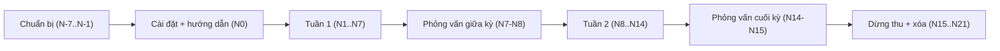

# Kịch bản thử 2 tuần với gia đình quen (A-lite E1)

> **Chưa được luật sư xem; không thay ý kiến pháp lý.** Bản nháp do AI soạn. Kịch bản này chỉ chạy khi **checklist trong `Test_Kit_00_README.md` đã đạt đủ** (FR-01 xong, phiếu ký, trẻ đồng ý, nơi lưu riêng tư, kế hoạch xóa). Phần an toàn (mục 7) **chưa được chuyên gia bảo vệ trẻ em duyệt**; xem README E2, E3.

- **Phạm vi:** nấc 1 = A-lite E1 (phụ huynh nhập biểu mẫu, thuật toán xếp lịch, **không AI**, lịch đồng bộ sang app của con). Không GPS, ảnh, ghi âm, chat. `CHILD_DIRECTED` ẩn (D-19).
- **Nguồn luồng:** F1 đến F5 trong `User_Flow_04_1_Scheduling_Loop.md`; G1 đến G10 trong `User_Flow_04_2_Remaining_Flows.md`.
- **Nguồn giả thuyết, tiêu chí:** `MVP_Options_for_Owner_Decision.md` §0 (CA-01 đến CA-04, D-11), PA-2 (thành công, dừng) mà PA-3 nấc 1 dùng lại; câu hỏi phỏng vấn lấy từ `User_Research_02_8` §5, §6.
- **Với ≤3 gia đình không tính phần trăm** (MVP Q7, đề xuất (c)). Ghi từng gia đình, so gia đình với chính nó.
- **Tên giả trong ví dụ:** bé "Na" (lớp 3), bé "Bin" (lớp 7), chị "Hoa". Không dùng tên thật trong tài liệu này.

## 1. Tổng quan

| Giai đoạn | Ngày | Việc chính |
|---|---|---|
| Chuẩn bị | N-7 đến N-1 | Checklist README; dry-run bằng dữ liệu giả; tuyển; ký phiếu; giải thích trẻ |
| Cài đặt, hướng dẫn | N0 | Một buổi 90 đến 120 phút tại nhà: F1, F2, F3, G5, G6, G8 |
| Tuần 1 | N1 đến N7 | Dùng thường ngày; nhiệm vụ nhỏ mỗi ngày; báo cáo tuần 1 |
| Giữa kỳ | N7 đến N8 | Phỏng vấn giữa kỳ; kiểm tiêu chí dừng |
| Tuần 2 | N8 đến N14 | Dùng thường ngày; thử luồng quản trị; báo cáo tuần 2 |
| Cuối kỳ | N14 đến N15 | Phỏng vấn cuối; hỏi lại trẻ có còn đồng ý |
| Kết thúc | N15 đến N21 | Dừng thu, xóa, thông báo gia đình, hoàn tất nhật ký xóa |

**Nguyên tắc nhiệm vụ:** gia đình **dùng như bình thường**; nhiệm vụ chỉ là gợi ý thử vài thao tác. Không ép. Nhiệm vụ nào gia đình không muốn: bỏ qua, ghi "bỏ qua". Không có nhiệm vụ cho **trẻ làm thay** việc người lớn, và không có nhiệm vụ nào **đòi trẻ báo mệt**.

## 2. Chuẩn bị (N-7 đến N-1)

| # | Việc | Người làm | Xong khi |
|---|---|---|---|
| 1 | Chạy lại checklist README, mọi ô có bằng chứng | Người thử + chủ sản phẩm | Không còn ô trống |
| 2 | **Dry-run** toàn bộ kịch bản này với hồ sơ giả (Na, Bin, chị Hoa), hai máy của nhóm | 2 người nhóm | Ghi lỗi vào Kit 04 mục 5 với nhãn "dry-run"; lỗi chặn đã sửa |
| 3 | Chuẩn bị 2 máy Android dự phòng, sạc, cáp; cách cài app đã chốt | Người thử | Cài được trên máy dry-run |
| 4 | Gọi cho gia đình: giới thiệu, hẹn ngày; nói rõ "không sao nếu không tham gia" | Người thử | Gia đình xác nhận |
| 5 | Gửi phiếu Kit 01 trước ít nhất 2 ngày để đọc; trả lời câu hỏi | Người thử | Gia đình ký, giữ riêng một bản |
| 6 | Giải thích cho trẻ theo Kit 02, ghi phiếu C2 | Người thử + bố mẹ | Trẻ "Đồng ý rõ" |
| 7 | Dặn gia đình chuẩn bị: thời khóa biểu (giấy hoặc ảnh để tự nhìn, **không gửi ảnh cho người thử**), danh sách hoạt động cố định, giờ vào/tan học | Người thử | Gia đình có sẵn |
| 8 | Chuẩn bị bảng mã ẩn danh NB-01..03 lưu riêng | Người thử | Tách khỏi ghi chép |
| 9 | Phát cho người thử bản in mục 7 (tình huống an toàn) và danh sách số khẩn | Người thử | Mang theo khi tới nhà |

## 3. Buổi cài đặt và hướng dẫn (N0, 90 đến 120 phút)

**Ai có mặt:** 2 người của nhóm (nếu được), bố mẹ, trẻ. Phụ huynh ở trong nhà suốt buổi. Không nói chuyện riêng một mình với trẻ.

| Phút | Việc | Luồng | Ghi chú |
|---|---|---|---|
| 0 đến 10 | Chào, nhắc lại: thử là tự nguyện, dừng bất cứ lúc nào; xác nhận phiếu đã ký; hỏi lại trẻ "con còn đồng ý chứ?" | Kit 01, Kit 02 | Ghi lại C2 nếu có thay đổi |
| 10 đến 40 | **Phụ huynh** tạo tài khoản, đọc và đồng ý (PA-02), nhập hồ sơ gia đình, hồ sơ con tối thiểu, giờ học, hoạt động cố định. **Tay phụ huynh bấm**, người thử chỉ hướng dẫn nếu bị kẹt | **F1** (G9 PA-32 xem lại đồng ý) | Không nhập sức khỏe, tên trường, địa chỉ. Câu "Con có điện thoại riêng không?" trả lời "Có" |
| 40 đến 70 | Phụ huynh nhập quỹ giờ, xem preset, bấm "Xếp lịch", xem trước, sửa nếu muốn, **Lưu lịch**. Đếm số lần sửa | **F2** | Ô Ngủ đỏ không có nút "Giữ mức này" (D-02). Ghi nhãn "mặc định chưa kiểm chứng" (D-08). Đếm vào Kit 04 mục 3 chỉ số (b) |
| 70 đến 85 | **Ghép máy:** con mở app, xem mã ghép; phụ huynh nhập mã, đặt Parent PIN; con thấy "Đã kết nối" | **F3** | Làm cùng nhau. PIN không ghi lại, không nói to |
| 85 đến 95 | Con xem màn **"Những gì bố mẹ thấy"**; bố mẹ xem cùng | **G6** (CA-16) | Hỏi lại vài câu kiểm tra (Kit 02) |
| 95 đến 105 | Cho phép thông báo; tắt tối ưu pin cho app; thử một lời nhắc | **G3** (PA-23, CA-15, F4-X1, X2, X3) | Ghi máy, hãng, phiên bản Android (không ghi số seri) |
| 105 đến 115 | Phụ huynh đặt chế độ tự chủ: giữ mặc định `UNSET` (như `PARENT_LED`). Cho xem chỗ nút "Hỗ trợ khẩn cấp" trên app phụ huynh | **G5**, **G8** | Không diễn tình huống nguy hiểm. Chỉ **chỉ cho xem** chỗ nút. Không bấm gửi tin giả |
| 115 đến 120 | Nhắc: số liên hệ người thử; cách tắt từng phần (P3, P4); ngày phỏng vấn giữa kỳ | | Phát tờ A5 một trang, chữ to, ghi số liên hệ |

**Ghi:** thời gian từng bước, chỗ kẹt, câu hỏi bố mẹ và trẻ đặt, lỗi. Không ghi tên thật vào phiếu kết quả.

## 4. Nhiệm vụ theo ngày

Cột "Luồng" ghi theo `User_Flow_04_1` (F1 đến F5) và `04_2` (G1 đến G10). **[tùy chọn]** = làm nếu gia đình đồng ý và tính năng đã có.

| Ngày | Nhiệm vụ cho phụ huynh | Nhiệm vụ cho con | Luồng | Người thử làm gì |
|---|---|---|---|---|
| **N0** | Cài đặt (mục 3) | Ghép máy; xem "Những gì bố mẹ thấy" | F1, F2, F3, G5, G6, G8 | Ngồi cạnh; ghi lại |
| **N1** | Xem lịch hôm nay trên Parent App (PA-11) | Nhận nhắc; bấm **Xong** ít nhất 1 việc nếu muốn; mở tab "Hôm nay" nếu muốn | F4 bước 1 đến 5, 10; G3 | Nhắn 1 tin cuối ngày: "Có lỗi gì không?" (không hỏi về cảm xúc) |
| **N2** | Như bình thường. Ghi vào phiếu nhật ký số lần phải nhắc con **[tùy chọn]** | Dùng bình thường. Phần hỏi thăm (CA-05) hiện sau giờ học; **bỏ qua hay chọn đều được** | F4 bước 6, 7 | Không nhắn. Nếu app lỗi, gọi giúp |
| **N3** | **Sửa lịch** một chỗ có thật (đổi giờ một hoạt động hoặc thêm hoạt động) và bấm "Xếp lại lịch"; đếm số lần sửa | — | F2 sửa; F1 bước 6 đến 8 | Quan sát nếu ở cạnh; hỏi "chỗ nào khó hiểu?" |
| **N4** | Xem trong app phần **nhắc**: lời nhắc đến đúng giờ chưa | Dùng bình thường | G3 | Ghi lệch nhắc nếu có (Kit 04 mục 3, chỉ số (c)) |
| **N5** | Xem hàng chờ "Con đề xuất và báo" (PA-16) nếu con có gửi mong muốn | **[tùy chọn]** Gửi **một** mong muốn bằng câu có sẵn, nếu thật sự có điều muốn nói. **Không** bắt gửi | F5-B (B1), D-10 | Không gợi nội dung mong muốn |
| **N6** | Thay đổi **chỉ tuần này** một việc (ví dụ nghỉ một buổi học thêm vì việc nhà) | Thấy lịch đổi trên máy | F5-C; F4-X4 | Ghi: máy con nhận lịch đổi trong bao lâu |
| **N7** | **Xem báo cáo tuần 1** (PA-21) | Xem "Tuần của con" (CA-13) nếu muốn | **G1** (F4 §5.2) | Cho phụ huynh đọc trước, rồi hỏi hiểu thế nào. Xem lại chỉ số tuần 1 |
| **N7 đến N8** | **Phỏng vấn giữa kỳ** (mục 5) | Trò chuyện ngắn với bố mẹ ở gần (mục 5.3) | | Kiểm tiêu chí dừng (mục 5.4) |
| **N9** | Vào **cài đặt thông báo** (PA-27): tắt một loại, bật lại | — | **G3** | Quan sát |
| **N10** | Vào **"Dữ liệu của gia đình"** (PA-33): xem app đang lưu gì, sửa một trường tùy chọn. **Không xóa** hồ sơ | — | **G7** | Hỏi "chị có nghĩ như vậy là đúng không?" |
| **N11** | Xem màn **đồng ý** (PA-32): chỉ ra nơi rút từng phần. **Không rút thật** trừ khi muốn. Nếu muốn, thử tắt phần hỏi thăm rồi hỏi lại con có muốn bật không | Con xem lại CA-16 nếu muốn | **G6**, D-28 | Hỏi "chị thấy rõ nơi rút chưa?" |
| **N12** | **Đăng xuất rồi đăng nhập lại** trên máy phụ huynh | — | **G10** | Chỉ thử đăng nhập bình thường. Khôi phục tài khoản khi quên: chưa có phương pháp (UNKNOWN), **không thử** |
| **N13** | **[tùy chọn]** Xem lịch sử thay đổi lịch (PA-25). **[tùy chọn, chỉ khi chủ sản phẩm cho (UF-Q26/Q27)]** khóa lịch (G2) hoặc mời người lớn thứ hai (G4) | — | G2, G4 | Chỉ nếu đã được duyệt; mặc định bỏ qua |
| **N14** | **Xem báo cáo tuần 2** (PA-21), gồm xu hướng 2 tuần nếu có | Xem CA-13; **hỏi lại con "còn muốn dùng không?"** | **G1** | Ghi lại câu trả lời của con (Kit 02 C2) |
| **N14 đến N15** | **Phỏng vấn cuối kỳ** (mục 6) | Trò chuyện ngắn có bố mẹ ở gần | | |
| **N15** | Quyết định cho gia đình: dừng tại ngày kết thúc | Dừng nhắc | | Mục 9 |
| **N15 đến N21** | Xác nhận đã nhận thông báo xóa | — | **G9** (xóa hồ sơ con qua app nếu có) | Xóa dữ liệu và ghi nhật ký (mục 9) |

**G8 (an toàn):** chỉ được "chỉ cho xem" ở N0. Không dùng nút "Con cần giúp đỡ" để thử giả. Nếu gia đình muốn thử bấm: chỉ bấm **mở màn hình**, không gửi tin "Con cần nói chuyện" cho ai.

## 5. Phỏng vấn giữa kỳ (N7 đến N8)

### 5.1 Cách làm

- Phụ huynh 30 đến 40 phút. Trẻ 10 đến 15 phút, **có bố mẹ ở gần** (lớp 1 đến 5 ngồi gần; lớp 6 đến 9 bố mẹ ở phòng bên, cửa mở, nếu bố mẹ đồng ý trước). Không hỏi riêng một mình nếu E3 chưa đạt.
- **Không ghi âm.** Ghi chép tay theo mã. Ghi câu trả lời ngắn, đánh dấu trích lời (Kit 04 mục 6).
- Không dẫn dắt. Hỏi về **việc đã làm**, không hỏi "có thích không".
- Trẻ nói "không muốn trả lời": chấp nhận.

### 5.2 Câu hỏi cho phụ huynh (giữa kỳ)

| # | Câu hỏi | Giả thuyết, tiêu chí | Nguồn |
|---|---|---|---|
| M-P1 | "Tuần qua mỗi ngày chị phải nhắc con làm việc mấy lần? So với tuần trước khi dùng app thì sao?" | CA-02; thành công (d) | MVP PA-2; `02_8` §5.2 |
| M-P2 | "Lịch app xếp: chị giữ nguyên chỗ nào, sửa chỗ nào, vì sao sửa?" | CA-03; thành công (b) | MVP PA-2; SPK |
| M-P3 | "Có chỗ nào lịch làm chị thấy không hợp với con? Chỗ nào hợp?" | CA-03 (quy tắc cân bằng có ích); dừng "phụ huynh viết lại phần lớn lịch" | MVP PA-2 |
| M-P4 | "Nhắc việc có kêu đúng giờ không? Lần nào lệch?" | Độ tin cậy nhắc (c); A08 RG-07 | MVP PA-2; PLA §6 |
| M-P5 | "Con tự mở app khi nào? Chị thấy con mở mấy ngày?" (phụ huynh nói theo cảm nhận; không mở dữ liệu theo ngày) | CA-01; (e) | MVP §0 |
| M-P6 | "Chị đã xem báo cáo tuần chưa? Chị hiểu câu về mệt thế nào? Chị làm gì sau khi đọc?" | CA-04; D-03, D-21 | UF F4 b11; G1 |
| M-P7 | "Chị có muốn biết con chọn gì **từng ngày** không? Nếu muốn, vì sao? Nếu không, vì sao?" | Rủi ro định vị (phụ huynh từ chối "không đọc được"; báo ngay chủ sản phẩm nếu đa số từ chối) | `02_8` §9.3 |
| M-P8 | "Có lúc nào chị thấy con bị áp lực vì app không?" | Dừng: trẻ cảm thấy bị theo dõi | MVP PA-2 |
| M-P9 | "Chị có lo ngại gì về dữ liệu của con? Chị đọc phiếu xong còn thắc mắc gì?" | Niềm tin riêng tư | `02_8` §5.5 |
| M-P10 | "Điều gì làm chị muốn dùng tiếp? Điều gì làm chị bỏ ngay?" | Điều kiện chấp nhận | `02_8` §6.3 #6 (điều chỉnh) |

### 5.3 Câu hỏi cho trẻ (giữa kỳ)

**Lớp 1 đến 5** (nói chậm, cho chỉ hình):

| # | Câu hỏi | Giả thuyết |
|---|---|---|
| M-T1 | "Hôm qua app kêu mấy lần? Con làm việc nào khi nó kêu?" | CA-01 |
| M-T2 | "Con tự bấm 'Xong' hay bố/mẹ bấm giúp?" | CA-01 (tự chủ theo việc) |
| M-T3 | "Chỗ nào trong app con không hiểu?" | Khả dụng |
| M-T4 | "Có lúc nào con **không muốn** app kêu không?" | Áp lực, nhắc phiền |
| M-T5 | "Khi app hỏi 'hôm nay con thấy thế nào', con thường làm sao: chọn hay bỏ qua?" (đừng hỏi con chọn gì) | CA-04 |

**Lớp 6 đến 9:**

| # | Câu hỏi | Giả thuyết |
|---|---|---|
| M-T6 | "Em mở app lúc nào? Có ngày nào em không mở? Vì sao?" | CA-01 |
| M-T7 | "Em thấy app giúp em nhớ việc, hay chỉ làm bố mẹ yên tâm?" | CA-01, CA-02 |
| M-T8 | "Có khi nào em thấy bị theo dõi vì app không? Chuyện gì làm em thấy thế?" | Dừng: cảm giác bị theo dõi; `02_8` §6.3 #5 |
| M-T9 | "Em có hiểu bố mẹ thấy gì từ app không? Em nói lại thử." | Hiểu (Kit 02 B-Q2, B-Q3) |
| M-T10 | "Nếu em muốn đổi lịch, em làm cách nào? Cách đó có dùng được không?" | Mong muốn của con (F5-B) |

**Không hỏi trẻ:** "Con có thích app không?"; con chọn gì ở phần hỏi thăm; chuyện gia đình riêng tư; so với anh chị em hay bạn.

### 5.4 Kiểm tiêu chí dừng ngay sau phỏng vấn giữa kỳ

| Dấu hiệu | Hành động | Nguồn |
|---|---|---|
| Có **1 sự cố** quyền riêng tư hoặc an toàn | **Dừng thử** và xử lý trước (mục 7, Kit 04 mục 7) | MVP PA-2 "Dừng" |
| Trẻ nói cảm thấy **bị theo dõi hoặc áp lực** (M-P8, M-T8) | **Dừng phần hỏi thăm** (tắt P3) và xem lại thiết kế; hỏi trẻ có muốn tiếp không | MVP PA-2 "Dừng", MR-031 |
| Phụ huynh **bỏ hoặc viết lại phần lớn lịch** | Ghi lại; sau 2 tuần chủ sản phẩm cân nhắc cho AI soạn sớm hơn (mốc cho E1 chưa có) | MVP PA-2 "Dừng" |
| Trẻ **hầu như không mở app** | Ghi; sau 2 tuần chủ sản phẩm cân nhắc đổi hướng sang lịch cho phụ huynh + nhắc trên máy phụ huynh | MVP PA-2 "Dừng" |
| Đa số phụ huynh không chấp nhận ý "bố mẹ không đọc được từng ngày con chọn" | Báo ngay chủ sản phẩm (rủi ro định vị) | `02_8` §9.3 |
| Một câu hỏi làm trẻ khó chịu ở 2 lần liên tiếp | Bỏ hoặc viết lại câu đó | `02_8` §9.3 |

## 6. Phỏng vấn cuối kỳ (N14 đến N15)

### 6.1 Cách làm

Như 5.1. Cho phụ huynh xem lại **báo cáo tuần 2** và lịch hiện tại trước khi hỏi.

### 6.2 Câu hỏi cho phụ huynh (cuối kỳ)

| # | Câu hỏi | Giả thuyết, tiêu chí |
|---|---|---|
| E-P1 | "Trong 14 ngày, chị kích hoạt lịch tuần đầu mất bao lâu? Có khó không?" | Thành công (a): kích hoạt trong 7 ngày |
| E-P2 | "Lịch cuối cùng so với bản app xếp lần đầu, chị đã đổi bao nhiêu chỗ? Chị thấy thế nhiều hay ít?" | CA-03; (b) mốc tham khảo ≤3 chỉnh sửa |
| E-P3 | "Chị còn phải nhắc con mấy lần mỗi ngày? Có giảm so với trước khi dùng không?" (đối chiếu nhật ký bố mẹ nếu có) | CA-02; (d) |
| E-P4 | "Tuần 2, con tự mở tab 'Hôm nay' hầu hết các ngày đi học không? Chị dựa vào đâu để nói vậy?" | CA-01; (e) (≥4 ngày/tuần là mốc dùng sản phẩm, **không phải điểm của trẻ**) |
| E-P5 | "Báo cáo tuần có giúp chị quyết điều gì không? Chị đã đổi lịch vì nó chưa?" | CA-04; D-21 |
| E-P6 | "Chị có thấy hỏi thăm sau giờ học gây áp lực cho con không? Có bị con lạm dụng (chọn 'Rất mệt' để xin nghỉ) không?" | CA-04; dừng |
| E-P7 | "Chị có ý định dùng tiếp nếu app ra mắt? Chị sẽ trả tiền hay không?" (chỉ hỏi ý định, không hứa) | Giá trị; giả thuyết giá |
| E-P8 | "Nếu app có thêm trợ lý trò chuyện (Pal), chị muốn nó làm gì, và không muốn nó làm gì?" | Định hướng nấc 2 (chỉ thăm dò) |
| E-P9 | "Phần nào về dữ liệu của con làm chị lo? Chị thấy việc rút từng phần có rõ không?" | Riêng tư; D-28; LQ-14 |
| E-P10 | "Chị có muốn **xóa ngay** dữ liệu không, hay đợi đến hạn?" | Xóa (D-01) |
| E-P11 | "Chị có thể kể một lúc app làm chị ngạc nhiên (hay hơn, dở hơn mong đợi)?" | Mở |

### 6.3 Câu hỏi cho trẻ (cuối kỳ)

| # | Câu hỏi | Giả thuyết |
|---|---|---|
| E-T1 | "Con còn muốn dùng app không, hay muốn dừng? Con nói nào cũng được." (hỏi bằng lời trung tính) | Assent cuối kỳ (Kit 02 C2) |
| E-T2 | "Việc nào app nhắc con thấy hữu ích? Việc nào thấy phiền?" | CA-01 |
| E-T3 | "Hai tuần qua, con có tự mở app mà không ai nhắc không?" (Lớp 6 đến 9: "Em tự mở bao nhiêu ngày? Em tự quyết hay bị nhắc mở?") | CA-01; (e) |
| E-T4 | "Có lúc nào bố mẹ nói về app mà con không thích?" (hỏi nhẹ; không đào sâu nếu trẻ ngần ngại) | Áp lực |
| E-T5 | "Nếu con được đổi một điều trong app, con đổi điều gì?" | Mở |
| E-T6 | (Lớp 6 đến 9) "Nếu app nói chỉ em và bố mẹ biết những gì đã nói trong màn 'Những gì bố mẹ thấy', em có tin không? Cần điều gì để em tin?" | Niềm tin riêng tư; `02_8` §6.3 #8 |

### 6.4 Tiêu chí thành công (để chủ sản phẩm chốt; đề xuất)

Với ≤3 gia đình **không tính phần trăm** (MVP Q7). Mỗi chỉ số ghi **từng gia đình**, kèm số liệu thô. Quyết định tiếp tục hay đổi hướng do **chủ sản phẩm**, không phải người thử.

| Mã | Chỉ số | Mốc tham khảo | Đo thế nào | Nguồn |
|---|---|---|---|---|
| (a) | Phụ huynh kích hoạt được lịch tuần đầu | Trong 7 ngày | Ngày lưu lịch lần đầu | R05 §4; MR-008 |
| (b) | Số chỉnh sửa mỗi lịch | "≤3 chỉnh sửa" mượn từ R05 §4 (vốn cho bản Pal soạn; chỉ để tham khảo) | Đếm ở N0 và N3, N6 | MVP PA-2 |
| (c) | Độ lệch nhắc | Dưới 1 phút trong 7 ngày | Nhật ký giờ hẹn và giờ thật của app (F4-X7) | PLA §6 |
| (d) | Số lần phụ huynh tự báo phải nhắc con mỗi ngày | Giảm so với tuần trước khi dùng | Nhật ký bố mẹ 7 ngày + câu hỏi M-P1, E-P3 | MR-002 |
| (e) | Trẻ tự mở tab "Hôm nay" | Phần lớn ngày đi học ở tuần 2 (R05 đề xuất ≥4 ngày/tuần cho tuần 2 đến 4; đây là chỉ số dùng sản phẩm, **không phải điểm của trẻ**) | Nhật ký mở app (nếu có) và lời kể | R05 §4 |
| (f) | Sự cố riêng tư hoặc an toàn | 0 | Kit 04 mục 7 | MVP PA-2 |

Đợt này **không có tiêu chí chấm "tốt" cho trẻ**. Ghi nhận không dẫn tới đánh giá trẻ.

## 7. Tình huống an toàn và cách xử lý

> **Phần này chưa được chuyên gia bảo vệ trẻ em duyệt** (MR-022; README E3). Số **111, 113, 115** đang chờ thẩm định (cổng B-6); đối chiếu nguồn chính thức trước khi in. Quy tắc trong spec: **với trẻ**, lời chính là "nói với người lớn con tin", có thể kèm 111; **không** dùng 113, 115 làm lời chính cho trẻ (spec N2; D-06). Số 111, 113, 115 đầy đủ là **cho người lớn**, trong đó có người thử.

### 7.1 Nguyên tắc cho người chạy thử

1. **Người thử không tư vấn, không chẩn đoán, không điều trị** (spec N1). Việc của người thử là: **dừng, giữ an toàn trước mắt, kết nối người lớn phù hợp, ghi ngắn, báo chủ sản phẩm**.
2. **Không hỏi dò chi tiết.** Không hỏi ai làm, làm khi nào, ở đâu. Để chuyên gia hỏi.
3. **Không hứa giữ bí mật.** Nói thật từ đầu: nếu con hoặc ai đó có thể gặp nguy hiểm, người thử sẽ tìm người lớn phù hợp để giúp (Kit 02 A5, B5).
4. **Không mặc định báo cha mẹ** nếu nguy cơ có thể đến từ người chăm sóc (`02_8` §3.3; CRG CP-17).
5. **Không trò chuyện riêng một mình với trẻ** (README E3 mặc định chặt).
6. **Không ghi lại chi tiết nhạy cảm** vào phiếu kết quả. Phiếu chỉ ghi: ngày, mã, loại tình huống (S1 đến S8), việc đã làm. Chi tiết nếu cần ghi: một bản riêng do chủ sản phẩm giữ.
7. **Nút "Con cần giúp đỡ" không ghi lại gì**, nên người thử sẽ **không biết** trẻ có bấm hay không (D-26, D-30).
8. Mọi tình huống ở bảng dưới: **báo chủ sản phẩm trong ngày** qua điện thoại, không qua tin nhắn có tên thật.

### 7.2 Bảng tình huống

| # | Tình huống | Người thử làm | KHÔNG làm |
|---|---|---|---|
| **S1** | Trẻ nói bị đánh, bị làm đau, bị xâm hại, bị dụ dỗ, bị bắt nạt nặng | 1. Giữ bình tĩnh, nói: "Con nói với cô/chú là đúng rồi. Cô/chú cần nhờ người lớn giúp con." 2. **Dừng** chủ đề thử, dừng buổi nếu cần. 3. Nói với trẻ: "Con nói với một người lớn con tin; con cũng có thể gọi **111**." 4. **Người thứ hai trong nhóm** biết ngay. 5. Nếu có nguy cơ gần: gọi **113** (an ninh) hoặc **111** (bảo vệ trẻ em) như một người lớn. 6. Báo chủ sản phẩm trong ngày; chủ sản phẩm tìm người có chuyên môn bảo vệ trẻ em | Không hỏi dò; không đối chất người lớn; không hứa kín; **không mặc định báo bố mẹ** nếu nguy cơ có thể ở trong nhà; không tự điều tra |
| **S2** | Trẻ nói muốn làm hại bản thân, không muốn sống | Như S1. Ở cạnh trẻ cho đến khi có người lớn tin cậy tới. Nếu có nguy hiểm tức thì: gọi **115** hoặc **113**. Mời phụ huynh đến **nếu** phụ huynh không phải nguồn nguy cơ; nếu chưa rõ thì không để trẻ một mình và nhờ người lớn khác trong nhóm | Không tranh luận lý do; không hứa "mọi chuyện sẽ ổn"; không để trẻ một mình |
| **S3** | Trẻ hoặc phụ huynh có dấu hiệu cấp cứu y tế (khó thở, co giật, bất tỉnh) | Gọi **115** ngay, báo địa chỉ; bố mẹ ở nhà thì cùng làm. Giữ trẻ an toàn tới khi có người y tế | Không đưa thuốc; không nêu liều thuốc; không chẩn đoán (spec N1) |
| **S4** | Trẻ nói rất mệt, buồn, áp lực vì lịch hoặc vì app (không có dấu hiệu nguy hiểm) | Ghi nhận. **Dừng phần hỏi thăm** nếu liên quan app. Nói với cả nhà: "Chúng ta tạm dừng." Gợi ý bố mẹ nói chuyện với con, và tìm giáo viên hoặc bác sĩ nếu lo lắng | Không giảng giải; không chẩn đoán; không bình luận cách nuôi dạy |
| **S5** | Phụ huynh kể có dùng đòn roi, quát tháo nặng, hoặc nói chuyện có dấu hiệu bạo hành | Nhắc nhẹ, **một câu**: "Cô/chú không thể góp ý về chuyện này, nhưng nếu anh/chị cần hỗ trợ, tổng đài **111** là nơi gọi." Không cãi. Nếu có dấu hiệu trẻ bị đánh nặng hoặc đang bị nguy hiểm: làm như **S1** | Không phán xét dài; không hùa theo đòn roi; không điều tra |
| **S6** | Phụ huynh hoặc trẻ hỏi lời khuyên chuyên môn (bệnh, thuốc, tâm lý, học lực) | Ghi câu hỏi (là dữ liệu nhu cầu), nói: "Cô/chú không tư vấn được; anh/chị hỏi bác sĩ/giáo viên nhé." Không trả lời nội dung chuyên môn | Không chẩn đoán; không nêu thuốc, liều |
| **S7** | Nghi lộ dữ liệu (mất máy, gửi nhầm tin, người lạ xem, lỗi hiện dữ liệu gia đình khác) | **Dừng thu** cho hộ liên quan; gọi chủ sản phẩm trong ngày; thu hồi liên kết nếu cần (cần Parent PIN); ghi Kit 04 mục 7; báo gia đình. **Đây là sự cố đếm vào (f)** và là điều kiện **dừng thử** | Không giấu; không tự sửa dữ liệu của gia đình khác; không đăng lên chỗ công khai |
| **S8** | Trẻ muốn dừng hoặc khóc/giận khi nói chuyện về app | Dừng ngay phần đang hỏi; nói "con dừng được"; cho nghỉ; hỏi bố mẹ có muốn tiếp không | Không ép trả lời; không hỏi "tại sao" nhiều lần |

### 7.3 Lời nói mẫu với trẻ (cần chuyên gia duyệt)

- Khi trẻ vừa tiết lộ: "Cảm ơn con đã nói. Con không có lỗi. Cô/chú sẽ nhờ người lớn giúp con."
- Trẻ lớp 1 đến 5: "Con hãy nói với một người lớn con tin. Con có thể gọi 111, gọi miễn phí."
- Trẻ lớp 6 đến 9: "Em có thể nói với người lớn em tin. Em cũng có thể gọi 111 bất cứ lúc nào."

### 7.4 Sau tình huống

1. Ghi ngắn vào Kit 04 mục 7: ngày, mã, loại S1..S8, việc đã làm, ai được báo, **không** chi tiết nhạy cảm.
2. Chủ sản phẩm quyết: tiếp tục, tạm dừng gia đình đó, dừng cả đợt.
3. Nếu tình huống làm lộ thiếu sót của quy trình: cập nhật mục 7 này trước khi tiếp tục với gia đình khác.
4. Nghĩa vụ **báo cơ quan** của người thử/nhóm theo luật: **chưa biết** (LQ-09 câu 4). Hỏi luật sư khi có điều kiện; trong lúc chờ, theo S1.

## 8. Lỗi kỹ thuật thường gặp và xử lý nhanh

| Lỗi | Xử lý | Nguồn |
|---|---|---|
| Từ chối quyền thông báo | App vẫn dùng được; hướng dẫn bật lại | F4-X1, F3-X7 |
| Nhắc trễ do tiết kiệm pin | Hướng dẫn bỏ tối ưu pin theo hãng | F4-X3 |
| Thiếu quyền báo thức chính xác | Nhắc sớm vài phút | F4-X2 |
| Ghép máy sai con (nhiều con) | Hủy liên kết từ máy con (cần Parent PIN) rồi ghép lại | F3-X6 |
| Mã ghép sai hoặc hết hạn | Lấy mã mới trên máy con | F3-X1 |
| Con không có điện thoại riêng | Không vào đợt thử (D-11) | F3-X5 |
| Lịch không xếp được (tổng giờ > 24 hoặc ngủ dưới mức tối thiểu) | Giảm một ô nhập; ô Ngủ không có "Giữ mức này" | F2 bước 6b, 7 |

## 9. Kết thúc và xóa dữ liệu (N15 đến N21)

Các bước làm đúng thứ tự. Mỗi bước ghi vào **nhật ký xóa** (Kit 04 mục 8).

| # | Việc | Ai | Khi nào |
|---|---|---|---|
| 1 | **Ngừng thu** từ ngày kết thúc: tắt nhắc và đồng bộ, vô hiệu liên kết (token cũ) | Người thử | N15 |
| 2 | Hỏi gia đình: muốn xem dữ liệu của mình, tải bản sao, hay xóa ngay? Làm theo lựa chọn | Người thử | N15 |
| 3 | Phụ huynh **xóa hồ sơ con** trong app (G9) nếu chức năng có; người thử xem cùng | Phụ huynh + người thử | N15 đến N16 |
| 4 | Người thử **xóa thủ công** những gì còn lại ở máy chủ: hồ sơ gia đình, hồ sơ con, thẻ hoạt động, lịch, nhật ký sự kiện, hỏi thăm, mong muốn, tài khoản, mã thông báo, nhật ký lỗi có dữ liệu cá nhân | Người thử (người thứ hai kiểm) | Trong hạn ở Kit 01 mục 8 (đề xuất 7 ngày) |
| 5 | Xóa trên máy gia đình: gỡ app, xóa dữ liệu app | Gia đình (người thử hướng dẫn) | Cùng ngày |
| 6 | Xóa **ghi chép gốc có mã** của gia đình đó khi đã tổng hợp xong số liệu ẩn danh; xóa bảng mã khi không còn cần | Người thử | Theo hạn |
| 7 | Kiểm lại bằng tay: đăng nhập thử bằng tài khoản đã xóa không được; truy vấn dữ liệu không thấy; không còn trong sao lưu dễ xóa | Người thứ hai | Trước khi báo |
| 8 | **Báo gia đình đã xóa xong**, ghi ngày | Người thử | Sau bước 7 |
| 9 | Cất phiếu ký và nhật ký xóa ở nơi riêng (không xóa; xem README câu Q4) | Chủ sản phẩm | |
| 10 | Viết **bản tổng kết không có tên** (không có tuổi chính xác, trường, địa chỉ) và gửi chủ sản phẩm | Người thử | Sau xóa |

**Giới hạn cần nói thật:** chưa có luật sư xác nhận thời hạn xóa, nên việc xóa trong bản sao lưu của nhà cung cấp hạ tầng có thể mất thêm thời gian ngoài tầm kiểm soát. Ghi vào nhật ký xóa; không tuyên bố "xóa hoàn toàn" nếu chưa kiểm.

*người soạn: AI, chưa kiểm chứng độc lập; trạng thái: nháp chờ duyệt*
