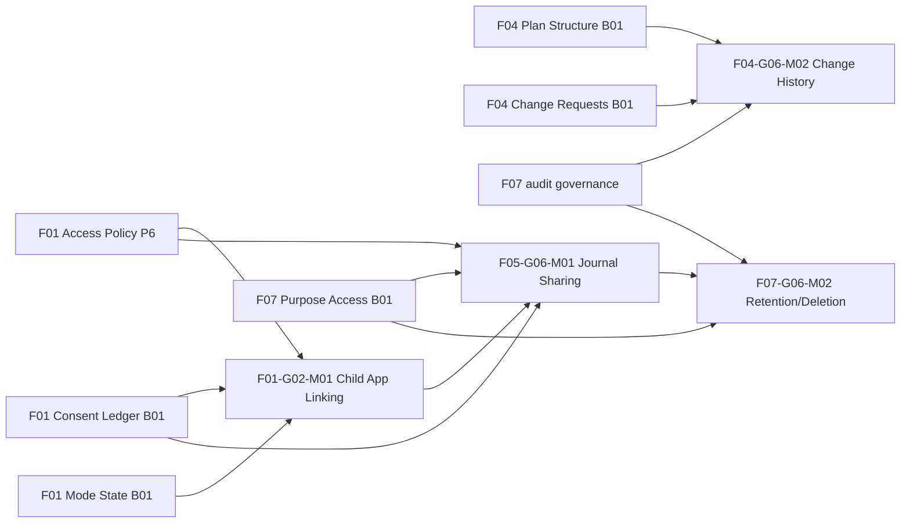

# Parent-Pal — Batch 02 Dependency & Scope Proposal

**Ngày:** 2026-11-14  
**Trạng thái:** `B02_SCOPE_PROPOSAL / NOT_OWNER_APPROVED`  
**Authority:** [Batch 01 Conditional Baseline Owner Gate](Feature_3_2_L4_B01_Conditional_Design_Baseline_Owner_Gate_APPROVED.md), 42 Owner Decisions and [Normalized Baseline](Feature_3_2_L4_B01_Normalized_Cross_Module_Baseline_REVIEW.md).

## 1. Mục tiêu

Lựa chọn L3 tiếp theo giúp **đóng các giao diện còn treo và giảm rủi ro xuyên module**, thay vì chạy tràn lan tất cả L3. Batch 02 vẫn là Product Feature Design (L3→L4) và không đồng nghĩa P7 hay System Design.

## 2. Candidate ranking — preliminary, not numeric scoring

| Proposal priority | L3 | Business capability | Why now | Hard dependencies | Risks / bounds | ChatGPT/Claude |
|---|---|---|---|---|---|---|
| A1 | `F01-G02-M01` | Parent–Child App Linking | Enables child account to bind family/plan without takeover; prerequisite for realistic permission flows | F01 Access Policy, Consent Ledger, Mode State | invitation expiry, transfer/recovery/revoke, cross-child isolation, guardian self-declaration != legal proof | ChatGPT design; Claude focused security if high-risk ambiguity |
| A2 | `F04-G06-M02` | Change History | Completes F04 Plan/CR ownership split and audit provenance, strengthens stable commit replay | F04 Plan Structure, CR, F07 audit policy | event/outbox atomicity, idempotency, Journal minimization | ChatGPT design; deterministic state/test review; Claude only on unresolved critical race |
| B1 | `F05-G06-M01` | Child Journal Sharing / Child-controlled access | Critical privacy capability; resolves deferred B01C-L4-05 and revoke contract | F01 Child App Link, Access/Consent/Mode, F07 purpose/lineage | Journal child consent, no parent inferential leakage, default notify-off | ChatGPT design; Claude focused privacy adversarial review required before accepting safety-sensitive contract |
| B2 | `F07-G06-M02` | Retention & Deletion | 60d deletion and derivatives lineage; cannot safely promise Journal lifecycle without this | F05 sharing + F07 purpose/audit/lineage; consent/auth | lawful-retention exceptions/legal research, delayed job, backups/cache | ChatGPT design; Claude targeted high-risk consistency check |

**Suggested batch:** 4 modules in two workstreams: **WS-1 Identity + History** (A1/A2, partially parallel) and **WS-2 Journal Sharing + Retention** (B1/B2, dependency-gated, legal research tracked). Selection is **proposal**, not approved list.

## 3. Dependency graph

These are **design dependencies**, not evidence that any service implementation exists.

## 4. Per-module minimum output

Each L3 should yield: L4 candidates with temporary IDs, scope + data owner, actor/permission matrix, main/alternative/error flow, cross-domain interface contract, deterministic acceptance criteria, positive/negative design tests, cost/execution class E0–E3, privacy and safety gates, findings/research, Owner decisions **only if genuinely new**.

- A1 Linking: link invitation/token lifecycle, parent/app binding verification, unlink/recovery/role transition, anti-account takeover, independent child plan isolation.
- A2 History: plan version lineage distinct from reason/requester/approver history, linearizable write, idempotent replay/outbox, immutable audit metadata; separate F07 governance.
- B1 Journal Sharing: child-controlled share/revoke scope, explicit defaults, no automatic parent notifications, strict derived lineage fail-closed and child UI state.
- B2 Retention: immediate visible removal vs permanent deletion after 60 days, traceable derivatives/caches/backups, exceptions only where legally verified and disclosed; `LEGAL_UNKNOWN` remains DENY for real data.

## 5. Staged execution and stopping conditions

1. **Now:** Owner decides B02 scope and workstream order; ChatGPT may prepare cross-module design templates and current source pinning.
2. **A1/A2:** Design independently with synthetic data and explicit contracts; recheck all 42 decisions.
3. **B1:** Start after A1 interface assumptions are written; if linking unresolved, isolate Journal module as conditional proposal not deployable spec.
4. **B2:** Start after privacy/sharing lineage model and retention legal research gaps are flagged; do not invent legal exceptions.
5. **Consolidation:** single module contract index, dedup tests and owner/finding trace. Claude independent critique only on meaningful risk, no unnecessary extra batches.

## 6. Costs and review policy

- No LLM for authorization, consent enforcement, expiry, ledger, audit, retention scheduler or policy decision (E0/E1 preferred).
- No ChatGPT-created per-module subagent; Claude default 0 subagents and at most 1 Sonnet 5.5 for focused independent challenge if justified.
- Prioritization here is qualitative; **numerical score/confidence remains UNKNOWN** pending value/effort/risk evidence and 3.3 scoring refresh. Do not invent scores.

## 7. Owner scope question

Approve these **4 L3 candidates**, in workstream order **(F01-G02-M01 + F04-G06-M02) → (F05-G06-M01 + F07-G06-M02)**, for Batch 02 design? If not, name modules/priority to change. This does not approve the generated L4 items themselves.

## Update 2026-11-14 — Batch 02 scope confirmed

Owner explicitly approved **all four** Batch 02 L3 modules in proposed workstream order; see [B02 Scope Owner Decision](Feature_3_2_L4_B02_Scope_Owner_Decision_APPROVED.md). This approval supersedes any older `B02_SCOPE_PROPOSAL / NOT_OWNER_APPROVED` or `BLOCKED_BY_SCOPE_GATE` status in this historical document. **B02 design is authorized**, but no L4 deliverable has yet been accepted. Product Blueprint 3.2-R1 contains **106 L3**; 3 P6 + 5 B01 already reviewed, 4 B02 selected, **94 remain beyond B02**. ChatGPT starts F01-G02-M01, then F04-G06-M02; Journal and Retention follow dependency gates. No canonical changes or production child data use.
